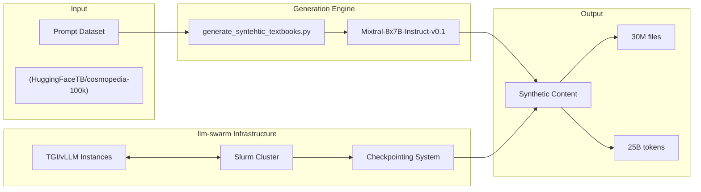
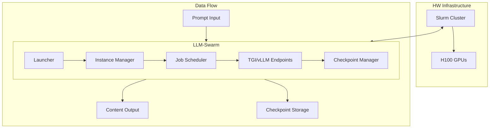
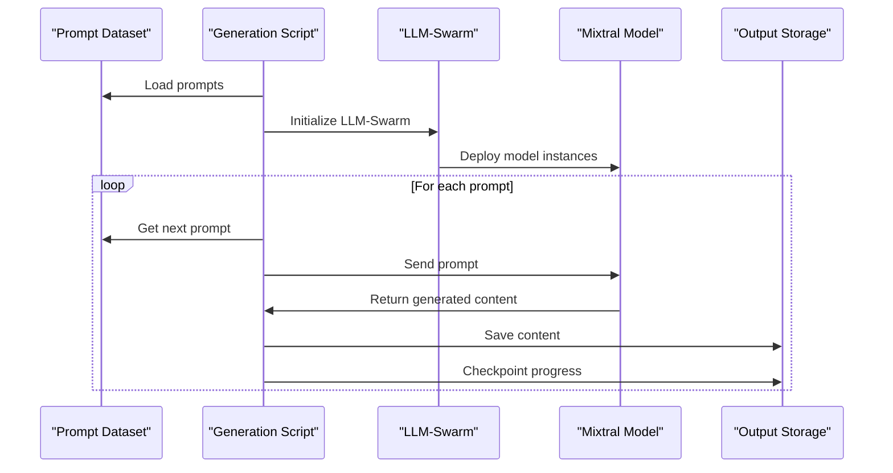
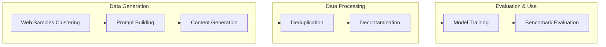

<!-- source: DeepWiki mcp.deepwiki.com · repo huggingface/cosmopedia · page 2.2 Content Generation · fetched 2026-10-26 -->

# Content Generation

Relevant source files

The following files were used as context for generating this wiki page:

- [LICENSE](LICENSE)
- [README.md](README.md)
- [generation/README.md](generation/README.md)

## Purpose and Scope

This document describes the content generation system used in the Cosmopedia project, which is responsible for producing synthetic textbooks, blogposts, stories, posts, and WikiHow articles. The system leverages the Mixtral-8x7B-Instruct-v0.1 model through the llm-swarm framework to generate content at scale. This page focuses specifically on the technical implementation and architecture of the content generation process, which occurs after prompt creation (see [Prompt Building](#2.1)) and before data processing steps (see [Data Processing](#3)).

## Architecture Overview

The content generation system uses carefully crafted prompts to instruct a large language model to generate educational and informative content spanning diverse topics. The generation process operates at massive scale, leveraging distributed infrastructure to produce the 30M files and 25B tokens that comprise the Cosmopedia dataset.

Sources: [README.md:13-16](), [generation/README.md:2-9]()

## Generation System Components

The content generation system consists of several key components that work together to enable large-scale synthetic data generation:

### The LLM-Swarm Framework

LLM-Swarm is a distributed infrastructure framework used to deploy multiple inference instances of large language models across a cluster. It's specifically designed to handle the scale required for generating billions of tokens of content.

Sources: [generation/README.md:4-6](), [README.md:27-28]()

### Mixtral-8x7B-Instruct-v0.1 Model

The Cosmopedia dataset was generated using Mixtral-8x7B-Instruct-v0.1, a large language model developed by Mistral AI. This model was chosen for its ability to generate high-quality, coherent, and educational content across various domains.

### Generation Script

The generation process is orchestrated by a Python script that handles:
1. Loading prompts from the dataset
2. Managing model instances
3. Performing content generation
4. Checkpointing for fault tolerance

## Technical Implementation

The generation is implemented using the `generate_syntehtic_textbooks.py` script within the llm-swarm framework. This script handles various aspects of the generation process:

Sources: [generation/README.md:10-21]()

### Key Configuration Parameters

The generation script accepts several parameters to control the generation process:

| Parameter | Description | Example Value |
|-----------|-------------|---------------|
| `--model` | The model to use for generation | mistralai/Mixtral-8x7B-Instruct-v0.1 |
| `--instances` | Number of model instances to run in parallel | 2 |
| `--prompts_dataset` | HuggingFace dataset containing prompts | HuggingFaceTB/cosmopedia-100k |
| `--prompt_column` | Column in dataset containing the prompt | prompt |
| `--max_samples` | Maximum number of samples to generate | 2000 |
| `--checkpoint_path` | Path to save checkpoints | ./synthetic_data |
| `--checkpoint_interval` | Interval for saving checkpoints | 1000 |

Sources: [generation/README.md:13-20]()

## Scale and Resource Requirements

The Cosmopedia dataset generation was a substantial computational effort:

- **Compute Resources**: Over 10,000 H100 GPU hours
- **Output Volume**: 30 million files containing 25 billion tokens
- **Infrastructure**: Deployed on a Slurm cluster with multiple GPU nodes

This scale of generation demonstrates the significant computational resources required to create comprehensive synthetic datasets for language model training.

Sources: [README.md:14](), [generation/README.md:4]()

## Output and Downstream Processing

After generation, the synthetic content proceeds to the data processing pipeline, which includes:

1. **Deduplication**: Removing near-duplicate content using MinHash algorithms via datatrove
2. **Decontamination**: Ensuring the dataset doesn't contain content that overlaps with evaluation benchmarks

These processing steps are crucial for maintaining the quality and integrity of the synthetic dataset before it's used for model training.

Sources: [README.md:28-29]()

## Integration with Overall Pipeline

The content generation system fits into the larger Cosmopedia data pipeline as follows:

Sources: [README.md:25-29]()

## Summary

The content generation system in Cosmopedia leverages the Mixtral-8x7B-Instruct-v0.1 model through the llm-swarm infrastructure to generate a massive synthetic dataset. This component forms a crucial link in the overall pipeline, taking structured prompts as input and producing diverse, educational content that, after processing, can be used for training and evaluating language models.

---

