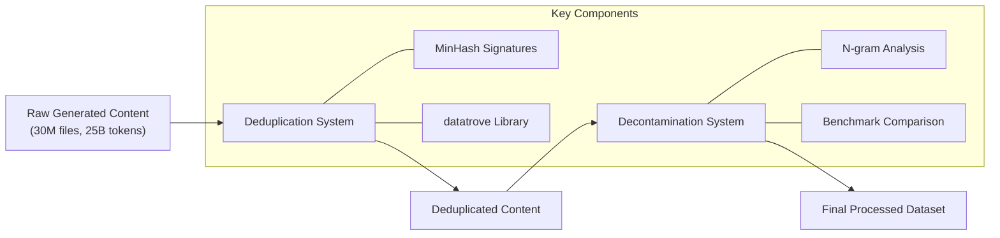
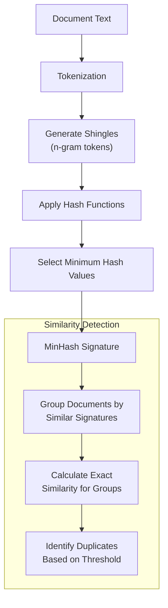
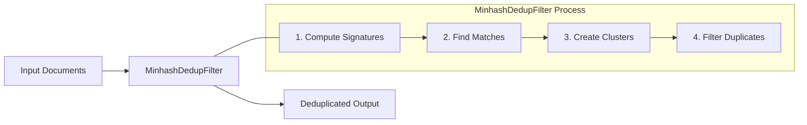
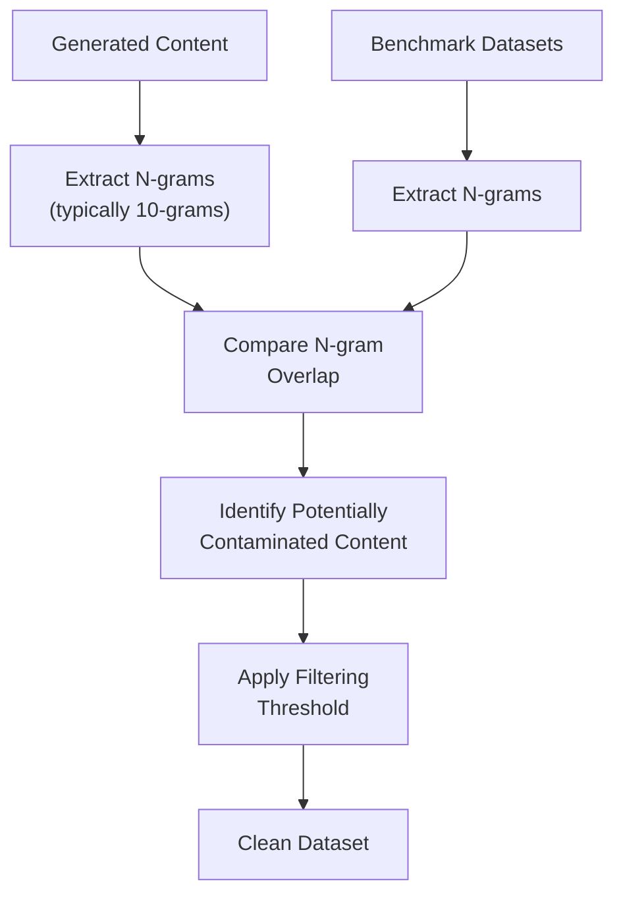
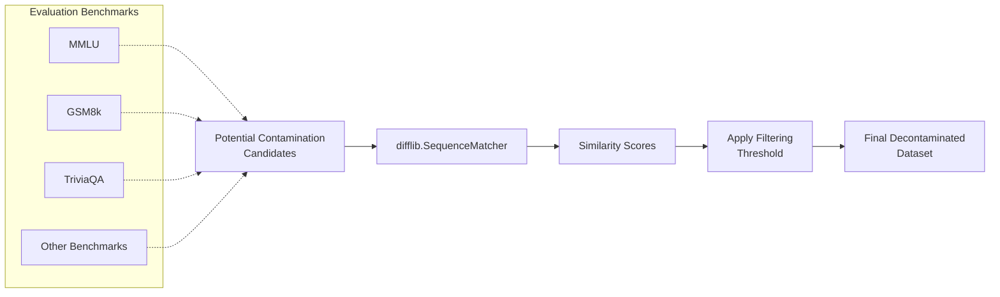
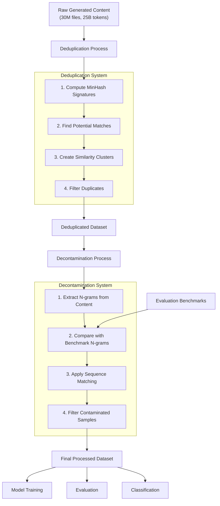
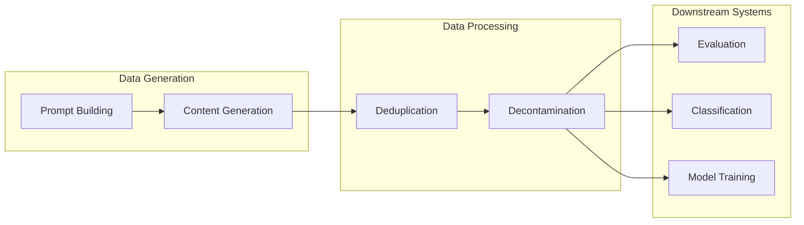

<!-- source: DeepWiki mcp.deepwiki.com · repo huggingface/cosmopedia · page 3 Data Processing · fetched 2026-10-26 -->

# Data Processing

Relevant source files

The following files were used as context for generating this wiki page:

- [LICENSE](LICENSE)
- [README.md](README.md)

This document covers the data processing pipeline used in the Cosmopedia project to ensure the quality and integrity of the synthetic dataset. The processing steps are applied after content generation and before evaluation or classification. For information about how the content is initially generated, see [Data Generation](#2).

## Purpose and Overview

The Data Processing system in Cosmopedia serves two critical functions:

1. **Deduplication**: Identifying and removing duplicate or near-duplicate content within the generated dataset to improve quality and reduce redundancy
2. **Decontamination**: Ensuring that the generated content doesn't contain exact matches or near-matches with evaluation benchmarks to prevent benchmark contamination

These processing steps are essential for maintaining the integrity of both the dataset and any evaluations performed on models trained with it.

Sources: README.md:26-29

## Deduplication

The deduplication process identifies and removes duplicate or near-duplicate content from the large volume of generated text. This step is crucial because:

1. It improves the efficiency of downstream processing and model training
2. It enhances dataset quality by eliminating redundant information
3. It prevents over-representation of certain topics or content styles

Cosmopedia implements deduplication using MinHash signatures through the datatrove library.

### MinHash Algorithm

MinHash is a locality-sensitive hashing technique that efficiently estimates the Jaccard similarity between document pairs, allowing for fast identification of similar documents in large datasets.

Sources: README.md:28

### Implementation with datatrove

The deduplication in Cosmopedia is implemented using [datatrove](https://github.com/huggingface/datatrove), a Hugging Face library designed for efficient text dataset processing. The deduplication workflow consists of four main stages:

1. **Compute Signatures**: Calculate MinHash signatures for each document
2. **Find Matches**: Identify potential duplicate pairs using Locality-Sensitive Hashing (LSH)
3. **Create Clusters**: Group similar documents into clusters
4. **Filter Duplicates**: Remove or mark duplicate documents based on similarity thresholds

Sources: README.md:28

## Decontamination

Decontamination is the process of ensuring that the generated content doesn't contain text that matches or closely resembles evaluation benchmark datasets. This is critical for:

1. Preventing data leakage that could artificially inflate benchmark scores
2. Ensuring fair and accurate model evaluation
3. Maintaining the integrity of research findings

The decontamination process in Cosmopedia uses n-gram analysis to detect and remove potential contamination.

### N-gram Analysis

The decontamination process analyzes n-grams (sequences of n consecutive tokens) in both the generated content and benchmark datasets to identify potential contamination:

Sources: README.md:29

### Benchmark Comparison

For more precise contamination detection, the system also uses sequence matching techniques beyond n-gram analysis:

Sources: README.md:29

## Complete Data Processing Pipeline

The following diagram illustrates the complete data processing pipeline, showing how the deduplication and decontamination processes work together:

Sources: README.md:26-29

## Integration with Other Components

The Data Processing system integrates with other components of the Cosmopedia pipeline:

1. **Input**: Receives raw generated content from the [Content Generation](#2.2) system
2. **Output**: Provides cleaned data for:
   - Model training (like cosmopedian-1b)
   - [Evaluation](#5) against benchmarks
   - [Content Classification](#4) for educational scoring

Sources: README.md:25-29

## Summary

The Data Processing system in Cosmopedia ensures the quality and integrity of the synthetic dataset through two main processes:

1. **Deduplication**: Uses MinHash algorithms via datatrove to identify and remove duplicate content
2. **Decontamination**: Uses n-gram analysis and sequence matching to prevent contamination with evaluation benchmarks

These processing steps are critical for maintaining the integrity of both the dataset and any evaluations performed on models trained with it. The resulting dataset contains 30 million files with 25 billion tokens of high-quality, deduplicated, and decontaminated synthetic content.

Sources: README.md:13-29

---

