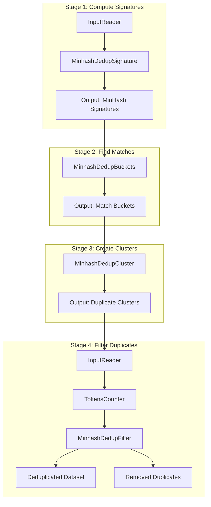
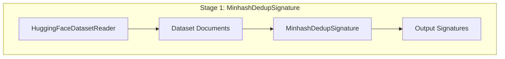
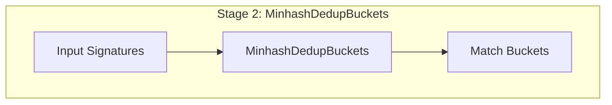
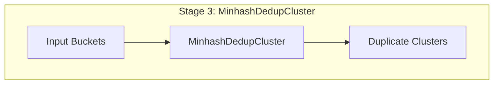
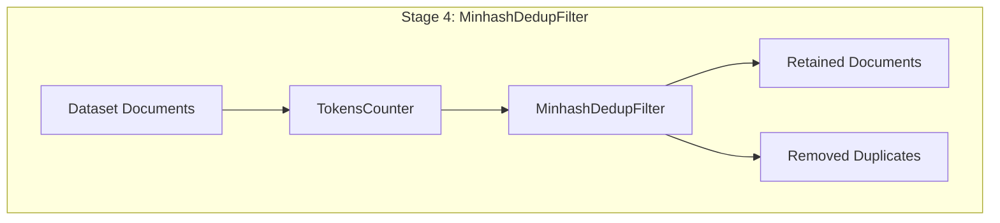
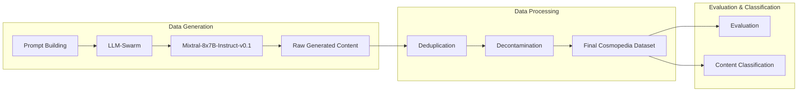

<!-- source: DeepWiki mcp.deepwiki.com · repo huggingface/cosmopedia · page 3.1 Deduplication · fetched 2026-10-26 -->

# Deduplication

<details>
<summary>Relevant source files</summary>

The following files were used as context for generating this wiki page:

- [LICENSE](LICENSE)
- [README.md](README.md)
- [deduplication/README.md](deduplication/README.md)
- [deduplication/deduplicate_dataset.py](deduplication/deduplicate_dataset.py)

</details>


## Purpose and Scope

This document describes the deduplication process used in the Cosmopedia dataset creation pipeline. Deduplication is a critical data processing step that identifies and removes duplicate or near-duplicate content from the generated synthetic data. This ensures the final dataset contains unique, high-quality content without redundancy.

For information about other data processing steps like decontamination, see [Decontamination](#3.2).

Sources: [README.md:25-29](), [deduplication/README.md:1-6]()

## Overview

The Cosmopedia dataset undergoes deduplication to maintain data quality and reduce redundancy. This process uses the MinHash algorithm implemented through the [datatrove](https://github.com/huggingface/datatrove) library. The deduplication pipeline identifies semantically similar content even when the text is not exactly identical, using probabilistic techniques to efficiently process the large dataset.

Despite already having undergone initial deduplication at the seed sample level and careful prompt engineering to produce distinct outputs, the final deduplication step found and removed less than 1% of files from the Cosmopedia dataset.

Sources: [deduplication/README.md:1-6]()

## MinHash Deduplication Process

### Deduplication Pipeline Architecture

The deduplication process is divided into four sequential stages, each handling a specific aspect of the workflow:



Sources: [deduplication/deduplicate_dataset.py:1-110]()

### How MinHash Deduplication Works

```mermaid
flowchart LR
    subgraph "Document Representation"
        A1["Original Document"] --> A2["N-gram Shingling"]
        A2 --> A3["Set of Shingles"]
    end
    
    subgraph "MinHash Signature Generation"
        A3 --> B1["Hash Functions"]
        B1 --> B2["MinHash Signature"]
    end
    
    subgraph "Locality Sensitive Hashing"
        B2 --> C1["Bucket Assignment"]
        C1 --> C2["Candidate Pairs"]
    end
    
    subgraph "Similarity Computation"
        C2 --> D1["Jaccard Similarity"]
        D1 --> D2["Similar Document Clusters"]
    end
    
    subgraph "Duplicate Filtering"
        D2 --> E1["Keep One Representative"]
        E1 --> E2["Final Deduplicated Dataset"]
    end
```



Sources: [deduplication/deduplicate_dataset.py:1-110]()

## Implementation Details

The deduplication implementation uses datatrove's MinHash components through a Slurm-based pipeline executor for distributed processing. Each stage is executed as a separate job in the pipeline.

### Configuration

The deduplication process uses a default MinHash configuration from datatrove, which can be customized for parameters like the number of hash functions, ngrams, and buckets.

```python
minhash_config = MinhashConfig()
```

Sources: [deduplication/deduplicate_dataset.py:16-17]()

### Stage 1: Computing MinHash Signatures

The first stage computes MinHash signatures for each document in the dataset. The input is read from a Hugging Face dataset, and the signatures are computed based on the "completion" field.



Sources: [deduplication/deduplicate_dataset.py:27-47]()

### Stage 2: Finding Matches Between Signatures

The second stage processes the signatures from stage 1 and finds matches between them by bucketing similar signatures together. This stage creates buckets of potentially similar documents.



Sources: [deduplication/deduplicate_dataset.py:50-66]()

### Stage 3: Clustering Duplicates

The third stage creates clusters of duplicates using the matching information from all buckets. This step consolidates the matching information from all buckets into a set of duplicate clusters.



Sources: [deduplication/deduplicate_dataset.py:69-86]()

### Stage 4: Filtering Duplicates

The final stage reads the original dataset again and filters out duplicates based on the clusters identified in stage 3. It keeps only one representative sample from each duplicate cluster.



Sources: [deduplication/deduplicate_dataset.py:89-107]()

## Execution Environment

The deduplication pipeline is executed using the SlurmPipelineExecutor, which distributes the workload across a Slurm compute cluster. Each stage has its own resource allocation and dependencies.

| Stage | Job Name | Tasks | Partition | Time Limit | Memory | Dependencies |
|-------|----------|-------|-----------|------------|--------|--------------|
| 1 | mh1 | 120 | hopper-cpu | 5:00:00 | - | None |
| 2 | mh2 | Based on buckets | hopper-prod | 90:00:00 | - | Stage 1 |
| 3 | mh3 | 1 | hopper-prod | 90:00:00 | 70GB | Stage 2 |
| 4 | mh4 | 120 | hopper-cpu | 50:00:00 | - | Stage 3 |

Sources: [deduplication/deduplicate_dataset.py:35-107]()

## Results and Performance

The deduplication process found and removed less than 1% of files from the Cosmopedia dataset. This low percentage reflects the effectiveness of the initial seed sample deduplication and the prompt engineering techniques used to ensure distinct outputs.

The token counter component added to stage 4 provides statistics on how many tokens were in the dataset before and after deduplication, helping quantify the impact of the process.

Sources: [deduplication/README.md:3-4]()

## Integration in the Data Processing Pipeline

The deduplication step is a critical component in the Cosmopedia data processing pipeline, positioned after content generation and before decontamination.



Sources: [README.md:25-29]()

## Conclusion

Deduplication is an essential step in ensuring the quality of the Cosmopedia dataset. By using MinHash and datatrove, the process efficiently identifies and removes near-duplicate content across the large dataset. The implementation through a four-stage Slurm pipeline allows for distributed processing, making it feasible to handle the 30 million files and 25 billion tokens in the dataset.

Sources: [README.md:14](), [deduplication/README.md:1-6]()

---

