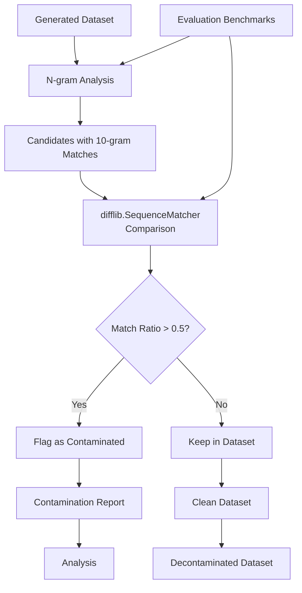
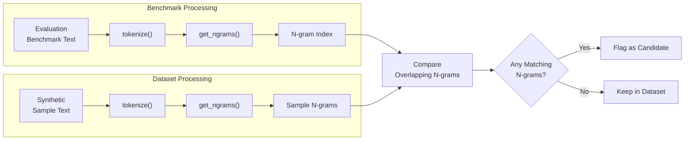
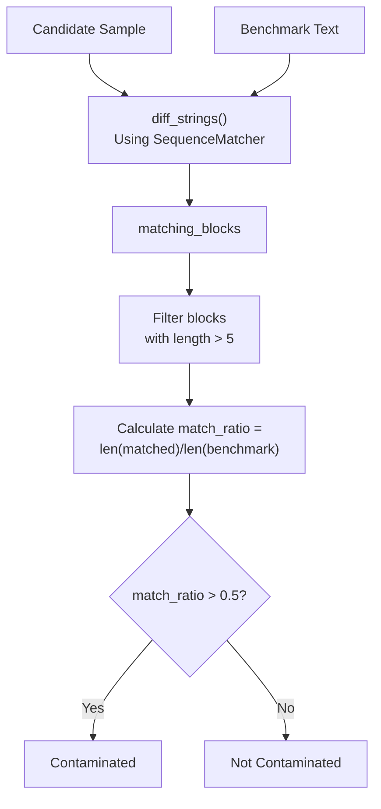
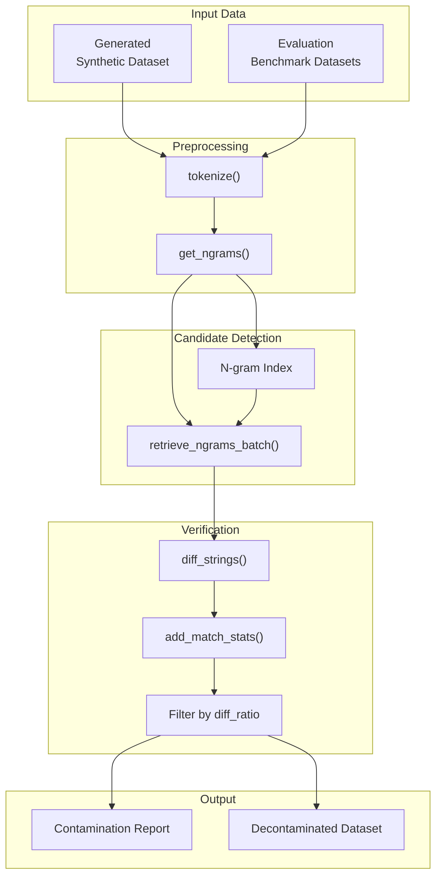

<!-- source: DeepWiki mcp.deepwiki.com · repo huggingface/cosmopedia · page 3.2 Decontamination · fetched 2026-10-26 -->

# Decontamination

<details>
<summary>Relevant source files</summary>

The following files were used as context for generating this wiki page:

- [LICENSE](LICENSE)
- [README.md](README.md)
- [decontamination/README.md](decontamination/README.md)
- [decontamination/decontaminate.py](decontamination/decontaminate.py)

</details>


## Purpose and Scope

This document details the decontamination process used in the Cosmopedia project to ensure the generated synthetic data doesn't contain substantial overlaps with evaluation benchmarks. This process is essential for preventing data leakage that could invalidate model evaluations. For information about removing duplicates within the dataset itself, see [Deduplication](#3.1).

Sources: [README.md:28-29](). [decontamination/README.md:1-5]()

## Overview

The decontamination process identifies and removes synthetic samples that have significant overlap with common evaluation benchmarks. This prevents artificially inflated performance when models trained on Cosmopedia are evaluated on these benchmarks. The process implements a two-stage approach:

1. **Candidate Retrieval**: Using n-gram overlap detection to identify potentially contaminated samples
2. **Contamination Verification**: Using string matching to confirm contamination based on a similarity threshold

Sources: [decontamination/README.md:3-5](), [decontamination/decontaminate.py:22-62]()

## Decontamination Workflow

![Decontamination Process Flow]


Sources: [decontamination/README.md:3-5](), [decontamination/decontaminate.py:65-104]()

## N-gram Analysis

The first stage of the decontamination process uses n-gram analysis to efficiently identify potential contamination candidates without performing expensive full-text comparisons on the entire dataset.

### N-gram Generation

The process uses 10-grams (sequences of 10 consecutive tokens) to identify potential overlaps:

1. Text is normalized by removing diacritics and tokenized
2. N-grams are generated from the tokens
3. A lookup index is created from the evaluation benchmark n-grams
4. Dataset samples are checked against this index

![N-gram Generation and Comparison]


Sources: [decontamination/decontaminate.py:10-19](), [decontamination/decontaminate.py:22-36](), [decontamination/decontaminate.py:65-77]()

## Contamination Verification

For samples flagged as potential contamination candidates, a more thorough comparison is performed:

1. `difflib.SequenceMatcher` is used to find matching substrings between the sample and benchmark text
2. Only matches longer than 5 characters are considered
3. The match ratio is calculated as the length of all matched substrings divided by the length of the benchmark text
4. If this ratio exceeds the threshold (default 0.5), the sample is considered contaminated

### Match Statistics Calculation



Sources: [decontamination/decontaminate.py:39-62](), [decontamination/README.md:4]()

## Implementation Details

The decontamination process is implemented in the `decontaminate.py` script. Here's a breakdown of the key components:

### Text Processing Functions

- `tokenize(text)`: Normalizes text by removing diacritics and tokenizing it into words
- `get_ngrams(tokens, n)`: Generates n-grams from the tokenized text

### Contamination Detection Functions

- `retrieve_ngrams_batch(batch, eval_ngrams, eval_datasets, eval_texts, ngram_len)`: Finds potentially contaminated samples based on n-gram overlap
- `diff_strings(string1, string2)`: Uses `difflib.SequenceMatcher` to find matching substrings between two strings
- `add_match_stats(example)`: Calculates match statistics, including diff ratio and longest matching part

### Main Process Flow

1. Load evaluation data and build an n-gram index
2. Load the training dataset to be decontaminated
3. Generate a contamination report by identifying and analyzing potential contamination
4. Filter the dataset to remove contaminated samples
5. Save both the contamination report and the decontaminated dataset

Sources: [decontamination/decontaminate.py:65-104](), [decontamination/decontaminate.py:10-62]()

## Covered Benchmarks

The decontamination process is run against all benchmarks used to evaluate the Cosmopedia-trained models:

| Benchmark Name | Description |
|----------------|-------------|
| MMLU | Massive Multitask Language Understanding |
| HellaSwag | Commonsense natural language inference task |
| PIQA | Physical Interaction Question Answering |
| SIQA | Social Interaction Question Answering |
| Winogrande | Commonsense reasoning tasks |
| OpenBookQA | Question answering requiring knowledge and reasoning |
| ARC-easy | AI2 Reasoning Challenge (easy) |
| ARC-challenge | AI2 Reasoning Challenge (challenge) |

Sources: [decontamination/README.md:5]()

## Usage

The decontamination script can be run with various parameters to control the process:

```bash
python decontaminate.py \
  --train_dataset "YOUR_DATASET_NAME" \
  --report_dataset_name "YOUR_REPORT_NAME" \
  --save_decontaminated \
  --decontaminated_dataset_name "YOUR_DECONTAMINATED_DATASET_NAME"
```

### Command-line Arguments

| Argument | Description | Default |
|----------|-------------|---------|
| `--eval_dataset` | Dataset with benchmark samples for decontamination | "HuggingFaceTB/phi2_eval_data_for_decontamination" |
| `--train_dataset` | Dataset to process | (Required) |
| `--report_dataset_name` | Name for output dataset with decontamination report | (Required) |
| `--decontaminated_dataset_name` | Name for the decontaminated dataset | None |
| `--private` | Make the output dataset private | False |
| `--ngram_length` | Length of n-grams to consider | 10 |
| `--diff_threshold` | Threshold for filtering based on difference ratio | 0.5 |
| `--num_proc` | Number of processes for map operations | 16 |
| `--save_decontaminated` | Whether to save the decontaminated dataset | False |

Sources: [decontamination/README.md:7-12](), [decontamination/decontaminate.py:106-124]()

## Decontamination System Architecture



Sources: [decontamination/decontaminate.py:1-104]()

---

