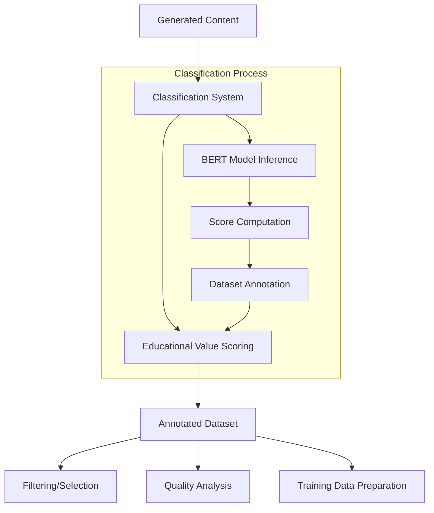
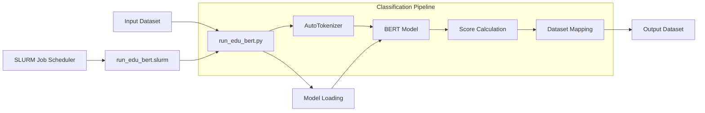
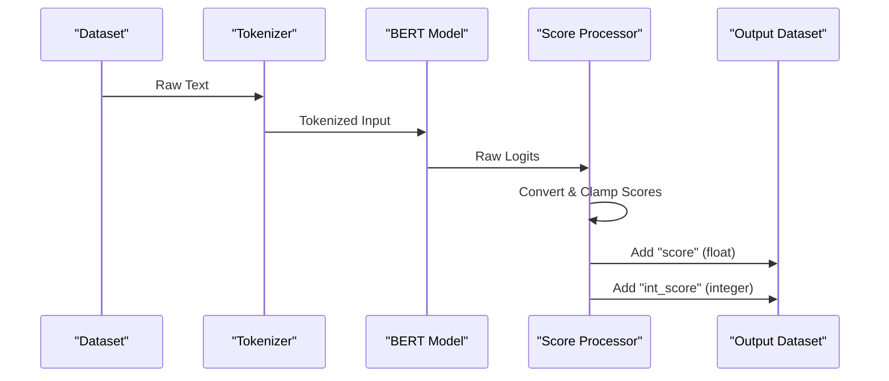
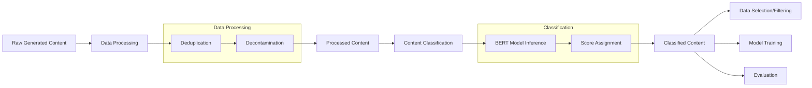

<!-- source: DeepWiki mcp.deepwiki.com · repo huggingface/cosmopedia · page 4 Content Classification · fetched 2026-10-26 -->

# Content Classification

<details>
<summary>Relevant source files</summary>

The following files were used as context for generating this wiki page:

- [classification/README.md](classification/README.md)
- [classification/run_edu_bert.py](classification/run_edu_bert.py)
- [classification/run_edu_bert.slurm](classification/run_edu_bert.slurm)
- [generation/boilerplate_cleanup.py](generation/boilerplate_cleanup.py)

</details>


This document describes the Content Classification system within Cosmopedia, which focuses on assessing the educational value of generated content. The system uses a fine-tuned BERT-based model to analyze text samples and assign educational scores, enabling automatic filtering and prioritization of high-quality educational content.

For information on how to train classification models, see [Training Classification Models](#4.1). For details about running classification on datasets, see [Running Classification](#4.2).

## Purpose and Overview

The Content Classification system serves as a critical quality control mechanism in the Cosmopedia pipeline. It analyzes generated content after the [Data Processing](#3) phase to:

1. Assign numerical educational value scores to content (0-5 scale)
2. Generate both floating-point scores and rounded integer scores
3. Enable filtering of low-quality or non-educational content
4. Support dataset annotation for downstream applications



Sources: [classification/run_edu_bert.py](), [classification/README.md]()

## System Architecture

The Content Classification system is built around a fine-tuned BERT-based model that processes text and predicts educational value scores. The architecture consists of the following components:



Sources: [classification/run_edu_bert.py](), [classification/run_edu_bert.slurm]()

### Key Components

1. **Model Loading**: The system loads a pre-trained BERT model specifically fine-tuned for educational content scoring.
   - Default model: `HuggingFaceFW/fineweb-edu-classifier`
   - Uses `AutoModelForSequenceClassification` for inference
   - Runs with BFloat16 precision for efficiency

2. **Dataset Processing**: Handles loading and processing of dataset shards.
   - Supports parallel processing across multiple shards
   - Filters dataset to process specific shards based on configuration

3. **Score Computation**: Converts model outputs into usable educational value scores.
   - Generates both raw floating-point scores and rounded integer scores (0-5)
   - Processes content in batches for efficiency

4. **Output Generation**: Creates annotated datasets with educational scores.
   - Pushes results to Hugging Face Hub with appropriate configuration

Sources: [classification/run_edu_bert.py:7-56]()

## Educational Value Classification

The educational value classifier assigns scores on a scale from 0 to 5, where higher scores indicate content with greater educational value. The classification process involves:

1. **Tokenization**: Text is tokenized using the model's associated tokenizer with padding and truncation.
2. **Inference**: Tokenized text is passed through the model to generate raw logits.
3. **Score Conversion**: Logits are converted to educational value scores.
4. **Dual Scoring**: Both raw floating-point scores and rounded integer scores are provided.



Sources: [classification/run_edu_bert.py:26-39]()

### Score Interpretation

The educational value scores provide insights into the quality and utility of content for educational purposes:

| Score Range | Interpretation |
|-------------|----------------|
| 0-1         | Minimal educational value |
| 2-3         | Moderate educational value |
| 4-5         | High educational value |

The system provides both raw scores (floating-point) and rounded integer scores to support different use cases:
- Raw scores: Useful for fine-grained ranking and sorting
- Integer scores: Useful for categorical filtering and binning

Sources: [classification/run_edu_bert.py:37-38]()

## Implementation Details

### Core Functions

The classification system centers around a few key functions:

1. **`compute_scores`**: This function handles the core scoring logic:
   - Takes batches of text samples
   - Tokenizes with appropriate padding/truncation
   - Runs inference through the model
   - Calculates and formats scores

```python
def compute_scores(batch):
    inputs = tokenizer(
        batch[args.text_column],
        return_tensors="pt",
        padding="longest",
        truncation=True,
    ).to(device)
    with torch.no_grad():
        outputs = model(**inputs)
        logits = outputs.logits.squeeze(-1).float().cpu().numpy()

    batch["score"] = logits.tolist()
    batch["int_score"] = [int(round(max(0, min(score, 5)))) for score in logits]
    return batch
```

Sources: [classification/run_edu_bert.py:26-39]()

2. **Dataset mapping**: The system applies the scoring function across the dataset using parallel processing:
   ```python
   dataset = dataset.map(compute_scores, batched=True, batch_size=512)
   ```

3. **Output persistence**: Handles reliable uploading of processed datasets:
   ```python
   dataset.push_to_hub(
       args.output_dataset_name,
       config_name=config_name,
       private=True,
       max_shard_size="4096MB",
   )
   ```

Sources: [classification/run_edu_bert.py:41-55]()

### Command-Line Interface

The classification system provides a flexible command-line interface with the following key parameters:

| Parameter | Description | Default Value |
|-----------|-------------|---------------|
| `--model_name` | Path to the fine-tuned educational classifier | `HuggingFaceFW/fineweb-edu-classifier` |
| `--dataset_name` | Input dataset to classify | `HuggingFaceFW/fineweb` |
| `--dataset_config` | Configuration of the input dataset | `default` |
| `--output_dataset_name` | Where to store the classified dataset | `HuggingFaceFW/fineweb-edu` |
| `--text_column` | Column containing text to classify | `text` |
| `--shard` | Index of the dataset shard to process | (required) |
| `--num_shards` | Total number of shards | (required) |

Sources: [classification/run_edu_bert.py:58-74]()

## Integration with Cosmopedia Pipeline

The Content Classification system integrates with the broader Cosmopedia pipeline, typically running after data generation and processing but before final dataset distribution and model training:



Sources: [classification/README.md](), [classification/run_edu_bert.py]()

## Usage

### Running Classification on a Dataset

To annotate a dataset with educational scores, the process involves:

1. **Configure parameters**: Edit the `run_edu_bert.slurm` file to set appropriate input/output datasets
2. **Launch job**: Submit the job to a SLURM cluster
3. **Access results**: Retrieve the annotated dataset from Hugging Face Hub

```bash
sbatch run_edu_bert.slurm
```

This will process the dataset according to the configuration, adding `score` and `int_score` columns to each record.

Sources: [classification/run_edu_bert.slurm](), [classification/README.md:16-20]()

### Training a New Classifier

The existing documentation suggests the following steps to fine-tune a new educational value classifier:

1. **Configure training**: Edit the `train_edu_bert.slurm` file to set:
   - Base model (e.g., `Snowflake/snowflake-arctic-embed-m`)
   - Training dataset (e.g., `HuggingFaceTB/LLM_juries_fineweb_430k_annotations`)
   - Target score column (e.g., `score`)

2. **Launch training**: Submit the training job to a SLURM cluster
   ```bash
   sbatch train_edu_bert.slurm
   ```

Sources: [classification/README.md:3-14]()

## Summary

The Content Classification system provides a crucial quality assessment layer in the Cosmopedia pipeline, enabling automatic scoring of content based on educational value. By leveraging a fine-tuned BERT model, the system can process large volumes of text efficiently, assigning meaningful educational scores that support content filtering, selection, and prioritization.

The system is designed to handle distributed workloads through SLURM job scheduling, making it suitable for processing the extensive Cosmopedia dataset across multiple compute nodes. The resulting annotated datasets provide valuable metadata that enhances the utility of the Cosmopedia content for various educational applications.

---

