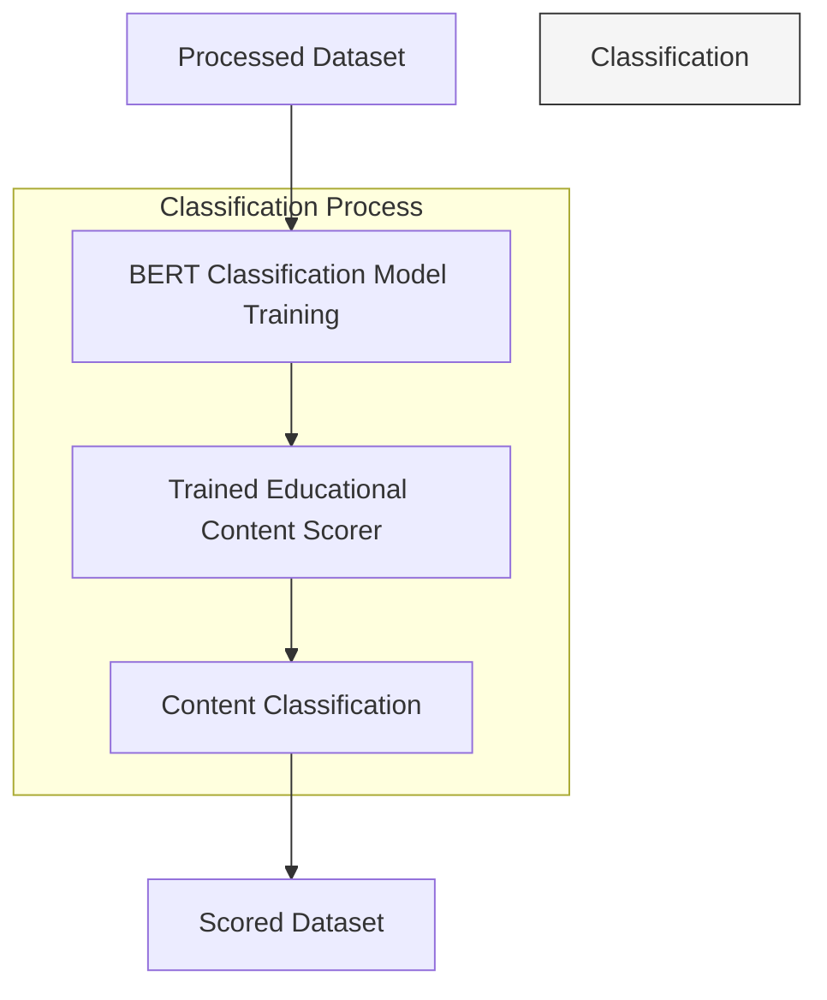
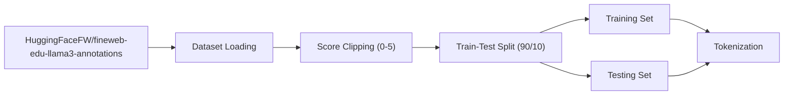
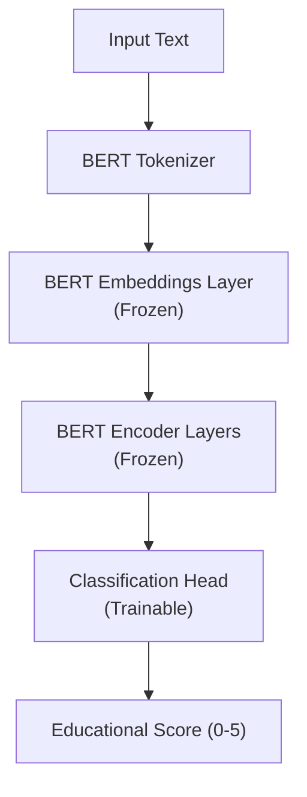
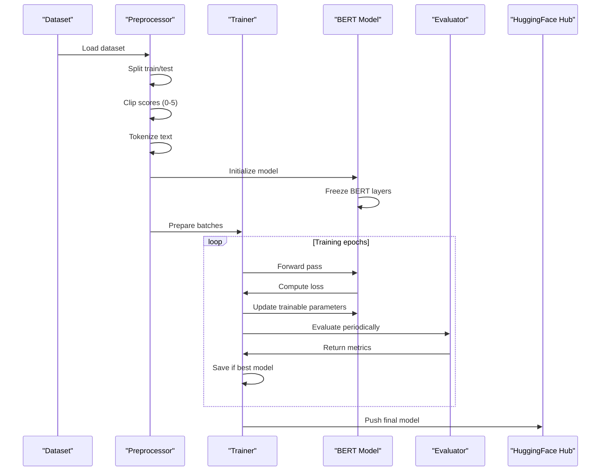
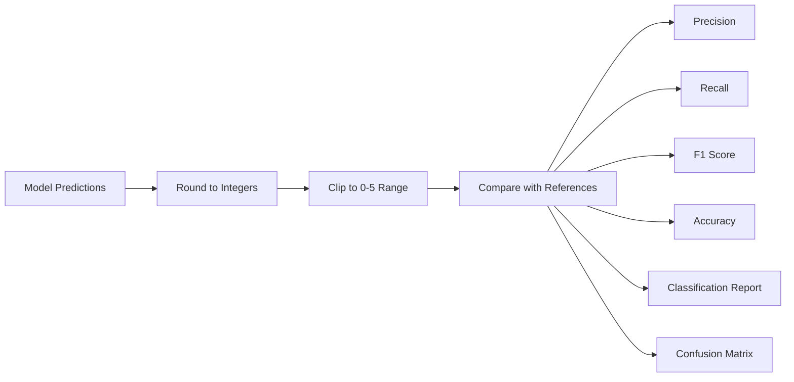
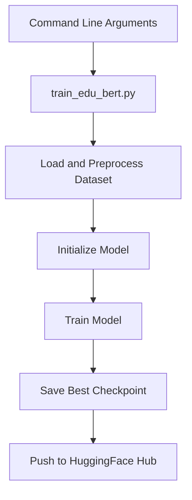
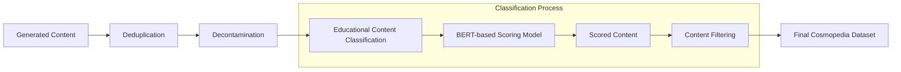

<!-- source: DeepWiki mcp.deepwiki.com · repo huggingface/cosmopedia · page 4.1 Training Classification Models · fetched 2026-10-26 -->

# Training Classification Models

Relevant source files

The following files were used as context for generating this wiki page:

- [classification/train_edu_bert.py](classification/train_edu_bert.py)
- [classification/train_edu_bert.slurm](classification/train_edu_bert.slurm)

## Purpose and Scope

This document explains the process of training BERT-based models for educational content classification within the Cosmopedia system. The models described here are specifically designed to assign educational value scores to content, which is used to filter and prioritize high-quality educational material. For information about running inference with these models, see [Running Classification](#4.2).

## Overview of the Classification System

The content classification system is a critical component of the Cosmopedia pipeline that evaluates generated content based on its educational value. After generation and processing steps (deduplication, decontamination), content is scored to identify high-quality educational material.

Sources: [classification/train_edu_bert.py]()

## Training Dataset

The classification models are trained on annotated educational content datasets. By default, the system uses the "HuggingFaceFW/fineweb-edu-llama3-annotations" dataset, which contains text samples annotated with educational quality scores ranging from 0 to 5.

The dataset is split into training (90%) and testing (10%) sets, with stratification based on the target score column to ensure balanced class distribution during evaluation.

Sources: [classification/train_edu_bert.py:47-61](), [classification/train_edu_bert.py:77-83]()

## Model Architecture

The classification model is based on a pre-trained BERT architecture, specifically the "Snowflake/snowflake-arctic-embed-m" model by default. The architecture is modified for regression tasks, with a single output value representing the educational quality score between 0 and 5.

A key aspect of the training approach is that only the classification head is trained, while the BERT embeddings and encoder layers are frozen. This transfer learning approach enables efficient training while preserving the knowledge encoded in the pre-trained model.

Sources: [classification/train_edu_bert.py:63-76](), [classification/train_edu_bert.py:85-88]()

## Training Process

The training process involves several key steps:

1. Loading and preprocessing the annotated dataset
2. Initializing the model with frozen BERT layers
3. Training the classification head with regression loss
4. Evaluating model performance using precision, recall, F1, and accuracy metrics
5. Saving the best checkpoint based on macro F1 score
6. Pushing the final model to the Hugging Face Hub

Sources: [classification/train_edu_bert.py:47-123]()

## Training Configuration

The training configuration includes the following key parameters:

| Parameter | Default Value | Description |
|-----------|---------------|-------------|
| Base Model | Snowflake/snowflake-arctic-embed-m | Pre-trained model used as starting point |
| Learning Rate | 3e-4 | Learning rate for the optimizer |
| Training Epochs | 20 | Maximum number of training epochs |
| Batch Size | 256 | Training batch size per device |
| Evaluation Batch Size | 128 | Evaluation batch size per device |
| Evaluation Strategy | steps | When to perform evaluation |
| Evaluation Steps | 1000 | Frequency of evaluation in steps |
| Save Strategy | steps | When to save checkpoints |
| Save Steps | 1000 | Frequency of saving in steps |
| Best Model Metric | f1_macro | Metric used to determine the best model |

Training is performed using mixed precision (bfloat16) for efficiency and typically requires a single GPU.

Sources: [classification/train_edu_bert.py:90-109](), [classification/train_edu_bert.slurm:1-23]()

## Evaluation Metrics

Model performance is evaluated using several metrics:

1. **Precision**: The ratio of correctly predicted positive observations to the total predicted positives
2. **Recall**: The ratio of correctly predicted positive observations to all actual positives
3. **F1 Score (Macro)**: The harmonic mean of precision and recall, averaged across all classes
4. **Accuracy**: The ratio of correctly predicted observations to the total observations

The evaluation process also generates a detailed classification report and confusion matrix to help understand model behavior across different score classes.

Sources: [classification/train_edu_bert.py:16-44]()

## Running Training Jobs

The training script can be run directly or through a SLURM job scheduler in a cluster environment. The main script is `classification/train_edu_bert.py` with several configurable parameters:

- `--base_model_name`: The pre-trained model to use (default: "Snowflake/snowflake-arctic-embed-m")
- `--dataset_name`: The dataset to train on (default: "HuggingFaceFW/fineweb-edu-llama3-annotations")
- `--target_column`: The column containing the score values (default: "score")
- `--checkpoint_dir`: Directory to save model checkpoints
- `--output_model_name`: Name for the model when pushed to Hugging Face Hub

For cluster environments, a SLURM script is provided that allocates appropriate resources for training.

Sources: [classification/train_edu_bert.py:125-146](), [classification/train_edu_bert.slurm:1-23]()

## Integration with Cosmopedia Pipeline

After training, the classification model becomes an integral part of the Cosmopedia data pipeline, helping to filter and prioritize high-quality educational content from the generated dataset.

Sources: [classification/train_edu_bert.py]()

---

