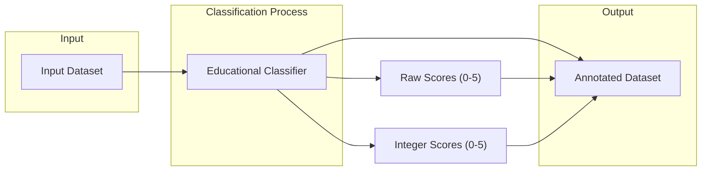
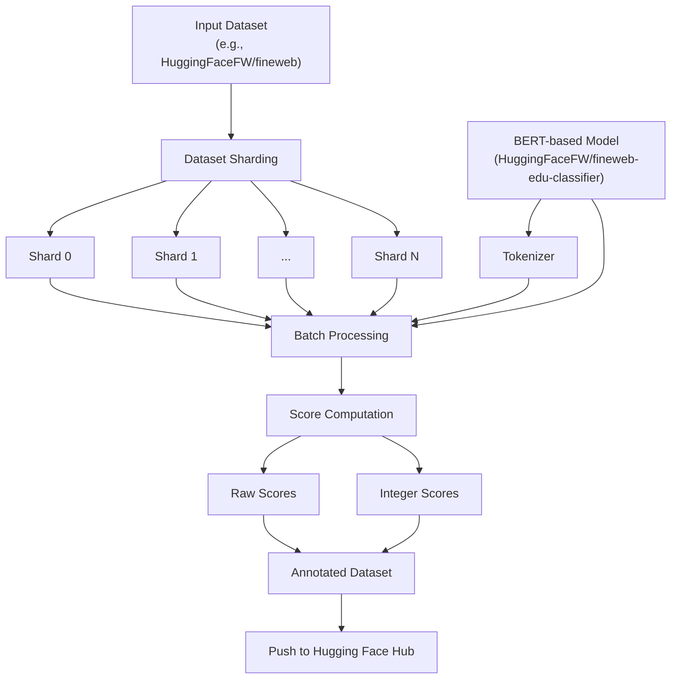
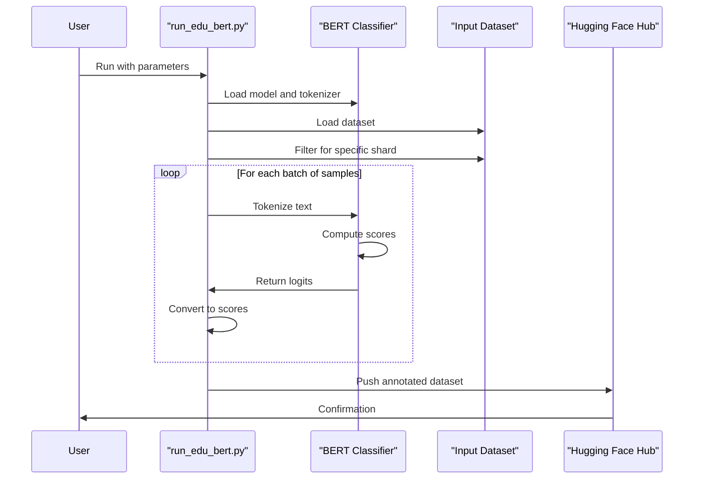
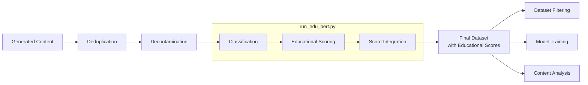

<!-- source: DeepWiki mcp.deepwiki.com · repo huggingface/cosmopedia · page 4.2 Running Classification · fetched 2026-10-26 -->

# Running Classification

<details>
<summary>Relevant source files</summary>

The following files were used as context for generating this wiki page:

- [classification/README.md](classification/README.md)
- [classification/run_edu_bert.py](classification/run_edu_bert.py)
- [classification/run_edu_bert.slurm](classification/run_edu_bert.slurm)
- [generation/boilerplate_cleanup.py](generation/boilerplate_cleanup.py)

</details>


This document explains how to run the pre-trained BERT-based educational value classification model on datasets within the Cosmopedia project. The classification process assigns educational value scores to content, enabling quality assessment and filtering of educational materials. For information about training the classification models, see [Training Classification Models](#4.1).

## Overview

The Cosmopedia educational classification system allows you to process large datasets and annotate them with educational value scores. These scores range from 0 to 5, with higher scores indicating content with greater educational value. The system uses a fine-tuned BERT-based model to analyze text and generate both floating-point scores and rounded integer scores.



Sources: [classification/run_edu_bert.py:1-75](), [classification/README.md:1-20]()

## Classification System Architecture

The classification system is designed to process large datasets efficiently by splitting the workload into multiple shards that can be processed in parallel. The system uses Hugging Face's model and dataset infrastructure for seamless integration.



Sources: [classification/run_edu_bert.py:7-56](), [classification/run_edu_bert.slurm:1-29]()

## Prerequisites

Before running the classification system, ensure you have:

1. Access to the pre-trained classification model (default: `HuggingFaceFW/fineweb-edu-classifier`)
2. The dataset you want to annotate
3. Sufficient computational resources (GPU recommended)
4. Python environment with PyTorch and Transformers libraries

## Running Classification Locally

To run the classification on a dataset locally, you'll use the `run_edu_bert.py` script with appropriate parameters.

The script requires the following parameters:

| Parameter | Description | Default |
|-----------|-------------|---------|
| `--model_name` | Path to the pre-trained classification model | `HuggingFaceFW/fineweb-edu-classifier` |
| `--dataset_name` | Name of the dataset to annotate | `HuggingFaceFW/fineweb` |
| `--dataset_config` | Configuration name for the dataset | `default` |
| `--output_dataset_name` | Name for the annotated output dataset | `HuggingFaceFW/fineweb-edu` |
| `--output_dataset_config` | Configuration name for the output dataset | `default` |
| `--text_column` | Column name containing the text to classify | `text` |
| `--shard` | Index of the dataset shard to process | Required |
| `--num_shards` | Total number of shards | Required |

Example command:

```
python run_edu_bert.py \
    --model_name="HuggingFaceFW/fineweb-edu-classifier" \
    --dataset_name="HuggingFaceFW/fineweb" \
    --dataset_config="CC-MAIN-2019-04" \
    --output_dataset_name="HuggingFaceFW/fineweb-edu-annotations" \
    --output_dataset_config="CC-MAIN-2019-04" \
    --text_column="text" \
    --shard 0 \
    --num_shards 1
```

Sources: [classification/run_edu_bert.py:58-75]()

## Running Classification on a SLURM Cluster

For large datasets, running classification on a SLURM cluster is recommended. The repository includes a SLURM job script (`run_edu_bert.slurm`) that handles parallel processing across multiple shards.

The script is set up to:
- Run on the `hopper-prod` partition
- Request 1 GPU
- Use 12 CPUs with 20GB of memory per CPU
- Process 128 shards in parallel (job array from 0 to 127)

To run the classification on a SLURM cluster:

```
sbatch run_edu_bert.slurm
```

The SLURM script will handle distribution of the processing across the requested resources, with each job in the array handling a different shard of the dataset.

Sources: [classification/run_edu_bert.slurm:1-29](), [classification/README.md:16-20]()

## Classification Process in Detail

The classification system operates through the following steps:



The code implements this process as follows:

1. **Load Model**: The script loads the pre-trained BERT model and tokenizer [classification/run_edu_bert.py:8-11]()

2. **Load Dataset**: The input dataset is loaded from the Hugging Face Hub [classification/run_edu_bert.py:15-21]()

3. **Shard Filtering**: The dataset is filtered to include only the samples in the current shard [classification/run_edu_bert.py:22-24]()

4. **Score Computation**: For each batch of text samples:
   - The text is tokenized
   - The model computes logits
   - The logits are converted to floating-point scores
   - Integer scores (0-5) are derived from the floating-point scores
   [classification/run_edu_bert.py:26-39]()

5. **Dataset Annotation**: The scores are added to the dataset as new columns [classification/run_edu_bert.py:41]()

6. **Upload Processed Data**: The annotated dataset is pushed back to the Hugging Face Hub [classification/run_edu_bert.py:43-55]()

Sources: [classification/run_edu_bert.py:7-56]()

## Understanding the Output

After running the classification, the output dataset will contain two new columns:

1. `score`: Raw floating-point educational value score
2. `int_score`: Integer score (0-5) obtained by rounding the raw score and clamping to the 0-5 range

These scores can be used to:
- Filter content based on educational value
- Rank content by quality
- Create stratified samples with different educational value levels
- Train downstream models with quality-based weighting

The output dataset is saved to the Hugging Face Hub with a configuration name that includes the original configuration and the shard number.

Sources: [classification/run_edu_bert.py:37-38](), [classification/run_edu_bert.py:45-51]()

## Integration with the Overall Cosmopedia Workflow

The classification step typically takes place after data generation and processing (deduplication and decontamination), adding educational quality metadata to the processed content.



The classification results can be used as a quality filter when selecting content for downstream applications, such as model training or content curation.

Sources: [classification/README.md:1-20](), [classification/run_edu_bert.py:1-75]()

## Troubleshooting

The classification script includes error handling to manage potential issues when pushing data to the Hugging Face Hub. If the push operation fails, the script will retry indefinitely until it succeeds.

Common issues include:
- Network connectivity problems
- Temporary Hugging Face Hub outages
- Permission issues with private datasets

If you encounter persistent failures, check:
- Your Hugging Face credentials
- Dataset permissions
- Network connectivity
- Whether the Hub is experiencing reported issues

Sources: [classification/run_edu_bert.py:43-55]()

## Performance Considerations

For optimal performance when running classification:

1. **Batch Size**: The script uses a batch size of 512 for efficient processing. Adjust this based on your GPU memory if needed.

2. **GPU Acceleration**: The script automatically uses CUDA if available, significantly improving processing speed.

3. **Model Precision**: The model is loaded in bfloat16 precision for efficient GPU utilization.

4. **Parallelization**: The dataset loading and filtering uses multiple processes (`num_proc=12`) to speed up I/O operations.

5. **Sharding**: Properly configuring the sharding parameters allows for efficient distributed processing.

Sources: [classification/run_edu_bert.py:9-13](), [classification/run_edu_bert.py:19-24](), [classification/run_edu_bert.py:41]()

## Conclusion

The classification system provides an efficient way to annotate large datasets with educational value scores. By leveraging pre-trained BERT models and distributed computing, it enables quality assessment of educational content at scale. The resulting annotated datasets can be used for content filtering, quality-aware model training, and educational resource curation.

---

