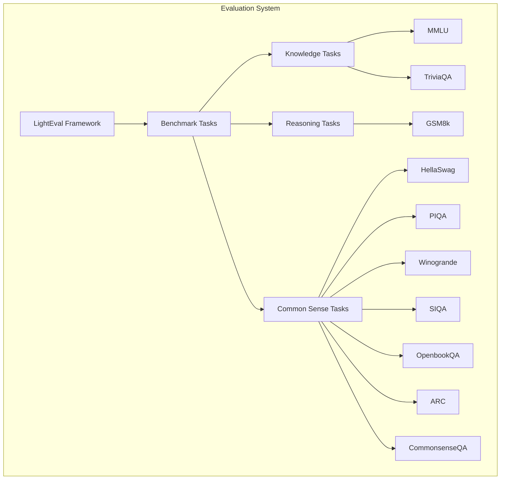
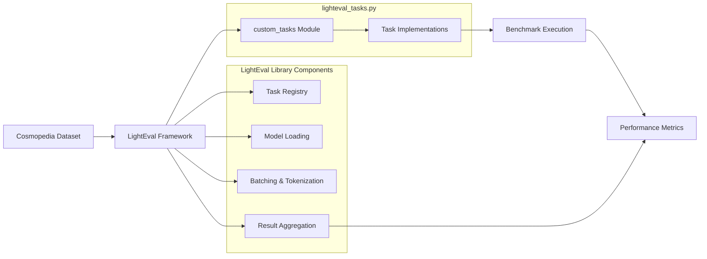
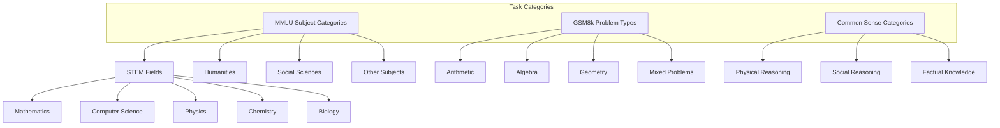
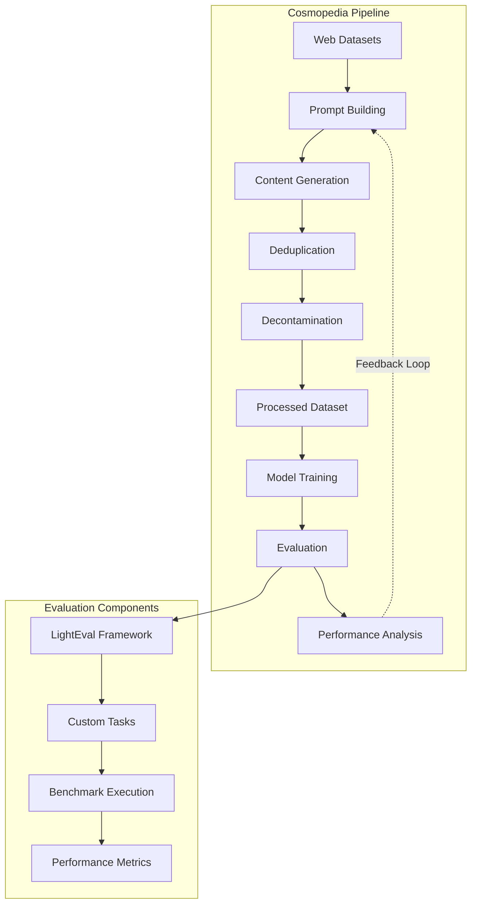

<!-- source: DeepWiki mcp.deepwiki.com · repo huggingface/cosmopedia · page 5 Evaluation · fetched 2026-10-26 -->

# Evaluation

<details>
<summary>Relevant source files</summary>

The following files were used as context for generating this wiki page:

- [LICENSE](LICENSE)
- [README.md](README.md)
- [evaluation/README.md](evaluation/README.md)

</details>


The Evaluation system in Cosmopedia is responsible for assessing the quality and effectiveness of models trained on the Cosmopedia dataset. This component provides a standardized framework for measuring model performance across various benchmarks and tasks, ensuring consistent and comparable results. This page documents the evaluation framework's architecture, available benchmark tasks, and how to run evaluations.

For information about the classification of content by educational value, see [Content Classification](#4).

## Overview

The Cosmopedia evaluation system uses the LightEval framework, an efficient and lightweight evaluation toolkit for language models. The evaluation framework has been extended beyond the original FineWeb-v1 evaluation script to include additional benchmarks such as MMLU-Pro, TriviaQA, and GSM8k.

This framework serves several important purposes:

1. Validating the quality of models trained on the Cosmopedia dataset
2. Comparing performance across different model sizes and architectures
3. Benchmarking against common evaluation tasks used in the field
4. Ensuring the synthetic data hasn't been contaminated with test data



Sources: [evaluation/README.md:1-4]()

## Evaluation Architecture

The evaluation system integrates with the broader Cosmopedia pipeline, taking processed data from the deduplication and decontamination stages, and providing performance metrics that can help guide further improvements to the data generation process.



Sources: [evaluation/README.md:3-4]()

## Benchmark Tasks

The evaluation framework includes a comprehensive set of benchmark tasks that cover different aspects of language model capabilities:

### Knowledge-Based Tasks

1. **MMLU (Massive Multitask Language Understanding)**: A collection of 57 subjects across STEM, humanities, social sciences, and more. The Cosmopedia evaluation uses the cloze-style (fill-in-the-blank) version of MMLU.

2. **MMLU-Pro**: An extended and more challenging version of MMLU.

3. **TriviaQA**: A reading comprehension dataset with question-answer pairs from trivia competitions.

### Reasoning Tasks

1. **GSM8k (Grade School Math 8k)**: A dataset of math word problems requiring multi-step reasoning.

### Common Sense Tasks

1. **HellaSwag**: Tests a model's ability to complete a sentence in a common-sense way.
  
2. **PIQA (Physical Interaction Question Answering)**: Tests physical common sense understanding.

3. **Winogrande**: A collection of fill-in-the-blank tasks that require commonsense reasoning.

4. **SIQA (Social IQA)**: Tests reasoning about social situations.

5. **OpenbookQA**: Questions that require combining facts with common knowledge.

6. **ARC (AI2 Reasoning Challenge)**: Science exam questions divided into Easy and Challenge sets.

7. **CommonsenseQA**: Questions requiring common sense reasoning.



Sources: [evaluation/README.md:4-19]()

## Running Evaluations

The evaluation system is built on top of the LightEval library, which requires specific installation steps and configuration to run properly.

### Installation

To run evaluations, you need to install the LightEval library:

```bash
git clone https://github.com/huggingface/lighteval.git
cd lighteval
conda create -n lighteval python=3.10 && conda activate lighteval
pip install '.[accelerate,quantization,adapters]'
```

### Executing Evaluations

Once installed, you can run evaluations using the following command pattern:

```bash
MODEL = "model-identifier"
accelerate launch --num_processes=1 --main_process_port=29600 \
    "lighteval/run_evals_accelerate.py" \
    --model_args="pretrained=$MODEL" \
    --custom_tasks "lighteval_tasks.py" \
    --output_dir $OUTPUT_DIR \
    --override_batch_size 16 \
    --tasks "custom|task1|0|1,custom|task2|0|1,..."
```

The command specifies:
- The model to evaluate
- The custom tasks module (lighteval_tasks.py)
- The output directory for results
- Batch size for processing
- A comma-separated list of tasks to evaluate

For the complete list of tasks used in Cosmopedia evaluation, refer to the example command in the README.

Sources: [evaluation/README.md:6-19]()

## Integration with Cosmopedia Pipeline

The evaluation system is an integral part of the Cosmopedia data pipeline, providing feedback on the quality of the dataset and models trained on it.



Sources: [README.md:25-29]()

## Performance Metrics

The evaluation framework generates several metrics for each task:

1. **Accuracy**: The percentage of correct answers.
2. **F1 Score**: For tasks where partial matches are meaningful.
3. **Average Score**: For tasks with multiple correct answers or multiple-choice tasks.
4. **Task-Specific Metrics**: Some tasks may have specialized metrics relevant to their domain.

These metrics are output to the specified directory after evaluation completes, usually in JSON format for easy parsing and analysis.

## Conclusion

The Evaluation component is a crucial part of the Cosmopedia ecosystem, providing standardized assessment of model performance across a wide range of tasks. By using the LightEval framework, Cosmopedia ensures efficient and consistent evaluation of models trained on its synthetic dataset, enabling meaningful comparisons and helping to guide improvements to the data generation process.

Sources: [evaluation/README.md:1-19](), [README.md:13-16]()

---

