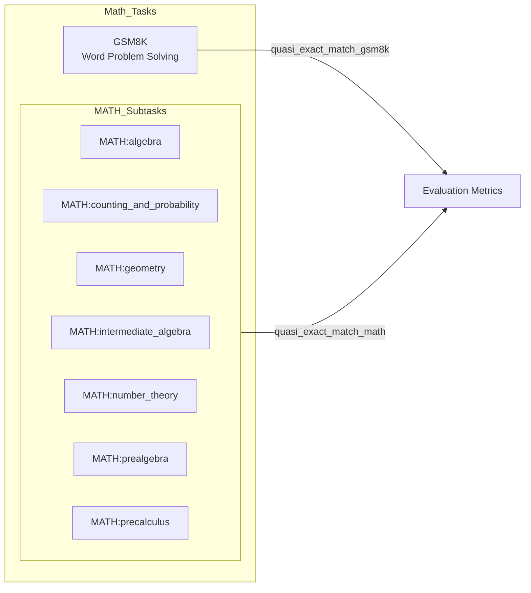
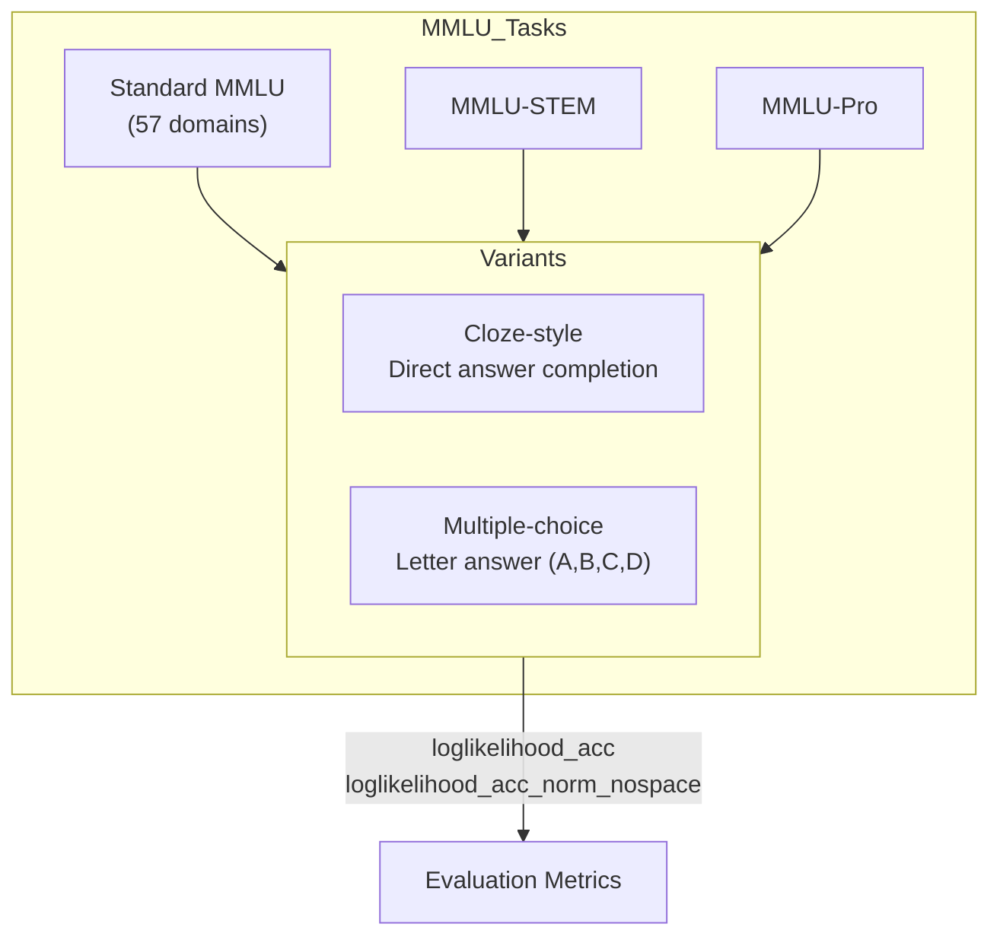
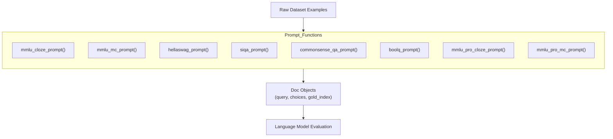
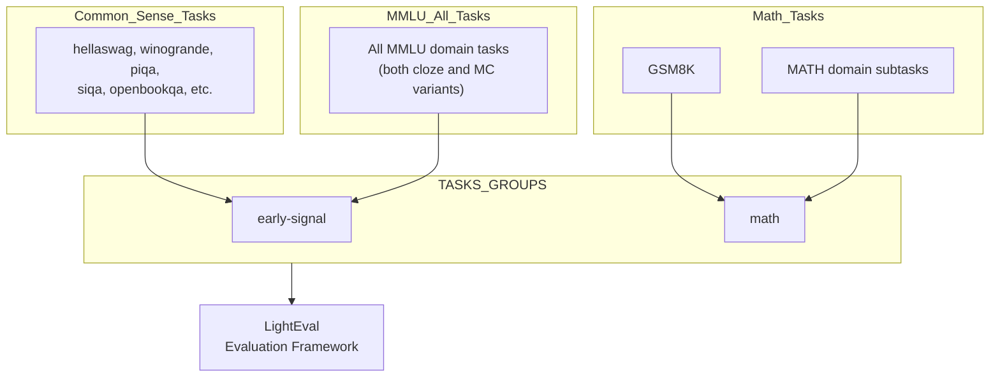

<!-- source: DeepWiki mcp.deepwiki.com · repo huggingface/cosmopedia · page 5.1 Evaluation Tasks · fetched 2026-10-26 -->

# Evaluation Tasks

<details>
<summary>Relevant source files</summary>

The following files were used as context for generating this wiki page:

- [evaluation/lighteval_tasks.py](evaluation/lighteval_tasks.py)

</details>


This page provides a detailed explanation of the evaluation tasks and benchmarks used within the Cosmopedia project to assess model performance. The evaluation system uses a customized version of the LightEval framework with tailored tasks and prompting strategies. For information on how to run these evaluations, see [Running Evaluations](#5.2).

## Evaluation Framework Overview

Cosmopedia uses the LightEval framework with custom task configurations designed to provide meaningful signal even for smaller models. Many of the evaluation tasks utilize modified prompting strategies from standard benchmarks to improve evaluation effectiveness across model scales.

The evaluation tasks are organized into three main categories:
- Common Sense Reasoning Tasks
- Mathematical Reasoning Tasks
- Multi-task Language Understanding (MMLU) Tasks

Sources: [evaluation/lighteval_tasks.py:2-21]()

## Task Configuration System

Each evaluation task in Cosmopedia is defined using the `LightevalTaskConfig` class, which specifies all parameters required for evaluation, including:

- Task name and HuggingFace dataset repository
- Prompt formatting function
- Evaluation metrics
- Generation settings (size, stop sequences)
- Few-shot configuration

This unified configuration system enables consistent evaluation across diverse task types.

```mermaid
classDiagram
    class "LightevalTaskConfig" {
        +str name
        +str prompt_function
        +str hf_repo
        +str hf_subset
        +list[Metrics] metric
        +list evaluation_splits
        +str few_shots_split
        +int generation_size
        +list stop_sequence
    }
    
    class "CustomMMLUEvaluationTask" {
        +Inherits LightevalTaskConfig
    }
    
    class "Doc" {
        +str task_name
        +str query
        +list choices
        +int gold_index
        +str instruction
    }
    
    LightevalTaskConfig <|-- CustomMMLUEvaluationTask
    LightevalTaskConfig ..> "Doc" : creates via prompt functions
```

Sources: [evaluation/lighteval_tasks.py:26-28](), [evaluation/lighteval_tasks.py:275-307]()

## Evaluation Task Categories

### Common Sense Reasoning Tasks

These tasks evaluate a model's ability to understand and reason about everyday situations, contextual information, and commonsense knowledge.

| Task Name | Description | Metrics | Dataset |
|-----------|-------------|---------|---------|
| hellaswag | Context completion with challenging options | loglikelihood_acc, loglikelihood_acc_norm_nospace | hellaswag |
| winogrande | Resolving references in sentences | loglikelihood_acc, loglikelihood_acc_norm_nospace | winogrande_xl |
| piqa | Physical commonsense reasoning | loglikelihood_acc, loglikelihood_acc_norm_nospace | piqa |
| siqa | Social interaction reasoning | loglikelihood_acc, loglikelihood_acc_norm_nospace | lighteval/siqa |
| openbookqa | Knowledge-based question answering | loglikelihood_acc, loglikelihood_acc_norm_nospace | openbookqa |
| arc:easy | Science questions (easy) | loglikelihood_acc, loglikelihood_acc_norm_nospace | ai2_arc/ARC-Easy |
| arc:challenge | Science questions (challenging) | loglikelihood_acc, loglikelihood_acc_norm_nospace | ai2_arc/ARC-Challenge |
| commonsense_qa | Commonsense question answering | loglikelihood_acc, loglikelihood_acc_norm_nospace | commonsense_qa |
| boolq | Yes/no question answering | loglikelihood_acc, loglikelihood_acc_norm_nospace | super_glue/boolq |
| trivia_qa | Factoid question answering | quasi_exact_match_triviaqa | mandarjoshi/trivia_qa |

Sources: [evaluation/lighteval_tasks.py:34-146]()

### Mathematical Reasoning Tasks

These tasks evaluate a model's ability to solve mathematical problems of varying complexity.



- **GSM8K**: Grade school math word problems, evaluated using `quasi_exact_match_gsm8k` metric
- **MATH**: Advanced mathematical problems across 7 domains (algebra, counting_and_probability, geometry, etc.), evaluated using `quasi_exact_match_math` metric

Both tasks use generative evaluation with a generation size of 256 tokens and appropriate stopping sequences.

Sources: [evaluation/lighteval_tasks.py:230-272]()

### MMLU Tasks

The Multi-task Language Understanding (MMLU) benchmark evaluates models across a wide range of knowledge domains. Cosmopedia implements two variants of each MMLU task:

1. **Cloze-style**: Direct answer completion without multiple-choice format
2. **Multiple-choice**: Traditional format with letter answers (A, B, C, D)

The repository includes 57 subject domains from standard MMLU plus custom additions:
- MMLU-STEM: Specialized STEM-focused subset
- MMLU-Pro: Professional knowledge domains



Each MMLU task is implemented using the `CustomMMLUEvaluationTask` class, which extends `LightevalTaskConfig` with specialized configuration for MMLU-style evaluations.

Sources: [evaluation/lighteval_tasks.py:275-437]()

## Prompt Functions

Each task type has a corresponding prompt function that transforms the raw dataset examples into properly formatted prompts for evaluation. These functions create `Doc` objects that include:

- The formatted query
- Available choices
- Gold index (correct answer)
- Optional instruction prefix for few-shot learning

The prompt functions are designed to improve performance signal for smaller models by using more explicit instructions and formatting.



Sources: [evaluation/lighteval_tasks.py:149-187](), [evaluation/lighteval_tasks.py:198-228](), [evaluation/lighteval_tasks.py:401-432]()

## Task Organization and Grouping

Tasks are organized into logical groups for convenience when running evaluations:

1. **early-signal**: Common Sense Reasoning + MMLU tasks, which provide quick signal on model performance
2. **math**: All mathematical reasoning tasks (GSM8K + MATH subtasks)



Sources: [evaluation/lighteval_tasks.py:438-448]()

## Example Usage

The evaluation tasks can be run using LightEval's accelerate launcher, specifying the custom tasks file and desired task list. For example:

```
accelerate launch --num_processes=1 lighteval/run_evals_accelerate.py \
    --model_args="pretrained=HuggingFaceTB/cosmo-1b" \
    --custom_tasks "lighteval_tasks.py" --output_dir [OUTPUTPATH] --max_samples 1000 \
    --tasks "custom|hellaswag|0|1,custom|winogrande|0|1,..."
```

For more detailed instructions on running evaluations, see [Running Evaluations](#5.2).

Sources: [evaluation/lighteval_tasks.py:10-15]()

## Performance Considerations

Evaluations are typically run with `max_samples=1000` to speed up large evaluations. The custom prompt changes in this implementation are designed to improve signal for smaller models, which might perform poorly on standard benchmark implementations (particularly MMLU with letter answers like "A", "B", etc.).

Sources: [evaluation/lighteval_tasks.py:5-20]()

---

