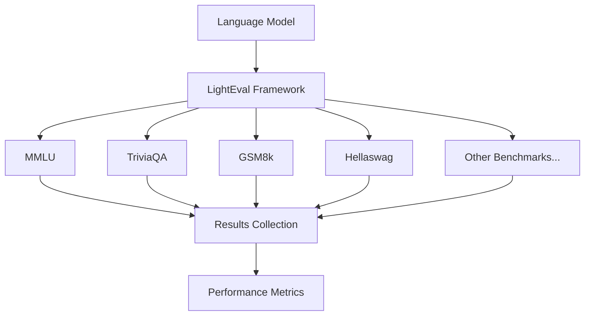
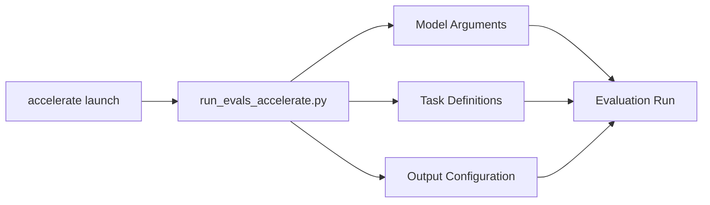
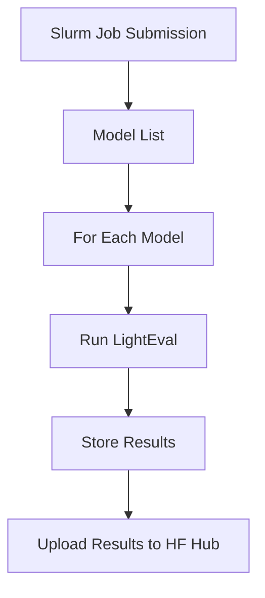
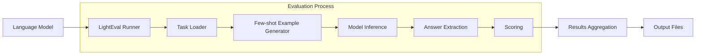

<!-- source: DeepWiki mcp.deepwiki.com · repo huggingface/cosmopedia · page 5.2 Running Evaluations · fetched 2026-10-26 -->

# Running Evaluations

<details>
<summary>Relevant source files</summary>

The following files were used as context for generating this wiki page:

- [evaluation/README.md](evaluation/README.md)
- [evaluation/eval.slurm](evaluation/eval.slurm)

</details>


This page provides detailed instructions for running evaluations on language models using the Cosmopedia evaluation framework. The framework is designed to assess model performance across a comprehensive set of benchmark tasks. For information about the specific evaluation tasks used, see [Evaluation Tasks](#5.1).

## Evaluation Framework Overview

The Cosmopedia evaluation system is built on top of LightEval, a lightweight framework for evaluating language models. The framework supports a wide range of benchmark tasks, including MMLU, MMLU-Pro, TriviaQA, GSM8k, and many others.



Sources: [evaluation/README.md:1-21]()

## Setting Up the Environment

Before running evaluations, you need to set up the LightEval environment. This involves installing the LightEval library and its dependencies.

### Installation Steps

1. Clone the LightEval repository:
```bash
git clone https://github.com/huggingface/lighteval.git
cd lighteval
```

2. Create and activate a conda environment:
```bash
conda create -n lighteval python=3.10 && conda activate lighteval
```

3. Install LightEval with required dependencies:
```bash
pip install '.[accelerate,quantization,adapters]'
```

Sources: [evaluation/README.md:6-12]()

## Running Basic Evaluations

To evaluate a language model, use the `accelerate launch` command with the appropriate parameters.

### Basic Command Structure



### Example Command

Here's an example command to evaluate a model on multiple benchmarks:

```bash
MODEL="openai-community/gpt2"
OUTPUT_DIR="./evaluation_results"

accelerate launch --num_processes=1 --main_process_port=29600 "lighteval/run_evals_accelerate.py" \
  --model_args="pretrained=$MODEL" \
  --custom_tasks "lighteval_tasks.py" \
  --output_dir $OUTPUT_DIR \
  --override_batch_size 16 \
  --tasks "custom|hellaswag|0|1,custom|winogrande|0|1,custom|piqa|0|1,custom|siqa|0|1,custom|openbookqa|0|1,custom|arc:easy|0|1,custom|arc:challenge|0|1,custom|commonsense_qa|0|1,custom|trivia_qa|0|1,custom|mmlu_pro_cloze|0|1,custom|gsm8k|5|1"
```

This command:
1. Uses `accelerate` to run the evaluation
2. Specifies the model to evaluate (`MODEL`)
3. Points to custom task definitions in `lighteval_tasks.py`
4. Sets the output directory for results
5. Overrides the batch size to 16
6. Lists all tasks to run in the format `custom|task_name|few_shot_count|num_runs`

For MMLU tasks, you can evaluate specific subtasks by providing their names, such as `custom|mmlu_cloze:abstract_algebra|0|1`.

Sources: [evaluation/README.md:14-19]()

## Task Format Specification

In the `--tasks` parameter, each task is specified in the format:

```
custom|task_name|few_shot_count|num_runs
```

Where:
- `custom` indicates a custom task defined in the `lighteval_tasks.py` file
- `task_name` is the name of the benchmark (e.g., `hellaswag`, `mmlu_cloze:abstract_algebra`)
- `few_shot_count` is the number of few-shot examples to use (0 for zero-shot)
- `num_runs` is the number of times to run the evaluation (typically 1)

For example:
- `custom|hellaswag|0|1` - Run Hellaswag benchmark in zero-shot setting once
- `custom|gsm8k|5|1` - Run GSM8k benchmark with 5-shot examples once

Sources: [evaluation/README.md:16-19](), [evaluation/eval.slurm:62-64]()

## Batch Evaluation with Slurm

For large-scale evaluations across multiple models, you can use a Slurm script to automate the process.



### Example Slurm Script

The repository includes a Slurm script (`eval.slurm`) that demonstrates how to evaluate multiple models sequentially. Key components include:

1. Resource allocation (CPUs, GPUs, memory)
2. Environment setup
3. Model list definition
4. Output directory configuration
5. Evaluation loop
6. Results upload to Hugging Face Hub

The script runs a comprehensive set of benchmarks on each model specified in the model list.

Sources: [evaluation/eval.slurm:1-68]()

### Modified Script for Custom Evaluations

To adapt the Slurm script for your own use:

1. Update resource requirements based on your environment
2. Modify the list of models to evaluate
3. Adjust the output directory path
4. Update the tasks list if necessary

## Understanding Evaluation Parameters

The evaluation framework supports various parameters for customization:

| Parameter | Description | Example |
|-----------|-------------|---------|
| `--num_processes` | Number of GPUs to use | `--num_processes=8` |
| `--model_args` | Model specification | `--model_args="pretrained=openai-community/gpt2"` |
| `--custom_tasks` | Path to custom task definitions | `--custom_tasks "lighteval_tasks.py"` |
| `--output_dir` | Directory for results | `--output_dir "./results"` |
| `--override_batch_size` | Batch size for inference | `--override_batch_size 16` |
| `--tasks` | List of tasks to evaluate | See examples above |

Sources: [evaluation/README.md:16-19](), [evaluation/eval.slurm:62-64]()

## Model Evaluation Flow

The following diagram illustrates how a model progresses through the evaluation pipeline:



The process involves:
1. Loading the model to be evaluated
2. Loading task definitions and examples
3. Generating few-shot examples if specified
4. Running model inference on test inputs
5. Extracting answers from model outputs
6. Scoring the answers against ground truth
7. Aggregating results across tasks
8. Outputting results to the specified directory

Sources: [evaluation/README.md:14-19](), [evaluation/eval.slurm:62-64]()

## Interpreting Results

After running the evaluation, results are stored in the specified output directory. For batch evaluations using the Slurm script, results are also uploaded to a Hugging Face dataset repository.

The results include performance metrics for each benchmark task, which can be used to compare different models or track improvements in model performance over time.

Sources: [evaluation/eval.slurm:67-68]()

## Troubleshooting

When running evaluations, you might encounter issues related to:

1. GPU memory limitations - Try reducing the batch size using `--override_batch_size`
2. Task definition errors - Ensure the custom tasks file is correctly formatted
3. Model loading failures - Check if the model path is correct and accessible

If you encounter memory issues with large models, consider:
- Reducing the number of concurrent tasks
- Using model quantization (supported via LightEval's quantization features)
- Distributing evaluation across multiple machines

Sources: [evaluation/README.md:6-12](), [evaluation/eval.slurm:1-68]()

---

