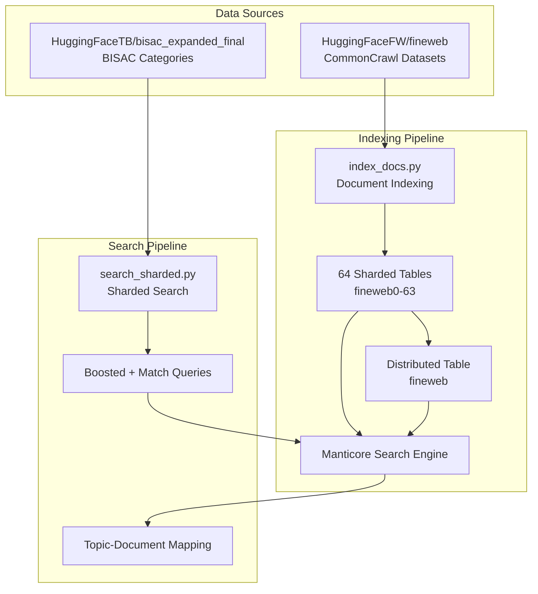
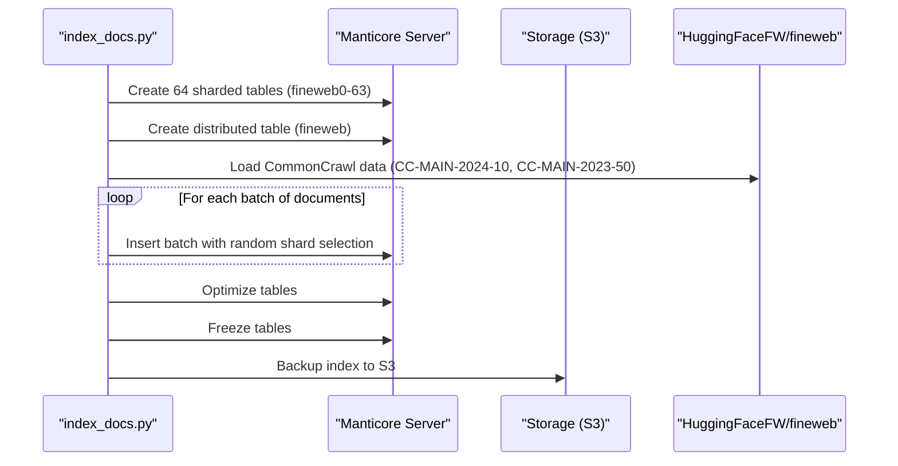
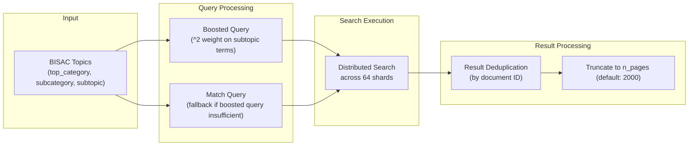
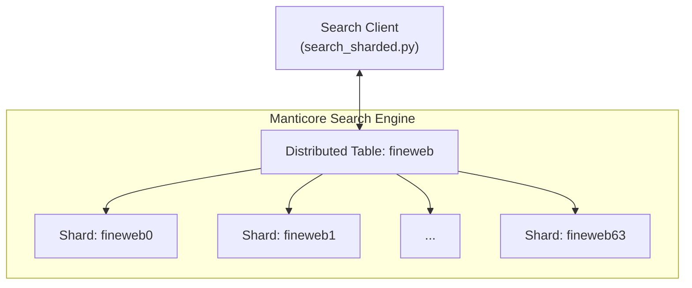

<!-- source: DeepWiki mcp.deepwiki.com · repo huggingface/cosmopedia · page 6 Fulltext Search · fetched 2026-10-26 -->

# Fulltext Search

<details>
<summary>Relevant source files</summary>

The following files were used as context for generating this wiki page:

- [fulltext_search/README.md](fulltext_search/README.md)
- [fulltext_search/index_docs.py](fulltext_search/index_docs.py)
- [fulltext_search/index_docs.slurm](fulltext_search/index_docs.slurm)
- [fulltext_search/manticore.conf](fulltext_search/manticore.conf)
- [fulltext_search/search_sharded.py](fulltext_search/search_sharded.py)
- [fulltext_search/search_sharded.slurm](fulltext_search/search_sharded.slurm)

</details>


## Overview

This document describes the fulltext search capabilities implemented in the Cosmopedia project. The system enables efficient search across large web corpora (specifically CommonCrawl data) using Manticore Search, with particular emphasis on topic-based retrieval using BISAC (Book Industry Standards and Communications) categories.

The fulltext search functionality serves as a reference implementation for searching and retrieving topically-relevant content from massive web datasets, primarily to support the data generation process in Cosmopedia.

Sources: [fulltext_search/README.md]()

## Architecture

Below is a diagram of the fulltext search system architecture:



The fulltext search system consists of two main processes:
1. **Indexing pipeline**: Ingests web documents and creates searchable indices
2. **Search pipeline**: Retrieves topically-relevant content based on BISAC categories

Sources: [fulltext_search/index_docs.py](), [fulltext_search/search_sharded.py]()

## Indexing Process

The indexing process converts the web corpus into a queryable fulltext index. It's designed to handle the scale of CommonCrawl data efficiently through sharding.



### Key Components of the Indexing Process

1. **Table Creation**: The system creates 64 sharded tables (`fineweb0` through `fineweb63`) along with a distributed table (`fineweb`) that combines them.

2. **Document Processing**: Each document from the datasets is processed and inserted into a randomly selected shard to distribute the load evenly.

3. **Index Optimization**: After all documents are inserted, tables are optimized and frozen to maximize search performance.

The indexing script randomly assigns documents to one of 64 shards to distribute the index across multiple tables:

```
index_name = f"fineweb{random.randint(0, 63)}"
```

The document schema includes:
- `content`: The fulltext content
- `fw_id`: Document identifier
- `url`: Source URL
- `language_score`: Language quality score
- `token_count`: Number of tokens

Sources: [fulltext_search/index_docs.py:10-50](), [fulltext_search/index_docs.py:53-124]()

## Search Process

The search process retrieves topically relevant documents using BISAC categories, which provide hierarchical topic classifications.



### Search Query Construction

For each BISAC topic, the system constructs two types of queries:

1. **Boosted Query**: Uses Manticore's query_string syntax with boosting (^2) on subtopic terms to prioritize documents that match the most specific part of the topic hierarchy.

2. **Match Query**: Used as a fallback when boosted queries don't return enough results. This is a simpler match query combining all topic levels.

Example query construction:
```python
# Boosting the IDF score of subtopic tokens
boosted_subtopic = " ".join([w + "^2" for w in subtopic.split()])
match_query = " ".join([top_category, subcategory, subtopic])
boosted_query = " ".join([top_category, subcategory, boosted_subtopic])
```

The search process is parallelized using SLURM array jobs, with each job processing a subset of the BISAC categories.

Sources: [fulltext_search/search_sharded.py:47-114](), [fulltext_search/search_sharded.py:10-46]()

## Implementation Details

### Sharding Architecture

The system uses a distributed search architecture with 64 shards to handle the scale of CommonCrawl data efficiently:



Each shard contains a subset of the documents, and searches are executed across all shards via the distributed table.

The configuration enables:
- English stemming (`stem_en`)
- English stopword removal
- Non-CJK (Chinese, Japanese, Korean) character handling
- Document IDs linked to CommonCrawl IDs

Sources: [fulltext_search/index_docs.py:66-80](), [fulltext_search/manticore.conf]()

### Performance Considerations

The system makes several optimizations for performance:

1. **Memory Configuration**: Manticore is configured with high limits for file handles (65535) and memory usage to handle large datasets.

2. **Multithreading**: The server uses 64 threads for processing queries.

3. **Batch Processing**: Documents are inserted in batches of 10,000 for efficiency.

4. **Table Optimization**: After indexing, tables are optimized with:
   ```python
   # Optimize with cutoff=16 (min word occurrences)
   response = requests.post(
       sql_url,
       data={"query": f"OPTIMIZE TABLE fineweb{i} OPTION cutoff=16, sync=1"},
       timeout=600,
   )
   ```

5. **Parallel Processing**: Both indexing and searching use parallel processing (64 processes for indexing, 16 sharded jobs for searching).

Sources: [fulltext_search/index_docs.slurm](), [fulltext_search/manticore.conf:94-97](), [fulltext_search/search_sharded.slurm]()

## Usage

### Running the Indexing Process

The indexing process is executed via a SLURM job, which:
1. Creates the necessary directory structure
2. Launches a Manticore container
3. Runs the indexing script
4. Copies the resulting index to S3

```bash
sbatch fulltext_search/index_docs.slurm
```

The indexing script (`index_docs.py`) performs the following steps:
1. Initializes the Manticore tables
2. Loads the datasets from HuggingFace
3. Processes and inserts documents in batches
4. Optimizes the tables after indexing

Sources: [fulltext_search/index_docs.slurm]()

### Running the Search Process

The search process is executed as a SLURM array job with 16 shards:

```bash
sbatch fulltext_search/search_sharded.slurm
```

Each shard:
1. Downloads the index from S3
2. Starts a Manticore instance
3. Processes a subset of BISAC topics
4. Uploads results to HuggingFace as a dataset

Key parameters for search:
- `--input_dataset`: BISAC topic dataset (default: "HuggingFaceTB/bisac_expanded_final")
- `--n_pages`: Number of pages to retrieve per topic (default: 2000)
- `--output_dataset`: Output dataset name (default: "HuggingFaceTB/bisac_boosted_new_index_2000")
- `--shard` and `--num_shards`: Sharding parameters

Sources: [fulltext_search/search_sharded.slurm](), [fulltext_search/search_sharded.py:10-23]()

## Search Result Structure

The search results are organized into a dataset with the following structure:

| Field | Description |
|-------|-------------|
| `top_category` | Top-level BISAC category |
| `subcategory` | Mid-level BISAC category |
| `subtopic` | Detailed BISAC subtopic |
| `topic_hits` | Documents matching the topic |
| `num_hits` | Number of hits found |

Each topic generates up to `n_pages` (default: 2000) document results, which are merged and deduplicated across query types.

Sources: [fulltext_search/search_sharded.py:106-114]()