# Page: Overview

# Overview

<details>
<summary>Relevant source files</summary>

The following files were used as context for generating this wiki page:

- [LICENSE](LICENSE)
- [README.md](README.md)

</details>


This document provides an introduction to the Cosmopedia repository, a comprehensive system for generating, processing, and evaluating synthetic data for training language models. Cosmopedia represents a large-scale effort to create high-quality synthetic textbooks, blogposts, stories, and guides that cover a wide range of world knowledge.

For specific details about the dataset itself, see [Dataset Overview](#1.1).

## Purpose and Scope

Cosmopedia aims to create a massive, high-quality synthetic dataset that maps world knowledge present in web datasets such as RefinedWeb and RedPajama. The project encompasses the entire pipeline from prompt generation to content evaluation:

1. **Data Generation**: Creating prompts from web data and generating synthetic content
2. **Data Processing**: Ensuring quality through deduplication and decontamination
3. **Content Classification**: Scoring content for educational value
4. **Evaluation**: Benchmarking the quality of the generated data

The resulting dataset contains over 30 million files and 25 billion tokens, making it the largest open synthetic dataset to date.

Sources: [README.md:13-16]()

## System Architecture

The Cosmopedia system consists of four main components organized in a sequential pipeline.

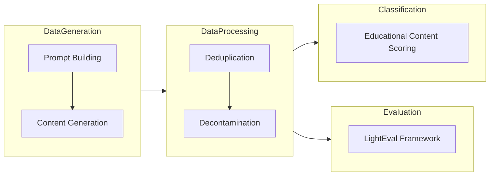

Sources: [README.md:25-29]()

### Core Components

Cosmopedia's architecture follows a logical flow from data generation to evaluation:

1. **Data Generation**: This process starts with topic clustering from web samples to build diverse prompts. These prompts are then fed to the Mixtral-8x7B-Instruct-v0.1 model through llm-swarm infrastructure to generate the synthetic content.

2. **Data Processing**: The generated content undergoes rigorous processing, including MinHash-based deduplication using datatrove and n-gram decontamination against evaluation benchmarks.

3. **Content Classification**: Educational content scoring is performed using fine-tuned BERT models to classify and score the synthetic content.

4. **Evaluation**: The processed dataset is evaluated using the LightEval framework against benchmarks like MMLU, GSM8k, TriviaQA, and others.

Sources: [README.md:25-29]()

## Detailed System Architecture and Data Flow

The following diagram illustrates the complete data flow through the Cosmopedia system, mapping specific code components to each stage of the process:

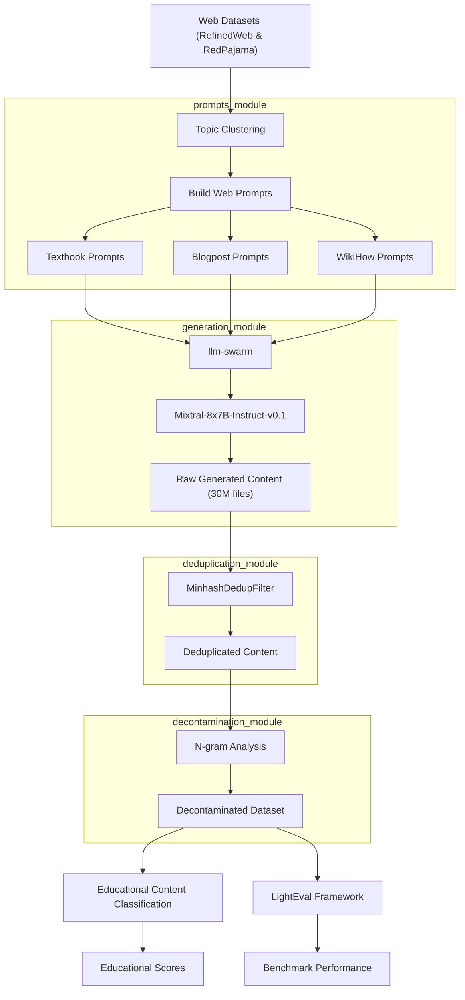

Sources: [README.md:13-29]()

## Dataset Content and Coverage

Cosmopedia covers a diverse range of topics, attempting to map world knowledge present in large web datasets. The content is distributed across various clusters representing different domains of knowledge.

The dataset includes:
- Synthetic textbooks on academic subjects
- Blogposts on various topics
- Stories and fictional content
- WikiHow-style guides and tutorials

The content is generated through carefully crafted prompts and then processed to ensure uniqueness and quality.

Sources: [README.md:14-16]()

## Code Structure

The Cosmopedia repository is organized into the following main directories:

| Directory | Purpose |
|-----------|---------|
| `prompts` | Code for building prompts from web samples, including topic clustering |
| `generation` | Code for running large-scale synthetic generations with llm-swarm |
| `deduplication` | Scripts for MinHash deduplication using datatrove |
| `decontamination` | Code for n-gram decontamination against evaluation benchmarks |

Additional components include classification systems for scoring educational content and evaluation frameworks for benchmarking the quality of the dataset.

Sources: [README.md:25-29]()

## License and Usage

Cosmopedia is released under the Apache License 2.0, allowing for free use, modification, and distribution with proper attribution.

Sources: [LICENSE:1-201]()

## Relation to Other Components

The Overview page serves as an entry point to understanding the Cosmopedia system. For more detailed information about specific components, refer to:

- [Data Generation](#2) for details on the prompt building and content generation process
- [Data Processing](#3) for information about deduplication and decontamination
- [Content Classification](#4) for details on the educational content scoring system
- [Evaluation](#5) for information about the evaluation framework and benchmarks

---

# Page: Dataset Overview

# Dataset Overview

<details>
<summary>Relevant source files</summary>

The following files were used as context for generating this wiki page:

- [LICENSE](LICENSE)
- [README.md](README.md)

</details>


## Purpose and Scope

This document provides a comprehensive overview of the Cosmopedia dataset, including its size, content types, and structure. It describes what the dataset contains and how it's organized, without delving into the technical details of its generation or processing, which are covered in other sections of the documentation. For information about how prompts are built for generation, see [Prompt Building](#2.1), and for details on the content generation process, see [Content Generation](#2.2).

## Dataset Description

Cosmopedia is a synthetic dataset generated by Mixtral-8x7B-Instruct-v0.1, designed to serve as a high-quality corpus for training language models. It represents one of the largest open synthetic datasets available, containing a diverse range of educational and informative content spanning numerous knowledge domains.

| Dataset Attribute | Value |
|-------------------|-------|
| Version | 0.1 |
| Total Files | >30 million |
| Total Tokens | ~25 billion |
| Generation Model | Mixtral-8x7B-Instruct-v0.1 |
| License | Apache License 2.0 |

Sources: [README.md:13-16]()

## Content Types

The Cosmopedia dataset consists of several distinct content types, each designed to capture different styles and formats of educational material:

1. **Textbooks**: Structured educational content with chapters, sections, and comprehensive topic coverage
2. **Blogposts**: More conversational informative content on specific topics
3. **Stories**: Narrative content that can include educational elements
4. **Posts**: Shorter informative pieces on specific subjects
5. **WikiHow Articles**: Instructional content formatted as step-by-step guides

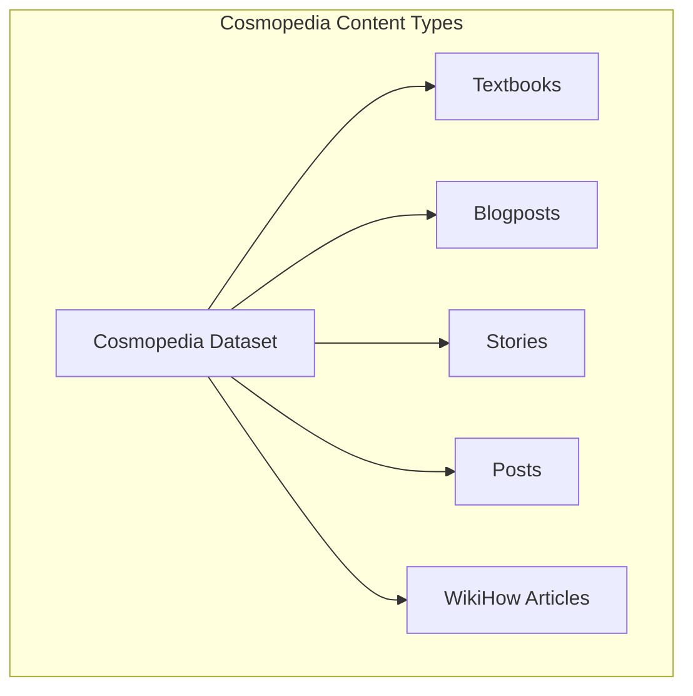

Sources: [README.md:14]()

## Topical Coverage

Cosmopedia aims to map the world knowledge present in web datasets like RefinedWeb and RedPajama. The content is organized into topical clusters that span a broad range of subject areas. The dataset's clusters visualization (available in the repository at `plots/clusters_map.png`) illustrates the diverse topical coverage.

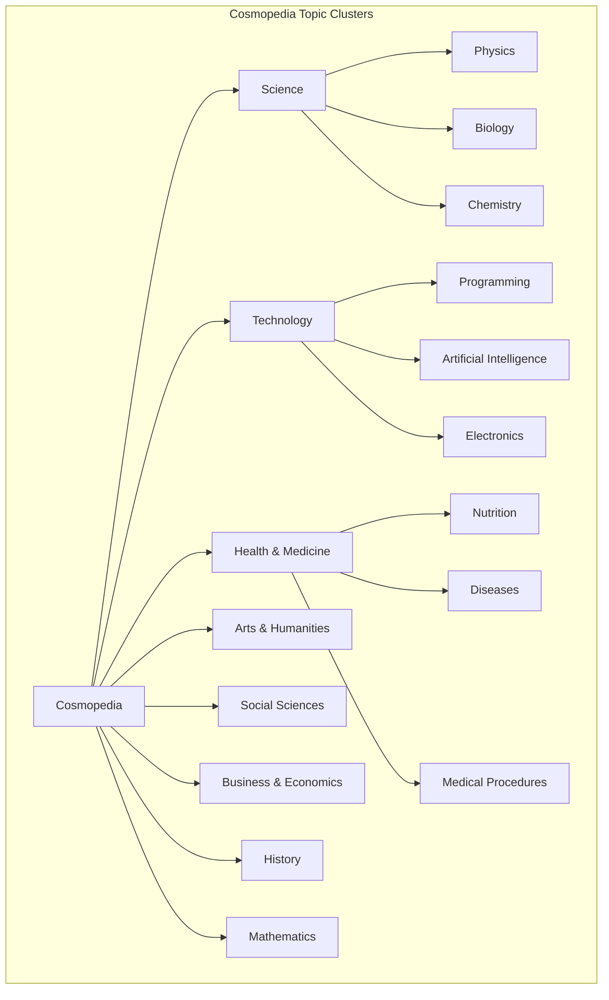

The topic distribution in the dataset is not uniform, with some topics having more representation than others. A frequency plot of single topic clusters is available in the repository at `plots/topic_distpng.png`.

Sources: [README.md:16-23]()

## Dataset Structure

The Cosmopedia dataset is structured to facilitate easy access and utilization. At the highest level, the dataset is organized by content type and topic clusters.

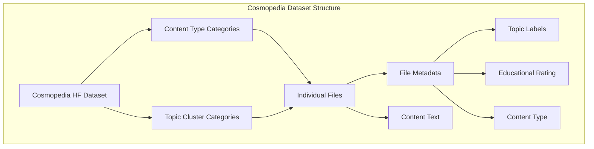

Each file in the dataset contains the synthetic content along with metadata that can include topic labels, educational rating scores (for classified content), and content type information. This structure allows for efficient filtering and selection of specific content types or topics for downstream applications.

Sources: [README.md:14-16]()

## Dataset Access

The Cosmopedia dataset is publicly available through the Hugging Face Datasets Hub. It can be accessed at [huggingface.co/datasets/HuggingFaceTB/cosmopedia](https://huggingface.co/datasets/HuggingFaceTB/cosmopedia).

The dataset can be loaded using the Hugging Face Datasets library:

```python
from datasets import load_dataset

dataset = load_dataset("HuggingFaceTB/cosmopedia")
```

Additionally, a 1B parameter language model trained on Cosmopedia is available at [huggingface.co/HuggingFaceTB/cosmopedian-1b](https://huggingface.co/HuggingFaceTB/cosmopedian-1b).

Sources: [README.md:8-9]()

## Dataset Processing

While the detailed processing is covered in other sections of the documentation, it's worth noting that the Cosmopedia dataset has undergone rigorous quality assurance, including:

1. **Deduplication**: Removal of near-duplicate content using MinHash algorithms and datatrove
2. **Decontamination**: Protection against contamination with evaluation benchmarks through n-gram analysis
3. **Educational Content Classification**: Assessment of the educational value of content

For more detailed information about these processes, see [Deduplication](#3.1), [Decontamination](#3.2), and [Content Classification](#4).

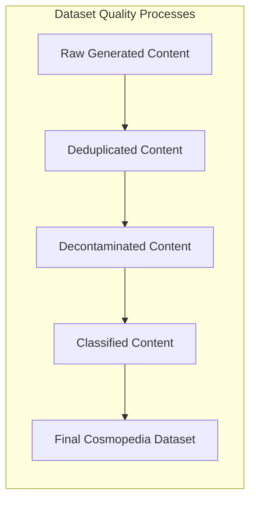

Sources: [README.md:27-29]()

## Use Cases

The Cosmopedia dataset is designed to support various research applications in natural language processing and machine learning, including:

1. **Language Model Training**: As demonstrated by cosmopedian-1b, the dataset can be used to train language models from scratch
2. **Fine-tuning Existing Models**: The dataset provides high-quality synthetic data for fine-tuning pretrained models
3. **Synthetic Data Research**: Investigating the properties and effectiveness of synthetic data for NLP tasks
4. **Educational Content Generation**: Studying how language models can generate educational material

The dataset's v0.1 designation indicates it's an initial version with room for improvement and expansion, making it a valuable resource for ongoing research in synthetic data generation and utilization.

Sources: [README.md:16]()

---

# Page: Data Generation

# Data Generation

<details>
<summary>Relevant source files</summary>

The following files were used as context for generating this wiki page:

- [LICENSE](LICENSE)
- [README.md](README.md)
- [generation/README.md](generation/README.md)

</details>


## Purpose and Scope

This page documents the synthetic data generation system in Cosmopedia, which is responsible for creating high-quality synthetic textbooks, blogposts, stories, and WikiHow articles. The Data Generation system takes input from web datasets, creates prompts through topic clustering, and uses large language models to generate content at scale. This page provides an overview of the entire generation process, while detailed information about specific components can be found in [Prompt Building](#2.1) and [Content Generation](#2.2).

## Overview of Data Generation Process

The Cosmopedia Data Generation system transforms web data into a large-scale synthetic dataset (30M files, 25B tokens) through a multi-stage pipeline. The process begins with topic clustering of web samples, followed by prompt creation, and finally large-scale content generation using advanced language models.

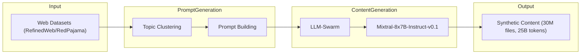

Sources: [README.md:14-16](), [generation/README.md:4]()

## Generation System Architecture

The Data Generation system consists of two main components: Prompt Generation and Content Generation. The following diagram illustrates the detailed architecture of the generation process:

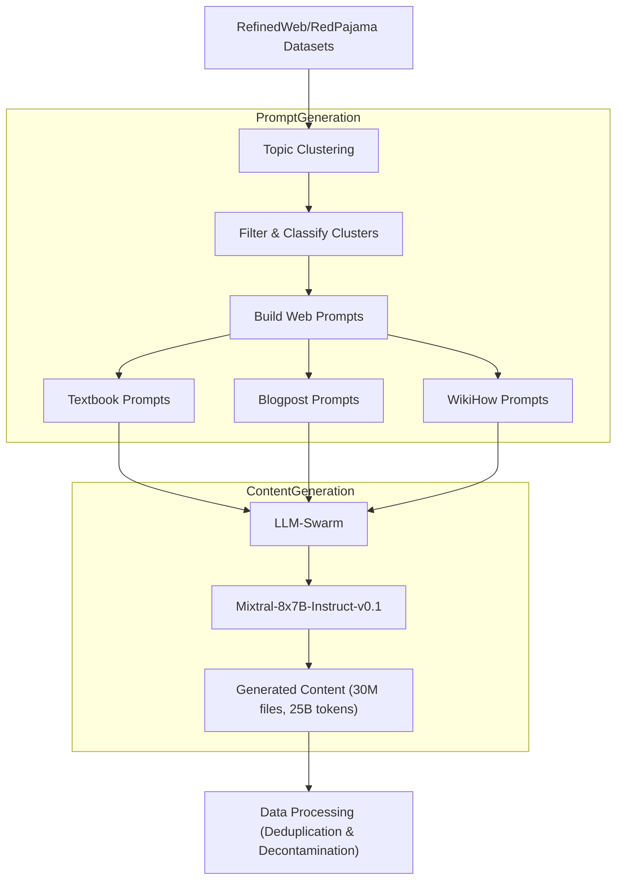

Sources: [README.md:25-27](), [generation/README.md:2-8]()

## Prompt Generation

The Prompt Generation component takes web samples from datasets like RefinedWeb and RedPajama and processes them into effective prompts for content generation. The process involves:

1. **Topic Clustering**: Web samples are clustered by topics to identify knowledge domains to cover
2. **Filtering and Classification**: Clusters are filtered and classified to organize content types
3. **Prompt Building**: Different types of prompts are created for textbooks, blogposts, and WikiHow articles

For detailed information about prompt building, see the [Prompt Building](#2.1) page.

Sources: [README.md:26]()

## Content Generation

The Content Generation component uses the `llm-swarm` system to deploy multiple instances of the Mixtral-8x7B-Instruct-v0.1 model across a distributed computing environment. This enables efficient, large-scale generation of synthetic content based on the prompts created in the previous stage.

### Generation Scale and Resource Requirements

Content generation for Cosmopedia was a substantial computational undertaking:
- Used over 10,000 H100 GPU hours
- Generated 30 million files
- Produced 25 billion tokens of synthetic content

### Generation Process with LLM-Swarm

The `llm-swarm` tool orchestrates the deployment of Text Generation Inference (TGI) or vLLM instances on Slurm clusters. Below is an example of how content generation is executed:

```
python generate_syntehtic_textbooks.py \
    --model mistralai/Mixtral-8x7B-Instruct-v0.1 \
    --instances 2 \
    --prompts_dataset "HuggingFaceTB/cosmopedia-100k" \
    --prompt_column prompt \
    --max_samples 2000 \
    --checkpoint_path "./synthetic_data" \
    --checkpoint_interval 1000
```

For more detailed information about the content generation process, see the [Content Generation](#2.2) page.

Sources: [generation/README.md:4-21]()

## Data Types and Coverage

Cosmopedia's Data Generation system produces a variety of content types to cover a broad range of knowledge domains:

| Content Type | Description | Purpose |
|-------------|-------------|---------|
| Textbooks | Educational content structured as textbook chapters | Comprehensive coverage of academic subjects |
| Blogposts | Informal articles on various topics | Coverage of practical knowledge and contemporary topics |
| Stories | Narrative content | Creative and entertainment content |
| WikiHow Articles | Step-by-step instructional content | Procedural knowledge and how-to information |

The generated content attempts to map the world knowledge present in web datasets, though the creators note that version 0.1 has "ample room for improvement and topics to be more comprehensively covered."

Sources: [README.md:14-16]()

## Integration with Downstream Systems

After generation, the synthetic content flows into subsequent processing systems:

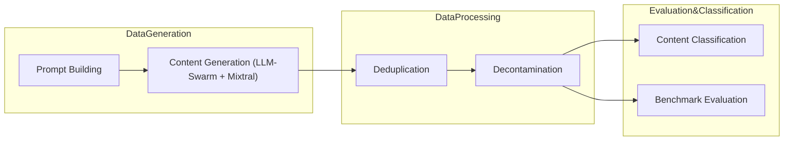

The output from Data Generation feeds into the Data Processing system ([Deduplication](#3.1) and [Decontamination](#3.2)) to ensure high-quality, unique content before being used for model training, classification, and evaluation.

Sources: [README.md:28-29]()

---

# Page: Prompt Building

# Prompt Building

<details>
<summary>Relevant source files</summary>

The following files were used as context for generating this wiki page:

- [prompts/README.md](prompts/README.md)
- [prompts/auto_math_text/README.md](prompts/auto_math_text/README.md)
- [prompts/openstax/README.md](prompts/openstax/README.md)
- [prompts/stories/README.md](prompts/stories/README.md)
- [prompts/web_samples/README.md](prompts/web_samples/README.md)

</details>


## Purpose and Scope

This document details the prompt building process within the Cosmopedia project, which is a crucial first step in the synthetic data generation pipeline. Prompt building involves transforming various seed data sources into structured prompts that guide the language model to generate high-quality, educational content. For information about how these prompts are used in the actual content generation process, see [Content Generation](#2.2).

## Prompt Building Process Overview

Prompt building in Cosmopedia involves creating tailored prompts from multiple seed data sources, each following a specific workflow designed to maximize the educational quality and diversity of the generated content.

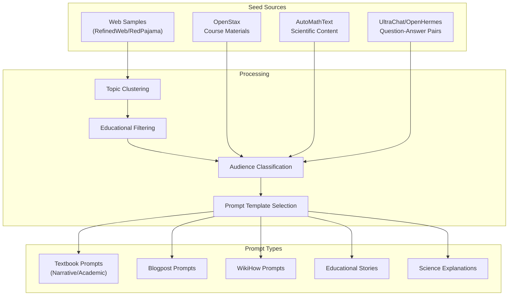

Sources: [prompts/README.md](), [prompts/web_samples/README.md]()

## Web Sample-Based Prompts

The majority of prompts in Cosmopedia are derived from web samples through a clustering and topic-based approach.

### Clustering and Topic Identification

The process begins by clustering 100,000 samples from web datasets like RefinedWeb to identify distinct topics and content types.

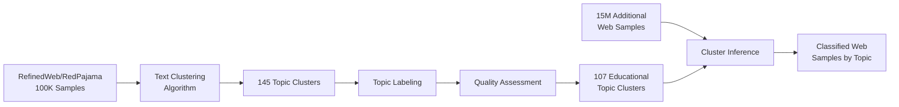

Sources: [prompts/web_samples/README.md:3-9]()

### Filtering and Classification

The clustering process resulted in 145 clusters, of which 38 were excluded based on quality assessment. Each remaining cluster was then classified for potential generation styles.

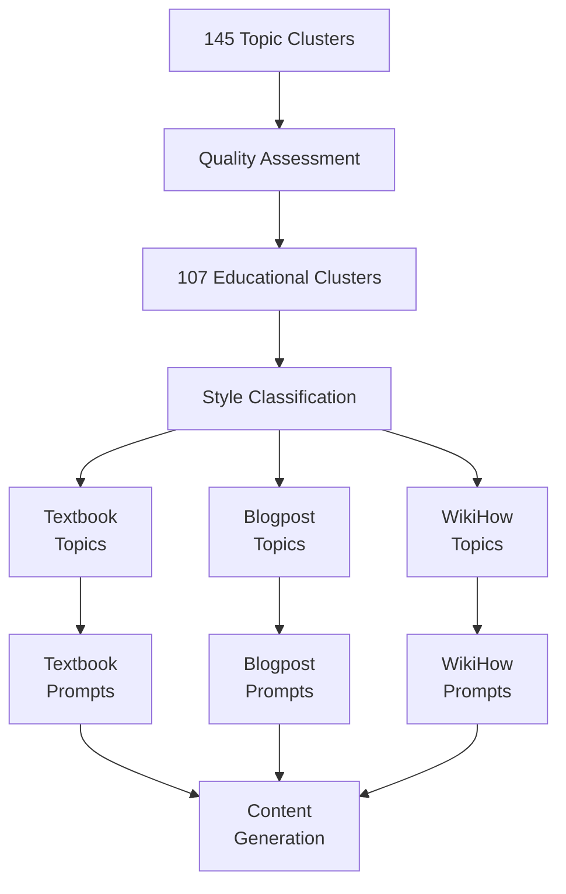

Sources: [prompts/web_samples/README.md:7-16]()

### Implementation

The web sample prompt building process is implemented in two main scripts:

1. `filter_and_classify_clusters.py` - Filters out non-educational clusters and classifies the remaining ones by content type
2. `build_web_prompts.py` - Constructs the actual prompts based on the classified clusters

Sources: [prompts/web_samples/README.md:11-19]()

## Other Prompt Sources

In addition to web samples, Cosmopedia uses several other data sources to create a diverse set of prompts.

### AutoMathText Prompts

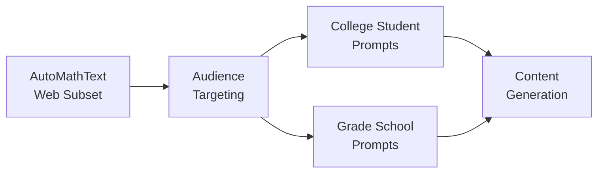

AutoMathText serves as a source for science and mathematics prompts, with tailored versions created for two distinct audience levels:
- College students
- Grade school students

The script `build_science_prompt.py` handles the creation of these prompts, with options to generate for specific audiences or all styles at once.

Sources: [prompts/auto_math_text/README.md]()

### Story-Based Prompts

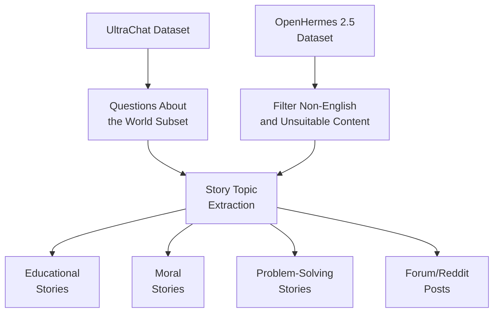

Story-based prompts are created from:
- UltraChat (specifically the "Questions about the world" subset)
- OpenHermes 2.5 (filtered for English content and suitable categories)

These sources are used to create four types of narratives:
1. Educational stories for young children
2. Stories involving morals and principles
3. Stories involving problem solving
4. Posts found on forums and Reddit

The key scripts for this process are:
- `filter_openhermes.py` - Filters OpenHermes dataset
- `build_openhermes_stories_prompts.py` - Creates prompts from OpenHermes
- `build_ultrachat_stories_prompts.py` - Creates prompts from UltraChat

Sources: [prompts/stories/README.md]()

### OpenStax Prompts

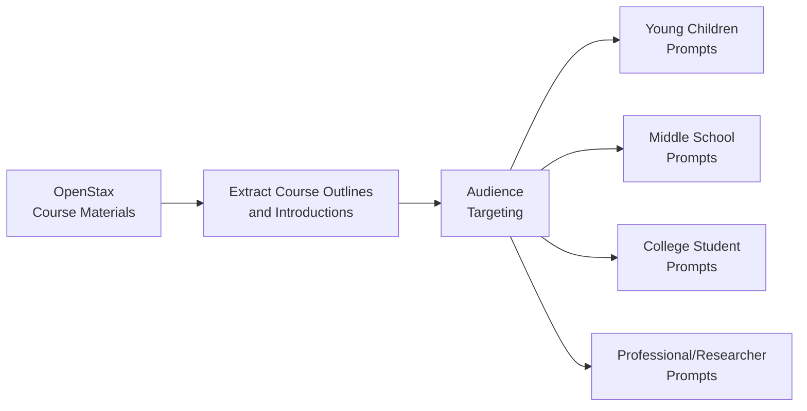

OpenStax educational materials are used to create textbook-style prompts for four different audience levels:
1. Young children
2. Middle school students
3. College students
4. Professionals and researchers

The script `build_openstax_prompts.py` handles this process, with each prompt tailored to its target audience.

Sources: [prompts/openstax/README.md]()

## Prompt Structure and Implementation

The overall organization of the prompt building process is represented in the file structure below:

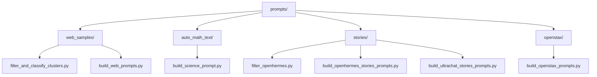

Sources: [prompts/README.md](), [prompts/web_samples/README.md](), [prompts/auto_math_text/README.md](), [prompts/stories/README.md](), [prompts/openstax/README.md]()

### Integration with Data Generation Pipeline

After prompt building, the created prompts feed into the content generation system as shown below:

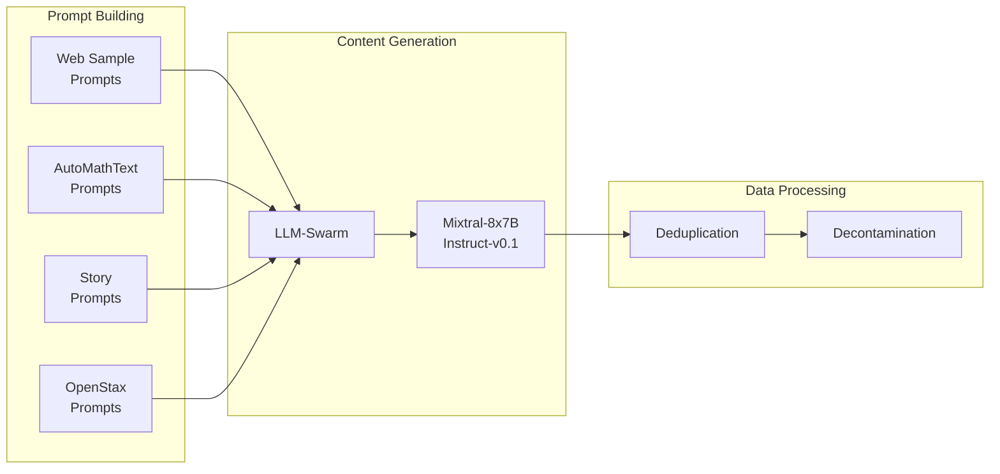

Sources: [prompts/README.md]()

## Summary

The prompt building system in Cosmopedia transforms various seed data sources into structured prompts that guide the generation of diverse, educational content. The process involves clustering web samples to identify topics, filtering for educational value, and classifying content types to create appropriate prompts. Additional sources like AutoMathText, OpenStax, and story datasets further enhance the diversity of the generated content.

Key aspects of the prompt building process include:
- Topic-based clustering of web samples
- Educational quality filtering
- Audience targeting for different knowledge levels
- Multiple content types (textbooks, blogposts, WikiHow, stories)
- Specialized prompts for scientific, narrative, and educational content

This systematic approach to prompt building ensures that the generated Cosmopedia dataset contains high-quality, diverse educational content covering a wide range of topics and formats.

---

# Page: Content Generation

# Content Generation

<details>
<summary>Relevant source files</summary>

The following files were used as context for generating this wiki page:

- [LICENSE](LICENSE)
- [README.md](README.md)
- [generation/README.md](generation/README.md)

</details>


## Purpose and Scope

This document describes the content generation system used in the Cosmopedia project, which is responsible for producing synthetic textbooks, blogposts, stories, posts, and WikiHow articles. The system leverages the Mixtral-8x7B-Instruct-v0.1 model through the llm-swarm framework to generate content at scale. This page focuses specifically on the technical implementation and architecture of the content generation process, which occurs after prompt creation (see [Prompt Building](#2.1)) and before data processing steps (see [Data Processing](#3)).

## Architecture Overview

The content generation system uses carefully crafted prompts to instruct a large language model to generate educational and informative content spanning diverse topics. The generation process operates at massive scale, leveraging distributed infrastructure to produce the 30M files and 25B tokens that comprise the Cosmopedia dataset.

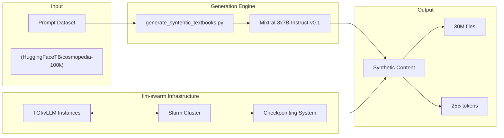

Sources: [README.md:13-16](), [generation/README.md:2-9]()

## Generation System Components

The content generation system consists of several key components that work together to enable large-scale synthetic data generation:

### The LLM-Swarm Framework

LLM-Swarm is a distributed infrastructure framework used to deploy multiple inference instances of large language models across a cluster. It's specifically designed to handle the scale required for generating billions of tokens of content.

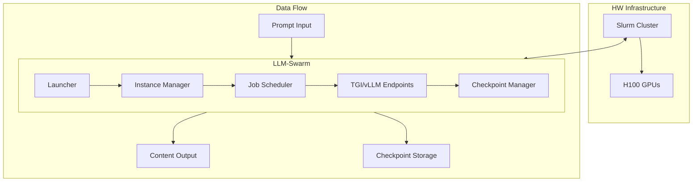

Sources: [generation/README.md:4-6](), [README.md:27-28]()

### Mixtral-8x7B-Instruct-v0.1 Model

The Cosmopedia dataset was generated using Mixtral-8x7B-Instruct-v0.1, a large language model developed by Mistral AI. This model was chosen for its ability to generate high-quality, coherent, and educational content across various domains.

### Generation Script

The generation process is orchestrated by a Python script that handles:
1. Loading prompts from the dataset
2. Managing model instances
3. Performing content generation
4. Checkpointing for fault tolerance

## Technical Implementation

The generation is implemented using the `generate_syntehtic_textbooks.py` script within the llm-swarm framework. This script handles various aspects of the generation process:

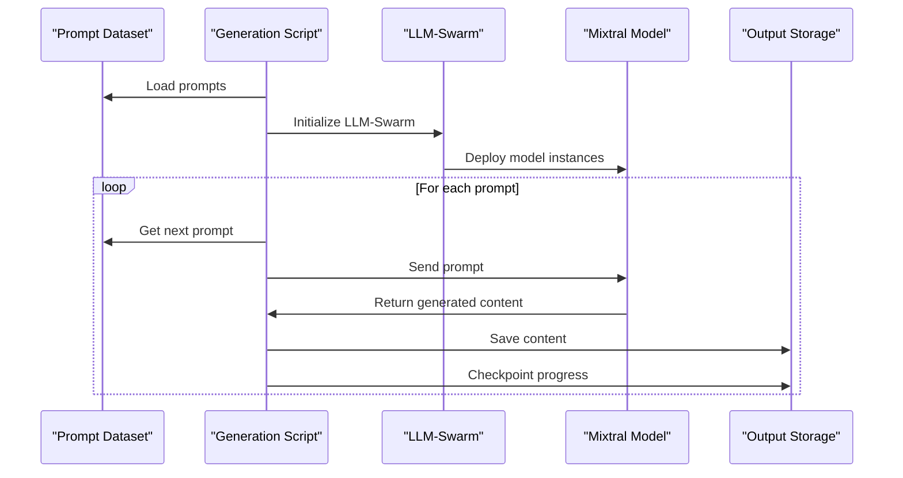

Sources: [generation/README.md:10-21]()

### Key Configuration Parameters

The generation script accepts several parameters to control the generation process:

| Parameter | Description | Example Value |
|-----------|-------------|---------------|
| `--model` | The model to use for generation | mistralai/Mixtral-8x7B-Instruct-v0.1 |
| `--instances` | Number of model instances to run in parallel | 2 |
| `--prompts_dataset` | HuggingFace dataset containing prompts | HuggingFaceTB/cosmopedia-100k |
| `--prompt_column` | Column in dataset containing the prompt | prompt |
| `--max_samples` | Maximum number of samples to generate | 2000 |
| `--checkpoint_path` | Path to save checkpoints | ./synthetic_data |
| `--checkpoint_interval` | Interval for saving checkpoints | 1000 |

Sources: [generation/README.md:13-20]()

## Scale and Resource Requirements

The Cosmopedia dataset generation was a substantial computational effort:

- **Compute Resources**: Over 10,000 H100 GPU hours
- **Output Volume**: 30 million files containing 25 billion tokens
- **Infrastructure**: Deployed on a Slurm cluster with multiple GPU nodes

This scale of generation demonstrates the significant computational resources required to create comprehensive synthetic datasets for language model training.

Sources: [README.md:14](), [generation/README.md:4]()

## Output and Downstream Processing

After generation, the synthetic content proceeds to the data processing pipeline, which includes:

1. **Deduplication**: Removing near-duplicate content using MinHash algorithms via datatrove
2. **Decontamination**: Ensuring the dataset doesn't contain content that overlaps with evaluation benchmarks

These processing steps are crucial for maintaining the quality and integrity of the synthetic dataset before it's used for model training.

Sources: [README.md:28-29]()

## Integration with Overall Pipeline

The content generation system fits into the larger Cosmopedia data pipeline as follows:

```mermaid
flowchart LR
    subgraph "Data Generation"
        A["Web Samples Clustering"]
        B["Prompt Building"]
        C["Content Generation"]
        
        A --> B
        B --> C
    end
    
    subgraph "Data Processing"
        D["Deduplication"]
        E["Decontamination"]
        
        D --> E
    end
    
    subgraph "Evaluation & Use"
        F["Model Training"]
        G["Benchmark Evaluation"]
        
        F --> G
    end
    
    C --> D
    E --> F
```

Sources: [README.md:25-29]()

## Summary

The content generation system in Cosmopedia leverages the Mixtral-8x7B-Instruct-v0.1 model through the llm-swarm infrastructure to generate a massive synthetic dataset. This component forms a crucial link in the overall pipeline, taking structured prompts as input and producing diverse, educational content that, after processing, can be used for training and evaluating language models.

---

# Page: Data Processing

# Data Processing

<details>
<summary>Relevant source files</summary>

The following files were used as context for generating this wiki page:

- [LICENSE](LICENSE)
- [README.md](README.md)

</details>


This document covers the data processing pipeline used in the Cosmopedia project to ensure the quality and integrity of the synthetic dataset. The processing steps are applied after content generation and before evaluation or classification. For information about how the content is initially generated, see [Data Generation](#2).

## Purpose and Overview

The Data Processing system in Cosmopedia serves two critical functions:

1. **Deduplication**: Identifying and removing duplicate or near-duplicate content within the generated dataset to improve quality and reduce redundancy
2. **Decontamination**: Ensuring that the generated content doesn't contain exact matches or near-matches with evaluation benchmarks to prevent benchmark contamination

These processing steps are essential for maintaining the integrity of both the dataset and any evaluations performed on models trained with it.

```mermaid
flowchart LR
    A["Raw Generated Content
    (30M files, 25B tokens)"] --> B["Deduplication System"]
    B --> C["Deduplicated Content"]
    C --> D["Decontamination System"]
    D --> E["Final Processed Dataset"]

    subgraph "Key Components"
        B --- F["MinHash Signatures"]
        B --- G["datatrove Library"]
        D --- H["N-gram Analysis"]
        D --- I["Benchmark Comparison"]
    end
```

Sources: README.md:26-29

## Deduplication

The deduplication process identifies and removes duplicate or near-duplicate content from the large volume of generated text. This step is crucial because:

1. It improves the efficiency of downstream processing and model training
2. It enhances dataset quality by eliminating redundant information
3. It prevents over-representation of certain topics or content styles

Cosmopedia implements deduplication using MinHash signatures through the datatrove library.

### MinHash Algorithm

MinHash is a locality-sensitive hashing technique that efficiently estimates the Jaccard similarity between document pairs, allowing for fast identification of similar documents in large datasets.

```mermaid
flowchart TD
    A["Document Text"] --> B["Tokenization"]
    B --> C["Generate Shingles
    (n-gram tokens)"]
    C --> D["Apply Hash Functions"]
    D --> E["Select Minimum Hash Values"]
    E --> F["MinHash Signature"]
    
    subgraph "Similarity Detection"
        F --> G["Group Documents by
        Similar Signatures"]
        G --> H["Calculate Exact
        Similarity for Groups"]
        H --> I["Identify Duplicates
        Based on Threshold"]
    end
```

Sources: README.md:28

### Implementation with datatrove

The deduplication in Cosmopedia is implemented using [datatrove](https://github.com/huggingface/datatrove), a Hugging Face library designed for efficient text dataset processing. The deduplication workflow consists of four main stages:

1. **Compute Signatures**: Calculate MinHash signatures for each document
2. **Find Matches**: Identify potential duplicate pairs using Locality-Sensitive Hashing (LSH)
3. **Create Clusters**: Group similar documents into clusters
4. **Filter Duplicates**: Remove or mark duplicate documents based on similarity thresholds

```mermaid
flowchart LR
    A["Input Documents"] --> B["MinhashDedupFilter"]
    B --> C["Deduplicated Output"]
    
    subgraph "MinhashDedupFilter Process"
        D["1. Compute Signatures"] --> E["2. Find Matches"]
        E --> F["3. Create Clusters"]
        F --> G["4. Filter Duplicates"]
    end
    
    B --- D
```

Sources: README.md:28

## Decontamination

Decontamination is the process of ensuring that the generated content doesn't contain text that matches or closely resembles evaluation benchmark datasets. This is critical for:

1. Preventing data leakage that could artificially inflate benchmark scores
2. Ensuring fair and accurate model evaluation
3. Maintaining the integrity of research findings

The decontamination process in Cosmopedia uses n-gram analysis to detect and remove potential contamination.

### N-gram Analysis

The decontamination process analyzes n-grams (sequences of n consecutive tokens) in both the generated content and benchmark datasets to identify potential contamination:

```mermaid
flowchart TD
    A["Generated Content"] --> B["Extract N-grams
    (typically 10-grams)"]
    
    C["Benchmark Datasets"] --> D["Extract N-grams"]
    
    B --> E["Compare N-gram
    Overlap"]
    D --> E
    
    E --> F["Identify Potentially
    Contaminated Content"]
    
    F --> G["Apply Filtering
    Threshold"]
    
    G --> H["Clean Dataset"]
```

Sources: README.md:29

### Benchmark Comparison

For more precise contamination detection, the system also uses sequence matching techniques beyond n-gram analysis:

```mermaid
flowchart LR
    A["Potential Contamination
    Candidates"] --> B["difflib.SequenceMatcher"]
    
    B --> C["Similarity Scores"]
    
    C --> D["Apply Filtering
    Threshold"]
    
    D --> E["Final Decontaminated
    Dataset"]
    
    subgraph "Evaluation Benchmarks"
        F["MMLU"]
        G["GSM8k"]
        H["TriviaQA"]
        I["Other Benchmarks"]
    end
    
    F & G & H & I -.-> A
```

Sources: README.md:29

## Complete Data Processing Pipeline

The following diagram illustrates the complete data processing pipeline, showing how the deduplication and decontamination processes work together:

```mermaid
flowchart TD
    A["Raw Generated Content
    (30M files, 25B tokens)"] --> B["Deduplication Process"]
    
    subgraph "Deduplication System"
        B1["1. Compute MinHash Signatures"] --> B2["2. Find Potential Matches"]
        B2 --> B3["3. Create Similarity Clusters"]
        B3 --> B4["4. Filter Duplicates"]
    end
    
    B --> B1
    B4 --> C["Deduplicated Dataset"]
    
    C --> D["Decontamination Process"]
    
    subgraph "Decontamination System"
        D1["1. Extract N-grams from Content"] --> D2["2. Compare with Benchmark N-grams"]
        D2 --> D3["3. Apply Sequence Matching"]
        D3 --> D4["4. Filter Contaminated Samples"]
    end
    
    D --> D1
    
    E["Evaluation Benchmarks"] --> D2
    
    D4 --> F["Final Processed Dataset"]
    
    F --> G["Model Training"]
    F --> H["Evaluation"]
    F --> I["Classification"]
```

Sources: README.md:26-29

## Integration with Other Components

The Data Processing system integrates with other components of the Cosmopedia pipeline:

1. **Input**: Receives raw generated content from the [Content Generation](#2.2) system
2. **Output**: Provides cleaned data for:
   - Model training (like cosmopedian-1b)
   - [Evaluation](#5) against benchmarks
   - [Content Classification](#4) for educational scoring

```mermaid
flowchart LR
    subgraph "Data Generation"
        A["Prompt Building"] --> B["Content Generation"]
    end
    
    subgraph "Data Processing"
        C["Deduplication"] --> D["Decontamination"]
    end
    
    subgraph "Downstream Systems"
        E["Evaluation"]
        F["Classification"]
        G["Model Training"]
    end
    
    B --> C
    D --> E & F & G
```

Sources: README.md:25-29

## Summary

The Data Processing system in Cosmopedia ensures the quality and integrity of the synthetic dataset through two main processes:

1. **Deduplication**: Uses MinHash algorithms via datatrove to identify and remove duplicate content
2. **Decontamination**: Uses n-gram analysis and sequence matching to prevent contamination with evaluation benchmarks

These processing steps are critical for maintaining the integrity of both the dataset and any evaluations performed on models trained with it. The resulting dataset contains 30 million files with 25 billion tokens of high-quality, deduplicated, and decontaminated synthetic content.

Sources: README.md:13-29

---

# Page: Deduplication

# Deduplication

<details>
<summary>Relevant source files</summary>

The following files were used as context for generating this wiki page:

- [LICENSE](LICENSE)
- [README.md](README.md)
- [deduplication/README.md](deduplication/README.md)
- [deduplication/deduplicate_dataset.py](deduplication/deduplicate_dataset.py)

</details>


## Purpose and Scope

This document describes the deduplication process used in the Cosmopedia dataset creation pipeline. Deduplication is a critical data processing step that identifies and removes duplicate or near-duplicate content from the generated synthetic data. This ensures the final dataset contains unique, high-quality content without redundancy.

For information about other data processing steps like decontamination, see [Decontamination](#3.2).

Sources: [README.md:25-29](), [deduplication/README.md:1-6]()

## Overview

The Cosmopedia dataset undergoes deduplication to maintain data quality and reduce redundancy. This process uses the MinHash algorithm implemented through the [datatrove](https://github.com/huggingface/datatrove) library. The deduplication pipeline identifies semantically similar content even when the text is not exactly identical, using probabilistic techniques to efficiently process the large dataset.

Despite already having undergone initial deduplication at the seed sample level and careful prompt engineering to produce distinct outputs, the final deduplication step found and removed less than 1% of files from the Cosmopedia dataset.

Sources: [deduplication/README.md:1-6]()

## MinHash Deduplication Process

### Deduplication Pipeline Architecture

The deduplication process is divided into four sequential stages, each handling a specific aspect of the workflow:

```mermaid
flowchart TD
    subgraph "Stage 1: Compute Signatures"
        A["InputReader"] --> B["MinhashDedupSignature"]
        B --> C["Output: MinHash Signatures"]
    end
    
    subgraph "Stage 2: Find Matches"
        C --> D["MinhashDedupBuckets"]
        D --> E["Output: Match Buckets"]
    end
    
    subgraph "Stage 3: Create Clusters"
        E --> F["MinhashDedupCluster"]
        F --> G["Output: Duplicate Clusters"]
    end
    
    subgraph "Stage 4: Filter Duplicates"
        G --> H["InputReader"]
        H --> I["TokensCounter"]
        I --> J["MinhashDedupFilter"]
        J --> K["Deduplicated Dataset"]
        J --> L["Removed Duplicates"]
    end
```

Sources: [deduplication/deduplicate_dataset.py:1-110]()

### How MinHash Deduplication Works

```mermaid
flowchart LR
    subgraph "Document Representation"
        A1["Original Document"] --> A2["N-gram Shingling"]
        A2 --> A3["Set of Shingles"]
    end
    
    subgraph "MinHash Signature Generation"
        A3 --> B1["Hash Functions"]
        B1 --> B2["MinHash Signature"]
    end
    
    subgraph "Locality Sensitive Hashing"
        B2 --> C1["Bucket Assignment"]
        C1 --> C2["Candidate Pairs"]
    end
    
    subgraph "Similarity Computation"
        C2 --> D1["Jaccard Similarity"]
        D1 --> D2["Similar Document Clusters"]
    end
    
    subgraph "Duplicate Filtering"
        D2 --> E1["Keep One Representative"]
        E1 --> E2["Final Deduplicated Dataset"]
    end
```

Sources: [deduplication/deduplicate_dataset.py:1-110]()

## Implementation Details

The deduplication implementation uses datatrove's MinHash components through a Slurm-based pipeline executor for distributed processing. Each stage is executed as a separate job in the pipeline.

### Configuration

The deduplication process uses a default MinHash configuration from datatrove, which can be customized for parameters like the number of hash functions, ngrams, and buckets.

```python
minhash_config = MinhashConfig()
```

Sources: [deduplication/deduplicate_dataset.py:16-17]()

### Stage 1: Computing MinHash Signatures

The first stage computes MinHash signatures for each document in the dataset. The input is read from a Hugging Face dataset, and the signatures are computed based on the "completion" field.

```mermaid
graph TD
    subgraph "Stage 1: MinhashDedupSignature"
        A["HuggingFaceDatasetReader"] --> B["Dataset Documents"]
        B --> C["MinhashDedupSignature"]
        C --> D["Output Signatures"]
    end
```

Sources: [deduplication/deduplicate_dataset.py:27-47]()

### Stage 2: Finding Matches Between Signatures

The second stage processes the signatures from stage 1 and finds matches between them by bucketing similar signatures together. This stage creates buckets of potentially similar documents.

```mermaid
graph TD
    subgraph "Stage 2: MinhashDedupBuckets"
        A["Input Signatures"] --> B["MinhashDedupBuckets"]
        B --> C["Match Buckets"]
    end
```

Sources: [deduplication/deduplicate_dataset.py:50-66]()

### Stage 3: Clustering Duplicates

The third stage creates clusters of duplicates using the matching information from all buckets. This step consolidates the matching information from all buckets into a set of duplicate clusters.

```mermaid
graph TD
    subgraph "Stage 3: MinhashDedupCluster"
        A["Input Buckets"] --> B["MinhashDedupCluster"]
        B --> C["Duplicate Clusters"]
    end
```

Sources: [deduplication/deduplicate_dataset.py:69-86]()

### Stage 4: Filtering Duplicates

The final stage reads the original dataset again and filters out duplicates based on the clusters identified in stage 3. It keeps only one representative sample from each duplicate cluster.

```mermaid
graph TD
    subgraph "Stage 4: MinhashDedupFilter"
        A["Dataset Documents"] --> B["TokensCounter"]
        B --> C["MinhashDedupFilter"]
        C --> D["Retained Documents"]
        C --> E["Removed Duplicates"]
    end
```

Sources: [deduplication/deduplicate_dataset.py:89-107]()

## Execution Environment

The deduplication pipeline is executed using the SlurmPipelineExecutor, which distributes the workload across a Slurm compute cluster. Each stage has its own resource allocation and dependencies.

| Stage | Job Name | Tasks | Partition | Time Limit | Memory | Dependencies |
|-------|----------|-------|-----------|------------|--------|--------------|
| 1 | mh1 | 120 | hopper-cpu | 5:00:00 | - | None |
| 2 | mh2 | Based on buckets | hopper-prod | 90:00:00 | - | Stage 1 |
| 3 | mh3 | 1 | hopper-prod | 90:00:00 | 70GB | Stage 2 |
| 4 | mh4 | 120 | hopper-cpu | 50:00:00 | - | Stage 3 |

Sources: [deduplication/deduplicate_dataset.py:35-107]()

## Results and Performance

The deduplication process found and removed less than 1% of files from the Cosmopedia dataset. This low percentage reflects the effectiveness of the initial seed sample deduplication and the prompt engineering techniques used to ensure distinct outputs.

The token counter component added to stage 4 provides statistics on how many tokens were in the dataset before and after deduplication, helping quantify the impact of the process.

Sources: [deduplication/README.md:3-4]()

## Integration in the Data Processing Pipeline

The deduplication step is a critical component in the Cosmopedia data processing pipeline, positioned after content generation and before decontamination.

```mermaid
flowchart LR
    subgraph "Data Generation"
        A["Prompt Building"] --> B["LLM-Swarm"]
        B --> C["Mixtral-8x7B-Instruct-v0.1"]
        C --> D["Raw Generated Content"]
    end
    
    subgraph "Data Processing"
        D --> E["Deduplication"]
        E --> F["Decontamination"]
        F --> G["Final Cosmopedia Dataset"]
    end
    
    subgraph "Evaluation & Classification"
        G --> H["Evaluation"]
        G --> I["Content Classification"]
    end
```

Sources: [README.md:25-29]()

## Conclusion

Deduplication is an essential step in ensuring the quality of the Cosmopedia dataset. By using MinHash and datatrove, the process efficiently identifies and removes near-duplicate content across the large dataset. The implementation through a four-stage Slurm pipeline allows for distributed processing, making it feasible to handle the 30 million files and 25 billion tokens in the dataset.

Sources: [README.md:14](), [deduplication/README.md:1-6]()

---

# Page: Decontamination

# Decontamination

<details>
<summary>Relevant source files</summary>

The following files were used as context for generating this wiki page:

- [LICENSE](LICENSE)
- [README.md](README.md)
- [decontamination/README.md](decontamination/README.md)
- [decontamination/decontaminate.py](decontamination/decontaminate.py)

</details>


## Purpose and Scope

This document details the decontamination process used in the Cosmopedia project to ensure the generated synthetic data doesn't contain substantial overlaps with evaluation benchmarks. This process is essential for preventing data leakage that could invalidate model evaluations. For information about removing duplicates within the dataset itself, see [Deduplication](#3.1).

Sources: [README.md:28-29](). [decontamination/README.md:1-5]()

## Overview

The decontamination process identifies and removes synthetic samples that have significant overlap with common evaluation benchmarks. This prevents artificially inflated performance when models trained on Cosmopedia are evaluated on these benchmarks. The process implements a two-stage approach:

1. **Candidate Retrieval**: Using n-gram overlap detection to identify potentially contaminated samples
2. **Contamination Verification**: Using string matching to confirm contamination based on a similarity threshold

Sources: [decontamination/README.md:3-5](), [decontamination/decontaminate.py:22-62]()

## Decontamination Workflow

![Decontamination Process Flow]
```mermaid
flowchart TD
    A["Generated Dataset"] --> B["N-gram Analysis"]
    B --> C["Candidates with 10-gram Matches"]
    C --> D["difflib.SequenceMatcher\nComparison"]
    D --> E{"Match Ratio > 0.5?"}
    E -- "Yes" --> F["Flag as Contaminated"]
    E -- "No" --> G["Keep in Dataset"]
    F --> H["Contamination Report"]
    G --> I["Clean Dataset"]
    H --> J["Analysis"]
    I --> K["Decontaminated Dataset"]
    
    B1["Evaluation Benchmarks"] --> B
    B1 --> D
```

Sources: [decontamination/README.md:3-5](), [decontamination/decontaminate.py:65-104]()

## N-gram Analysis

The first stage of the decontamination process uses n-gram analysis to efficiently identify potential contamination candidates without performing expensive full-text comparisons on the entire dataset.

### N-gram Generation

The process uses 10-grams (sequences of 10 consecutive tokens) to identify potential overlaps:

1. Text is normalized by removing diacritics and tokenized
2. N-grams are generated from the tokens
3. A lookup index is created from the evaluation benchmark n-grams
4. Dataset samples are checked against this index

![N-gram Generation and Comparison]
```mermaid
flowchart LR
    subgraph "Benchmark Processing"
        A1["Evaluation\nBenchmark Text"] --> B1["tokenize()"]
        B1 --> C1["get_ngrams()"]
        C1 --> D1["N-gram Index"]
    end
    
    subgraph "Dataset Processing"
        A2["Synthetic\nSample Text"] --> B2["tokenize()"]
        B2 --> C2["get_ngrams()"]
        C2 --> D2["Sample N-grams"]
    end
    
    D1 --> E["Compare\nOverlapping N-grams"]
    D2 --> E
    E --> F{"Any Matching\nN-grams?"}
    F -- "Yes" --> G["Flag as Candidate"]
    F -- "No" --> H["Keep in Dataset"]
```

Sources: [decontamination/decontaminate.py:10-19](), [decontamination/decontaminate.py:22-36](), [decontamination/decontaminate.py:65-77]()

## Contamination Verification

For samples flagged as potential contamination candidates, a more thorough comparison is performed:

1. `difflib.SequenceMatcher` is used to find matching substrings between the sample and benchmark text
2. Only matches longer than 5 characters are considered
3. The match ratio is calculated as the length of all matched substrings divided by the length of the benchmark text
4. If this ratio exceeds the threshold (default 0.5), the sample is considered contaminated

### Match Statistics Calculation

```mermaid
flowchart TD
    A["Candidate Sample"] --> B["diff_strings()\nUsing SequenceMatcher"]
    C["Benchmark Text"] --> B
    B --> D["matching_blocks"]
    D --> E["Filter blocks\nwith length > 5"]
    E --> F["Calculate match_ratio =\nlen(matched)/len(benchmark)"]
    F --> G{"match_ratio > 0.5?"}
    G -- "Yes" --> H["Contaminated"]
    G -- "No" --> I["Not Contaminated"]
```

Sources: [decontamination/decontaminate.py:39-62](), [decontamination/README.md:4]()

## Implementation Details

The decontamination process is implemented in the `decontaminate.py` script. Here's a breakdown of the key components:

### Text Processing Functions

- `tokenize(text)`: Normalizes text by removing diacritics and tokenizing it into words
- `get_ngrams(tokens, n)`: Generates n-grams from the tokenized text

### Contamination Detection Functions

- `retrieve_ngrams_batch(batch, eval_ngrams, eval_datasets, eval_texts, ngram_len)`: Finds potentially contaminated samples based on n-gram overlap
- `diff_strings(string1, string2)`: Uses `difflib.SequenceMatcher` to find matching substrings between two strings
- `add_match_stats(example)`: Calculates match statistics, including diff ratio and longest matching part

### Main Process Flow

1. Load evaluation data and build an n-gram index
2. Load the training dataset to be decontaminated
3. Generate a contamination report by identifying and analyzing potential contamination
4. Filter the dataset to remove contaminated samples
5. Save both the contamination report and the decontaminated dataset

Sources: [decontamination/decontaminate.py:65-104](), [decontamination/decontaminate.py:10-62]()

## Covered Benchmarks

The decontamination process is run against all benchmarks used to evaluate the Cosmopedia-trained models:

| Benchmark Name | Description |
|----------------|-------------|
| MMLU | Massive Multitask Language Understanding |
| HellaSwag | Commonsense natural language inference task |
| PIQA | Physical Interaction Question Answering |
| SIQA | Social Interaction Question Answering |
| Winogrande | Commonsense reasoning tasks |
| OpenBookQA | Question answering requiring knowledge and reasoning |
| ARC-easy | AI2 Reasoning Challenge (easy) |
| ARC-challenge | AI2 Reasoning Challenge (challenge) |

Sources: [decontamination/README.md:5]()

## Usage

The decontamination script can be run with various parameters to control the process:

```bash
python decontaminate.py \
  --train_dataset "YOUR_DATASET_NAME" \
  --report_dataset_name "YOUR_REPORT_NAME" \
  --save_decontaminated \
  --decontaminated_dataset_name "YOUR_DECONTAMINATED_DATASET_NAME"
```

### Command-line Arguments

| Argument | Description | Default |
|----------|-------------|---------|
| `--eval_dataset` | Dataset with benchmark samples for decontamination | "HuggingFaceTB/phi2_eval_data_for_decontamination" |
| `--train_dataset` | Dataset to process | (Required) |
| `--report_dataset_name` | Name for output dataset with decontamination report | (Required) |
| `--decontaminated_dataset_name` | Name for the decontaminated dataset | None |
| `--private` | Make the output dataset private | False |
| `--ngram_length` | Length of n-grams to consider | 10 |
| `--diff_threshold` | Threshold for filtering based on difference ratio | 0.5 |
| `--num_proc` | Number of processes for map operations | 16 |
| `--save_decontaminated` | Whether to save the decontaminated dataset | False |

Sources: [decontamination/README.md:7-12](), [decontamination/decontaminate.py:106-124]()

## Decontamination System Architecture

```mermaid
graph TD
    subgraph "Input Data"
        A1["Generated\nSynthetic Dataset"]
        A2["Evaluation\nBenchmark Datasets"]
    end
    
    subgraph "Preprocessing"
        B1["tokenize()"]
        B2["get_ngrams()"]
    end
    
    subgraph "Candidate Detection"
        C1["retrieve_ngrams_batch()"]
        C2["N-gram Index"]
    end
    
    subgraph "Verification"
        D1["diff_strings()"]
        D2["add_match_stats()"]
        D3["Filter by diff_ratio"]
    end
    
    subgraph "Output"
        E1["Contamination Report"]
        E2["Decontaminated Dataset"]
    end
    
    A1 --> B1
    A2 --> B1
    B1 --> B2
    B2 --> C2
    B2 --> C1
    C2 --> C1
    C1 --> D1
    D1 --> D2
    D2 --> D3
    D3 --> E1
    D3 --> E2
```

Sources: [decontamination/decontaminate.py:1-104]()

---

# Page: Content Classification

# Content Classification

<details>
<summary>Relevant source files</summary>

The following files were used as context for generating this wiki page:

- [classification/README.md](classification/README.md)
- [classification/run_edu_bert.py](classification/run_edu_bert.py)
- [classification/run_edu_bert.slurm](classification/run_edu_bert.slurm)
- [generation/boilerplate_cleanup.py](generation/boilerplate_cleanup.py)

</details>


This document describes the Content Classification system within Cosmopedia, which focuses on assessing the educational value of generated content. The system uses a fine-tuned BERT-based model to analyze text samples and assign educational scores, enabling automatic filtering and prioritization of high-quality educational content.

For information on how to train classification models, see [Training Classification Models](#4.1). For details about running classification on datasets, see [Running Classification](#4.2).

## Purpose and Overview

The Content Classification system serves as a critical quality control mechanism in the Cosmopedia pipeline. It analyzes generated content after the [Data Processing](#3) phase to:

1. Assign numerical educational value scores to content (0-5 scale)
2. Generate both floating-point scores and rounded integer scores
3. Enable filtering of low-quality or non-educational content
4. Support dataset annotation for downstream applications

```mermaid
flowchart TD
    A["Generated Content"] --> B["Classification System"]
    B --> C["Educational Value Scoring"]
    C --> D["Annotated Dataset"]
    
    subgraph "Classification Process"
        B --> B1["BERT Model Inference"]
        B1 --> B2["Score Computation"]
        B2 --> B3["Dataset Annotation"]
        B3 --> C
    end
    
    D --> E["Filtering/Selection"]
    D --> F["Quality Analysis"]
    D --> G["Training Data Preparation"]
```

Sources: [classification/run_edu_bert.py](), [classification/README.md]()

## System Architecture

The Content Classification system is built around a fine-tuned BERT-based model that processes text and predicts educational value scores. The architecture consists of the following components:

```mermaid
flowchart LR
    A["Input Dataset"] --> B["run_edu_bert.py"]
    
    subgraph "Classification Pipeline"
        B --> C["AutoTokenizer"]
        C --> D["BERT Model"]
        D --> E["Score Calculation"]
        E --> F["Dataset Mapping"]
    end
    
    B --> G["Model Loading"]
    G --> D
    
    F --> H["Output Dataset"]
    
    I["SLURM Job Scheduler"] --> J["run_edu_bert.slurm"]
    J --> B
```

Sources: [classification/run_edu_bert.py](), [classification/run_edu_bert.slurm]()

### Key Components

1. **Model Loading**: The system loads a pre-trained BERT model specifically fine-tuned for educational content scoring.
   - Default model: `HuggingFaceFW/fineweb-edu-classifier`
   - Uses `AutoModelForSequenceClassification` for inference
   - Runs with BFloat16 precision for efficiency

2. **Dataset Processing**: Handles loading and processing of dataset shards.
   - Supports parallel processing across multiple shards
   - Filters dataset to process specific shards based on configuration

3. **Score Computation**: Converts model outputs into usable educational value scores.
   - Generates both raw floating-point scores and rounded integer scores (0-5)
   - Processes content in batches for efficiency

4. **Output Generation**: Creates annotated datasets with educational scores.
   - Pushes results to Hugging Face Hub with appropriate configuration

Sources: [classification/run_edu_bert.py:7-56]()

## Educational Value Classification

The educational value classifier assigns scores on a scale from 0 to 5, where higher scores indicate content with greater educational value. The classification process involves:

1. **Tokenization**: Text is tokenized using the model's associated tokenizer with padding and truncation.
2. **Inference**: Tokenized text is passed through the model to generate raw logits.
3. **Score Conversion**: Logits are converted to educational value scores.
4. **Dual Scoring**: Both raw floating-point scores and rounded integer scores are provided.

```mermaid
sequenceDiagram
    participant D as "Dataset"
    participant T as "Tokenizer"
    participant M as "BERT Model"
    participant S as "Score Processor"
    participant O as "Output Dataset"
    
    D->>T: Raw Text
    T->>M: Tokenized Input
    M->>S: Raw Logits
    S->>S: Convert & Clamp Scores
    S->>O: Add "score" (float)
    S->>O: Add "int_score" (integer)
```

Sources: [classification/run_edu_bert.py:26-39]()

### Score Interpretation

The educational value scores provide insights into the quality and utility of content for educational purposes:

| Score Range | Interpretation |
|-------------|----------------|
| 0-1         | Minimal educational value |
| 2-3         | Moderate educational value |
| 4-5         | High educational value |

The system provides both raw scores (floating-point) and rounded integer scores to support different use cases:
- Raw scores: Useful for fine-grained ranking and sorting
- Integer scores: Useful for categorical filtering and binning

Sources: [classification/run_edu_bert.py:37-38]()

## Implementation Details

### Core Functions

The classification system centers around a few key functions:

1. **`compute_scores`**: This function handles the core scoring logic:
   - Takes batches of text samples
   - Tokenizes with appropriate padding/truncation
   - Runs inference through the model
   - Calculates and formats scores

```python
def compute_scores(batch):
    inputs = tokenizer(
        batch[args.text_column],
        return_tensors="pt",
        padding="longest",
        truncation=True,
    ).to(device)
    with torch.no_grad():
        outputs = model(**inputs)
        logits = outputs.logits.squeeze(-1).float().cpu().numpy()

    batch["score"] = logits.tolist()
    batch["int_score"] = [int(round(max(0, min(score, 5)))) for score in logits]
    return batch
```

Sources: [classification/run_edu_bert.py:26-39]()

2. **Dataset mapping**: The system applies the scoring function across the dataset using parallel processing:
   ```python
   dataset = dataset.map(compute_scores, batched=True, batch_size=512)
   ```

3. **Output persistence**: Handles reliable uploading of processed datasets:
   ```python
   dataset.push_to_hub(
       args.output_dataset_name,
       config_name=config_name,
       private=True,
       max_shard_size="4096MB",
   )
   ```

Sources: [classification/run_edu_bert.py:41-55]()

### Command-Line Interface

The classification system provides a flexible command-line interface with the following key parameters:

| Parameter | Description | Default Value |
|-----------|-------------|---------------|
| `--model_name` | Path to the fine-tuned educational classifier | `HuggingFaceFW/fineweb-edu-classifier` |
| `--dataset_name` | Input dataset to classify | `HuggingFaceFW/fineweb` |
| `--dataset_config` | Configuration of the input dataset | `default` |
| `--output_dataset_name` | Where to store the classified dataset | `HuggingFaceFW/fineweb-edu` |
| `--text_column` | Column containing text to classify | `text` |
| `--shard` | Index of the dataset shard to process | (required) |
| `--num_shards` | Total number of shards | (required) |

Sources: [classification/run_edu_bert.py:58-74]()

## Integration with Cosmopedia Pipeline

The Content Classification system integrates with the broader Cosmopedia pipeline, typically running after data generation and processing but before final dataset distribution and model training:

```mermaid
flowchart LR
    A["Raw Generated Content"] --> B["Data Processing"]
    
    subgraph "Data Processing"
        B1["Deduplication"]
        B2["Decontamination"]
        B1 --> B2
    end
    
    B --> B1
    B2 --> C["Processed Content"]
    
    C --> D["Content Classification"]
    
    subgraph "Classification"
        D1["BERT Model Inference"]
        D2["Score Assignment"]
        D1 --> D2
    end
    
    D --> D1
    D2 --> E["Classified Content"]
    
    E --> F["Data Selection/Filtering"]
    E --> G["Model Training"]
    E --> H["Evaluation"]
```

Sources: [classification/README.md](), [classification/run_edu_bert.py]()

## Usage

### Running Classification on a Dataset

To annotate a dataset with educational scores, the process involves:

1. **Configure parameters**: Edit the `run_edu_bert.slurm` file to set appropriate input/output datasets
2. **Launch job**: Submit the job to a SLURM cluster
3. **Access results**: Retrieve the annotated dataset from Hugging Face Hub

```bash
sbatch run_edu_bert.slurm
```

This will process the dataset according to the configuration, adding `score` and `int_score` columns to each record.

Sources: [classification/run_edu_bert.slurm](), [classification/README.md:16-20]()

### Training a New Classifier

The existing documentation suggests the following steps to fine-tune a new educational value classifier:

1. **Configure training**: Edit the `train_edu_bert.slurm` file to set:
   - Base model (e.g., `Snowflake/snowflake-arctic-embed-m`)
   - Training dataset (e.g., `HuggingFaceTB/LLM_juries_fineweb_430k_annotations`)
   - Target score column (e.g., `score`)

2. **Launch training**: Submit the training job to a SLURM cluster
   ```bash
   sbatch train_edu_bert.slurm
   ```

Sources: [classification/README.md:3-14]()

## Summary

The Content Classification system provides a crucial quality assessment layer in the Cosmopedia pipeline, enabling automatic scoring of content based on educational value. By leveraging a fine-tuned BERT model, the system can process large volumes of text efficiently, assigning meaningful educational scores that support content filtering, selection, and prioritization.

The system is designed to handle distributed workloads through SLURM job scheduling, making it suitable for processing the extensive Cosmopedia dataset across multiple compute nodes. The resulting annotated datasets provide valuable metadata that enhances the utility of the Cosmopedia content for various educational applications.

---

# Page: Training Classification Models

# Training Classification Models

<details>
<summary>Relevant source files</summary>

The following files were used as context for generating this wiki page:

- [classification/train_edu_bert.py](classification/train_edu_bert.py)
- [classification/train_edu_bert.slurm](classification/train_edu_bert.slurm)

</details>


## Purpose and Scope

This document explains the process of training BERT-based models for educational content classification within the Cosmopedia system. The models described here are specifically designed to assign educational value scores to content, which is used to filter and prioritize high-quality educational material. For information about running inference with these models, see [Running Classification](#4.2).

## Overview of the Classification System

The content classification system is a critical component of the Cosmopedia pipeline that evaluates generated content based on its educational value. After generation and processing steps (deduplication, decontamination), content is scored to identify high-quality educational material.

```mermaid
flowchart TD
    A["Processed Dataset"] --> B["BERT Classification Model Training"]
    B --> C["Trained Educational Content Scorer"]
    C --> D["Content Classification"]
    D --> E["Scored Dataset"]
    
    subgraph "Classification Process"
    B
    C
    D
    end
    
    style Classification fill:#f5f5f5,stroke:#333,stroke-width:1px
```

Sources: [classification/train_edu_bert.py]()

## Training Dataset

The classification models are trained on annotated educational content datasets. By default, the system uses the "HuggingFaceFW/fineweb-edu-llama3-annotations" dataset, which contains text samples annotated with educational quality scores ranging from 0 to 5.

The dataset is split into training (90%) and testing (10%) sets, with stratification based on the target score column to ensure balanced class distribution during evaluation.

```mermaid
flowchart LR
    A["HuggingFaceFW/fineweb-edu-llama3-annotations"] --> B["Dataset Loading"]
    B --> C["Score Clipping (0-5)"]
    C --> D["Train-Test Split (90/10)"]
    D --> E1["Training Set"]
    D --> E2["Testing Set"]
    E1 --> F["Tokenization"]
    E2 --> F
```

Sources: [classification/train_edu_bert.py:47-61](), [classification/train_edu_bert.py:77-83]()

## Model Architecture

The classification model is based on a pre-trained BERT architecture, specifically the "Snowflake/snowflake-arctic-embed-m" model by default. The architecture is modified for regression tasks, with a single output value representing the educational quality score between 0 and 5.

A key aspect of the training approach is that only the classification head is trained, while the BERT embeddings and encoder layers are frozen. This transfer learning approach enables efficient training while preserving the knowledge encoded in the pre-trained model.

```mermaid
flowchart TD
    A["Input Text"] --> B["BERT Tokenizer"]
    B --> C["BERT Embeddings Layer\n(Frozen)"]
    C --> D["BERT Encoder Layers\n(Frozen)"]
    D --> E["Classification Head\n(Trainable)"]
    E --> F["Educational Score (0-5)"]
```

Sources: [classification/train_edu_bert.py:63-76](), [classification/train_edu_bert.py:85-88]()

## Training Process

The training process involves several key steps:

1. Loading and preprocessing the annotated dataset
2. Initializing the model with frozen BERT layers
3. Training the classification head with regression loss
4. Evaluating model performance using precision, recall, F1, and accuracy metrics
5. Saving the best checkpoint based on macro F1 score
6. Pushing the final model to the Hugging Face Hub

```mermaid
sequenceDiagram
    participant D as "Dataset"
    participant P as "Preprocessor"
    participant T as "Trainer"
    participant M as "BERT Model"
    participant E as "Evaluator"
    participant H as "HuggingFace Hub"
    
    D->>P: Load dataset
    P->>P: Split train/test
    P->>P: Clip scores (0-5)
    P->>P: Tokenize text
    P->>M: Initialize model
    M->>M: Freeze BERT layers
    P->>T: Prepare batches
    loop Training epochs
        T->>M: Forward pass
        M->>T: Compute loss
        T->>M: Update trainable parameters
        T->>E: Evaluate periodically
        E->>T: Return metrics
        T->>T: Save if best model
    end
    T->>H: Push final model
```

Sources: [classification/train_edu_bert.py:47-123]()

## Training Configuration

The training configuration includes the following key parameters:

| Parameter | Default Value | Description |
|-----------|---------------|-------------|
| Base Model | Snowflake/snowflake-arctic-embed-m | Pre-trained model used as starting point |
| Learning Rate | 3e-4 | Learning rate for the optimizer |
| Training Epochs | 20 | Maximum number of training epochs |
| Batch Size | 256 | Training batch size per device |
| Evaluation Batch Size | 128 | Evaluation batch size per device |
| Evaluation Strategy | steps | When to perform evaluation |
| Evaluation Steps | 1000 | Frequency of evaluation in steps |
| Save Strategy | steps | When to save checkpoints |
| Save Steps | 1000 | Frequency of saving in steps |
| Best Model Metric | f1_macro | Metric used to determine the best model |

Training is performed using mixed precision (bfloat16) for efficiency and typically requires a single GPU.

Sources: [classification/train_edu_bert.py:90-109](), [classification/train_edu_bert.slurm:1-23]()

## Evaluation Metrics

Model performance is evaluated using several metrics:

1. **Precision**: The ratio of correctly predicted positive observations to the total predicted positives
2. **Recall**: The ratio of correctly predicted positive observations to all actual positives
3. **F1 Score (Macro)**: The harmonic mean of precision and recall, averaged across all classes
4. **Accuracy**: The ratio of correctly predicted observations to the total observations

The evaluation process also generates a detailed classification report and confusion matrix to help understand model behavior across different score classes.

```mermaid
flowchart LR
    A["Model Predictions"] --> B["Round to Integers"]
    B --> C["Clip to 0-5 Range"]
    C --> D["Compare with References"]
    D --> E1["Precision"]
    D --> E2["Recall"]
    D --> E3["F1 Score"]
    D --> E4["Accuracy"]
    D --> E5["Classification Report"]
    D --> E6["Confusion Matrix"]
```

Sources: [classification/train_edu_bert.py:16-44]()

## Running Training Jobs

The training script can be run directly or through a SLURM job scheduler in a cluster environment. The main script is `classification/train_edu_bert.py` with several configurable parameters:

- `--base_model_name`: The pre-trained model to use (default: "Snowflake/snowflake-arctic-embed-m")
- `--dataset_name`: The dataset to train on (default: "HuggingFaceFW/fineweb-edu-llama3-annotations")
- `--target_column`: The column containing the score values (default: "score")
- `--checkpoint_dir`: Directory to save model checkpoints
- `--output_model_name`: Name for the model when pushed to Hugging Face Hub

For cluster environments, a SLURM script is provided that allocates appropriate resources for training.

```mermaid
flowchart TD
    A["Command Line Arguments"] --> B["train_edu_bert.py"]
    B --> C["Load and Preprocess Dataset"]
    C --> D["Initialize Model"]
    D --> E["Train Model"]
    E --> F["Save Best Checkpoint"]
    F --> G["Push to HuggingFace Hub"]
```

Sources: [classification/train_edu_bert.py:125-146](), [classification/train_edu_bert.slurm:1-23]()

## Integration with Cosmopedia Pipeline

After training, the classification model becomes an integral part of the Cosmopedia data pipeline, helping to filter and prioritize high-quality educational content from the generated dataset.

```mermaid
flowchart LR
    A["Generated Content"] --> B["Deduplication"]
    B --> C["Decontamination"]
    C --> D["Educational Content Classification"]
    
    subgraph "Classification Process"
    D --> E["BERT-based Scoring Model"]
    E --> F["Scored Content"]
    F --> G["Content Filtering"]
    end
    
    G --> H["Final Cosmopedia Dataset"]
```

Sources: [classification/train_edu_bert.py]()

---

# Page: Running Classification

# Running Classification

<details>
<summary>Relevant source files</summary>

The following files were used as context for generating this wiki page:

- [classification/README.md](classification/README.md)
- [classification/run_edu_bert.py](classification/run_edu_bert.py)
- [classification/run_edu_bert.slurm](classification/run_edu_bert.slurm)
- [generation/boilerplate_cleanup.py](generation/boilerplate_cleanup.py)

</details>


This document explains how to run the pre-trained BERT-based educational value classification model on datasets within the Cosmopedia project. The classification process assigns educational value scores to content, enabling quality assessment and filtering of educational materials. For information about training the classification models, see [Training Classification Models](#4.1).

## Overview

The Cosmopedia educational classification system allows you to process large datasets and annotate them with educational value scores. These scores range from 0 to 5, with higher scores indicating content with greater educational value. The system uses a fine-tuned BERT-based model to analyze text and generate both floating-point scores and rounded integer scores.

```mermaid
flowchart LR
    A["Input Dataset"] --> B["Educational Classifier"]
    B --> C["Annotated Dataset"]
    
    subgraph "Classification Process"
    B
    end
    
    subgraph "Input"
    A
    end
    
    subgraph "Output"
    C
    end
    
    B --> D["Raw Scores (0-5)"]
    B --> E["Integer Scores (0-5)"]
    
    D --> C
    E --> C
```

Sources: [classification/run_edu_bert.py:1-75](), [classification/README.md:1-20]()

## Classification System Architecture

The classification system is designed to process large datasets efficiently by splitting the workload into multiple shards that can be processed in parallel. The system uses Hugging Face's model and dataset infrastructure for seamless integration.

```mermaid
flowchart TD
    A["BERT-based Model\n(HuggingFaceFW/fineweb-edu-classifier)"] --> B["Tokenizer"]
    C["Input Dataset\n(e.g., HuggingFaceFW/fineweb)"] --> D["Dataset Sharding"]
    
    D --> E["Shard 0"]
    D --> F["Shard 1"]
    D --> G["..."]
    D --> H["Shard N"]
    
    E --> I["Batch Processing"]
    F --> I
    G --> I
    H --> I
    
    B --> I
    A --> I
    
    I --> J["Score Computation"]
    J --> K["Raw Scores"]
    J --> L["Integer Scores"]
    
    K --> M["Annotated Dataset"]
    L --> M
    
    M --> N["Push to Hugging Face Hub"]
```

Sources: [classification/run_edu_bert.py:7-56](), [classification/run_edu_bert.slurm:1-29]()

## Prerequisites

Before running the classification system, ensure you have:

1. Access to the pre-trained classification model (default: `HuggingFaceFW/fineweb-edu-classifier`)
2. The dataset you want to annotate
3. Sufficient computational resources (GPU recommended)
4. Python environment with PyTorch and Transformers libraries

## Running Classification Locally

To run the classification on a dataset locally, you'll use the `run_edu_bert.py` script with appropriate parameters.

The script requires the following parameters:

| Parameter | Description | Default |
|-----------|-------------|---------|
| `--model_name` | Path to the pre-trained classification model | `HuggingFaceFW/fineweb-edu-classifier` |
| `--dataset_name` | Name of the dataset to annotate | `HuggingFaceFW/fineweb` |
| `--dataset_config` | Configuration name for the dataset | `default` |
| `--output_dataset_name` | Name for the annotated output dataset | `HuggingFaceFW/fineweb-edu` |
| `--output_dataset_config` | Configuration name for the output dataset | `default` |
| `--text_column` | Column name containing the text to classify | `text` |
| `--shard` | Index of the dataset shard to process | Required |
| `--num_shards` | Total number of shards | Required |

Example command:

```
python run_edu_bert.py \
    --model_name="HuggingFaceFW/fineweb-edu-classifier" \
    --dataset_name="HuggingFaceFW/fineweb" \
    --dataset_config="CC-MAIN-2019-04" \
    --output_dataset_name="HuggingFaceFW/fineweb-edu-annotations" \
    --output_dataset_config="CC-MAIN-2019-04" \
    --text_column="text" \
    --shard 0 \
    --num_shards 1
```

Sources: [classification/run_edu_bert.py:58-75]()

## Running Classification on a SLURM Cluster

For large datasets, running classification on a SLURM cluster is recommended. The repository includes a SLURM job script (`run_edu_bert.slurm`) that handles parallel processing across multiple shards.

The script is set up to:
- Run on the `hopper-prod` partition
- Request 1 GPU
- Use 12 CPUs with 20GB of memory per CPU
- Process 128 shards in parallel (job array from 0 to 127)

To run the classification on a SLURM cluster:

```
sbatch run_edu_bert.slurm
```

The SLURM script will handle distribution of the processing across the requested resources, with each job in the array handling a different shard of the dataset.

Sources: [classification/run_edu_bert.slurm:1-29](), [classification/README.md:16-20]()

## Classification Process in Detail

The classification system operates through the following steps:

```mermaid
sequenceDiagram
    participant User
    participant Script as "run_edu_bert.py"
    participant Model as "BERT Classifier"
    participant Dataset as "Input Dataset"
    participant Hub as "Hugging Face Hub"
    
    User->>Script: Run with parameters
    Script->>Model: Load model and tokenizer
    Script->>Dataset: Load dataset
    Script->>Dataset: Filter for specific shard
    
    loop For each batch of samples
        Script->>Model: Tokenize text
        Model->>Model: Compute scores
        Model->>Script: Return logits
        Script->>Script: Convert to scores
    end
    
    Script->>Hub: Push annotated dataset
    Hub->>User: Confirmation
```

The code implements this process as follows:

1. **Load Model**: The script loads the pre-trained BERT model and tokenizer [classification/run_edu_bert.py:8-11]()

2. **Load Dataset**: The input dataset is loaded from the Hugging Face Hub [classification/run_edu_bert.py:15-21]()

3. **Shard Filtering**: The dataset is filtered to include only the samples in the current shard [classification/run_edu_bert.py:22-24]()

4. **Score Computation**: For each batch of text samples:
   - The text is tokenized
   - The model computes logits
   - The logits are converted to floating-point scores
   - Integer scores (0-5) are derived from the floating-point scores
   [classification/run_edu_bert.py:26-39]()

5. **Dataset Annotation**: The scores are added to the dataset as new columns [classification/run_edu_bert.py:41]()

6. **Upload Processed Data**: The annotated dataset is pushed back to the Hugging Face Hub [classification/run_edu_bert.py:43-55]()

Sources: [classification/run_edu_bert.py:7-56]()

## Understanding the Output

After running the classification, the output dataset will contain two new columns:

1. `score`: Raw floating-point educational value score
2. `int_score`: Integer score (0-5) obtained by rounding the raw score and clamping to the 0-5 range

These scores can be used to:
- Filter content based on educational value
- Rank content by quality
- Create stratified samples with different educational value levels
- Train downstream models with quality-based weighting

The output dataset is saved to the Hugging Face Hub with a configuration name that includes the original configuration and the shard number.

Sources: [classification/run_edu_bert.py:37-38](), [classification/run_edu_bert.py:45-51]()

## Integration with the Overall Cosmopedia Workflow

The classification step typically takes place after data generation and processing (deduplication and decontamination), adding educational quality metadata to the processed content.

```mermaid
flowchart LR
    A["Generated Content"] --> B["Deduplication"]
    B --> C["Decontamination"]
    C --> D["Classification"]
    
    subgraph "run_edu_bert.py"
        D --> E["Educational Scoring"]
        E --> F["Score Integration"]
    end
    
    F --> G["Final Dataset\nwith Educational Scores"]
    
    G --> H["Dataset Filtering"]
    G --> I["Model Training"]
    G --> J["Content Analysis"]
```

The classification results can be used as a quality filter when selecting content for downstream applications, such as model training or content curation.

Sources: [classification/README.md:1-20](), [classification/run_edu_bert.py:1-75]()

## Troubleshooting

The classification script includes error handling to manage potential issues when pushing data to the Hugging Face Hub. If the push operation fails, the script will retry indefinitely until it succeeds.

Common issues include:
- Network connectivity problems
- Temporary Hugging Face Hub outages
- Permission issues with private datasets

If you encounter persistent failures, check:
- Your Hugging Face credentials
- Dataset permissions
- Network connectivity
- Whether the Hub is experiencing reported issues

Sources: [classification/run_edu_bert.py:43-55]()

## Performance Considerations

For optimal performance when running classification:

1. **Batch Size**: The script uses a batch size of 512 for efficient processing. Adjust this based on your GPU memory if needed.

2. **GPU Acceleration**: The script automatically uses CUDA if available, significantly improving processing speed.

3. **Model Precision**: The model is loaded in bfloat16 precision for efficient GPU utilization.

4. **Parallelization**: The dataset loading and filtering uses multiple processes (`num_proc=12`) to speed up I/O operations.

5. **Sharding**: Properly configuring the sharding parameters allows for efficient distributed processing.

Sources: [classification/run_edu_bert.py:9-13](), [classification/run_edu_bert.py:19-24](), [classification/run_edu_bert.py:41]()

## Conclusion

The classification system provides an efficient way to annotate large datasets with educational value scores. By leveraging pre-trained BERT models and distributed computing, it enables quality assessment of educational content at scale. The resulting annotated datasets can be used for content filtering, quality-aware model training, and educational resource curation.

---

# Page: Evaluation

# Evaluation

<details>
<summary>Relevant source files</summary>

The following files were used as context for generating this wiki page:

- [LICENSE](LICENSE)
- [README.md](README.md)
- [evaluation/README.md](evaluation/README.md)

</details>


The Evaluation system in Cosmopedia is responsible for assessing the quality and effectiveness of models trained on the Cosmopedia dataset. This component provides a standardized framework for measuring model performance across various benchmarks and tasks, ensuring consistent and comparable results. This page documents the evaluation framework's architecture, available benchmark tasks, and how to run evaluations.

For information about the classification of content by educational value, see [Content Classification](#4).

## Overview

The Cosmopedia evaluation system uses the LightEval framework, an efficient and lightweight evaluation toolkit for language models. The evaluation framework has been extended beyond the original FineWeb-v1 evaluation script to include additional benchmarks such as MMLU-Pro, TriviaQA, and GSM8k.

This framework serves several important purposes:

1. Validating the quality of models trained on the Cosmopedia dataset
2. Comparing performance across different model sizes and architectures
3. Benchmarking against common evaluation tasks used in the field
4. Ensuring the synthetic data hasn't been contaminated with test data

```mermaid
flowchart TD
    subgraph "Evaluation System"
        A["LightEval Framework"] --> B["Benchmark Tasks"]
        B --> C1["Knowledge Tasks"]
        B --> C2["Reasoning Tasks"]
        B --> C3["Common Sense Tasks"]
        
        C1 --> D1["MMLU"]
        C1 --> D2["TriviaQA"]
        C2 --> D3["GSM8k"]
        C3 --> D4["HellaSwag"]
        C3 --> D5["PIQA"]
        C3 --> D6["Winogrande"]
        C3 --> D7["SIQA"]
        C3 --> D8["OpenbookQA"]
        C3 --> D9["ARC"]
        C3 --> D10["CommonsenseQA"]
    end
```

Sources: [evaluation/README.md:1-4]()

## Evaluation Architecture

The evaluation system integrates with the broader Cosmopedia pipeline, taking processed data from the deduplication and decontamination stages, and providing performance metrics that can help guide further improvements to the data generation process.

```mermaid
flowchart LR
    A["Cosmopedia Dataset"] --> B["LightEval Framework"]
    B --> C["custom_tasks Module"]
    C --> D["Task Implementations"]
    D --> E["Benchmark Execution"]
    E --> F["Performance Metrics"]
    
    subgraph "lighteval_tasks.py"
        C
        D
    end

    subgraph "LightEval Library Components"
        G["Task Registry"]
        H["Model Loading"]
        I["Batching & Tokenization"]
        J["Result Aggregation"]
    end
    
    B --> G
    B --> H
    B --> I
    B --> J
    J --> F
```

Sources: [evaluation/README.md:3-4]()

## Benchmark Tasks

The evaluation framework includes a comprehensive set of benchmark tasks that cover different aspects of language model capabilities:

### Knowledge-Based Tasks

1. **MMLU (Massive Multitask Language Understanding)**: A collection of 57 subjects across STEM, humanities, social sciences, and more. The Cosmopedia evaluation uses the cloze-style (fill-in-the-blank) version of MMLU.

2. **MMLU-Pro**: An extended and more challenging version of MMLU.

3. **TriviaQA**: A reading comprehension dataset with question-answer pairs from trivia competitions.

### Reasoning Tasks

1. **GSM8k (Grade School Math 8k)**: A dataset of math word problems requiring multi-step reasoning.

### Common Sense Tasks

1. **HellaSwag**: Tests a model's ability to complete a sentence in a common-sense way.
  
2. **PIQA (Physical Interaction Question Answering)**: Tests physical common sense understanding.

3. **Winogrande**: A collection of fill-in-the-blank tasks that require commonsense reasoning.

4. **SIQA (Social IQA)**: Tests reasoning about social situations.

5. **OpenbookQA**: Questions that require combining facts with common knowledge.

6. **ARC (AI2 Reasoning Challenge)**: Science exam questions divided into Easy and Challenge sets.

7. **CommonsenseQA**: Questions requiring common sense reasoning.

```mermaid
graph TD
    subgraph "Task Categories"
        A["MMLU Subject Categories"]
        B["GSM8k Problem Types"]
        C["Common Sense Categories"]
    end
    
    A --> A1["STEM Fields"]
    A --> A2["Humanities"]
    A --> A3["Social Sciences"]
    A --> A4["Other Subjects"]
    
    A1 --> A1a["Mathematics"]
    A1 --> A1b["Computer Science"]
    A1 --> A1c["Physics"]
    A1 --> A1d["Chemistry"]
    A1 --> A1e["Biology"]
    
    B --> B1["Arithmetic"]
    B --> B2["Algebra"]
    B --> B3["Geometry"]
    B --> B4["Mixed Problems"]
    
    C --> C1["Physical Reasoning"]
    C --> C2["Social Reasoning"]
    C --> C3["Factual Knowledge"]
```

Sources: [evaluation/README.md:4-19]()

## Running Evaluations

The evaluation system is built on top of the LightEval library, which requires specific installation steps and configuration to run properly.

### Installation

To run evaluations, you need to install the LightEval library:

```bash
git clone https://github.com/huggingface/lighteval.git
cd lighteval
conda create -n lighteval python=3.10 && conda activate lighteval
pip install '.[accelerate,quantization,adapters]'
```

### Executing Evaluations

Once installed, you can run evaluations using the following command pattern:

```bash
MODEL = "model-identifier"
accelerate launch --num_processes=1 --main_process_port=29600 \
    "lighteval/run_evals_accelerate.py" \
    --model_args="pretrained=$MODEL" \
    --custom_tasks "lighteval_tasks.py" \
    --output_dir $OUTPUT_DIR \
    --override_batch_size 16 \
    --tasks "custom|task1|0|1,custom|task2|0|1,..."
```

The command specifies:
- The model to evaluate
- The custom tasks module (lighteval_tasks.py)
- The output directory for results
- Batch size for processing
- A comma-separated list of tasks to evaluate

For the complete list of tasks used in Cosmopedia evaluation, refer to the example command in the README.

Sources: [evaluation/README.md:6-19]()

## Integration with Cosmopedia Pipeline

The evaluation system is an integral part of the Cosmopedia data pipeline, providing feedback on the quality of the dataset and models trained on it.

```mermaid
flowchart TD
    subgraph "Cosmopedia Pipeline"
        A["Web Datasets"]
        B["Prompt Building"]
        C["Content Generation"]
        D["Deduplication"]
        E["Decontamination"]
        F["Processed Dataset"]
        G["Model Training"]
        H["Evaluation"]
        I["Performance Analysis"]
        
        A --> B
        B --> C
        C --> D
        D --> E
        E --> F
        F --> G
        G --> H
        H --> I
        I -.-> |"Feedback Loop"| B
    end
    
    subgraph "Evaluation Components"
        J["LightEval Framework"]
        K["Custom Tasks"]
        L["Benchmark Execution"]
        M["Performance Metrics"]
        
        J --> K
        K --> L
        L --> M
    end
    
    H --> J
```

Sources: [README.md:25-29]()

## Performance Metrics

The evaluation framework generates several metrics for each task:

1. **Accuracy**: The percentage of correct answers.
2. **F1 Score**: For tasks where partial matches are meaningful.
3. **Average Score**: For tasks with multiple correct answers or multiple-choice tasks.
4. **Task-Specific Metrics**: Some tasks may have specialized metrics relevant to their domain.

These metrics are output to the specified directory after evaluation completes, usually in JSON format for easy parsing and analysis.

## Conclusion

The Evaluation component is a crucial part of the Cosmopedia ecosystem, providing standardized assessment of model performance across a wide range of tasks. By using the LightEval framework, Cosmopedia ensures efficient and consistent evaluation of models trained on its synthetic dataset, enabling meaningful comparisons and helping to guide improvements to the data generation process.

Sources: [evaluation/README.md:1-19](), [README.md:13-16]()

---

# Page: Evaluation Tasks

# Evaluation Tasks

<details>
<summary>Relevant source files</summary>

The following files were used as context for generating this wiki page:

- [evaluation/lighteval_tasks.py](evaluation/lighteval_tasks.py)

</details>


This page provides a detailed explanation of the evaluation tasks and benchmarks used within the Cosmopedia project to assess model performance. The evaluation system uses a customized version of the LightEval framework with tailored tasks and prompting strategies. For information on how to run these evaluations, see [Running Evaluations](#5.2).

## Evaluation Framework Overview

Cosmopedia uses the LightEval framework with custom task configurations designed to provide meaningful signal even for smaller models. Many of the evaluation tasks utilize modified prompting strategies from standard benchmarks to improve evaluation effectiveness across model scales.

The evaluation tasks are organized into three main categories:
- Common Sense Reasoning Tasks
- Mathematical Reasoning Tasks
- Multi-task Language Understanding (MMLU) Tasks

Sources: [evaluation/lighteval_tasks.py:2-21]()

## Task Configuration System

Each evaluation task in Cosmopedia is defined using the `LightevalTaskConfig` class, which specifies all parameters required for evaluation, including:

- Task name and HuggingFace dataset repository
- Prompt formatting function
- Evaluation metrics
- Generation settings (size, stop sequences)
- Few-shot configuration

This unified configuration system enables consistent evaluation across diverse task types.

```mermaid
classDiagram
    class "LightevalTaskConfig" {
        +str name
        +str prompt_function
        +str hf_repo
        +str hf_subset
        +list[Metrics] metric
        +list evaluation_splits
        +str few_shots_split
        +int generation_size
        +list stop_sequence
    }
    
    class "CustomMMLUEvaluationTask" {
        +Inherits LightevalTaskConfig
    }
    
    class "Doc" {
        +str task_name
        +str query
        +list choices
        +int gold_index
        +str instruction
    }
    
    LightevalTaskConfig <|-- CustomMMLUEvaluationTask
    LightevalTaskConfig ..> "Doc" : creates via prompt functions
```

Sources: [evaluation/lighteval_tasks.py:26-28](), [evaluation/lighteval_tasks.py:275-307]()

## Evaluation Task Categories

### Common Sense Reasoning Tasks

These tasks evaluate a model's ability to understand and reason about everyday situations, contextual information, and commonsense knowledge.

| Task Name | Description | Metrics | Dataset |
|-----------|-------------|---------|---------|
| hellaswag | Context completion with challenging options | loglikelihood_acc, loglikelihood_acc_norm_nospace | hellaswag |
| winogrande | Resolving references in sentences | loglikelihood_acc, loglikelihood_acc_norm_nospace | winogrande_xl |
| piqa | Physical commonsense reasoning | loglikelihood_acc, loglikelihood_acc_norm_nospace | piqa |
| siqa | Social interaction reasoning | loglikelihood_acc, loglikelihood_acc_norm_nospace | lighteval/siqa |
| openbookqa | Knowledge-based question answering | loglikelihood_acc, loglikelihood_acc_norm_nospace | openbookqa |
| arc:easy | Science questions (easy) | loglikelihood_acc, loglikelihood_acc_norm_nospace | ai2_arc/ARC-Easy |
| arc:challenge | Science questions (challenging) | loglikelihood_acc, loglikelihood_acc_norm_nospace | ai2_arc/ARC-Challenge |
| commonsense_qa | Commonsense question answering | loglikelihood_acc, loglikelihood_acc_norm_nospace | commonsense_qa |
| boolq | Yes/no question answering | loglikelihood_acc, loglikelihood_acc_norm_nospace | super_glue/boolq |
| trivia_qa | Factoid question answering | quasi_exact_match_triviaqa | mandarjoshi/trivia_qa |

Sources: [evaluation/lighteval_tasks.py:34-146]()

### Mathematical Reasoning Tasks

These tasks evaluate a model's ability to solve mathematical problems of varying complexity.

```mermaid
flowchart LR
    subgraph "Math_Tasks"
        direction TB
        GSM8K["GSM8K\nWord Problem Solving"]
        
        subgraph "MATH_Subtasks"
            direction LR
            MATH_ALG["MATH:algebra"]
            MATH_PROB["MATH:counting_and_probability"]
            MATH_GEO["MATH:geometry"]
            MATH_INT_ALG["MATH:intermediate_algebra"]
            MATH_NUM["MATH:number_theory"]
            MATH_PRE_ALG["MATH:prealgebra"]
            MATH_PRE_CALC["MATH:precalculus"]
        end
    end
    
    GSM8K -->|"quasi_exact_match_gsm8k"| EVAL["Evaluation Metrics"]
    MATH_Subtasks -->|"quasi_exact_match_math"| EVAL
```

- **GSM8K**: Grade school math word problems, evaluated using `quasi_exact_match_gsm8k` metric
- **MATH**: Advanced mathematical problems across 7 domains (algebra, counting_and_probability, geometry, etc.), evaluated using `quasi_exact_match_math` metric

Both tasks use generative evaluation with a generation size of 256 tokens and appropriate stopping sequences.

Sources: [evaluation/lighteval_tasks.py:230-272]()

### MMLU Tasks

The Multi-task Language Understanding (MMLU) benchmark evaluates models across a wide range of knowledge domains. Cosmopedia implements two variants of each MMLU task:

1. **Cloze-style**: Direct answer completion without multiple-choice format
2. **Multiple-choice**: Traditional format with letter answers (A, B, C, D)

The repository includes 57 subject domains from standard MMLU plus custom additions:
- MMLU-STEM: Specialized STEM-focused subset
- MMLU-Pro: Professional knowledge domains

```mermaid
flowchart TD
    subgraph "MMLU_Tasks"
        direction LR
        MMLU_STANDARD["Standard MMLU\n(57 domains)"]
        MMLU_STEM["MMLU-STEM"]
        MMLU_PRO["MMLU-Pro"]
        
        subgraph "Variants"
            CLOZE["Cloze-style\nDirect answer completion"]
            MC["Multiple-choice\nLetter answer (A,B,C,D)"]
        end
    end
    
    MMLU_STANDARD --> Variants
    MMLU_STEM --> Variants
    MMLU_PRO --> Variants
    
    Variants -->|"loglikelihood_acc\nloglikelihood_acc_norm_nospace"| METRICS["Evaluation Metrics"]
```

Each MMLU task is implemented using the `CustomMMLUEvaluationTask` class, which extends `LightevalTaskConfig` with specialized configuration for MMLU-style evaluations.

Sources: [evaluation/lighteval_tasks.py:275-437]()

## Prompt Functions

Each task type has a corresponding prompt function that transforms the raw dataset examples into properly formatted prompts for evaluation. These functions create `Doc` objects that include:

- The formatted query
- Available choices
- Gold index (correct answer)
- Optional instruction prefix for few-shot learning

The prompt functions are designed to improve performance signal for smaller models by using more explicit instructions and formatting.

```mermaid
flowchart TD
    subgraph "Prompt_Functions"
        direction TB
        MMLU_CLOZE["mmlu_cloze_prompt()"]
        MMLU_MC["mmlu_mc_prompt()"]
        HELLASWAG["hellaswag_prompt()"]
        SIQA["siqa_prompt()"]
        CSQ["commonsense_qa_prompt()"]
        BOOLQ["boolq_prompt()"]
        MMLU_PRO_CLOZE["mmlu_pro_cloze_prompt()"]
        MMLU_PRO_MC["mmlu_pro_mc_prompt()"]
    end
    
    DATASET["Raw Dataset Examples"] --> Prompt_Functions
    Prompt_Functions --> DOC["Doc Objects\n(query, choices, gold_index)"]
    DOC --> MODEL["Language Model Evaluation"]
```

Sources: [evaluation/lighteval_tasks.py:149-187](), [evaluation/lighteval_tasks.py:198-228](), [evaluation/lighteval_tasks.py:401-432]()

## Task Organization and Grouping

Tasks are organized into logical groups for convenience when running evaluations:

1. **early-signal**: Common Sense Reasoning + MMLU tasks, which provide quick signal on model performance
2. **math**: All mathematical reasoning tasks (GSM8K + MATH subtasks)

```mermaid
graph TD
    subgraph "TASKS_GROUPS"
        ES["early-signal"]
        MATH["math"]
    end
    
    subgraph "Common_Sense_Tasks"
        CSR["hellaswag, winogrande, piqa,\nsiqa, openbookqa, etc."]
    end
    
    subgraph "MMLU_All_Tasks"
        MMLU["All MMLU domain tasks\n(both cloze and MC variants)"]
    end
    
    subgraph "Math_Tasks"
        GSM["GSM8K"]
        MATHSUB["MATH domain subtasks"]
    end
    
    CSR --> ES
    MMLU --> ES
    GSM --> MATH
    MATHSUB --> MATH
    
    TASKS_GROUPS --> EVAL["LightEval\nEvaluation Framework"]
```

Sources: [evaluation/lighteval_tasks.py:438-448]()

## Example Usage

The evaluation tasks can be run using LightEval's accelerate launcher, specifying the custom tasks file and desired task list. For example:

```
accelerate launch --num_processes=1 lighteval/run_evals_accelerate.py \
    --model_args="pretrained=HuggingFaceTB/cosmo-1b" \
    --custom_tasks "lighteval_tasks.py" --output_dir [OUTPUTPATH] --max_samples 1000 \
    --tasks "custom|hellaswag|0|1,custom|winogrande|0|1,..."
```

For more detailed instructions on running evaluations, see [Running Evaluations](#5.2).

Sources: [evaluation/lighteval_tasks.py:10-15]()

## Performance Considerations

Evaluations are typically run with `max_samples=1000` to speed up large evaluations. The custom prompt changes in this implementation are designed to improve signal for smaller models, which might perform poorly on standard benchmark implementations (particularly MMLU with letter answers like "A", "B", etc.).

Sources: [evaluation/lighteval_tasks.py:5-20]()

---

# Page: Running Evaluations

# Running Evaluations

<details>
<summary>Relevant source files</summary>

The following files were used as context for generating this wiki page:

- [evaluation/README.md](evaluation/README.md)
- [evaluation/eval.slurm](evaluation/eval.slurm)

</details>


This page provides detailed instructions for running evaluations on language models using the Cosmopedia evaluation framework. The framework is designed to assess model performance across a comprehensive set of benchmark tasks. For information about the specific evaluation tasks used, see [Evaluation Tasks](#5.1).

## Evaluation Framework Overview

The Cosmopedia evaluation system is built on top of LightEval, a lightweight framework for evaluating language models. The framework supports a wide range of benchmark tasks, including MMLU, MMLU-Pro, TriviaQA, GSM8k, and many others.

```mermaid
flowchart TD
    A["Language Model"] --> B["LightEval Framework"]
    B --> C1["MMLU"]
    B --> C2["TriviaQA"]
    B --> C3["GSM8k"]
    B --> C4["Hellaswag"]
    B --> C5["Other Benchmarks..."]
    
    C1 --> D["Results Collection"]
    C2 --> D
    C3 --> D
    C4 --> D
    C5 --> D
    
    D --> E["Performance Metrics"]
```

Sources: [evaluation/README.md:1-21]()

## Setting Up the Environment

Before running evaluations, you need to set up the LightEval environment. This involves installing the LightEval library and its dependencies.

### Installation Steps

1. Clone the LightEval repository:
```bash
git clone https://github.com/huggingface/lighteval.git
cd lighteval
```

2. Create and activate a conda environment:
```bash
conda create -n lighteval python=3.10 && conda activate lighteval
```

3. Install LightEval with required dependencies:
```bash
pip install '.[accelerate,quantization,adapters]'
```

Sources: [evaluation/README.md:6-12]()

## Running Basic Evaluations

To evaluate a language model, use the `accelerate launch` command with the appropriate parameters.

### Basic Command Structure

```mermaid
flowchart LR
    A["accelerate launch"] --> B["run_evals_accelerate.py"]
    B --> C1["Model Arguments"]
    B --> C2["Task Definitions"]
    B --> C3["Output Configuration"]
    
    C1 --> D["Evaluation Run"]
    C2 --> D
    C3 --> D
```

### Example Command

Here's an example command to evaluate a model on multiple benchmarks:

```bash
MODEL="openai-community/gpt2"
OUTPUT_DIR="./evaluation_results"

accelerate launch --num_processes=1 --main_process_port=29600 "lighteval/run_evals_accelerate.py" \
  --model_args="pretrained=$MODEL" \
  --custom_tasks "lighteval_tasks.py" \
  --output_dir $OUTPUT_DIR \
  --override_batch_size 16 \
  --tasks "custom|hellaswag|0|1,custom|winogrande|0|1,custom|piqa|0|1,custom|siqa|0|1,custom|openbookqa|0|1,custom|arc:easy|0|1,custom|arc:challenge|0|1,custom|commonsense_qa|0|1,custom|trivia_qa|0|1,custom|mmlu_pro_cloze|0|1,custom|gsm8k|5|1"
```

This command:
1. Uses `accelerate` to run the evaluation
2. Specifies the model to evaluate (`MODEL`)
3. Points to custom task definitions in `lighteval_tasks.py`
4. Sets the output directory for results
5. Overrides the batch size to 16
6. Lists all tasks to run in the format `custom|task_name|few_shot_count|num_runs`

For MMLU tasks, you can evaluate specific subtasks by providing their names, such as `custom|mmlu_cloze:abstract_algebra|0|1`.

Sources: [evaluation/README.md:14-19]()

## Task Format Specification

In the `--tasks` parameter, each task is specified in the format:

```
custom|task_name|few_shot_count|num_runs
```

Where:
- `custom` indicates a custom task defined in the `lighteval_tasks.py` file
- `task_name` is the name of the benchmark (e.g., `hellaswag`, `mmlu_cloze:abstract_algebra`)
- `few_shot_count` is the number of few-shot examples to use (0 for zero-shot)
- `num_runs` is the number of times to run the evaluation (typically 1)

For example:
- `custom|hellaswag|0|1` - Run Hellaswag benchmark in zero-shot setting once
- `custom|gsm8k|5|1` - Run GSM8k benchmark with 5-shot examples once

Sources: [evaluation/README.md:16-19](), [evaluation/eval.slurm:62-64]()

## Batch Evaluation with Slurm

For large-scale evaluations across multiple models, you can use a Slurm script to automate the process.

```mermaid
flowchart TD
    A["Slurm Job Submission"] --> B["Model List"]
    B --> C["For Each Model"]
    C --> D["Run LightEval"]
    D --> E["Store Results"]
    E --> F["Upload Results to HF Hub"]
```

### Example Slurm Script

The repository includes a Slurm script (`eval.slurm`) that demonstrates how to evaluate multiple models sequentially. Key components include:

1. Resource allocation (CPUs, GPUs, memory)
2. Environment setup
3. Model list definition
4. Output directory configuration
5. Evaluation loop
6. Results upload to Hugging Face Hub

The script runs a comprehensive set of benchmarks on each model specified in the model list.

Sources: [evaluation/eval.slurm:1-68]()

### Modified Script for Custom Evaluations

To adapt the Slurm script for your own use:

1. Update resource requirements based on your environment
2. Modify the list of models to evaluate
3. Adjust the output directory path
4. Update the tasks list if necessary

## Understanding Evaluation Parameters

The evaluation framework supports various parameters for customization:

| Parameter | Description | Example |
|-----------|-------------|---------|
| `--num_processes` | Number of GPUs to use | `--num_processes=8` |
| `--model_args` | Model specification | `--model_args="pretrained=openai-community/gpt2"` |
| `--custom_tasks` | Path to custom task definitions | `--custom_tasks "lighteval_tasks.py"` |
| `--output_dir` | Directory for results | `--output_dir "./results"` |
| `--override_batch_size` | Batch size for inference | `--override_batch_size 16` |
| `--tasks` | List of tasks to evaluate | See examples above |

Sources: [evaluation/README.md:16-19](), [evaluation/eval.slurm:62-64]()

## Model Evaluation Flow

The following diagram illustrates how a model progresses through the evaluation pipeline:

```mermaid
flowchart LR
    A["Language Model"] --> B["LightEval Runner"]
    
    subgraph "Evaluation Process"
        B --> C["Task Loader"]
        C --> D["Few-shot Example Generator"]
        D --> E["Model Inference"]
        E --> F["Answer Extraction"]
        F --> G["Scoring"]
    end
    
    G --> H["Results Aggregation"]
    H --> I["Output Files"]
```

The process involves:
1. Loading the model to be evaluated
2. Loading task definitions and examples
3. Generating few-shot examples if specified
4. Running model inference on test inputs
5. Extracting answers from model outputs
6. Scoring the answers against ground truth
7. Aggregating results across tasks
8. Outputting results to the specified directory

Sources: [evaluation/README.md:14-19](), [evaluation/eval.slurm:62-64]()

## Interpreting Results

After running the evaluation, results are stored in the specified output directory. For batch evaluations using the Slurm script, results are also uploaded to a Hugging Face dataset repository.

The results include performance metrics for each benchmark task, which can be used to compare different models or track improvements in model performance over time.

Sources: [evaluation/eval.slurm:67-68]()

## Troubleshooting

When running evaluations, you might encounter issues related to:

1. GPU memory limitations - Try reducing the batch size using `--override_batch_size`
2. Task definition errors - Ensure the custom tasks file is correctly formatted
3. Model loading failures - Check if the model path is correct and accessible

If you encounter memory issues with large models, consider:
- Reducing the number of concurrent tasks
- Using model quantization (supported via LightEval's quantization features)
- Distributing evaluation across multiple machines

Sources: [evaluation/README.md:6-12](), [evaluation/eval.slurm:1-68]()

---

# Page: Fulltext Search

# Fulltext Search

<details>
<summary>Relevant source files</summary>

The following files were used as context for generating this wiki page:

- [fulltext_search/README.md](fulltext_search/README.md)
- [fulltext_search/index_docs.py](fulltext_search/index_docs.py)
- [fulltext_search/index_docs.slurm](fulltext_search/index_docs.slurm)
- [fulltext_search/manticore.conf](fulltext_search/manticore.conf)
- [fulltext_search/search_sharded.py](fulltext_search/search_sharded.py)
- [fulltext_search/search_sharded.slurm](fulltext_search/search_sharded.slurm)

</details>


## Overview

This document describes the fulltext search capabilities implemented in the Cosmopedia project. The system enables efficient search across large web corpora (specifically CommonCrawl data) using Manticore Search, with particular emphasis on topic-based retrieval using BISAC (Book Industry Standards and Communications) categories.

The fulltext search functionality serves as a reference implementation for searching and retrieving topically-relevant content from massive web datasets, primarily to support the data generation process in Cosmopedia.

Sources: [fulltext_search/README.md]()

## Architecture

Below is a diagram of the fulltext search system architecture:

```mermaid
flowchart TD
    subgraph "Data Sources"
        Fineweb["HuggingFaceFW/fineweb\nCommonCrawl Datasets"]
        BISAC["HuggingFaceTB/bisac_expanded_final\nBISAC Categories"]
    end

    subgraph "Indexing Pipeline"
        IndexDocs["index_docs.py\nDocument Indexing"]
        Manticore["Manticore Search Engine"]
        ShardedTables["64 Sharded Tables\nfineweb0-63"]
        DistributedTable["Distributed Table\nfineweb"]
    end

    subgraph "Search Pipeline"
        SearchSharded["search_sharded.py\nSharded Search"]
        QueryBuilder["Boosted + Match Queries"]
        Results["Topic-Document Mapping"]
    end

    Fineweb --> IndexDocs
    IndexDocs --> ShardedTables
    ShardedTables --> DistributedTable
    ShardedTables --> Manticore
    DistributedTable --> Manticore
    
    BISAC --> SearchSharded
    SearchSharded --> QueryBuilder
    QueryBuilder --> Manticore
    Manticore --> Results
```

The fulltext search system consists of two main processes:
1. **Indexing pipeline**: Ingests web documents and creates searchable indices
2. **Search pipeline**: Retrieves topically-relevant content based on BISAC categories

Sources: [fulltext_search/index_docs.py](), [fulltext_search/search_sharded.py]()

## Indexing Process

The indexing process converts the web corpus into a queryable fulltext index. It's designed to handle the scale of CommonCrawl data efficiently through sharding.

```mermaid
sequenceDiagram
    participant IndexScript as "index_docs.py"
    participant Manticore as "Manticore Server"
    participant Storage as "Storage (S3)"
    participant Dataset as "HuggingFaceFW/fineweb"
    
    IndexScript->>Manticore: Create 64 sharded tables (fineweb0-63)
    IndexScript->>Manticore: Create distributed table (fineweb)
    IndexScript->>Dataset: Load CommonCrawl data (CC-MAIN-2024-10, CC-MAIN-2023-50)
    
    loop For each batch of documents
        IndexScript->>Manticore: Insert batch with random shard selection
    end
    
    IndexScript->>Manticore: Optimize tables
    IndexScript->>Manticore: Freeze tables
    IndexScript->>Storage: Backup index to S3
```

### Key Components of the Indexing Process

1. **Table Creation**: The system creates 64 sharded tables (`fineweb0` through `fineweb63`) along with a distributed table (`fineweb`) that combines them.

2. **Document Processing**: Each document from the datasets is processed and inserted into a randomly selected shard to distribute the load evenly.

3. **Index Optimization**: After all documents are inserted, tables are optimized and frozen to maximize search performance.

The indexing script randomly assigns documents to one of 64 shards to distribute the index across multiple tables:

```
index_name = f"fineweb{random.randint(0, 63)}"
```

The document schema includes:
- `content`: The fulltext content
- `fw_id`: Document identifier
- `url`: Source URL
- `language_score`: Language quality score
- `token_count`: Number of tokens

Sources: [fulltext_search/index_docs.py:10-50](), [fulltext_search/index_docs.py:53-124]()

## Search Process

The search process retrieves topically relevant documents using BISAC categories, which provide hierarchical topic classifications.

```mermaid
flowchart LR
    subgraph "Input"
        BISAC["BISAC Topics\n(top_category, subcategory, subtopic)"]
    end

    subgraph "Query Processing"
        BoostedQuery["Boosted Query\n(^2 weight on subtopic terms)"]
        MatchQuery["Match Query\n(fallback if boosted query insufficient)"]
    end

    subgraph "Search Execution"
        DistributedSearch["Distributed Search\nacross 64 shards"]
    end

    subgraph "Result Processing"
        Deduplication["Result Deduplication\n(by document ID)"]
        Truncation["Truncate to n_pages (default: 2000)"]
    end

    BISAC --> BoostedQuery
    BISAC --> MatchQuery
    BoostedQuery --> DistributedSearch
    MatchQuery --> DistributedSearch
    DistributedSearch --> Deduplication
    Deduplication --> Truncation
```

### Search Query Construction

For each BISAC topic, the system constructs two types of queries:

1. **Boosted Query**: Uses Manticore's query_string syntax with boosting (^2) on subtopic terms to prioritize documents that match the most specific part of the topic hierarchy.

2. **Match Query**: Used as a fallback when boosted queries don't return enough results. This is a simpler match query combining all topic levels.

Example query construction:
```python
# Boosting the IDF score of subtopic tokens
boosted_subtopic = " ".join([w + "^2" for w in subtopic.split()])
match_query = " ".join([top_category, subcategory, subtopic])
boosted_query = " ".join([top_category, subcategory, boosted_subtopic])
```

The search process is parallelized using SLURM array jobs, with each job processing a subset of the BISAC categories.

Sources: [fulltext_search/search_sharded.py:47-114](), [fulltext_search/search_sharded.py:10-46]()

## Implementation Details

### Sharding Architecture

The system uses a distributed search architecture with 64 shards to handle the scale of CommonCrawl data efficiently:

```mermaid
flowchart TD
    subgraph "Manticore Search Engine"
        DistributedTable["Distributed Table: fineweb"]
        
        Shard0["Shard: fineweb0"]
        Shard1["Shard: fineweb1"]
        ShardDots["..."]
        Shard63["Shard: fineweb63"]
        
        DistributedTable --> Shard0
        DistributedTable --> Shard1
        DistributedTable --> ShardDots
        DistributedTable --> Shard63
    end
    
    Client["Search Client\n(search_sharded.py)"] <--> DistributedTable
```

Each shard contains a subset of the documents, and searches are executed across all shards via the distributed table.

The configuration enables:
- English stemming (`stem_en`)
- English stopword removal
- Non-CJK (Chinese, Japanese, Korean) character handling
- Document IDs linked to CommonCrawl IDs

Sources: [fulltext_search/index_docs.py:66-80](), [fulltext_search/manticore.conf]()

### Performance Considerations

The system makes several optimizations for performance:

1. **Memory Configuration**: Manticore is configured with high limits for file handles (65535) and memory usage to handle large datasets.

2. **Multithreading**: The server uses 64 threads for processing queries.

3. **Batch Processing**: Documents are inserted in batches of 10,000 for efficiency.

4. **Table Optimization**: After indexing, tables are optimized with:
   ```python
   # Optimize with cutoff=16 (min word occurrences)
   response = requests.post(
       sql_url,
       data={"query": f"OPTIMIZE TABLE fineweb{i} OPTION cutoff=16, sync=1"},
       timeout=600,
   )
   ```

5. **Parallel Processing**: Both indexing and searching use parallel processing (64 processes for indexing, 16 sharded jobs for searching).

Sources: [fulltext_search/index_docs.slurm](), [fulltext_search/manticore.conf:94-97](), [fulltext_search/search_sharded.slurm]()

## Usage

### Running the Indexing Process

The indexing process is executed via a SLURM job, which:
1. Creates the necessary directory structure
2. Launches a Manticore container
3. Runs the indexing script
4. Copies the resulting index to S3

```bash
sbatch fulltext_search/index_docs.slurm
```

The indexing script (`index_docs.py`) performs the following steps:
1. Initializes the Manticore tables
2. Loads the datasets from HuggingFace
3. Processes and inserts documents in batches
4. Optimizes the tables after indexing

Sources: [fulltext_search/index_docs.slurm]()

### Running the Search Process

The search process is executed as a SLURM array job with 16 shards:

```bash
sbatch fulltext_search/search_sharded.slurm
```

Each shard:
1. Downloads the index from S3
2. Starts a Manticore instance
3. Processes a subset of BISAC topics
4. Uploads results to HuggingFace as a dataset

Key parameters for search:
- `--input_dataset`: BISAC topic dataset (default: "HuggingFaceTB/bisac_expanded_final")
- `--n_pages`: Number of pages to retrieve per topic (default: 2000)
- `--output_dataset`: Output dataset name (default: "HuggingFaceTB/bisac_boosted_new_index_2000")
- `--shard` and `--num_shards`: Sharding parameters

Sources: [fulltext_search/search_sharded.slurm](), [fulltext_search/search_sharded.py:10-23]()

## Search Result Structure

The search results are organized into a dataset with the following structure:

| Field | Description |
|-------|-------------|
| `top_category` | Top-level BISAC category |
| `subcategory` | Mid-level BISAC category |
| `subtopic` | Detailed BISAC subtopic |
| `topic_hits` | Documents matching the topic |
| `num_hits` | Number of hits found |

Each topic generates up to `n_pages` (default: 2000) document results, which are merged and deduplicated across query types.

Sources: [fulltext_search/search_sharded.py:106-114]()