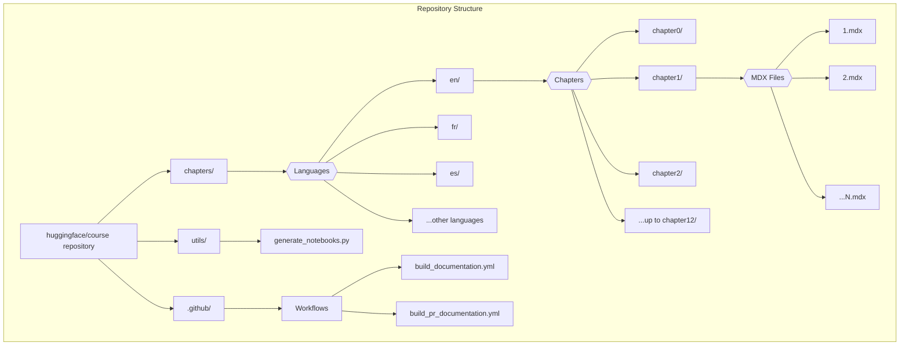
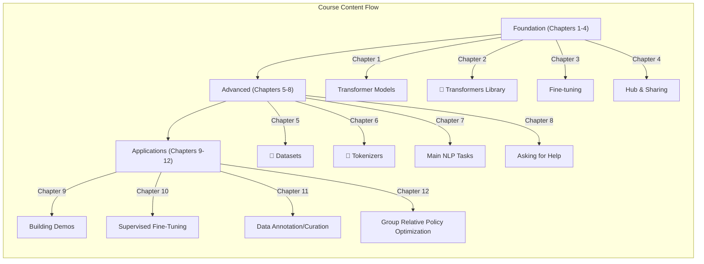
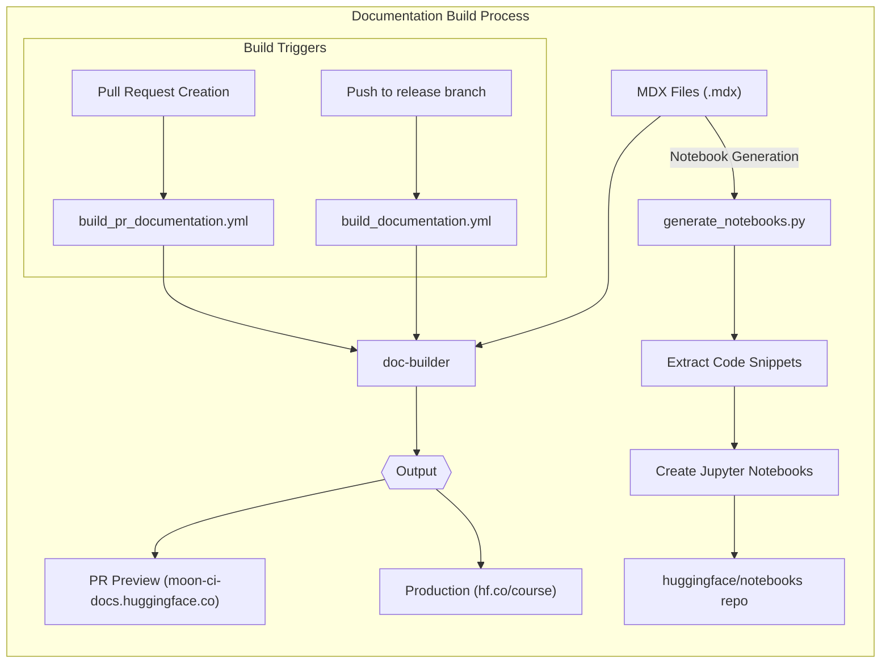
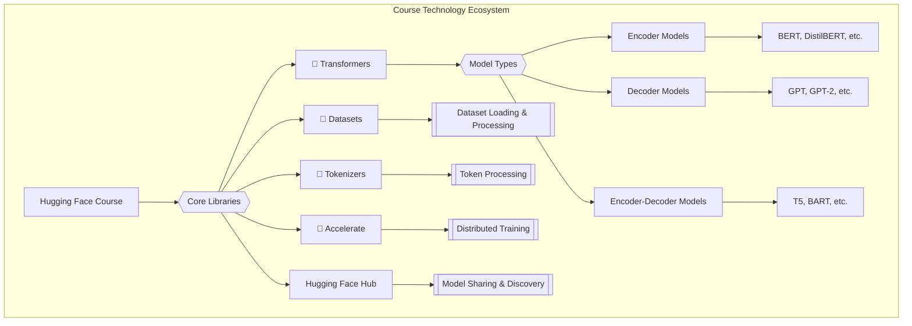

<!-- source: DeepWiki mcp.deepwiki.com · repo huggingface/course · page 1 Hugging Face Course Overview · fetched 2026-10-26 -->

# Hugging Face Course Overview

Relevant source files

The following files were used as context for generating this wiki page:

- [.github/ISSUE_TEMPLATE/translations.md](.github/ISSUE_TEMPLATE/translations.md)
- [README.md](README.md)
- [chapters/en/chapter1/1.mdx](chapters/en/chapter1/1.mdx)
- [chapters/en/chapter1/2.mdx](chapters/en/chapter1/2.mdx)
- [chapters/en/chapter1/4.mdx](chapters/en/chapter1/4.mdx)
- [chapters/en/chapter1/8.mdx](chapters/en/chapter1/8.mdx)
- [chapters/en/chapter1/9.mdx](chapters/en/chapter1/9.mdx)
- [chapters/en/chapter8/4.mdx](chapters/en/chapter8/4.mdx)
- [chapters/en/chapter8/4_tf.mdx](chapters/en/chapter8/4_tf.mdx)
- [chapters/en/chapter8/7.mdx](chapters/en/chapter8/7.mdx)
- [chapters/es/chapter8/1.mdx](chapters/es/chapter8/1.mdx)
- [chapters/es/chapter8/2.mdx](chapters/es/chapter8/2.mdx)
- [chapters/fr/chapter8/4.mdx](chapters/fr/chapter8/4.mdx)
- [chapters/fr/chapter8/4_tf.mdx](chapters/fr/chapter8/4_tf.mdx)
- [chapters/vi/chapter1/1.mdx](chapters/vi/chapter1/1.mdx)
- [chapters/vi/chapter8/4.mdx](chapters/vi/chapter8/4.mdx)
- [utils/generate_notebooks.py](utils/generate_notebooks.py)

This document provides a technical overview of the Hugging Face Course repository, its structure, and how it operates. The course is designed to teach students about the Hugging Face ecosystem, with a focus on large language models (LLMs), natural language processing (NLP), and how to use libraries like 🤗 Transformers, 🤗 Datasets, 🤗 Tokenizers, and 🤗 Accelerate.

## Purpose and Scope

The Hugging Face Course is an open-source educational resource focused on teaching students how to apply Transformer models to various tasks in natural language processing and beyond. The course is completely free and available in multiple languages.

The repository at https://github.com/huggingface/course contains all the content used to build the course website at https://huggingface.co/course. It includes text explanations, code snippets, diagrams, and utilities for generating Jupyter notebooks from the course content.

Sources: [README.md:1-4](). [chapters/en/chapter1/1.mdx:10-14]()

## Repository Structure and Content Organization

### Course Content Organization

The course repository is organized into several main directories:

- `chapters/`: Contains the course content in MDX format, organized by language and chapter
- `utils/`: Contains utility scripts like notebook generators
- `.github/`: Contains GitHub workflows for CI/CD and documentation building

Each language directory in `chapters/` (like `en/`, `fr/`, etc.) contains chapter directories, and each chapter directory contains numbered MDX files representing sections of that chapter.

Sources: [README.md:57-60](), [README.md:117-131]()

### Content Structure and Progression

The course is divided into three main sections:

1. **Foundation (Chapters 1-4)**: Introduction to Transformer models, using the 🤗 Transformers library, fine-tuning, and sharing models on the Hub
2. **Advanced (Chapters 5-8)**: Deeper exploration of 🤗 Datasets and 🤗 Tokenizers, NLP tasks, and troubleshooting
3. **Applications (Chapters 9-12)**: Building demos, advanced fine-tuning techniques, data curation, and reinforcement learning

Sources: [chapters/en/chapter1/1.mdx:33-36](), [README.md:1-4]()

## Multilingual Support

The course is available in multiple languages, with translations managed by community contributors. Each language has its own directory under `chapters/`, with content files that mirror the English versions.

| Language | Status | Directory | Example |
|----------|--------|-----------|---------|
| English | Complete | `chapters/en/` | Original content |
| French | Complete | `chapters/fr/` | Fully translated |
| Vietnamese | Complete | `chapters/vi/` | Fully translated |
| Chinese (simplified) | Complete | `chapters/zh-CN/` | Fully translated |
| Spanish | WIP | `chapters/es/` | In progress |
| German | WIP | `chapters/de/` | In progress |
| ... | ... | ... | ... |

Translation contributions follow a structured process, with new translations submitted via pull requests after the original English content is completed.

Sources: [README.md:5-28](), [README.md:31-115](), [chapters/en/chapter1/1.mdx:115-147]()

## Documentation Building Pipeline

The documentation for the course is built using the `doc-builder` tool from Hugging Face. This process occurs in two main scenarios:

1. **Pull Request Preview**: When a PR is created, the `build_pr_documentation.yml` workflow runs to build a preview version of the documentation, accessible via a temporary URL for review.

2. **Production Build**: When changes are pushed to the `release` branch, the `build_documentation.yml` workflow runs to build the documentation for the production website at `hf.co/course`.

Sources: [README.md:147-163](), [.github/ISSUE_TEMPLATE/translations.md:1-4]()

## Notebook Generation Process

The repository includes a utility script, `generate_notebooks.py`, which extracts code snippets from the MDX files and generates Jupyter notebooks. This allows students to run the code examples interactively.

The notebook generation process:

1. Reads MDX files and extracts code blocks
2. Creates notebook cells for each extracted code block
3. Adds necessary import and setup cells
4. Organizes notebooks by chapter and language
5. Handles framework-specific code (PyTorch vs. TensorFlow)

Generated notebooks are available in the [`huggingface/notebooks`](https://github.com/huggingface/notebooks) repository and can be run in Google Colab or Amazon SageMaker Studio Lab.

Sources: [README.md:117-131](), [utils/generate_notebooks.py:1-290]()

## Core Components and Technology Stack

The course is built around the Hugging Face ecosystem of libraries:

1. **🤗 Transformers**: The main library for working with Transformer models
2. **🤗 Datasets**: For loading, processing, and sharing datasets
3. **🤗 Tokenizers**: For efficient text tokenization
4. **🤗 Accelerate**: For distributed training
5. **Hugging Face Hub**: For sharing and discovering models and datasets

These libraries are integrated throughout the course, with examples showing how to use them for various NLP tasks.

Sources: [chapters/en/chapter1/1.mdx:12-13](), [chapters/en/chapter1/4.mdx:9-169]()

## Model Architectures and Use Cases

The course covers three main types of Transformer architectures:

1. **Encoder-only models** (BERT, DistilBERT, ALBERT, RoBERTa):
   - Used for: Sentence classification, named entity recognition, extractive question answering
   - Focus on understanding input

2. **Decoder-only models** (GPT, GPT-2, CTRL):
   - Used for: Text generation
   - Focus on generating output

3. **Encoder-decoder models** (BART, T5, Marian):
   - Used for: Summarization, translation, generative question answering
   - Combine understanding of input with generation of output

Sources: [chapters/en/chapter1/4.mdx:124-141](), [chapters/en/chapter1/9.mdx:10-16]()

## Contributing to the Course

The repository includes guidelines for contributing, especially for translations. Contributors can:

1. Create a fork of the repository
2. Create new content or translate existing content
3. Submit pull requests
4. Use the `doc-builder` tool to preview changes locally

New translations are managed through GitHub issues, with contributors claiming specific chapters to translate. The community coordinates translation efforts through Discord channels.

Sources: [README.md:31-115](), [.github/ISSUE_TEMPLATE/translations.md:1-107]()

## Conclusion

The Hugging Face Course is a comprehensive educational resource for learning about Transformer models and the Hugging Face ecosystem. The repository is designed to be accessible, multilingual, and community-driven, with tools for building documentation and generating code examples. The course covers a wide range of topics, from the basics of Transformer models to advanced techniques for fine-tuning and building applications.

---

