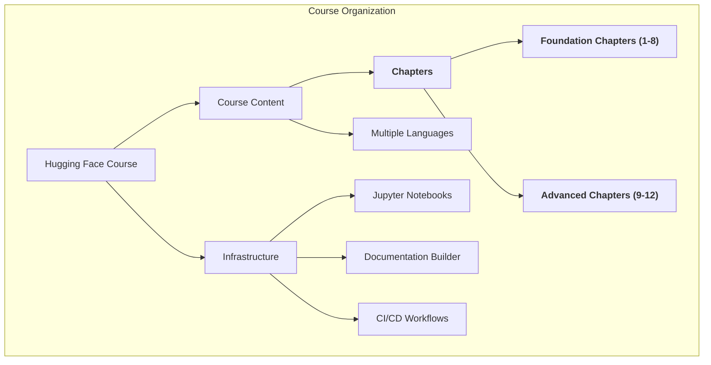
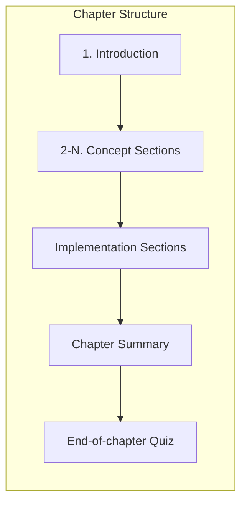
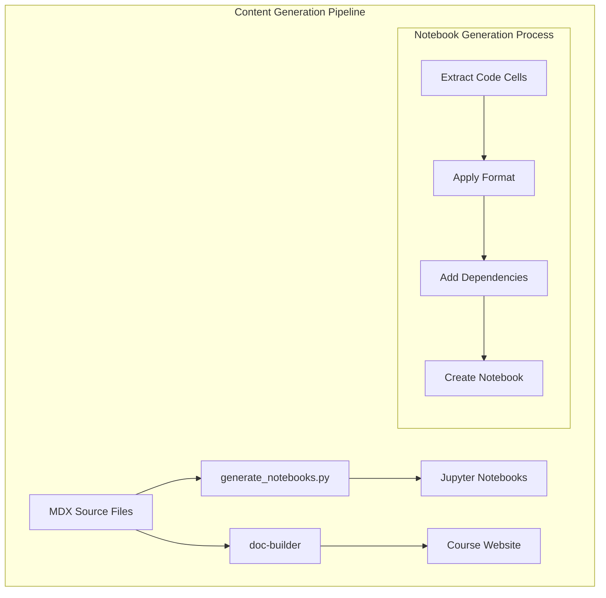
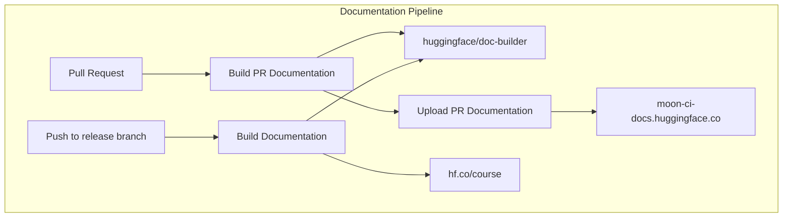

<!-- source: DeepWiki mcp.deepwiki.com · repo huggingface/course · page 2 Course Structure and Organization · fetched 2026-10-26 -->

# Course Structure and Organization

Relevant source files

The following files were used as context for generating this wiki page:

- [.github/ISSUE_TEMPLATE/translations.md](.github/ISSUE_TEMPLATE/translations.md)
- [README.md](README.md)
- [chapters/en/_toctree.yml](chapters/en/_toctree.yml)
- [chapters/en/chapter12/1.mdx](chapters/en/chapter12/1.mdx)
- [chapters/en/chapter12/2.mdx](chapters/en/chapter12/2.mdx)
- [chapters/en/chapter12/3.mdx](chapters/en/chapter12/3.mdx)
- [chapters/en/chapter12/3a.mdx](chapters/en/chapter12/3a.mdx)
- [chapters/en/chapter12/4.mdx](chapters/en/chapter12/4.mdx)
- [chapters/en/chapter12/5.mdx](chapters/en/chapter12/5.mdx)
- [chapters/en/chapter12/6.mdx](chapters/en/chapter12/6.mdx)
- [chapters/en/chapter12/7.mdx](chapters/en/chapter12/7.mdx)
- [chapters/en/chapter12/img/1.png](chapters/en/chapter12/img/1.png)
- [chapters/en/chapter12/img/2.jpg](chapters/en/chapter12/img/2.jpg)
- [chapters/en/chapter8/4.mdx](chapters/en/chapter8/4.mdx)
- [chapters/en/chapter8/4_tf.mdx](chapters/en/chapter8/4_tf.mdx)
- [chapters/en/chapter8/7.mdx](chapters/en/chapter8/7.mdx)
- [chapters/es/chapter8/1.mdx](chapters/es/chapter8/1.mdx)
- [chapters/es/chapter8/2.mdx](chapters/es/chapter8/2.mdx)
- [chapters/fr/chapter8/4.mdx](chapters/fr/chapter8/4.mdx)
- [chapters/fr/chapter8/4_tf.mdx](chapters/fr/chapter8/4_tf.mdx)
- [chapters/pt/_toctree.yml](chapters/pt/_toctree.yml)
- [chapters/pt/chapter1/10.mdx](chapters/pt/chapter1/10.mdx)
- [chapters/pt/chapter1/4.mdx](chapters/pt/chapter1/4.mdx)
- [chapters/pt/chapter1/5.mdx](chapters/pt/chapter1/5.mdx)
- [chapters/pt/chapter1/6.mdx](chapters/pt/chapter1/6.mdx)
- [chapters/pt/chapter1/7.mdx](chapters/pt/chapter1/7.mdx)
- [chapters/pt/chapter1/8.mdx](chapters/pt/chapter1/8.mdx)
- [chapters/pt/chapter1/9.mdx](chapters/pt/chapter1/9.mdx)
- [chapters/pt/chapter4/3.mdx](chapters/pt/chapter4/3.mdx)
- [chapters/pt/chapter6/1.mdx](chapters/pt/chapter6/1.mdx)
- [chapters/pt/chapter6/2.mdx](chapters/pt/chapter6/2.mdx)
- [chapters/pt/chapter6/3.mdx](chapters/pt/chapter6/3.mdx)
- [chapters/vi/chapter8/4.mdx](chapters/vi/chapter8/4.mdx)
- [utils/generate_notebooks.py](utils/generate_notebooks.py)

This document provides an overview of the Hugging Face course structure, organization, and content flow. It explains how the course is organized into chapters, the progression of topics, and how different components work together. For information about multilingual support and translations, see [Multilingual Support](#2.1).

## Course Overview

The Hugging Face course is a comprehensive educational resource designed to teach users how to apply Transformer models to various tasks in natural language processing and beyond. The course is structured to provide a progressive learning path, beginning with foundational concepts and advancing to more complex applications.

Sources: [README.md:1-46](). [chapters/en/_toctree.yml:1-251]()

## Chapter Organization

The course is organized into 12 chapters plus supplementary materials. Each chapter focuses on a specific aspect of Transformer models, libraries, or applications and follows a structured organization.

### Foundation Chapters (1-8)

The foundation chapters cover the essential concepts and tools needed to understand and work with Transformer models:

| Chapter | Title | Focus |
|---------|-------|-------|
| 1 | Transformer models | Understanding the core architecture and capabilities |
| 2 | Using 🤗 Transformers | Getting started with the primary library |
| 3 | Fine-tuning a pretrained model | Adapting models to specific tasks |
| 4 | Sharing models and tokenizers | Using and contributing to the Hub |
| 5 | The 🤗 Datasets library | Working with datasets efficiently |
| 6 | The 🤗 Tokenizers library | Understanding and customizing tokenization |
| 7 | Classical NLP tasks | Applying models to common NLP problems |
| 8 | How to ask for help | Debugging and community resources |

### Advanced Chapters (9-12)

The advanced chapters build on the foundation to explore more complex applications and techniques:

| Chapter | Title | Focus |
|---------|-------|-------|
| 9 | Building and sharing demos | Creating interactive demos with Gradio |
| 10 | Curate high-quality datasets | Data annotation and curation with Argilla |
| 11 | Fine-tune Large Language Models | SFT and Low-Rank Adaptation techniques |
| 12 | Build Reasoning Models | Group Relative Policy Optimization (GRPO) |

Sources: [chapters/en/_toctree.yml:1-251](). [README.md:1-46]()

## Section Structure

Each chapter is divided into multiple sections, typically following this pattern:

Sections are delivered as MDX files (Markdown with JSX components), which allow for interactive elements, executable code snippets, and embedded media. Each section generally includes:

- Explanatory text with concepts and theory
- Code examples that can be copied and run
- Interactive elements (when viewed on the website)
- Visual diagrams and illustrations
- Practical application tips

Sources: [chapters/en/_toctree.yml:1-251](). [chapters/en/chapter12/1.mdx:1-94](). [chapters/en/chapter12/2.mdx:1-246]()

## Content Formats and Generation

The course content exists in multiple formats to accommodate different learning preferences:

### MDX Source Files

The primary content is authored in MDX format, which combines Markdown with JSX components for enhanced interactivity.

### Jupyter Notebooks

Jupyter notebooks are automatically generated from the MDX source files, allowing learners to execute code examples directly.

The notebook generation process:
1. Extracts code cells from MDX files
2. Applies proper formatting
3. Adds necessary dependencies (libraries like transformers, datasets)
4. Creates executable Jupyter notebooks

Sources: [utils/generate_notebooks.py:1-291](). [README.md:117-131]()

## Documentation Building and Deployment

The course website is built using a documentation builder that processes the MDX files:

The documentation process includes:
1. Building PR previews for review
2. Building the main documentation on release
3. Deploying to the Hugging Face course website

Sources: [README.md:147-165]()

## Learning Pathways

The course is designed to support multiple learning pathways depending on the learner's interests and goals:

### Foundation Path
For those new to Transformers, following chapters 1-8 in sequence provides a comprehensive understanding of the core concepts and libraries.

### Task-Specific Paths
Learners can focus on specific NLP tasks by studying:
- Chapter 1 for understanding the architecture
- Chapter 2 for basic usage
- Chapter 3 for fine-tuning
- Chapter 7 for the specific task of interest

### Advanced Applications Path
For those interested in building and deploying models:
- Chapters 1-4 for core concepts
- Chapter 9 for creating demos
- Chapter 10 for dataset curation
- Chapter 11-12 for advanced fine-tuning techniques

Sources: [chapters/en/_toctree.yml:1-251]()

## Practical Exercises and Quizzes

Each chapter includes practical exercises throughout the sections and concludes with a quiz to test understanding:

1. **In-chapter exercises**: Marked with "Your turn!" prompts for hands-on practice
2. **End-of-chapter quizzes**: Multiple-choice questions testing comprehension
3. **Practical projects**: More extensive exercises, especially in advanced chapters

The advanced chapters (11-12) feature comprehensive practical exercises like fine-tuning models with GRPO (Group Relative Policy Optimization).

Sources: [chapters/en/chapter12/5.mdx:1-238](). [chapters/en/chapter12/6.mdx:1-378](). [chapters/en/chapter8/7.mdx:1-205]()

## Course Materials and Resources

The course leverages various types of materials to enhance the learning experience:

1. **Explanatory text**: Core concepts and theory
2. **Code snippets**: Practical implementation examples
3. **Diagrams**: Visual representations of architectures and workflows
4. **Jupyter notebooks**: Interactive environments for code execution
5. **Sample applications**: Working examples of model usage
6. **Community forums**: Spaces for questions and discussion

Sources: [README.md:1-169](). [chapters/en/_toctree.yml:1-251]()

## Course Updates and Maintenance

The course is actively maintained and updated with new content:

1. New chapters are added to cover emerging techniques (like chapter 12 on reasoning models)
2. Existing chapters are updated to reflect library changes
3. Community contributions and translations expand the reach
4. Course events provide additional learning opportunities

The most recent updates are typically marked with a "new" tag in the table of contents.

Sources: [chapters/en/_toctree.yml:231-250](). [chapters/en/chapter12/7.mdx:1-17]()

## Conclusion

The Hugging Face course provides a structured learning path from foundational concepts to advanced applications of Transformer models. Through its progressive chapter organization, multilingual support, and various content formats, it accommodates different learning styles and objectives. The course continues to evolve with new chapters and updates that reflect the latest developments in the field.

---

