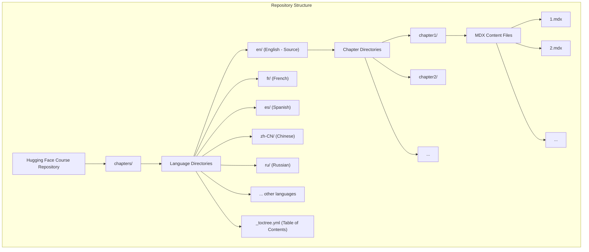
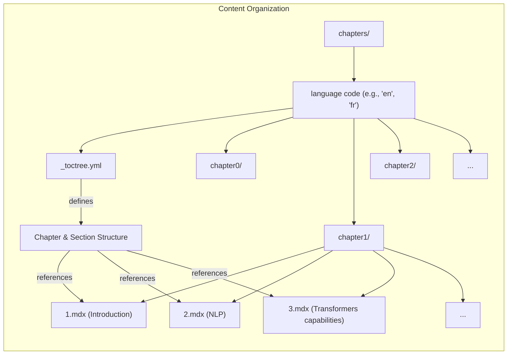
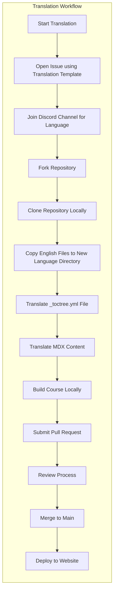
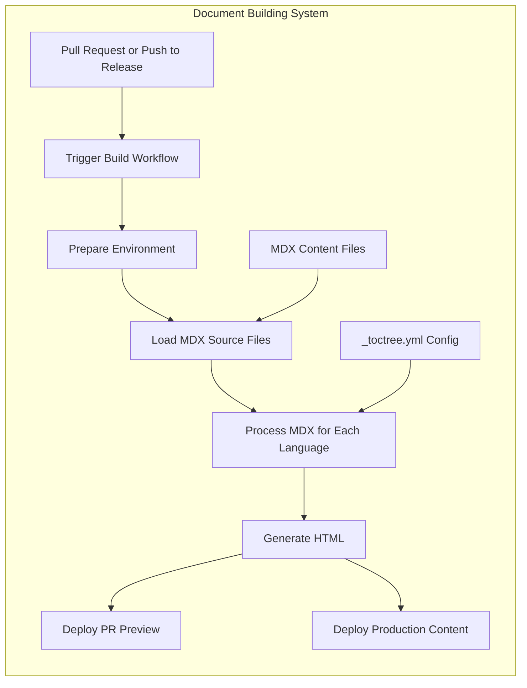
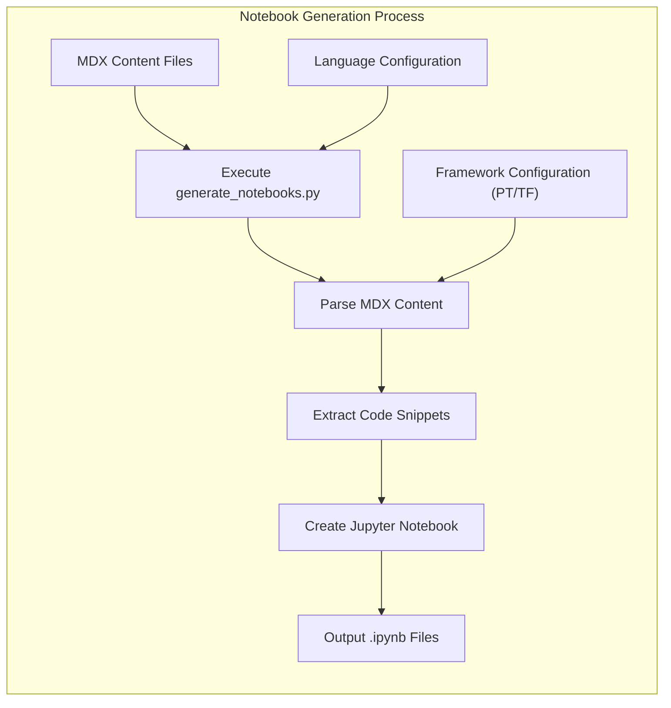

<!-- source: DeepWiki mcp.deepwiki.com · repo huggingface/course · page 2.1 Multilingual Support · fetched 2026-10-26 -->

# Multilingual Support

<details>
<summary>Relevant source files</summary>

The following files were used as context for generating this wiki page:

- [.github/ISSUE_TEMPLATE/translations.md](.github/ISSUE_TEMPLATE/translations.md)
- [.github/workflows/quality.yml](.github/workflows/quality.yml)
- [README.md](README.md)
- [chapters/en/chapter8/4.mdx](chapters/en/chapter8/4.mdx)
- [chapters/en/chapter8/4_tf.mdx](chapters/en/chapter8/4_tf.mdx)
- [chapters/en/chapter8/7.mdx](chapters/en/chapter8/7.mdx)
- [chapters/es/TRANSLATING.txt](chapters/es/TRANSLATING.txt)
- [chapters/es/_toctree.yml](chapters/es/_toctree.yml)
- [chapters/es/chapter0/1.mdx](chapters/es/chapter0/1.mdx)
- [chapters/es/chapter1/10.mdx](chapters/es/chapter1/10.mdx)
- [chapters/es/chapter2/4.mdx](chapters/es/chapter2/4.mdx)
- [chapters/es/chapter2/5.mdx](chapters/es/chapter2/5.mdx)
- [chapters/es/chapter2/6.mdx](chapters/es/chapter2/6.mdx)
- [chapters/es/chapter3/1.mdx](chapters/es/chapter3/1.mdx)
- [chapters/es/chapter3/3.mdx](chapters/es/chapter3/3.mdx)
- [chapters/es/chapter3/3_tf.mdx](chapters/es/chapter3/3_tf.mdx)
- [chapters/es/chapter3/4.mdx](chapters/es/chapter3/4.mdx)
- [chapters/es/chapter3/5.mdx](chapters/es/chapter3/5.mdx)
- [chapters/es/chapter3/6.mdx](chapters/es/chapter3/6.mdx)
- [chapters/es/chapter8/1.mdx](chapters/es/chapter8/1.mdx)
- [chapters/es/chapter8/2.mdx](chapters/es/chapter8/2.mdx)
- [chapters/es/glossary/1.mdx](chapters/es/glossary/1.mdx)
- [chapters/fr/chapter8/4.mdx](chapters/fr/chapter8/4.mdx)
- [chapters/fr/chapter8/4_tf.mdx](chapters/fr/chapter8/4_tf.mdx)
- [chapters/ja/_toctree.yml](chapters/ja/_toctree.yml)
- [chapters/ja/chapter2/1.mdx](chapters/ja/chapter2/1.mdx)
- [chapters/ja/chapter2/2.mdx](chapters/ja/chapter2/2.mdx)
- [chapters/ja/chapter2/3.mdx](chapters/ja/chapter2/3.mdx)
- [chapters/ja/chapter2/4.mdx](chapters/ja/chapter2/4.mdx)
- [chapters/ja/chapter2/5.mdx](chapters/ja/chapter2/5.mdx)
- [chapters/ru/_toctree.yml](chapters/ru/_toctree.yml)
- [chapters/ru/chapter2/1.mdx](chapters/ru/chapter2/1.mdx)
- [chapters/ru/chapter2/2.mdx](chapters/ru/chapter2/2.mdx)
- [chapters/ru/chapter2/3.mdx](chapters/ru/chapter2/3.mdx)
- [chapters/ru/chapter2/4.mdx](chapters/ru/chapter2/4.mdx)
- [chapters/ru/chapter2/5.mdx](chapters/ru/chapter2/5.mdx)
- [chapters/ru/chapter2/6.mdx](chapters/ru/chapter2/6.mdx)
- [chapters/ru/chapter2/7.mdx](chapters/ru/chapter2/7.mdx)
- [chapters/ru/chapter2/8.mdx](chapters/ru/chapter2/8.mdx)
- [chapters/vi/chapter8/4.mdx](chapters/vi/chapter8/4.mdx)
- [utils/generate_notebooks.py](utils/generate_notebooks.py)

</details>


This page documents how the Hugging Face course is translated and maintained across multiple languages, enabling a global audience to access educational materials on machine learning and Natural Language Processing (NLP). The multilingual support system ensures consistency across translations while accommodating the unique characteristics of each language.

## Overview

The Hugging Face course is designed with internationalization as a core principle. The course's repository structure, build processes, and contribution workflows all support multiple languages, allowing the community to collaborate on translations. Currently, the course is available in several languages, with more being added through community contributions.



Sources: [README.md:5-32](), [utils/generate_notebooks.py:23-26]()

## Available Languages

The course is currently available in multiple languages, with varying levels of completion. The English version serves as the source content, while other languages are translated from it.

| Language | Status | Repository Path |
|----------|--------|-----------------|
| English | Complete | `chapters/en/` |
| French | Complete | `chapters/fr/` |
| Vietnamese | Complete | `chapters/vi/` |
| Chinese (simplified) | Complete | `chapters/zh-CN/` |
| Spanish | In Progress | `chapters/es/` |
| Russian | In Progress | `chapters/ru/` |
| Japanese | In Progress | `chapters/ja/` |
| German | In Progress | `chapters/de/` |
| Portuguese | In Progress | `chapters/pt/` |
| ... | ... | ... |

Many more languages are in various stages of translation, including Bengali, Persian, Gujarati, Hebrew, Hindi, Indonesian, Italian, Korean, Thai, Turkish, and traditional Chinese.

Sources: [README.md:7-28]()

## Content Organization

Each language version has an identical structure, mirroring the English source content. This ensures that readers can easily navigate between languages while maintaining their place in the course.

### Directory Structure



Sources: [chapters/ru/_toctree.yml:1-204](), [chapters/es/_toctree.yml:1-120](), [chapters/ja/_toctree.yml:1-93]()

### Table of Contents

Each language has a `_toctree.yml` file that defines the course structure. This file specifies:

- Chapter titles and organization
- Section titles and corresponding MDX files
- Quiz locations and identifiers
- Framework-specific content variants (PyTorch/TensorFlow)

The table of contents serves as the structural backbone for rendering the course website and ensures consistent navigation across all language versions.

Sources: [chapters/ru/_toctree.yml:1-204](), [chapters/es/_toctree.yml:1-120](), [chapters/ja/_toctree.yml:1-93]()

## Translation Workflow

Contributing to the translation of the course follows a structured process designed to ensure quality and consistency.



Sources: [README.md:31-115](), [.github/ISSUE_TEMPLATE/translations.md:1-107]()

### Starting a Translation

1. **Open an Issue**: Begin by creating an issue using the translation template, specifying which language you want to translate to and which chapters you'll work on.
2. **Join Discord**: Connect with other translators for your language in the dedicated Discord channel.
3. **Fork & Clone**: Fork the repository and clone it locally to start working.

### Translation Process

1. **Copy Source Files**: Copy the English files from `chapters/en/` to your language directory (e.g., `chapters/es/`).
2. **Translate TOC**: Start by translating the `_toctree.yml` file to establish the chapter and section structure.
3. **Translate Content**: Translate the MDX files, maintaining all code blocks, special syntax, and formatting.
4. **Local Testing**: Build the course locally to test your changes.

### Review and Publishing

1. **Submit PR**: Once a section or chapter is translated, submit a pull request.
2. **Review**: Native speakers review the translation for accuracy and clarity.
3. **Merge**: After approval, changes are merged to the main branch.
4. **Deployment**: Translated content is automatically built and deployed to the course website.

Sources: [README.md:31-115](), [.github/ISSUE_TEMPLATE/translations.md:1-107](), [chapters/es/TRANSLATING.txt:1-45]()

## Technical Implementation

The multilingual support system is built on several key components that work together to handle content in different languages.

### Document Building Process



Sources: [README.md:88-102](), [README.md:147-164]()

### Notebook Generation

The course automatically generates Jupyter notebooks from the MDX content files for each language (except for French, which has manually created notebooks). This process extracts code snippets and creates executable notebooks that learners can use.



Sources: [utils/generate_notebooks.py:1-291](), [README.md:117-131]()

## Translation Guidelines

Each language has specific guidelines to ensure consistency across translations. These guidelines typically cover:

1. **Terminology**: Standard translations for technical terms
2. **Style**: Voice, formality level, and cultural adaptations
3. **Formatting**: How to handle code blocks, special characters, and layout
4. **Diagrams and Images**: Instructions for translating or adapting visual elements

Translators are encouraged to use the glossary specific to their language when available, to maintain consistent terminology throughout the course.

Sources: [chapters/es/TRANSLATING.txt:1-45](), [chapters/es/glossary/1.mdx:1-100]()

## Framework-Specific Content

The course supports both PyTorch and TensorFlow, with some content varying depending on the framework. This is handled in the MDX files using special syntax:

```
{#if fw === 'pt'}
PyTorch-specific content
{:else}
TensorFlow-specific content
{/if}
```

During the build process, this generates separate content for each framework while maintaining a single source file. The notebook generation process also creates framework-specific notebooks when necessary.

Sources: [chapters/ru/chapter2/2.mdx:1-354](), [utils/generate_notebooks.py:10-12](), [utils/generate_notebooks.py:173-190]()

## Quality Assurance

To ensure high-quality translations, several processes are in place:

1. **Review Process**: Pull requests for translations are reviewed by native speakers
2. **Style Checks**: Automated checks ensure formatting is consistent
3. **Build Testing**: Continuous integration validates that translated content builds correctly
4. **Community Feedback**: Readers can provide feedback on translations through GitHub issues

Quality checks run on every pull request to verify that the content meets the project's standards before merging.

Sources: [.github/workflows/quality.yml:1-22]()

## Contributing to Translations

New translators are always welcome to contribute to the project. The recommended workflow for new translators is:

1. Check the README for already supported languages and their status
2. Open an issue using the translation template if starting a new language
3. Join the Discord server to coordinate with other translators
4. Start with small sections (e.g., chapter introductions) to get familiar with the process
5. Submit regular, small pull requests rather than large ones

For detailed instructions on contributing to translations, refer to the "Translating the course into your language" section in the README.

Sources: [README.md:31-115](), [.github/ISSUE_TEMPLATE/translations.md:1-107]()

---

