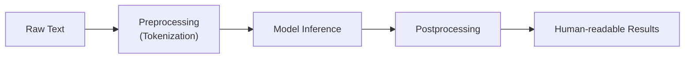
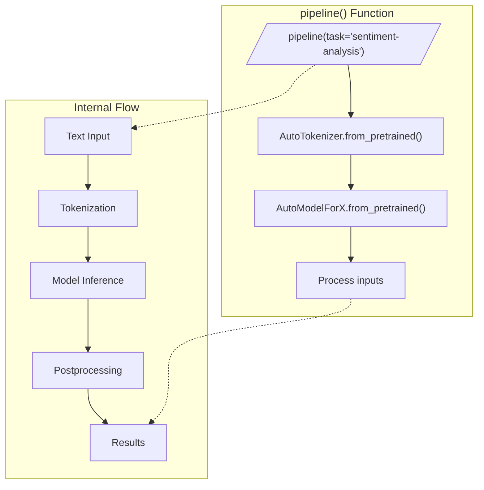
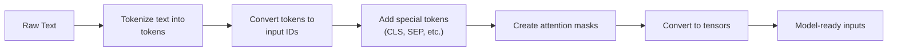

<!-- source: DeepWiki mcp.deepwiki.com · repo huggingface/course · page 3.1 The pipeline() Function · fetched 2026-10-26 -->

# The pipeline() Function

<details>
<summary>Relevant source files</summary>

The following files were used as context for generating this wiki page:

- [.github/workflows/quality.yml](.github/workflows/quality.yml)
- [chapters/it/_toctree.yml](chapters/it/_toctree.yml)
- [chapters/it/chapter1/10.mdx](chapters/it/chapter1/10.mdx)
- [chapters/it/chapter1/2.mdx](chapters/it/chapter1/2.mdx)
- [chapters/it/chapter1/3.mdx](chapters/it/chapter1/3.mdx)
- [chapters/it/chapter2/3.mdx](chapters/it/chapter2/3.mdx)
- [chapters/it/chapter2/4.mdx](chapters/it/chapter2/4.mdx)
- [chapters/it/chapter2/5.mdx](chapters/it/chapter2/5.mdx)
- [chapters/it/chapter2/6.mdx](chapters/it/chapter2/6.mdx)
- [chapters/it/chapter2/7.mdx](chapters/it/chapter2/7.mdx)
- [chapters/ja/_toctree.yml](chapters/ja/_toctree.yml)
- [chapters/ja/chapter2/1.mdx](chapters/ja/chapter2/1.mdx)
- [chapters/ja/chapter2/2.mdx](chapters/ja/chapter2/2.mdx)
- [chapters/ja/chapter2/3.mdx](chapters/ja/chapter2/3.mdx)
- [chapters/ja/chapter2/4.mdx](chapters/ja/chapter2/4.mdx)
- [chapters/ja/chapter2/5.mdx](chapters/ja/chapter2/5.mdx)
- [chapters/th/chapter1/3.mdx](chapters/th/chapter1/3.mdx)

</details>


The `pipeline()` function is the cornerstone of the 🤗 Transformers library, providing a simple yet powerful interface for running inference with transformer models. This function encapsulates the complete NLP workflow - from text preprocessing to prediction generation - into a single callable object, allowing users to immediately start using state-of-the-art models with minimal code.

This page details how the `pipeline()` function works, its capabilities, and various ways to use it for different NLP tasks. For information about the underlying models that power these pipelines, see [AutoModel and AutoTokenizer Classes](#3.2).

## Purpose and Architecture

The `pipeline()` function bridges the gap between raw text and model predictions by automating three essential steps:

1. **Preprocessing**: Converting text into numeric representations (tokens and IDs)
2. **Model inference**: Passing these representations through a transformer model
3. **Postprocessing**: Converting model outputs back into human-readable results



Sources: chapters/it/chapter1/3.mdx, chapters/ja/chapter2/2.mdx, chapters/th/chapter1/3.mdx

### Behind the Pipeline

Under the hood, the `pipeline()` function automatically:

1. **Loads appropriate components**: Selects and instantiates the right model and tokenizer
2. **Handles batching**: Processes multiple inputs efficiently
3. **Manages device placement**: Utilizes GPU when available
4. **Applies sensible defaults**: Sets reasonable parameter values for each task



Sources: chapters/ja/chapter2/2.mdx, chapters/it/chapter1/3.mdx

## Available Tasks

The `pipeline()` function supports a variety of NLP tasks, each corresponding to a specific transformer model capability:

| Task Type | Pipeline Name | Description | Output Format |
|-----------|---------------|-------------|--------------|
| Text Classification | `sentiment-analysis` | Analyzes the sentiment of text | `[{'label': 'POSITIVE/NEGATIVE', 'score': float}]` |
| Text Classification | `zero-shot-classification` | Classifies text with user-defined labels | `{'labels': [str], 'scores': [float]}` |
| Token Classification | `ner` (Named Entity Recognition) | Identifies entities (people, organizations, locations) | `[{'entity': str, 'score': float, 'word': str, 'start': int, 'end': int}]` |
| Question Answering | `question-answering` | Extracts answers from context | `{'score': float, 'start': int, 'end': int, 'answer': str}` |
| Text Generation | `text-generation` | Completes or generates text from a prompt | `[{'generated_text': str}]` |
| Summarization | `summarization` | Creates shorter versions of text | `[{'summary_text': str}]` |
| Translation | `translation_xx_to_yy` | Translates text between languages | `[{'translation_text': str}]` |
| Fill-Mask | `fill-mask` | Fills in masked words in text | `[{'sequence': str, 'score': float, 'token': int, 'token_str': str}]` |

Sources: chapters/it/chapter1/3.mdx, chapters/th/chapter1/3.mdx

## Basic Usage

Using the `pipeline()` function typically follows this simple pattern:

1. Import the function
2. Initialize a pipeline for your desired task
3. Pass your input text to the pipeline

Here's how to use the `pipeline()` function for sentiment analysis:

```python
from transformers import pipeline

# Initialize a pipeline for sentiment analysis
classifier = pipeline("sentiment-analysis")

# Analyze a single text
result = classifier("I've been waiting for a HuggingFace course my whole life.")
# Output: [{'label': 'POSITIVE', 'score': 0.9598047137260437}]

# Analyze multiple texts
results = classifier([
    "I've been waiting for a HuggingFace course my whole life.",
    "I hate this so much!"
])
# Output: [{'label': 'POSITIVE', 'score': 0.9598047}, {'label': 'NEGATIVE', 'score': 0.9994558}]
```

Sources: chapters/it/chapter1/3.mdx, chapters/th/chapter1/3.mdx

## Pipeline Examples by Task

Let's explore how to use various pipeline types for different NLP tasks.

### Zero-shot Classification

This pipeline allows you to classify text with your own custom labels, without requiring any training:

```python
from transformers import pipeline

classifier = pipeline("zero-shot-classification")
result = classifier(
    "This is a course about the Transformers library",
    candidate_labels=["education", "politics", "business"]
)
# Output: {'sequence': '...', 'labels': ['education', 'business', 'politics'], 
#          'scores': [0.8445, 0.1119, 0.0434]}
```

Sources: chapters/it/chapter1/3.mdx, chapters/th/chapter1/3.mdx

### Text Generation

Generate text from a prompt:

```python
from transformers import pipeline

generator = pipeline("text-generation")
result = generator("In this course, we will teach you how to")
# Output: [{'generated_text': 'In this course, we will teach you how to understand and use...'}]

# Control number of sequences and maximum length
result = generator(
    "In this course, we will teach you how to",
    max_length=30,
    num_return_sequences=2
)
```

Sources: chapters/it/chapter1/3.mdx, chapters/th/chapter1/3.mdx

### Named Entity Recognition

Identify named entities in text:

```python
from transformers import pipeline

ner = pipeline("ner", grouped_entities=True)
result = ner("My name is Sylvain and I work at Hugging Face in Brooklyn.")
# Output: [{'entity_group': 'PER', 'score': 0.99816, 'word': 'Sylvain', 'start': 11, 'end': 18}, 
#          {'entity_group': 'ORG', 'score': 0.97960, 'word': 'Hugging Face', 'start': 33, 'end': 45}, 
#          {'entity_group': 'LOC', 'score': 0.99321, 'word': 'Brooklyn', 'start': 49, 'end': 57}]
```

The `grouped_entities=True` parameter enables the pipeline to group tokens that belong to the same entity, such as "Hugging" and "Face" being recognized as a single organization.

Sources: chapters/it/chapter1/3.mdx, chapters/th/chapter1/3.mdx

### Question Answering

Extract answers from a context:

```python
from transformers import pipeline

question_answerer = pipeline("question-answering")
result = question_answerer(
    question="Where do I work?",
    context="My name is Sylvain and I work at Hugging Face in Brooklyn"
)
# Output: {'score': 0.6385916471481323, 'start': 33, 'end': 45, 'answer': 'Hugging Face'}
```

Sources: chapters/it/chapter1/3.mdx, chapters/th/chapter1/3.mdx

### Summarization

Create concise summaries of longer texts:

```python
from transformers import pipeline

summarizer = pipeline("summarization")
result = summarizer("""
    America has changed dramatically during recent years. Not only has the number of 
    graduates in traditional engineering disciplines such as mechanical, civil, 
    electrical, chemical, and aeronautical engineering declined, but in most of 
    the premier American universities engineering curricula now concentrate on 
    and encourage largely the study of engineering science. As a result, there 
    are declining offerings in engineering subjects dealing with infrastructure, 
    the environment, and related issues, and greater concentration on high 
    technology subjects, largely supporting increasingly complex scientific 
    developments. While the latter is important, it should not be at the expense 
    of more traditional engineering.

    Rapidly developing economies such as China and India, as well as other 
    industrial countries in Europe and Asia, continue to encourage and advance 
    the teaching of engineering. Both China and India, respectively, graduate 
    six and eight times as many traditional engineers as does the United States. 
    Other industrial countries at minimum maintain their output, while America 
    suffers an increasingly serious decline in the number of engineering graduates 
    and a lack of well-educated engineers.
""")
# Output: [{'summary_text': 'America has changed dramatically during recent years. The number...'}]
```

Sources: chapters/it/chapter1/3.mdx, chapters/th/chapter1/3.mdx

### Fill-Mask

Complete text with masked words:

```python
from transformers import pipeline

unmasker = pipeline("fill-mask")
result = unmasker("This course will teach you all about <mask> models.", top_k=2)
# Output: [{'sequence': '...', 'score': 0.1961, 'token': 30412, 'token_str': ' mathematical'},
#          {'sequence': '...', 'score': 0.0405, 'token': 38163, 'token_str': ' computational'}]
```

Note that each model may use different mask tokens. For BERT models, the mask token is typically `[MASK]`.

Sources: chapters/it/chapter1/3.mdx, chapters/th/chapter1/3.mdx

### Translation

Translate text between languages:

```python
from transformers import pipeline

translator = pipeline("translation", model="Helsinki-NLP/opus-mt-fr-en")
result = translator("Ce cours est produit par Hugging Face.")
# Output: [{'translation_text': 'This course is produced by Hugging Face.'}]
```

Sources: chapters/it/chapter1/3.mdx, chapters/th/chapter1/3.mdx

## Using Custom Models with Pipeline

While each pipeline has a default model, you can specify any compatible model from the Hugging Face Model Hub:

```python
from transformers import pipeline

# Use a specific model for text generation
generator = pipeline("text-generation", model="distilgpt2")
result = generator(
    "In this course, we will teach you how to",
    max_length=30,
    num_return_sequences=2
)
```

This allows you to leverage specialized models tailored for specific domains, languages, or performance characteristics.

Sources: chapters/it/chapter1/3.mdx, chapters/th/chapter1/3.mdx

## Technical Implementation Details

Under the hood, the `pipeline()` function performs several important steps:

```mermaid
sequenceDiagram
    participant User
    participant Pipeline as "pipeline()"
    participant AutoTokenizer as "AutoTokenizer"
    participant AutoModel as "AutoModel"
    participant Processor as "Postprocessor"

    User->>Pipeline: Call with text input
    Pipeline->>AutoTokenizer: from_pretrained(checkpoint)
    AutoTokenizer->>Pipeline: tokenizer
    Pipeline->>AutoModel: from_pretrained(checkpoint)
    AutoModel->>Pipeline: model
    
    User->>Pipeline: __call__(text)
    Pipeline->>AutoTokenizer: Tokenize text
    AutoTokenizer->>Pipeline: input_ids, attention_mask
    Pipeline->>AutoModel: Forward pass
    AutoModel->>Pipeline: model_outputs
    Pipeline->>Processor: Process outputs
    Processor->>Pipeline: human_readable_results
    Pipeline->>User: Return results

    classDef default font-size:14px;
```

Sources: chapters/ja/chapter2/2.mdx, chapters/it/chapter2/3.mdx, chapters/it/chapter2/4.mdx

### Step 1: Tokenization

The tokenizer converts raw text into a format the model can understand:

1. **Text splitting**: Divides text into tokens (words, subwords, or characters)
2. **ID conversion**: Maps tokens to their corresponding numeric IDs
3. **Special tokens**: Adds model-specific tokens like `[CLS]`, `[SEP]`, or `[MASK]`
4. **Attention mask**: Creates masks to indicate which tokens are padding
5. **Tensor conversion**: Converts lists to tensors in the appropriate framework format



Sources: chapters/ja/chapter2/4.mdx, chapters/it/chapter2/4.mdx, chapters/ja/chapter2/2.mdx

### Step 2: Model Inference

The numeric inputs are passed through the model to obtain predictions:

1. **Input handling**: Processes input IDs and attention masks
2. **Forward pass**: Runs inputs through transformer layers
3. **Hidden states**: Produces contextualized representations
4. **Task-specific head**: Converts hidden states to task-specific outputs

Sources: chapters/ja/chapter2/3.mdx, chapters/it/chapter2/3.mdx, chapters/ja/chapter2/2.mdx

### Step 3: Postprocessing

Model outputs are converted to human-readable format:

1. **Interpretation**: Converts logits or hidden states to meaningful values
2. **Formatting**: Structures the output according to the task
3. **Decoding**: For generative tasks, converts IDs back to text

Sources: chapters/ja/chapter2/2.mdx, chapters/it/chapter2/6.mdx

## Advanced Pipeline Usage

The `pipeline()` function offers several advanced features for more complex use cases.

### Handling Multiple Sequences and Batching

The pipeline automatically handles batching for multiple input sequences:

```python
from transformers import pipeline

classifier = pipeline("sentiment-analysis")
results = classifier([
    "I've been waiting for a HuggingFace course my whole life.",
    "I hate this so much!"
])
```

Sources: chapters/ja/chapter2/5.mdx, chapters/it/chapter2/5.mdx

### Padding and Truncation

When dealing with sequences of different lengths, the pipeline handles padding and truncation:

```python
from transformers import pipeline

classifier = pipeline("text-classification")

# Pad sequences to the length of the longest sequence
results = classifier(sequences, padding="longest")

# Pad sequences to the maximum model length
results = classifier(sequences, padding="max_length")

# Truncate sequences longer than the model's maximum length
results = classifier(sequences, truncation=True)

# Specify a custom max length
results = classifier(sequences, max_length=128, truncation=True)
```

Sources: chapters/ja/chapter2/5.mdx, chapters/it/chapter2/5.mdx, chapters/it/chapter2/6.mdx

### Framework-Specific Tensors

You can specify which deep learning framework's tensors to return:

```python
from transformers import pipeline

classifier = pipeline("text-classification")

# Return PyTorch tensors
results = classifier(sequences, padding=True, return_tensors="pt")

# Return TensorFlow tensors
results = classifier(sequences, padding=True, return_tensors="tf")

# Return NumPy arrays
results = classifier(sequences, padding=True, return_tensors="np")
```

Sources: chapters/it/chapter2/6.mdx

## The Inference API Alternative

For quick testing without installing any libraries, the Hugging Face website provides an Inference API that you can use directly in your browser:

1. Visit [huggingface.co/models](https://huggingface.co/models)
2. Search for a model
3. Use the model's widget interface to test inputs

This API is also available as a paid service for production workloads.

Sources: chapters/it/chapter1/3.mdx, chapters/th/chapter1/3.mdx

## Limitations and Considerations

When using the `pipeline()` function, consider these limitations:

1. **Sequence length**: Most models have a maximum sequence length (typically 512 or 1024 tokens). Longer sequences need to be truncated.
2. **Memory usage**: Large models may require significant RAM or GPU memory, especially with large batch sizes.
3. **Computation time**: More parameters generally means longer inference time.
4. **Task-specific limitations**: Some tasks might require fine-tuning for domain-specific applications.

Sources: chapters/ja/chapter2/5.mdx

## Conclusion

The `pipeline()` function serves as an excellent entry point to the Hugging Face Transformers ecosystem, allowing users to quickly apply state-of-the-art models to various NLP tasks with minimal code. For more advanced usage or performance optimization, you may want to explore the underlying components: the tokenizers and models that power these pipelines.

For more detailed information on working directly with tokenizers and models, see [AutoModel and AutoTokenizer Classes](#3.2) and [The 🤗 Tokenizers Library](#3.3).

---

