<!-- source: DeepWiki mcp.deepwiki.com · repo huggingface/course · page 4 Fine-tuning Transformer Models · fetched 2026-10-26 -->

# Fine-tuning Transformer Models

Relevant source files

The following files were used as context for generating this wiki page:

- [chapters/de/chapter3/3_tf.mdx](chapters/de/chapter3/3_tf.mdx)
- [chapters/en/chapter3/3.mdx](chapters/en/chapter3/3.mdx)
- [chapters/en/chapter3/3_tf.mdx](chapters/en/chapter3/3_tf.mdx)
- [chapters/en/chapter7/2.mdx](chapters/en/chapter7/2.mdx)
- [chapters/en/chapter7/3.mdx](chapters/en/chapter7/3.mdx)
- [chapters/en/chapter7/4.mdx](chapters/en/chapter7/4.mdx)
- [chapters/en/chapter7/5.mdx](chapters/en/chapter7/5.mdx)
- [chapters/en/chapter7/6.mdx](chapters/en/chapter7/6.mdx)
- [chapters/en/chapter7/7.mdx](chapters/en/chapter7/7.mdx)
- [chapters/fa/TRANSLATING.txt](chapters/fa/TRANSLATING.txt)
- [chapters/fa/_toctree.yml](chapters/fa/_toctree.yml)
- [chapters/fa/chapter2/2.mdx](chapters/fa/chapter2/2.mdx)
- [chapters/fa/chapter3/1.mdx](chapters/fa/chapter3/1.mdx)
- [chapters/fa/chapter3/2.mdx](chapters/fa/chapter3/2.mdx)
- [chapters/fa/chapter3/3.mdx](chapters/fa/chapter3/3.mdx)
- [chapters/fa/chapter3/3_tf.mdx](chapters/fa/chapter3/3_tf.mdx)
- [chapters/fa/chapter4/1.mdx](chapters/fa/chapter4/1.mdx)
- [chapters/fa/glossary/1.mdx](chapters/fa/glossary/1.mdx)
- [chapters/th/chapter2/2.mdx](chapters/th/chapter2/2.mdx)

Fine-tuning is the process of taking a pre-trained model and further training it on a specific dataset for a particular task. This page explains how to fine-tune transformer models using the Hugging Face ecosystem, covering data preparation, training configuration, and evaluation. For information about creating models from scratch, see [Training a Causal Language Model from Scratch](#4.3).

## Overview of the Fine-tuning Process

Fine-tuning allows you to adapt powerful pre-trained models to specific tasks with relatively small amounts of task-specific data. The process follows these key steps:

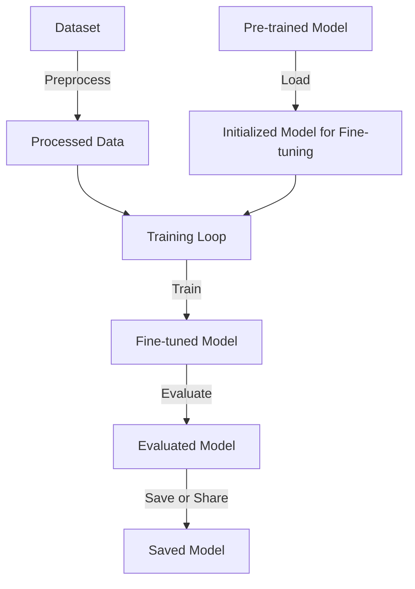

Sources: 
- chapters/fa/chapter3/2.mdx
- chapters/fa/chapter3/3.mdx
- chapters/fa/chapter3/3_tf.mdx

## Framework Options for Fine-tuning

You can fine-tune transformer models using different frameworks and approaches:

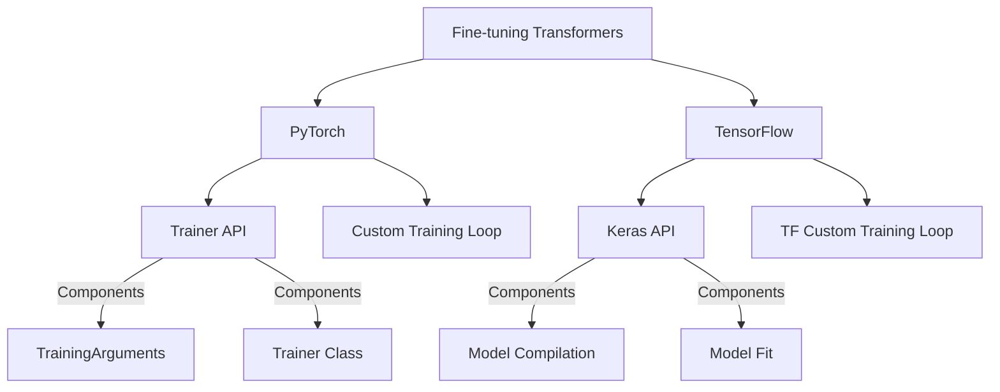

Sources:
- chapters/en/chapter3/3.mdx
- chapters/en/chapter3/3_tf.mdx

## Data Preparation

### Loading Datasets

The first step is to load your dataset using the `load_dataset()` function from the 🤗 Datasets library. This function can load both datasets from the Hugging Face Hub and custom datasets.

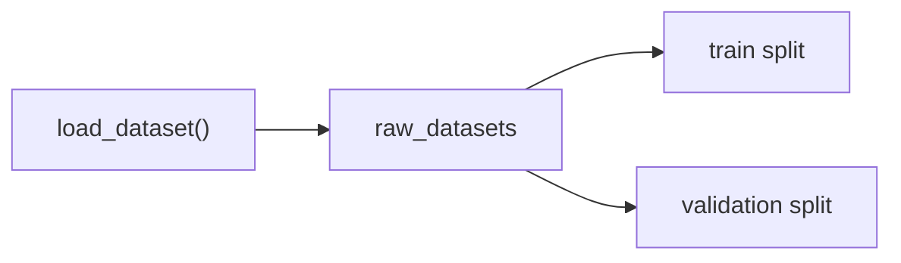

Sources:
- chapters/fa/chapter3/2.mdx:20-30
- chapters/en/chapter3/3.mdx:18-20

### Tokenization

Tokenization converts text into token IDs that the model can understand. The `AutoTokenizer` class handles this by loading the appropriate tokenizer for your chosen model.

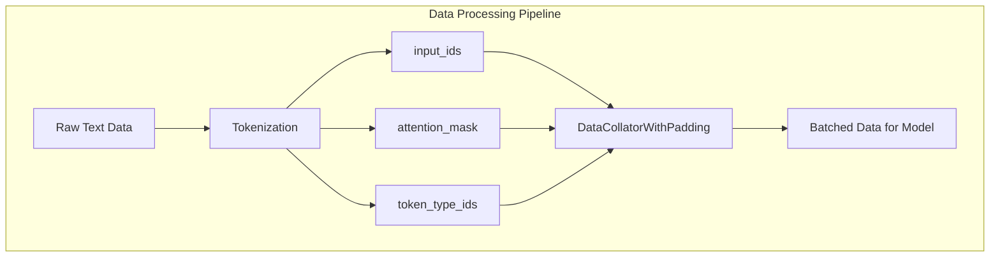

The tokenization process typically uses a function like `tokenize_function` to process multiple examples at once using the `map()` method of datasets.

Sources:
- chapters/fa/chapter3/2.mdx:185-217
- chapters/fa/chapter3/2.mdx:290-334

### Dynamic Padding

Instead of padding all sequences to the maximum length in the dataset, dynamic padding pads sequences to the maximum length within each batch. This is more efficient and is handled by the `DataCollatorWithPadding` class.

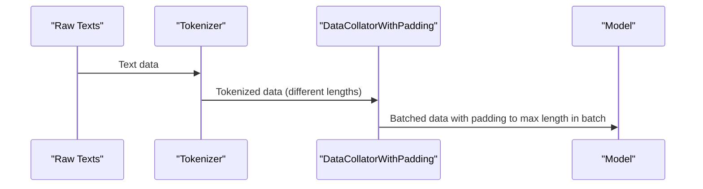

Sources:
- chapters/fa/chapter3/2.mdx:361-384
- chapters/en/chapter3/3.mdx:28-33

## Fine-tuning with the Trainer API (PyTorch)

### Setting Up Training Arguments

The `TrainingArguments` class configures the training process. You must specify an output directory for saving the model, and can optionally set learning rate, batch size, epochs, and evaluation strategy.

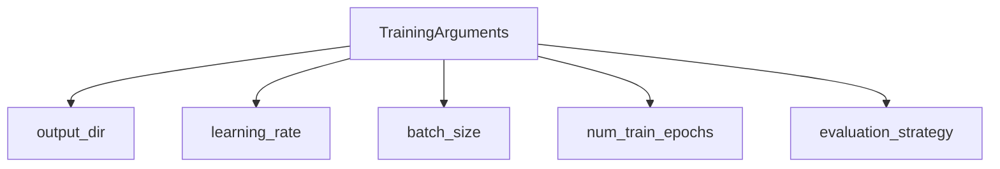

Sources:
- chapters/fa/chapter3/3.mdx:42-53
- chapters/en/chapter3/3.mdx:37-42

### Creating the Model

For fine-tuning, you'll need to load a pre-trained model with an appropriate head for your task. For classification tasks, use the `AutoModelForSequenceClassification` class.

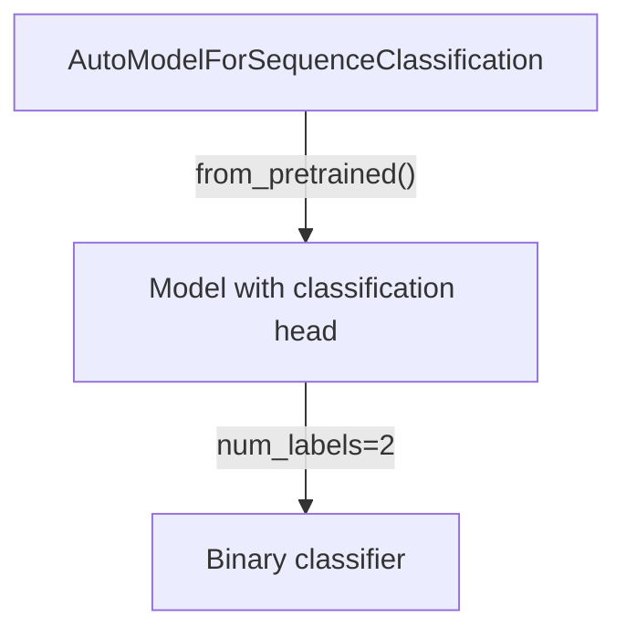

Sources:
- chapters/fa/chapter3/3.mdx:63-73
- chapters/en/chapter3/3.mdx:51-57

### Training

The `Trainer` class handles the entire training loop. You need to pass it the model, training arguments, datasets, tokenizer, and data collator.

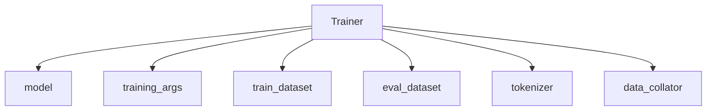

Call the `train()` method to start training. The model updates according to the specified hyperparameters.

Sources:
- chapters/fa/chapter3/3.mdx:77-96
- chapters/en/chapter3/3.mdx:61-74

### Evaluation

To evaluate the model, define a `compute_metrics` function that calculates metrics such as accuracy and F1 score from the model's predictions.

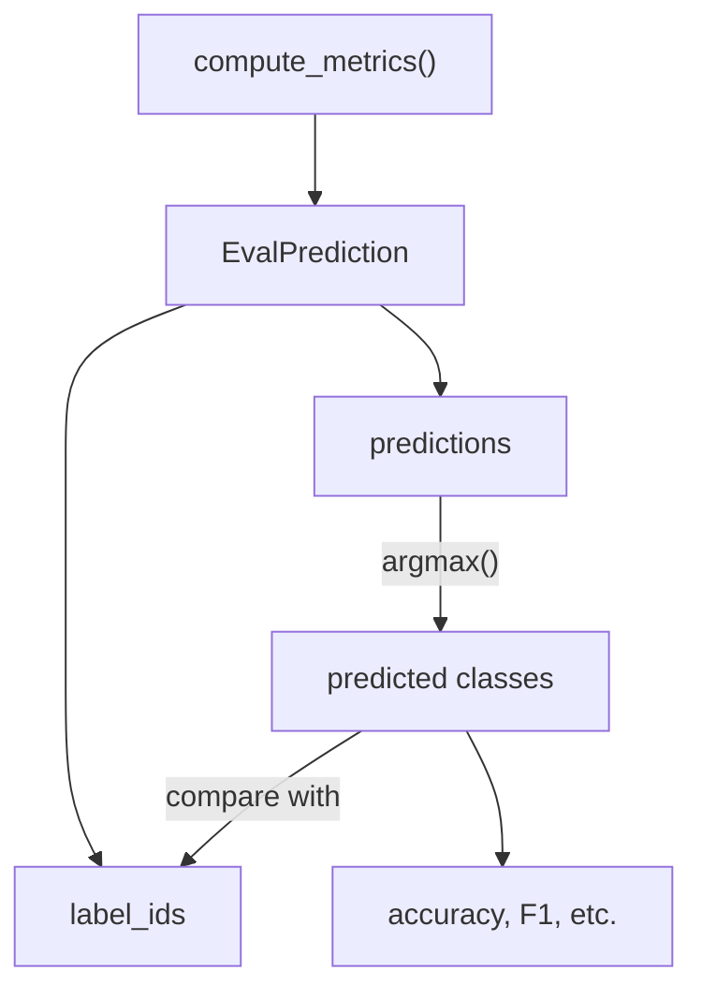

The metrics can be used to assess model performance and compare different fine-tuning approaches.

Sources:
- chapters/fa/chapter3/3.mdx:116-157
- chapters/en/chapter3/3.mdx:92-122

## Fine-tuning with Keras (TensorFlow)

### Preparing TensorFlow Datasets

Convert your tokenized datasets to TensorFlow format using the `to_tf_dataset()` method. Specify which columns to use as inputs and which to use as labels.

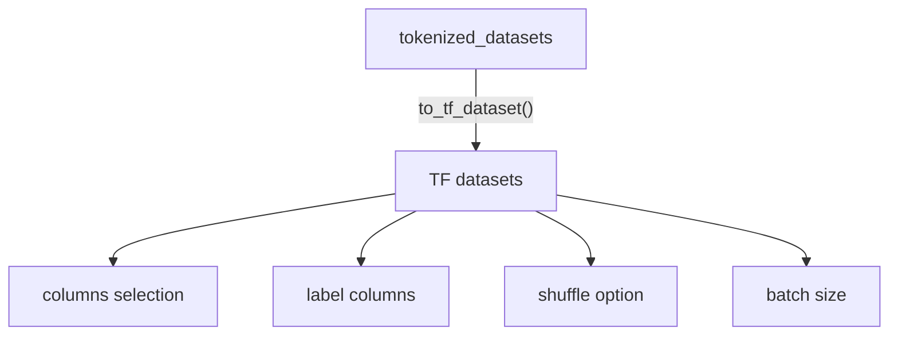

Sources:
- chapters/fa/chapter3/3_tf.mdx:477-495
- chapters/en/chapter3/3_tf.mdx:34-48

### Compiling and Training

Use `TFAutoModelForSequenceClassification` to load your model, then compile it with an optimizer, loss function, and metrics before calling the `fit()` method for training.

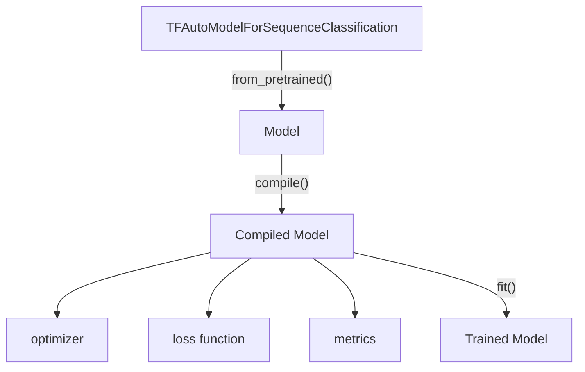

Sources:
- chapters/fa/chapter3/3_tf.mdx:80-104
- chapters/en/chapter3/3_tf.mdx:63-88

### Learning Rate Optimization

Optimize the learning rate to improve training results. TensorFlow provides schedulers like `PolynomialDecay` to gradually decrease the learning rate during training.

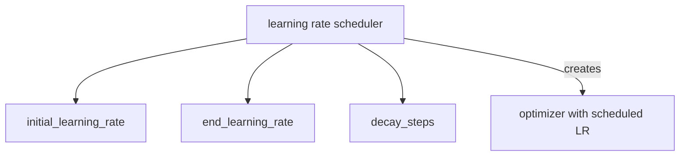

Sources:
- chapters/fa/chapter3/3_tf.mdx:114-137
- chapters/en/chapter3/3_tf.mdx:89-110

## Task-Specific Fine-tuning

Different NLP tasks require different model types. Choose the appropriate model class for your specific task:

| Task | Model Class | Example Use Case |
|------|-------------|------------------|
| Text Classification | AutoModelForSequenceClassification | Sentiment analysis |
| Token Classification | AutoModelForTokenClassification | Named entity recognition |
| Question Answering | AutoModelForQuestionAnswering | Extractive QA |
| Translation | AutoModelForSeq2SeqLM | Language translation |
| Summarization | AutoModelForSeq2SeqLM | Text summarization |
| Masked Language Modeling | AutoModelForMaskedLM | Domain adaptation |
| Causal Language Modeling | AutoModelForCausalLM | Text generation |

Sources:
- chapters/en/chapter7/2.mdx
- chapters/en/chapter7/3.mdx
- chapters/en/chapter7/4.mdx
- chapters/en/chapter7/5.mdx
- chapters/en/chapter7/6.mdx
- chapters/en/chapter7/7.mdx

## Domain Adaptation

When your target data differs significantly from the pretraining corpus, you may want to perform domain adaptation by first fine-tuning the language model on in-domain data before task-specific fine-tuning.

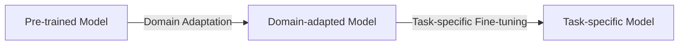

Domain adaptation is particularly useful for specialized domains like legal texts, scientific articles, or programming languages, where general-purpose models might not perform well.

Sources:
- chapters/en/chapter7/3.mdx:25-35

## Saving and Sharing Fine-tuned Models

After fine-tuning, save your model locally using `save_pretrained()` or share it on the Hugging Face Hub using `push_to_hub()`.

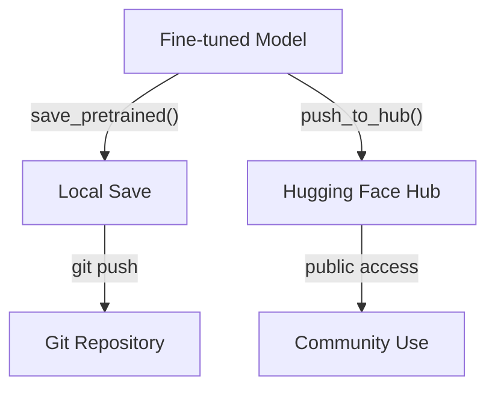

When sharing models, include information about the fine-tuning process, dataset, and performance metrics to help others understand the model's capabilities and limitations.

Sources:
- chapters/fa/chapter3/3.mdx:59-61
- chapters/en/chapter3/3.mdx:47-49

## Practical Tips for Effective Fine-tuning

1. **Start with an appropriate pre-trained model**: Choose a model architecture that was pre-trained on data similar to your task domain when possible.

2. **Perform hyperparameter tuning**: Experiment with learning rates, batch sizes, and number of epochs to find optimal settings.

3. **Monitor for overfitting**: Track both training and validation metrics to ensure your model generalizes well.

4. **Use dynamic padding**: This reduces memory usage and improves efficiency.

5. **Implement learning rate scheduling**: Gradually decreasing the learning rate often produces better results.

6. **Leverage mixed precision training**: For large models, use 16-bit precision to speed up training and reduce memory usage.

7. **Try domain adaptation**: For specialized domains, consider fine-tuning the language model on domain data before task-specific fine-tuning.

Sources:
- chapters/fa/chapter3/3_tf.mdx:114-146
- chapters/en/chapter7/3.mdx

---

