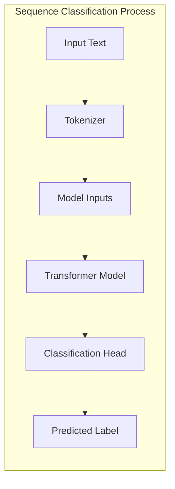
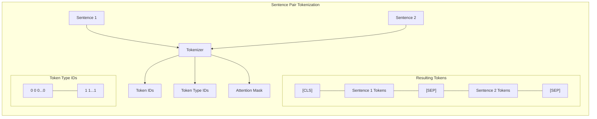
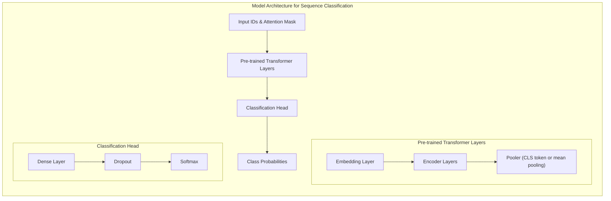
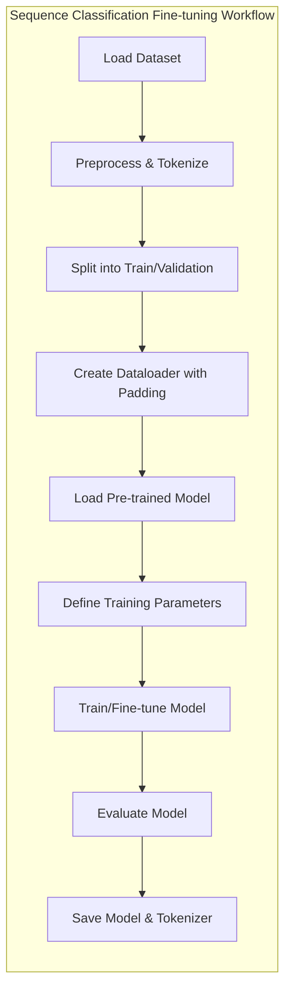

<!-- source: DeepWiki mcp.deepwiki.com · repo huggingface/course · page 4.1 Fine-tuning for Sequence Classification · fetched 2026-10-26 -->

# Fine-tuning for Sequence Classification

<details>
<summary>Relevant source files</summary>

The following files were used as context for generating this wiki page:

- [chapters/fa/TRANSLATING.txt](chapters/fa/TRANSLATING.txt)
- [chapters/fa/_toctree.yml](chapters/fa/_toctree.yml)
- [chapters/fa/chapter2/2.mdx](chapters/fa/chapter2/2.mdx)
- [chapters/fa/chapter3/1.mdx](chapters/fa/chapter3/1.mdx)
- [chapters/fa/chapter3/2.mdx](chapters/fa/chapter3/2.mdx)
- [chapters/fa/chapter3/3.mdx](chapters/fa/chapter3/3.mdx)
- [chapters/fa/chapter3/3_tf.mdx](chapters/fa/chapter3/3_tf.mdx)
- [chapters/fa/chapter4/1.mdx](chapters/fa/chapter4/1.mdx)
- [chapters/fa/glossary/1.mdx](chapters/fa/glossary/1.mdx)
- [chapters/fr/chapter3/3_tf.mdx](chapters/fr/chapter3/3_tf.mdx)
- [chapters/fr/chapter5/4.mdx](chapters/fr/chapter5/4.mdx)
- [chapters/fr/chapter6/8.mdx](chapters/fr/chapter6/8.mdx)
- [chapters/fr/chapter7/2.mdx](chapters/fr/chapter7/2.mdx)
- [chapters/fr/chapter7/3.mdx](chapters/fr/chapter7/3.mdx)
- [chapters/fr/chapter7/4.mdx](chapters/fr/chapter7/4.mdx)
- [chapters/fr/chapter7/5.mdx](chapters/fr/chapter7/5.mdx)
- [chapters/fr/chapter7/6.mdx](chapters/fr/chapter7/6.mdx)
- [chapters/fr/chapter7/7.mdx](chapters/fr/chapter7/7.mdx)
- [chapters/fr/chapter7/8.mdx](chapters/fr/chapter7/8.mdx)
- [chapters/th/chapter2/2.mdx](chapters/th/chapter2/2.mdx)

</details>


This document explains how to fine-tune transformer models for sequence classification tasks. Sequence classification is the task of assigning a label or class to an entire input sequence. Common examples include sentiment analysis, topic classification, spam detection, and language identification.

For information about fine-tuning models for token-level classification (like named entity recognition), see [Fine-tuning for Other NLP Tasks](#4.4). For conversational AI and chat applications, refer to [Supervised Fine-tuning (SFT) with ChatML](#4.2).

## Overview of Sequence Classification

Sequence classification involves training a model to predict a single label for an entire input sequence, such as a sentence or paragraph. This is in contrast to token classification, where the model predicts a label for each token in the sequence.



Sources: [chapters/fa/chapter3/2.mdx:26-28](), [chapters/fa/chapter3/3.mdx:61-76]()

## Preparing Data for Sequence Classification

Before fine-tuning a model, you need to prepare your dataset. This involves loading the dataset, tokenizing the input sequences, and formatting the data for model training.

### Loading Datasets

The Hugging Face ecosystem provides easy access to many datasets through the `datasets` library. For sequence classification, common datasets include GLUE tasks like MRPC (Microsoft Research Paraphrase Corpus).

```python
from datasets import load_dataset

# Load a dataset for sequence classification
raw_datasets = load_dataset("glue", "mrpc")
```

The MRPC dataset contains pairs of sentences, along with a label indicating whether they are paraphrases.

Sources: [chapters/fa/chapter3/2.mdx:94-105]()

### Tokenization and Processing

For sequence classification, you need to tokenize your input texts and convert them to model inputs. This involves several steps:

1. **Tokenization**: Converting text to tokens that the model understands
2. **Input ID generation**: Mapping tokens to their numerical IDs
3. **Special tokens handling**: Adding model-specific tokens (like `[CLS]` and `[SEP]` for BERT)
4. **Attention mask creation**: Generating masks to indicate which tokens should be attended to

For sentence pair classification (like paraphrase detection), the tokenizer handles both sentences together:

```python
from transformers import AutoTokenizer

# Load a tokenizer
checkpoint = "bert-base-uncased"
tokenizer = AutoTokenizer.from_pretrained(checkpoint)

# Tokenize a pair of sentences
inputs = tokenizer("This is the first sentence.", "This is the second one.")
```

This produces output that includes `input_ids`, `attention_mask`, and (for some models) `token_type_ids` which indicates which sentence each token belongs to.



Sources: [chapters/fa/chapter3/2.mdx:185-267](), [chapters/fa/chapter3/2.mdx:290-334]()

### Batch Processing and Dynamic Padding

To efficiently process data, we need to handle batches of inputs. Since sequences often have different lengths, we use padding to make them uniform within a batch:

1. **Map function**: Process the entire dataset using a `tokenize_function` with `Dataset.map()`
2. **Data collator**: Use `DataCollatorWithPadding` for dynamic padding at batch creation time

```python
# Tokenize function for processing dataset
def tokenize_function(example):
    return tokenizer(example["sentence1"], example["sentence2"], truncation=True)

# Apply to entire dataset
tokenized_datasets = raw_datasets.map(tokenize_function, batched=True)

# Create data collator for dynamic padding
from transformers import DataCollatorWithPadding
data_collator = DataCollatorWithPadding(tokenizer=tokenizer)
```

Dynamic padding is more efficient than static padding because it only pads to the maximum length within each batch, not the maximum length in the entire dataset.

Sources: [chapters/fa/chapter3/2.mdx:307-320](), [chapters/fa/chapter3/2.mdx:361-406]()

## Fine-tuning Models for Sequence Classification

There are two main approaches to fine-tuning models for sequence classification, depending on whether you're using PyTorch (with the Trainer API) or TensorFlow (with Keras).

### Using the Trainer API (PyTorch)

The `Trainer` API provides a high-level interface for fine-tuning models in PyTorch:

```python
from transformers import AutoModelForSequenceClassification, TrainingArguments, Trainer

# 1. Define model
model = AutoModelForSequenceClassification.from_pretrained(checkpoint, num_labels=2)

# 2. Define training arguments
training_args = TrainingArguments(
    "output-directory",
    evaluation_strategy="epoch",
    per_device_train_batch_size=16,
    learning_rate=5e-5,
    num_train_epochs=3,
)

# 3. Create Trainer
trainer = Trainer(
    model,
    training_args,
    train_dataset=tokenized_datasets["train"],
    eval_dataset=tokenized_datasets["validation"],
    data_collator=data_collator,
    tokenizer=tokenizer,
)

# 4. Train the model
trainer.train()
```

The `Trainer` handles many training details automatically, including:
- Batching and padding
- Learning rate scheduling
- Gradient accumulation
- Mixed precision training (when enabled)
- Model checkpointing

Sources: [chapters/fa/chapter3/3.mdx:42-104](), [chapters/fa/chapter3/3.mdx:116-132]()

### Using Keras (TensorFlow)

For TensorFlow users, you can fine-tune models using Keras:

```python
from transformers import TFAutoModelForSequenceClassification

# 1. Convert dataset to TF format
tf_train_dataset = tokenized_datasets["train"].to_tf_dataset(
    columns=["attention_mask", "input_ids", "token_type_ids"],
    label_cols=["labels"],
    shuffle=True,
    batch_size=8,
    collate_fn=data_collator,
)

# 2. Define model
model = TFAutoModelForSequenceClassification.from_pretrained(checkpoint, num_labels=2)

# 3. Compile model
from tensorflow.keras.optimizers import Adam
from tensorflow.keras.losses import SparseCategoricalCrossentropy

model.compile(
    optimizer=Adam(learning_rate=5e-5),
    loss=SparseCategoricalCrossentropy(from_logits=True),
    metrics=["accuracy"],
)

# 4. Train model
model.fit(
    tf_train_dataset,
    validation_data=tf_validation_dataset,
    epochs=3,
)
```

Sources: [chapters/fa/chapter3/3_tf.mdx:62-105](), [chapters/fa/chapter3/3_tf.mdx:114-169]()

## Model Architecture and Fine-tuning Process

Fine-tuning for sequence classification typically involves adding a classification head on top of a pre-trained transformer model. The process adapts the pre-trained weights to the specific classification task.



Sources: [chapters/fa/chapter3/3.mdx:75-76](), [chapters/fa/chapter3/3_tf.mdx:71-81]()

## Evaluation and Metrics

After fine-tuning, it's important to evaluate the model's performance on validation data. Common metrics for sequence classification include:

- **Accuracy**: The proportion of correctly classified samples
- **F1 Score**: Harmonic mean of precision and recall
- **Precision/Recall**: Metrics that balance true positives against false positives/negatives

### Computing Metrics

You can define a custom metrics function to evaluate your model:

```python
import numpy as np
from datasets import load_metric

def compute_metrics(eval_pred):
    metric = load_metric("glue", "mrpc")
    logits, labels = eval_pred
    predictions = np.argmax(logits, axis=-1)
    return metric.compute(predictions=predictions, references=labels)
```

This function can be passed to the `Trainer` for automatic evaluation during training.

### Getting Predictions

After training, you can use the model to make predictions on new data:

```python
from transformers import pipeline

classifier = pipeline("text-classification", model="your-fine-tuned-model")
predictions = classifier(["This is a test sentence."])
```

Sources: [chapters/fa/chapter3/3.mdx:144-158](), [chapters/fa/chapter3/3_tf.mdx:182-233]()

## End-to-End Fine-tuning Workflow

The complete workflow for fine-tuning a sequence classification model can be summarized as follows:



Sources: [chapters/fa/chapter3/2.mdx:94-105](), [chapters/fa/chapter3/2.mdx:290-334](), [chapters/fa/chapter3/3.mdx:42-104](), [chapters/fa/chapter3/3_tf.mdx:62-105](), [chapters/fa/chapter3/3_tf.mdx:114-169]()

## Practical Considerations and Tips

Here are some practical considerations to keep in mind when fine-tuning models for sequence classification:

1. **Model Selection**: Choose a model architecture appropriate for your task. BERT and RoBERTa work well for shorter sequence classification, while models like Longformer are better for longer documents.

2. **Hyperparameter Tuning**: Key hyperparameters to tune include:
   - Learning rate: Typically 2e-5 to 5e-5 for most transformer models
   - Batch size: As large as your GPU memory allows
   - Number of epochs: Usually 2-5 is sufficient

3. **Handling Class Imbalance**: For imbalanced datasets, consider:
   - Using class weights in the loss function
   - Adjusting evaluation metrics (F1 instead of accuracy)
   - Resampling techniques

4. **Multi-label Classification**: For tasks where multiple labels can apply to a single sequence, use:
   - Binary cross-entropy loss instead of cross-entropy
   - Sigmoid activation instead of softmax

5. **Resource Constraints**: If you have limited GPU memory:
   - Use gradient accumulation
   - Try smaller models like DistilBERT
   - Use mixed precision training

Sources: [chapters/fa/chapter3/3.mdx:116-132](), [chapters/fa/chapter3/3_tf.mdx:117-146]()

## Conclusion

Fine-tuning transformer models for sequence classification is a powerful technique for solving a wide range of NLP problems. The Hugging Face ecosystem provides tools that make this process streamlined and accessible, allowing you to quickly adapt state-of-the-art models to your specific needs.

By following the workflow outlined in this document – preparing your data, selecting an appropriate model, fine-tuning with the right parameters, and properly evaluating the results – you can build effective sequence classification models for various applications.

---

