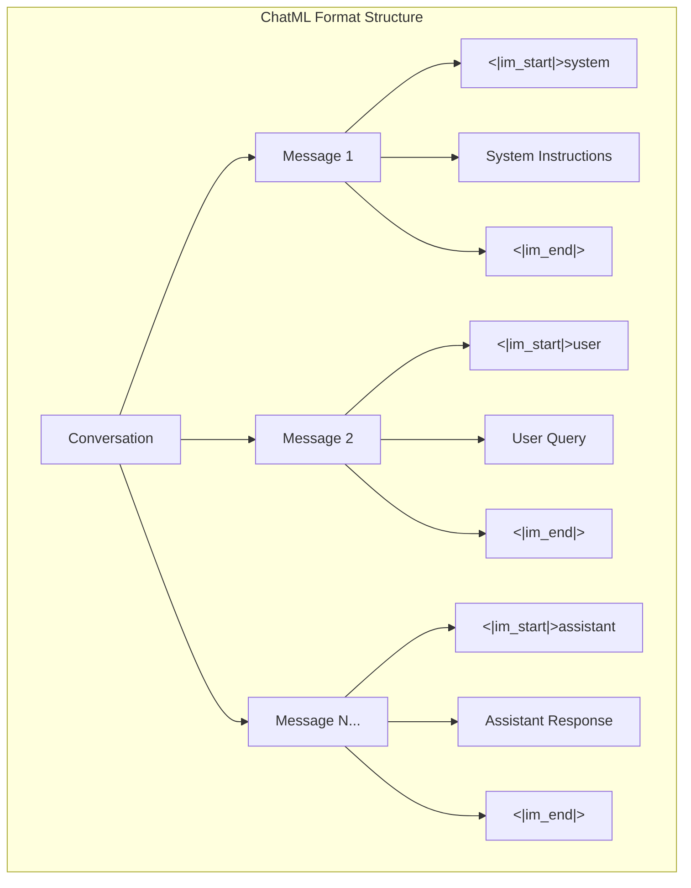
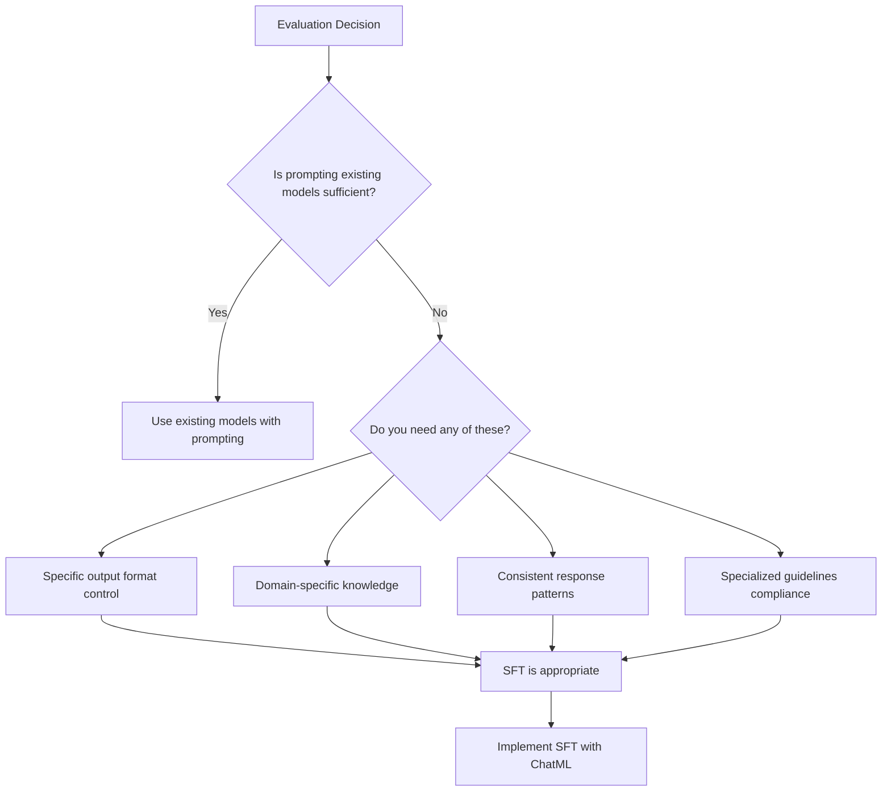
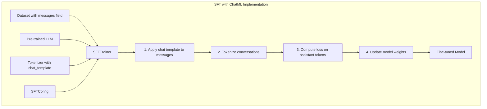
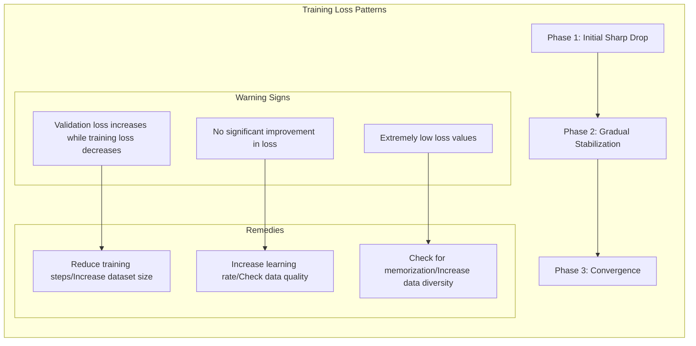
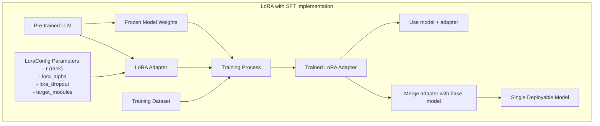
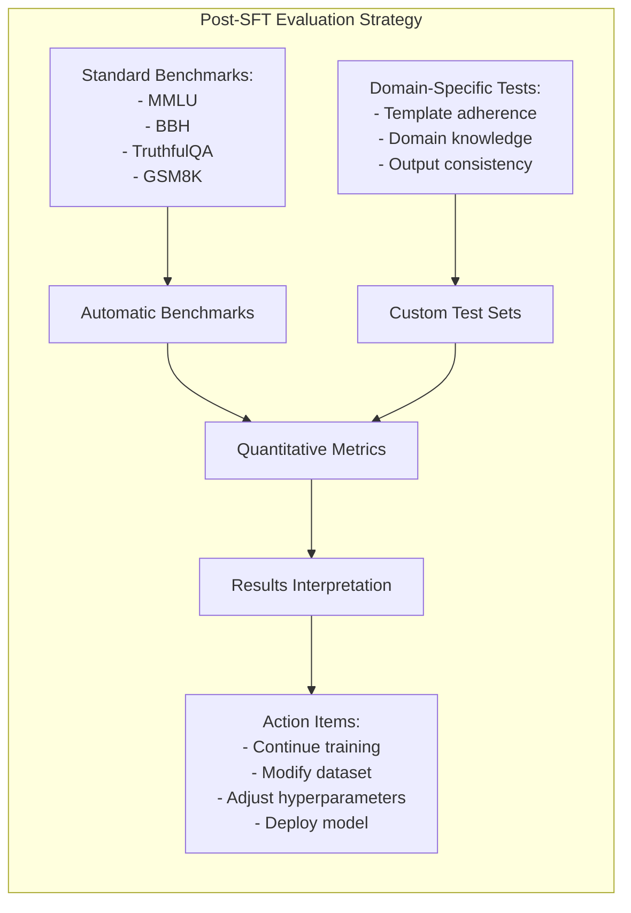

<!-- source: DeepWiki mcp.deepwiki.com · repo huggingface/course · page 4.2 Supervised Fine-tuning (SFT) with ChatML · fetched 2026-10-26 -->

# Supervised Fine-tuning (SFT) with ChatML

<details>
<summary>Relevant source files</summary>

The following files were used as context for generating this wiki page:

- [chapters/en/chapter11/1.mdx](chapters/en/chapter11/1.mdx)
- [chapters/en/chapter11/2.mdx](chapters/en/chapter11/2.mdx)
- [chapters/en/chapter11/3.mdx](chapters/en/chapter11/3.mdx)
- [chapters/en/chapter11/4.mdx](chapters/en/chapter11/4.mdx)
- [chapters/en/chapter11/5.mdx](chapters/en/chapter11/5.mdx)
- [chapters/en/chapter11/6.mdx](chapters/en/chapter11/6.mdx)
- [chapters/en/chapter11/7.mdx](chapters/en/chapter11/7.mdx)

</details>


## Purpose and Scope

This document provides detailed technical guidance on implementing Supervised Fine-Tuning (SFT) using the ChatML format. SFT is a process used to adapt pre-trained language models to follow instructions, engage in dialogue, and use specific output formats. This guide focuses specifically on the implementation and monitoring of SFT with ChatML using the Transformers Reinforcement Learning (TRL) library.

For information about standard fine-tuning techniques, see [Fine-tuning Transformer Models](#4). For details about Group Relative Policy Optimization (GRPO), see [GRPO](#4.3).

## Understanding ChatML

ChatML is a structured chat template format that provides clear role demarcation for conversational AI. Before diving into SFT, it's important to understand how ChatML organizes conversations.



Sources: [chapters/en/chapter11/2.mdx:49-125](). This diagram illustrates the nested structure of messages in the ChatML format, showing how special tokens mark the beginning and end of each message from different roles.

## When to Use SFT

Before implementing SFT with ChatML, evaluate whether it's the appropriate solution for your needs:



Sources: [chapters/en/chapter11/3.mdx:14-47]()

## Dataset Preparation

The SFT process requires datasets with structured conversation format. Each example should contain:

| Component | Description | Format |
|-----------|-------------|--------|
| System Message | Instructions for the assistant | `{"role": "system", "content": "You are a helpful assistant."}` |
| User Messages | Queries or instructions | `{"role": "user", "content": "What is machine learning?"}` |
| Assistant Messages | Expected model responses | `{"role": "assistant", "content": "Machine learning is..."}` |

A properly formatted dataset example for SFT with ChatML looks like:

```json
{
  "messages": [
    {"role": "system", "content": "You are a helpful assistant."},
    {"role": "user", "content": "What is machine learning?"},
    {"role": "assistant", "content": "Machine learning is a branch of artificial intelligence..."}
  ]
}
```

Sources: [chapters/en/chapter11/3.mdx:49-64]()

## SFT Implementation with TRL

The TRL library provides the `SFTTrainer` class, which streamlines the process of implementing SFT with ChatML.



Sources: [chapters/en/chapter11/3.mdx:99-146]()

### Training Configuration

The success of SFT depends heavily on proper configuration. Here are the critical parameters:

| Parameter Category | Key Parameters | Purpose | Recommendations |
|--------------------|----------------|---------|-----------------|
| Duration | `num_train_epochs`, `max_steps` | Control training length | Start with 1-3 epochs |
| Batch Size | `per_device_train_batch_size`, `gradient_accumulation_steps` | Memory usage and gradient stability | Smaller initially, increase if stable |
| Learning Rate | `learning_rate`, `warmup_ratio` | Control weight update size | Typically 1e-5 to 5e-5 for SFT |
| Monitoring | `logging_steps`, `eval_steps`, `save_steps` | Track training progress | Set based on dataset size |

A basic implementation example:

```python
from datasets import load_dataset
from trl import SFTConfig, SFTTrainer
from transformers import AutoModelForCausalLM, AutoTokenizer

# Load model and tokenizer
model_name = "HuggingFaceTB/SmolLM2-135M"
model = AutoModelForCausalLM.from_pretrained(model_name)
tokenizer = AutoTokenizer.from_pretrained(model_name)

# Load dataset
dataset = load_dataset("HuggingFaceTB/smoltalk", "all")

# Configure trainer
training_args = SFTConfig(
    output_dir="./sft_output",
    max_steps=1000,
    per_device_train_batch_size=4,
    learning_rate=5e-5,
    logging_steps=10,
    save_steps=100,
    eval_strategy="steps",
    eval_steps=50,
)

# Initialize trainer
trainer = SFTTrainer(
    model=model,
    args=training_args,
    train_dataset=dataset["train"],
    eval_dataset=dataset["test"],
    processing_class=tokenizer,
)

# Start training
trainer.train()
```

Sources: [chapters/en/chapter11/3.mdx:66-97](), [chapters/en/chapter11/3.mdx:99-146]()

### Optimizing with Dataset Packing

The `SFTTrainer` supports packing multiple examples into a single sequence to improve training efficiency:

```python
# Enable packing for more efficient training
training_args = SFTConfig(
    output_dir="./sft_output",
    max_steps=1000,
    per_device_train_batch_size=4,
    learning_rate=5e-5,
    packing=True,  # Enable packing for greater efficiency
)

# Custom formatting for multi-field datasets
def formatting_func(example):
    text = f"### Question: {example['question']}\n ### Answer: {example['answer']}"
    return text

trainer = SFTTrainer(
    model=model,
    args=training_args,
    train_dataset=dataset["train"],
    formatting_func=formatting_func,  # Optional custom formatting
)
```

Sources: [chapters/en/chapter11/3.mdx:152-180]()

## Monitoring Training Progress

Effective monitoring is crucial for successful fine-tuning. The loss curve provides key insights into training progress.



Sources: [chapters/en/chapter11/3.mdx:182-245]()

Key metrics to monitor:
- Training loss
- Validation loss
- Learning rate progression
- Gradient norms

## Using LoRA with SFT

LoRA (Low-Rank Adaptation) can be combined with SFT to significantly reduce memory requirements while maintaining performance.



Sources: [chapters/en/chapter11/4.mdx:9-17](), [chapters/en/chapter11/4.mdx:32-44](), [chapters/en/chapter11/4.mdx:58-72]()

### Implementing LoRA with SFTTrainer

Integration with TRL's `SFTTrainer` is straightforward:

```python
from peft import LoraConfig

# Configure LoRA parameters
peft_config = LoraConfig(
    r=6,                    # Rank dimension (4-32 typical)
    lora_alpha=8,           # LoRA scaling factor
    lora_dropout=0.05,      # Dropout probability for LoRA layers
    bias="none",            # Bias handling
    target_modules="all-linear",  # Modules to apply LoRA to
    task_type="CAUSAL_LM",  # Task type for model architecture
)

# Create SFTTrainer with LoRA configuration
trainer = SFTTrainer(
    model=model,
    args=training_args,
    train_dataset=dataset["train"],
    peft_config=peft_config,  # Pass LoRA configuration
    max_seq_length=512,
    processing_class=tokenizer,
)

# Training proceeds as normal
trainer.train()
```

Sources: [chapters/en/chapter11/4.mdx:74-113]()

### Merging LoRA Adapters

After training, you can merge LoRA adapters back into the base model for deployment:

```python
import torch
from transformers import AutoModelForCausalLM, AutoTokenizer
from peft import PeftModel

# Load base model
base_model = AutoModelForCausalLM.from_pretrained(
    "base_model_name", torch_dtype=torch.float16, device_map="auto"
)

# Load LoRA adapter
peft_model = PeftModel.from_pretrained(
    base_model, "path/to/adapter", torch_dtype=torch.float16
)

# Merge adapter with base model
merged_model = peft_model.merge_and_unload()

# Save the merged model and tokenizer
tokenizer = AutoTokenizer.from_pretrained("base_model_name")
merged_model.save_pretrained("path/to/save/merged_model")
tokenizer.save_pretrained("path/to/save/merged_model")
```

Sources: [chapters/en/chapter11/4.mdx:125-159]()

## Evaluation after SFT

After completing SFT, thorough evaluation is essential to validate the model's performance.



Sources: [chapters/en/chapter11/5.mdx:1-44](), [chapters/en/chapter11/3.mdx:252-262]()

### Implementing Evaluation with LightEval

You can use `lighteval` to evaluate your model on standard benchmarks:

```bash
lighteval accelerate \
    "pretrained=your-model-name" \
    "mmlu|anatomy|0|0" \
    "mmlu|high_school_biology|0|0" \
    "mmlu|high_school_chemistry|0|0" \
    "mmlu|professional_medicine|0|0" \
    --max_samples 40 \
    --batch_size 1 \
    --output_path "./results" \
    --save_generations true
```

Sources: [chapters/en/chapter11/5.mdx:74-108]()

## Best Practices

1. **Dataset Quality**: Ensure high-quality, diverse training examples that represent your target use case.

2. **Hyperparameter Selection**:
   - Start with conservative learning rates (1e-5 to 5e-5)
   - Use shorter training durations initially (1-3 epochs)
   - Monitor validation loss to prevent overfitting

3. **Monitoring and Evaluation**:
   - Track both quantitative metrics and qualitative outputs
   - Watch for divergence between training and validation loss
   - Regularly sample model outputs during training

4. **Documentation**:
   - Record training parameters, dataset characteristics, and performance metrics
   - Document known limitations and edge cases

Sources: [chapters/en/chapter11/3.mdx:252-262](), [chapters/en/chapter11/3.mdx:182-245]()

## Conclusion

Supervised Fine-tuning with ChatML provides a powerful approach to adapt pre-trained language models for specific applications while maintaining consistent output formatting. By following the implementation guidelines in this document and carefully monitoring the training process, you can create models that better understand instructions, engage in natural dialogue, and produce responses in your desired format.

---

