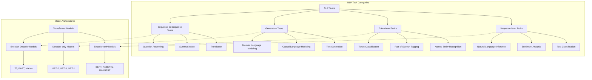
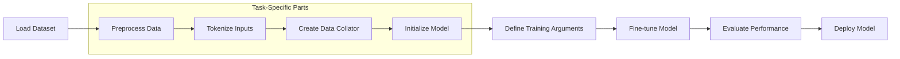
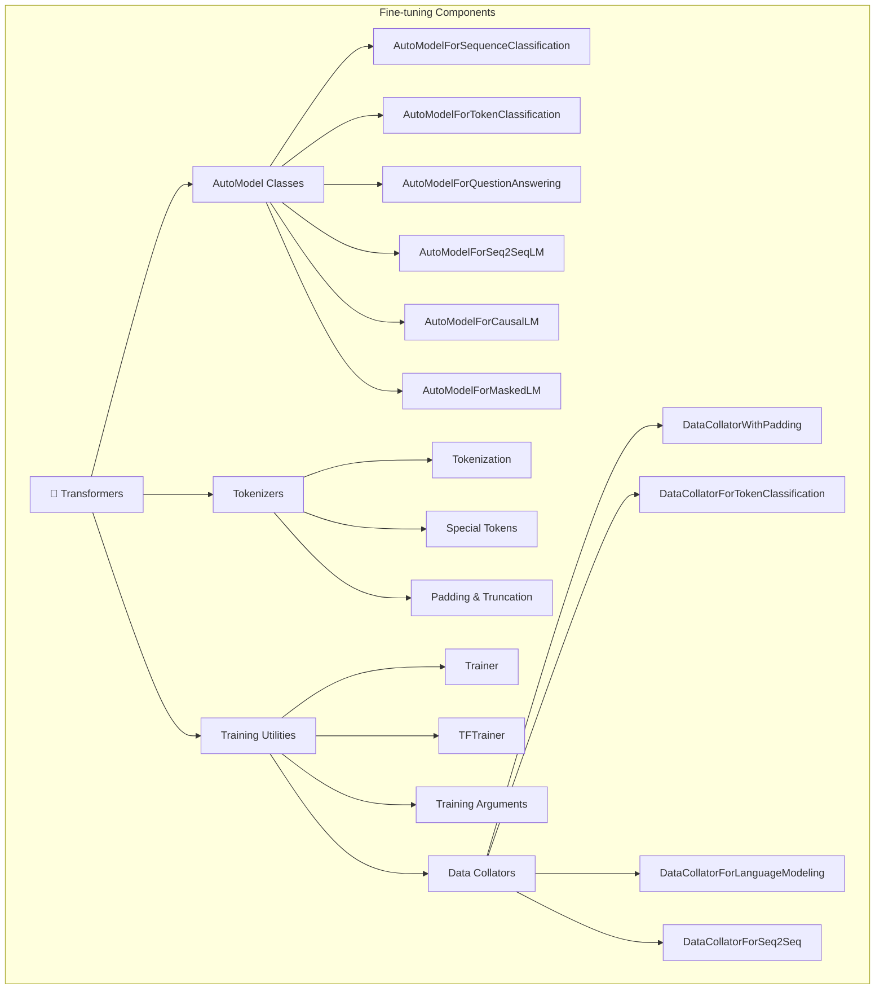
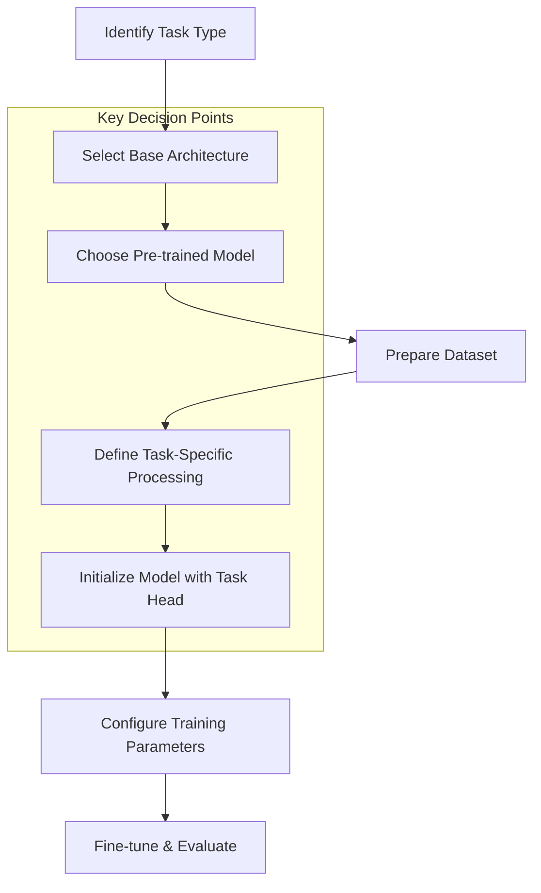

<!-- source: DeepWiki mcp.deepwiki.com · repo huggingface/course · page 4.4 Fine-tuning for Other NLP Tasks · fetched 2026-10-26 -->

# Fine-tuning for Other NLP Tasks

<details>
<summary>Relevant source files</summary>

The following files were used as context for generating this wiki page:

- [chapters/de/chapter3/3_tf.mdx](chapters/de/chapter3/3_tf.mdx)
- [chapters/en/chapter3/3.mdx](chapters/en/chapter3/3.mdx)
- [chapters/en/chapter3/3_tf.mdx](chapters/en/chapter3/3_tf.mdx)
- [chapters/en/chapter7/2.mdx](chapters/en/chapter7/2.mdx)
- [chapters/en/chapter7/3.mdx](chapters/en/chapter7/3.mdx)
- [chapters/en/chapter7/4.mdx](chapters/en/chapter7/4.mdx)
- [chapters/en/chapter7/5.mdx](chapters/en/chapter7/5.mdx)
- [chapters/en/chapter7/6.mdx](chapters/en/chapter7/6.mdx)
- [chapters/en/chapter7/7.mdx](chapters/en/chapter7/7.mdx)
- [chapters/ru/chapter7/1.mdx](chapters/ru/chapter7/1.mdx)
- [chapters/ru/chapter7/2.mdx](chapters/ru/chapter7/2.mdx)
- [chapters/ru/chapter7/3.mdx](chapters/ru/chapter7/3.mdx)
- [chapters/ru/chapter7/4.mdx](chapters/ru/chapter7/4.mdx)
- [chapters/ru/chapter7/5.mdx](chapters/ru/chapter7/5.mdx)
- [chapters/ru/chapter7/6.mdx](chapters/ru/chapter7/6.mdx)
- [chapters/ru/chapter7/7.mdx](chapters/ru/chapter7/7.mdx)
- [chapters/ru/chapter7/8.mdx](chapters/ru/chapter7/8.mdx)
- [chapters/ru/chapter7/9.mdx](chapters/ru/chapter7/9.mdx)

</details>


This page provides a comprehensive guide to fine-tuning transformer models for various NLP tasks beyond the standard sequence classification covered in earlier chapters. While previous sections focused on specific applications like [token classification](#7.2), [masked language modeling](#7.3), and [question answering](#7.7), here we'll explore how to approach a wider range of NLP tasks and adapt these techniques to your specific needs.

## Overview of NLP Tasks and Model Architectures

When approaching a new NLP task, it's crucial to understand which model architecture is most suitable. Different NLP tasks require different model architectures based on their input-output structure.



Sources: [chapters/ru/chapter7/1.mdx:10-20](). [chapters/en/chapter7/4.mdx:25-32]().

### Matching Task Type to Model Architecture

Selecting the right architecture for your task is fundamental to successful fine-tuning:

| Task Type | Examples | Recommended Architecture | Popular Models |
|-----------|----------|-------------------------|----------------|
| Sequence-level | Text classification, sentiment analysis | Encoder-only | BERT, RoBERTa, DistilBERT |
| Token-level | NER, POS tagging | Encoder-only | BERT, RoBERTa, DistilBERT |
| Generative | Text generation, story completion | Decoder-only | GPT-2, GPT-3, OPT |
| Sequence-to-sequence | Translation, summarization, Q&A | Encoder-decoder | T5, BART, Marian |

Sources: [chapters/en/chapter7/4.mdx:25-32](). [chapters/ru/chapter7/7.mdx:35-39]().

## Fine-tuning Process Across NLP Tasks

While specific preprocessing steps vary across tasks, the general fine-tuning workflow follows a consistent pattern:



Sources: [chapters/en/chapter3/3.mdx:36-80](). [chapters/en/chapter7/3.mdx:446-466]().

### Common Components Across Tasks

Despite differences in tasks, several components remain consistent across different fine-tuning scenarios:



Sources: [chapters/en/chapter7/3.mdx:446-466](). [chapters/en/chapter7/2.mdx:318-323]().

## Task-Specific Approaches

### Sequence Classification Tasks

For tasks like sentiment analysis, topic classification, or spam detection:

1. Use `AutoModelForSequenceClassification` with the number of labels appropriate for your task
2. Employ `DataCollatorWithPadding` for efficient batching
3. Metrics typically include accuracy, F1 score, and confusion matrices

```python
# Example model initialization for sequence classification
model = AutoModelForSequenceClassification.from_pretrained(
    checkpoint, num_labels=num_labels
)
```

Sources: [chapters/en/chapter3/3.mdx:52-58]().

### Token Classification Tasks

For tasks like named entity recognition (NER) or part-of-speech (POS) tagging:

1. Use `AutoModelForTokenClassification` with the appropriate number of labels
2. Special data processing is needed to align labels with tokenized inputs
3. Specifically handle subtokens when tokenization splits words
4. Use `DataCollatorForTokenClassification` for proper padding

Key considerations for token classification include:

```python
# Aligning labels with tokens is a critical step unique to token classification
def align_labels_with_tokens(labels, word_ids):
    new_labels = []
    current_word = None
    for word_id in word_ids:
        if word_id != current_word:
            # Start of a new word
            current_word = word_id
            label = -100 if word_id is None else labels[word_id]
            new_labels.append(label)
        elif word_id is None:
            # Special token
            new_labels.append(-100)
        else:
            # Same word as previous token
            label = labels[word_id]
            # If the label is B-XXX we change it to I-XXX
            if label % 2 == 1:
                label += 1
            new_labels.append(label)
    return new_labels
```

Sources: [chapters/en/chapter7/2.mdx:227-248](). [chapters/en/chapter7/2.mdx:318-323]().

### Sequence-to-Sequence Tasks

For tasks like translation, summarization, and question answering:

1. Use encoder-decoder models like T5, BART, or Marian
2. Employ `DataCollatorForSeq2Seq` to handle padding efficiently
3. Input formatting is critical for these tasks
4. Evaluation typically uses task-specific metrics like BLEU for translation or ROUGE for summarization

Example for translation task:

```python
# Preprocessing for sequence-to-sequence tasks needs to handle both source and target sequences
def preprocess_function(examples):
    inputs = [ex[source_lang] for ex in examples["translation"]]
    targets = [ex[target_lang] for ex in examples["translation"]]
    model_inputs = tokenizer(inputs, max_length=max_input_length, truncation=True)
    
    # Set up the tokenizer for targets
    with tokenizer.as_target_tokenizer():
        labels = tokenizer(targets, max_length=max_target_length, truncation=True)
    
    model_inputs["labels"] = labels["input_ids"]
    return model_inputs
```

Sources: [chapters/en/chapter7/4.mdx:165-179](). [chapters/en/chapter7/5.mdx:391-404]().

### Language Modeling Tasks

For both masked language modeling (MLM) and causal language modeling (CLM):

1. MLM uses `AutoModelForMaskedLM` while CLM uses `AutoModelForCausalLM`
2. Both require special data collators to handle the task specifics
3. Special considerations for concatenation and chunking of texts

Example for masked language modeling:

```python
# Data collation for masked language modeling
data_collator = DataCollatorForLanguageModeling(
    tokenizer=tokenizer, mlm=True, mlm_probability=0.15
)
```

Sources: [chapters/en/chapter7/3.mdx:446-454](). [chapters/en/chapter7/6.mdx:334-340]().

## Adapting Pre-trained Models for Custom Tasks

When adapting techniques to your own custom tasks, consider the following workflow:



Sources: [chapters/ru/chapter7/1.mdx:10-20](). [chapters/en/chapter7/2.mdx:44-51]().

### Domain Adaptation Considerations

If your task involves specialized domains (like legal, medical, or scientific texts), consider domain adaptation:

1. First fine-tune a language model on in-domain data
2. Then fine-tune for your specific task
3. This can significantly improve performance for domain-specific vocabulary

```python
# Example domain adaptation workflow
# Step 1: Fine-tune language model on domain-specific data
model_lm = AutoModelForMaskedLM.from_pretrained(checkpoint)
# Train on domain data

# Step 2: Use the domain-adapted model for your task
model_task = AutoModelForSequenceClassification.from_pretrained(
    "your-domain-adapted-model", num_labels=num_labels
)
# Fine-tune for your specific task
```

Sources: [chapters/en/chapter7/3.mdx:25-39]().

## Training Framework Options

The Hugging Face ecosystem offers multiple training frameworks to accommodate different preferences and requirements:

### Trainer API

The `Trainer` API provides a high-level interface with built-in functionality for:
- Distributed training
- Mixed precision
- Logging and checkpointing
- Hyperparameter optimization

```python
# Example Trainer setup
training_args = TrainingArguments(
    output_dir="./results",
    evaluation_strategy="epoch",
    learning_rate=2e-5,
    per_device_train_batch_size=16,
    per_device_eval_batch_size=16,
    num_train_epochs=3,
    weight_decay=0.01,
)

trainer = Trainer(
    model=model,
    args=training_args,
    train_dataset=tokenized_datasets["train"],
    eval_dataset=tokenized_datasets["validation"],
    tokenizer=tokenizer,
    data_collator=data_collator,
)

trainer.train()
```

Sources: [chapters/en/chapter3/3.mdx:63-74](). [chapters/en/chapter7/3.mdx:446-466]().

### Custom Training Loops with 🤗 Accelerate

For more control over the training process, you can use 🤗 Accelerate:

```python
# Example Accelerate setup pattern
from accelerate import Accelerator

accelerator = Accelerator()
model, optimizer, train_dataloader, eval_dataloader = accelerator.prepare(
    model, optimizer, train_dataloader, eval_dataloader
)

# Custom training loop
for epoch in range(num_epochs):
    model.train()
    for batch in train_dataloader:
        outputs = model(**batch)
        loss = outputs.loss
        accelerator.backward(loss)
        optimizer.step()
        optimizer.zero_grad()
```

Sources: [chapters/en/chapter7/6.mdx:656-687]().

### TensorFlow/Keras Integration

If you prefer TensorFlow, you can use the Keras API:

```python
# Example Keras fine-tuning
model = TFAutoModelForSequenceClassification.from_pretrained(checkpoint, num_labels=2)
optimizer = tf.keras.optimizers.Adam(learning_rate=5e-5)
model.compile(optimizer=optimizer, loss=loss, metrics=['accuracy'])

model.fit(
    tf_train_dataset,
    validation_data=tf_validation_dataset,
    epochs=3
)
```

Sources: [chapters/en/chapter3/3_tf.mdx:62-71]().

## Evaluation and Model Selection

Different NLP tasks require different evaluation metrics:

| Task | Common Metrics | Notes |
|------|----------------|-------|
| Classification | Accuracy, F1, Precision, Recall | Balance metrics based on class distribution |
| Token Classification | Per-token accuracy, Entity-level F1 | Consider both token and entity-level performance |
| Translation | BLEU, chrF | Reference-based metrics with limitations |
| Summarization | ROUGE, BERTScore | Captures different aspects of summary quality |
| Question Answering | Exact Match, F1 | Based on text span overlap |
| Language Modeling | Perplexity | Lower is better |

Sources: [chapters/en/chapter7/5.mdx:356-362](). [chapters/en/chapter7/7.mdx:115-122]().

## Best Practices for Fine-tuning Across Tasks

1. **Data preprocessing**: Pay special attention to task-specific preprocessing needs
2. **Model selection**: Choose the appropriate architecture based on task type
3. **Hyperparameter tuning**: Learning rate and batch size are most impactful
4. **Evaluation**: Use task-appropriate metrics and validation strategies
5. **Domain adaptation**: Consider domain-specific fine-tuning for specialized applications
6. **Mixed-precision training**: Use fp16 for faster training when available
7. **Version control**: Track all parameters, code, and results with tools like 🤗 Hub

Sources: [chapters/en/chapter7/3.mdx:25-39](). [chapters/en/chapter3/3.mdx:36-80]().

By understanding these principles and techniques, you can effectively fine-tune transformer models for virtually any NLP task, adapting the approaches covered in this course to your specific needs.

---

