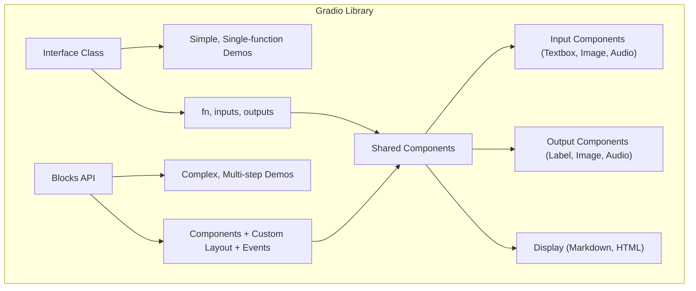
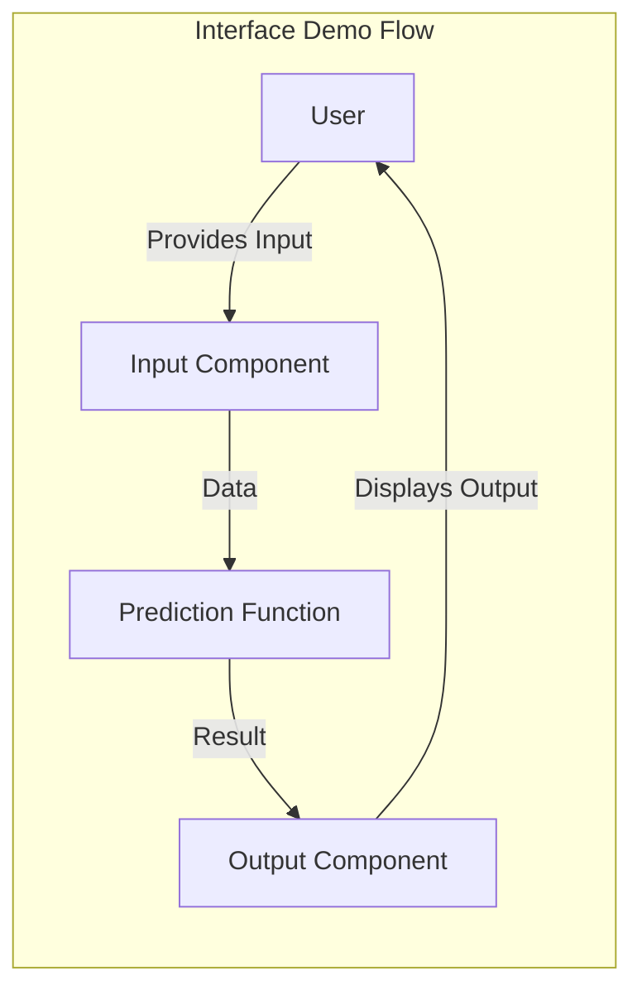
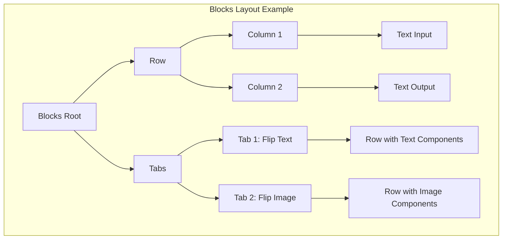
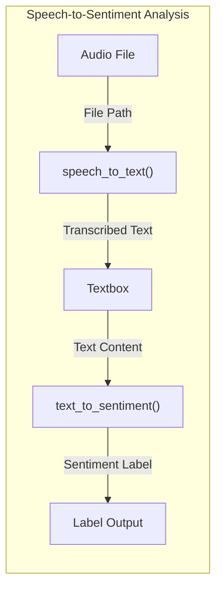
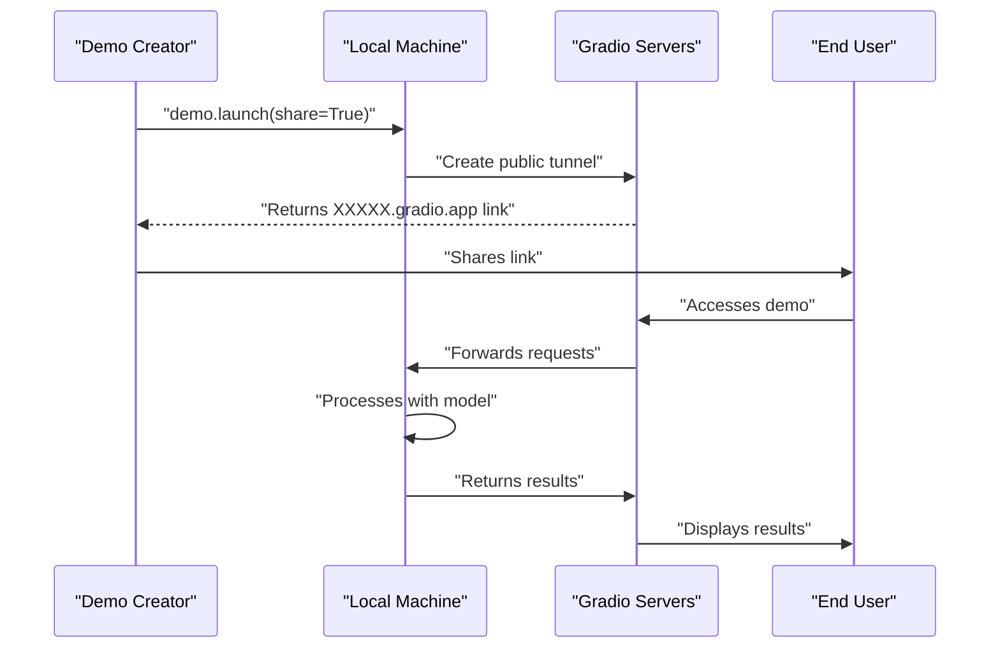
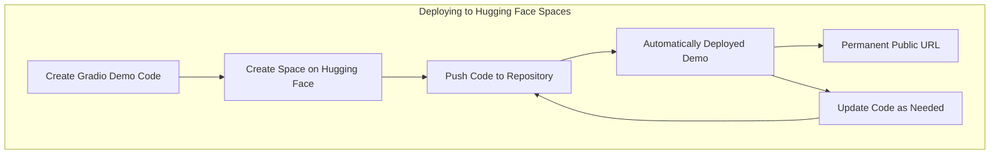
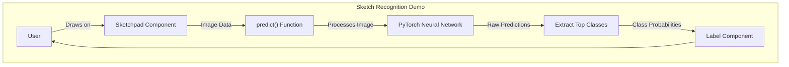
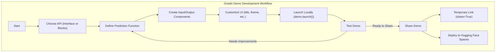

<!-- source: DeepWiki mcp.deepwiki.com · repo huggingface/course · page 5 Building and Sharing ML Demos · fetched 2026-10-26 -->

# Building and Sharing ML Demos

<details>
<summary>Relevant source files</summary>

The following files were used as context for generating this wiki page:

- [chapters/en/chapter9/1.mdx](chapters/en/chapter9/1.mdx)
- [chapters/en/chapter9/2.mdx](chapters/en/chapter9/2.mdx)
- [chapters/en/chapter9/3.mdx](chapters/en/chapter9/3.mdx)
- [chapters/en/chapter9/4.mdx](chapters/en/chapter9/4.mdx)
- [chapters/en/chapter9/5.mdx](chapters/en/chapter9/5.mdx)
- [chapters/en/chapter9/6.mdx](chapters/en/chapter9/6.mdx)
- [chapters/en/chapter9/7.mdx](chapters/en/chapter9/7.mdx)
- [chapters/en/chapter9/8.mdx](chapters/en/chapter9/8.mdx)
- [chapters/en/chapter9/9.mdx](chapters/en/chapter9/9.mdx)
- [chapters/fr/chapter9/8.mdx](chapters/fr/chapter9/8.mdx)
- [chapters/pt/chapter1/2.mdx](chapters/pt/chapter1/2.mdx)
- [chapters/ru/chapter9/1.mdx](chapters/ru/chapter9/1.mdx)
- [chapters/ru/chapter9/2.mdx](chapters/ru/chapter9/2.mdx)
- [chapters/ru/chapter9/3.mdx](chapters/ru/chapter9/3.mdx)
- [chapters/ru/chapter9/4.mdx](chapters/ru/chapter9/4.mdx)
- [chapters/ru/chapter9/5.mdx](chapters/ru/chapter9/5.mdx)
- [chapters/ru/chapter9/6.mdx](chapters/ru/chapter9/6.mdx)
- [chapters/ru/chapter9/7.mdx](chapters/ru/chapter9/7.mdx)
- [chapters/ru/chapter9/8.mdx](chapters/ru/chapter9/8.mdx)
- [chapters/ru/chapter9/9.mdx](chapters/ru/chapter9/9.mdx)
- [chapters/ru/events/1.mdx](chapters/ru/events/1.mdx)

</details>


This document explains how to build and share interactive machine learning demos using Gradio. Gradio is a Python library that allows you to create web interfaces for your machine learning models with just a few lines of code. This enables you to demonstrate your models to both technical and non-technical audiences, debug your models through user interaction, and collect feedback from users. For information about data annotation tools, see [Data Annotation and Curation](#6).

## Gradio: Interface vs Blocks

Gradio provides two main APIs for creating demos:



Sources: [chapters/en/chapter9/1.mdx], [chapters/en/chapter9/7.mdx:10-17]

### Interface API

The `Interface` class is a high-level API that requires three main parameters:

1. `fn`: The prediction function that processes inputs and returns outputs
2. `inputs`: Input component(s) that collect data from users
3. `outputs`: Output component(s) that display results

```python
import gradio as gr

def greet(name):
    return "Hello " + name

demo = gr.Interface(fn=greet, inputs="text", outputs="text")
demo.launch()
```

The `Interface` handles all the layout and event binding automatically, making it ideal for simple demos.

Sources: [chapters/en/chapter9/2.mdx:19-37], [chapters/en/chapter9/3.mdx:10-25]

### Blocks API

The `Blocks` API is a lower-level API that gives you full control over layout and data flow:

```python
import gradio as gr

def flip_text(x):
    return x[::-1]

demo = gr.Blocks()

with demo:
    gr.Markdown("# Flip Text!")
    input = gr.Textbox(placeholder="Flip this text")
    output = gr.Textbox()
    
    input.change(fn=flip_text, inputs=input, outputs=output)

demo.launch()
```

Key features of Blocks:
- Custom layouts with rows, columns, and tabs
- Explicit event handling
- Multi-step interfaces where outputs feed into other components
- Dynamic component properties

Sources: [chapters/en/chapter9/7.mdx:31-67]

## Building Demos with Interface

### Basic Structure



Sources: [chapters/en/chapter9/2.mdx], [chapters/en/chapter9/3.mdx]

### Input and Output Components

Gradio provides a variety of components for different data types:

| Component Type | Examples | Description |
|----------------|----------|-------------|
| Text Input     | `Textbox`, `Number`, `Slider` | For text and numerical inputs |
| Media Input    | `Image`, `Audio`, `Video` | For file uploads or recorded media |
| Selection      | `Dropdown`, `Radio`, `Checkbox` | For selecting options |
| Display Output | `Label`, `HighlightedText`, `JSON` | For displaying predictions |

Components can be customized by instantiating them directly:

```python
textbox = gr.Textbox(
    label="Type your query here:",
    placeholder="What is machine learning?",
    lines=3
)
```

Sources: [chapters/en/chapter9/2.mdx:46-68], [chapters/en/chapter9/3.mdx:30-76]

### Multiple Inputs and Outputs

For functions with multiple parameters or return values, pass lists of components:

```python
gr.Interface(
    fn=generate_tone,
    inputs=[
        gr.Dropdown(notes, type="index"),
        gr.Slider(minimum=4, maximum=6, step=1),
        gr.Number(value=1, label="Duration in seconds"),
    ],
    outputs="audio",
).launch()
```

Sources: [chapters/en/chapter9/3.mdx:78-121]

### Customizing Demos

Enhance your demos with additional parameters:

```python
gr.Interface(
    fn=predict,
    inputs="textbox",
    outputs="text",
    title="Ask Rick a Question",
    description="Bot trained on Rick and Morty dialogues",
    article="Based on [the original Rick and Morty Bot](https://example.com)",
    examples=[["What are you doing?"], ["Where should we time travel to?"]],
    theme="huggingface",
    live=True
).launch()
```

Sources: [chapters/en/chapter9/4.mdx:15-53]

## Building Complex Demos with Blocks

### Custom Layouts

With Blocks, you can create sophisticated layouts using `Row`, `Column`, and `Tabs`:



Sources: [chapters/en/chapter9/7.mdx:78-127]

Example of a multi-tab interface:

```python
with gr.Blocks() as demo:
    gr.Markdown("Flip text or image files using this demo.")
    with gr.Tabs():
        with gr.TabItem("Flip Text"):
            with gr.Row():
                text_input = gr.Textbox()
                text_output = gr.Textbox()
            text_button = gr.Button("Flip")
        with gr.TabItem("Flip Image"):
            with gr.Row():
                image_input = gr.Image()
                image_output = gr.Image()
            image_button = gr.Button("Flip")

    text_button.click(flip_text, inputs=text_input, outputs=text_output)
    image_button.click(flip_image, inputs=image_input, outputs=image_output)

demo.launch()
```

Sources: [chapters/en/chapter9/7.mdx:90-124]

### Events and Data Flow

Events connect user interactions to function calls:

| Component | Event | Triggered when |
|-----------|-------|----------------|
| Button | `click()` | Button is clicked |
| Textbox | `change()` | Content changes |
| Textbox | `submit()` | Enter key is pressed |
| Audio | `play()`, `pause()` | Media playback state changes |

Sources: [chapters/en/chapter9/7.mdx:132-145]

### Multi-step Interfaces

You can build multi-step workflows where outputs feed into other components:



Sources: [chapters/en/chapter9/7.mdx:168-206]

Example code:

```python
with demo:
    audio_file = gr.Audio(type="filepath")
    text = gr.Textbox()
    label = gr.Label()

    b1 = gr.Button("Recognize Speech")
    b2 = gr.Button("Classify Sentiment")

    b1.click(speech_to_text, inputs=audio_file, outputs=text)
    b2.click(text_to_sentiment, inputs=text, outputs=label)
```

Sources: [chapters/en/chapter9/7.mdx:176-202]

### Dynamic Component Updates

You can dynamically update component properties:

```python
def change_textbox(choice):
    if choice == "short":
        return gr.Textbox.update(lines=2, visible=True)
    elif choice == "long":
        return gr.Textbox.update(lines=8, visible=True)
    else:
        return gr.Textbox.update(visible=False)
```

Sources: [chapters/en/chapter9/7.mdx:208-237]

## Sharing Demos

### Temporary Share Links

Create a temporary public link (valid for 72 hours):

```python
demo.launch(share=True)
```



Sources: [chapters/en/chapter9/4.mdx:55-65]

### Hosting on Hugging Face Spaces

For permanent hosting:

1. Create a new Space on Hugging Face Spaces
2. Choose Gradio as the SDK
3. Push your code to the repository with the main file named `app.py`



Sources: [chapters/en/chapter9/4.mdx:67-75]

## Integration with Hugging Face Hub

### Loading Models from the Hub

Load models directly from the Hugging Face Hub:

```python
gr.Interface.load(
    "huggingface/EleutherAI/gpt-j-6B",
    inputs=gr.Textbox(lines=5, label="Input Text"),
    title="GPT-J Demo"
).launch()
```

This uses the Hugging Face Inference API rather than loading models locally, which is ideal for large models.

Sources: [chapters/en/chapter9/5.mdx:13-42]

### Loading from Spaces

Load and customize existing demos from Hugging Face Spaces:

```python
gr.Interface.load(
    "spaces/abidlabs/remove-bg", 
    inputs="webcam", 
    title="Remove your webcam background!"
).launch()
```

Sources: [chapters/en/chapter9/5.mdx:44-67]

## Advanced Features

### Session State for Data Persistence

Maintain state between interactions (useful for chatbots):

```python
def chat(message, history):
    history = history or []
    # Process message and generate response
    history.append((message, response))
    return history, history

iface = gr.Interface(
    chat,
    ["text", "state"],
    ["chatbot", "state"]
)
```

Sources: [chapters/en/chapter9/6.mdx:12-60]

### Model Interpretation

Enable interpretation to explain model predictions:

```python
gr.Interface(
    fn=classify_image,
    inputs=image,
    outputs=label,
    interpretation="default"
).launch()
```

This adds an "Interpret" button that highlights input features that influenced the output.

Sources: [chapters/en/chapter9/6.mdx:62-100]

## Complete Example: Sketch Recognition Demo

Let's look at a complete example of building a sketch recognition demo:



Sources: [chapters/en/chapter9/4.mdx:82-143]

Example code:

```python
from pathlib import Path
import torch
import gradio as gr
from torch import nn

# Load model and labels
LABELS = Path("class_names.txt").read_text().splitlines()
model = nn.Sequential(
    # Model architecture defined here
)
model.load_state_dict(torch.load("pytorch_model.bin", map_location="cpu"))
model.eval()

# Define prediction function
def predict(im):
    x = torch.tensor(im, dtype=torch.float32).unsqueeze(0).unsqueeze(0) / 255.0
    with torch.no_grad():
        out = model(x)
    probabilities = torch.nn.functional.softmax(out[0], dim=0)
    values, indices = torch.topk(probabilities, 5)
    return {LABELS[i]: v.item() for i, v in zip(indices, values)}

# Create and launch interface
interface = gr.Interface(
    predict,
    inputs="sketchpad",
    outputs="label",
    theme="huggingface",
    title="Sketch Recognition",
    description="Draw a common object, and the algorithm will guess in real time!",
    live=True
)
interface.launch(share=True)
```

Sources: [chapters/en/chapter9/4.mdx:82-132]

## Demo Creation Workflow

Here's the typical workflow for creating and sharing a Gradio demo:



Sources: [chapters/en/chapter9/2.mdx], [chapters/en/chapter9/3.mdx], [chapters/en/chapter9/4.mdx]

## Summary

Gradio provides a simple yet powerful way to build and share ML demos:

1. Use the `Interface` class for simple demos with minimal code
2. Use the `Blocks` API for complex demos with custom layouts and interactions
3. Share demos temporarily with `share=True` or permanently on Hugging Face Spaces
4. Enhance demos with features like session state and model interpretation
5. Integrate with Hugging Face Hub to use models or existing demos

By creating interactive demos, you can make your machine learning models more accessible and gather valuable feedback from users.

Sources: [chapters/en/chapter9/8.mdx]

---

