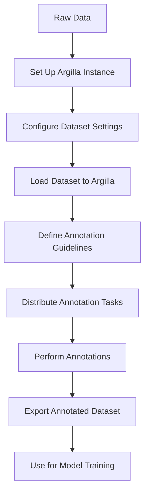
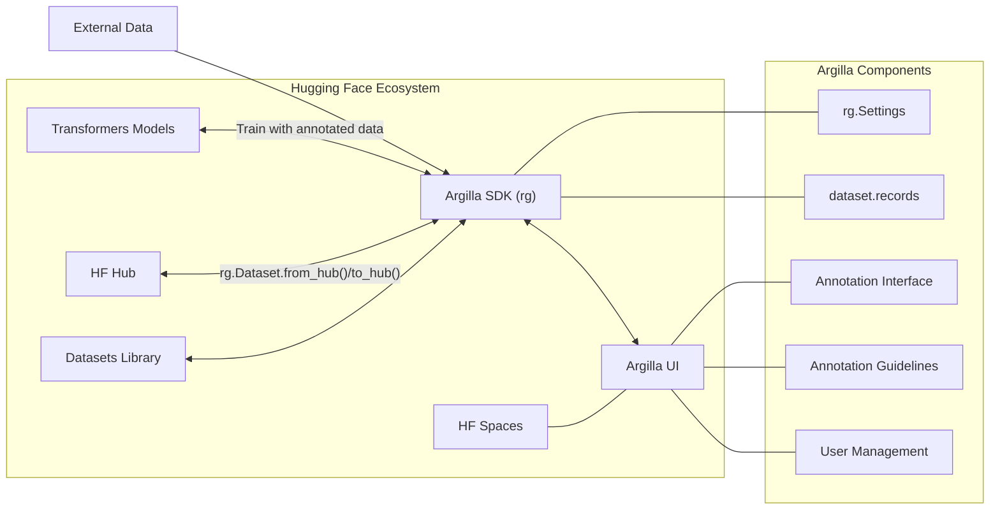
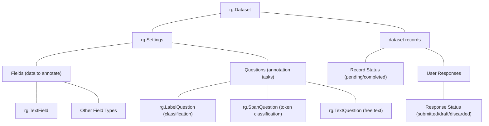
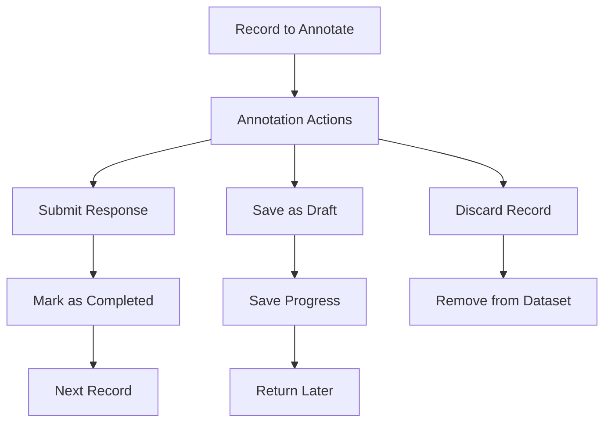

<!-- source: DeepWiki mcp.deepwiki.com · repo huggingface/course · page 6 Data Annotation and Curation · fetched 2026-10-26 -->

# Data Annotation and Curation

<details>
<summary>Relevant source files</summary>

The following files were used as context for generating this wiki page:

- [chapters/en/chapter10/1.mdx](chapters/en/chapter10/1.mdx)
- [chapters/en/chapter10/2.mdx](chapters/en/chapter10/2.mdx)
- [chapters/en/chapter10/3.mdx](chapters/en/chapter10/3.mdx)
- [chapters/en/chapter10/4.mdx](chapters/en/chapter10/4.mdx)
- [chapters/en/chapter10/5.mdx](chapters/en/chapter10/5.mdx)
- [chapters/en/chapter10/6.mdx](chapters/en/chapter10/6.mdx)
- [chapters/en/chapter10/7.mdx](chapters/en/chapter10/7.mdx)

</details>


## Purpose and Scope

This document covers techniques for annotating and curating datasets using Argilla, an open-source data annotation platform that integrates with the Hugging Face ecosystem. You'll learn how to set up Argilla, configure datasets for various annotation tasks, perform annotations collaboratively, and export curated datasets for model training and evaluation.

For information about building datasets programmatically without annotation interfaces, see [Datasets Library Core Components](#3).

## Overview of Data Annotation with Argilla

Data annotation is the process of adding structured labels or tags to raw, unstructured data, making it suitable for machine learning model training. Argilla provides both a user-friendly web interface and a Python SDK to facilitate this process.

Key capabilities:
- Convert unstructured data into structured data for NLP tasks
- Improve dataset quality through manual curation and review
- Gather human feedback for language and multi-modal models
- Support team collaboration for annotation projects

### Data Annotation Workflow

**Data Annotation Workflow with Argilla**


Sources: [chapters/en/chapter10/1.mdx:8-20](), [chapters/en/chapter10/3.mdx:1-10](), [chapters/en/chapter10/4.mdx:1-8](), [chapters/en/chapter10/5.mdx:1-10]()

## Setting Up Argilla

Argilla can be deployed through Hugging Face Spaces or locally using Docker.

### Deploying via Hugging Face Spaces

1. Create a new Space using the Argilla template form
2. Enable persistent storage to prevent data loss when the Space is paused
3. Access the Argilla UI using the Space URL

### Connecting with the Python SDK

Install the Argilla Python package:

```bash
pip install argilla
```

Connect to your Argilla instance:

```python
import argilla as rg

HF_TOKEN = "..."  # only for private spaces

client = rg.Argilla(
    api_url="...",  # Space URL
    api_key="...",  # API key from Argilla UI
    headers={"Authorization": f"Bearer {HF_TOKEN}"},  # only for private spaces
)

# Verify connection
client.me  # Should return user information
```

Sources: [chapters/en/chapter10/2.mdx:9-45]()

## Argilla Integration with Hugging Face

**Argilla and Hugging Face Ecosystem**


Sources: [chapters/en/chapter10/2.mdx:10-20](), [chapters/en/chapter10/3.mdx:19-36](), [chapters/en/chapter10/5.mdx:52-69]()

## Dataset Configuration in Argilla

### Basic Dataset Structure

Argilla datasets consist of:

1. **Fields** - The data to be annotated (text, chat, images)
2. **Questions** - The annotation tasks to perform
3. **Records** - The individual items to annotate
4. **Responses** - The annotations provided by users

**Dataset Configuration and Structure**


Sources: [chapters/en/chapter10/3.mdx:37-72](), [chapters/en/chapter10/4.mdx:26-44](), [chapters/en/chapter10/5.mdx:38-48]()

### Question Types

| Question Type | Purpose | Use Case | 
|---------------|---------|----------|
| `LabelQuestion` | Select a label for the entire record | Text classification |
| `SpanQuestion` | Highlight spans of text and apply labels | Named entity recognition, token classification |
| `TextQuestion` | Provide free-text responses | Summarization, translation |

Sources: [chapters/en/chapter10/3.mdx:59-78](), [chapters/en/chapter10/7.mdx:98-120]()

## Loading Datasets to Argilla

### From Hugging Face Datasets

```python
# Load a dataset from Hugging Face
from datasets import load_dataset
data = load_dataset("SetFit/ag_news", split="train")

# Define dataset settings
settings = rg.Settings(
    fields=[rg.TextField(name="text")],
    questions=[
        rg.LabelQuestion(
            name="label", 
            title="Classify the text:", 
            labels=data.unique("label_text")
        ),
        rg.SpanQuestion(
            name="entities",
            title="Highlight all the entities in the text:",
            labels=["PERSON", "ORG", "LOC", "EVENT"],
            field="text",
        ),
    ],
)

# Create the dataset
dataset = rg.Dataset(name="ag_news", settings=settings)
dataset.create()

# Log records with mapping to use existing labels as pre-annotations
dataset.records.log(data, mapping={"label_text": "label"})
```

Sources: [chapters/en/chapter10/3.mdx:36-102]()

## Annotation Process

### Setting Annotation Guidelines

Clear guidelines help ensure consistency across annotators:

1. Access dataset settings in the UI
2. Update guidelines and question descriptions
3. Share guidelines with all annotators

Best practice is to write guidelines before starting annotation, especially when working with multiple annotators.

Sources: [chapters/en/chapter10/4.mdx:10-18]()

### Task Distribution

Configure how annotations are distributed:

1. Set minimum submitted responses per record (default: 1)
2. Increase this value to analyze inter-annotator agreement
3. Team members can log in using Hugging Face OAuth (for Spaces)

Sources: [chapters/en/chapter10/4.mdx:20-30]()

### Annotation Actions

During annotation, users can:

- **Submit responses**: Mark annotations as complete
- **Save as draft**: Save work in progress to return later
- **Discard record**: Remove record from annotation set

**Annotation Interface Workflow**


Sources: [chapters/en/chapter10/4.mdx:31-44](), [chapters/en/chapter10/7.mdx:122-140]()

## Using Annotated Datasets

### Filtering Records

To retrieve only completed records:

```python
# Filter completed records
status_filter = rg.Query(filter=rg.Filter([("status", "==", "completed")]))
filtered_records = dataset.records(status_filter)
```

Sources: [chapters/en/chapter10/5.mdx:36-48]()

### Exporting to Hugging Face Hub

There are two ways to export datasets:

```python
# Export only filtered records
filtered_records.to_datasets().push_to_hub("username/dataset_name")

# Export the complete Argilla dataset (including settings)
dataset.to_hub(repo_id="username/dataset_name")
```

The second method preserves all Argilla settings, allowing others to import the complete dataset into their Argilla instances.

Sources: [chapters/en/chapter10/5.mdx:51-69](), [chapters/en/chapter10/7.mdx:157-186]()

### Importing from Hugging Face Hub

To import a dataset that was exported with settings:

```python
# Import a dataset from the Hub
dataset = rg.Dataset.from_hub(repo_id="username/dataset_name")
```

Sources: [chapters/en/chapter10/5.mdx:65-69]()

## Example Annotation Projects

### Text Classification

Configure a dataset for text classification:

```python
settings = rg.Settings(
    fields=[rg.TextField(name="text")],
    questions=[
        rg.LabelQuestion(
            name="topic", 
            title="Classify by topic:", 
            labels=["Business", "Technology", "Sports", "Entertainment"]
        ),
    ],
)
```

Sources: [chapters/en/chapter10/3.mdx:57-62]()

### Named Entity Recognition

Configure a dataset for token classification (NER):

```python
settings = rg.Settings(
    fields=[rg.TextField(name="text")],
    questions=[
        rg.SpanQuestion(
            name="entities",
            title="Highlight all entities:",
            labels=["PERSON", "ORG", "LOC", "EVENT"],
            field="text",
        ),
    ],
)
```

Sources: [chapters/en/chapter10/3.mdx:63-78]()

## Best Practices

1. **Start with clear guidelines**: Define annotation rules before starting to ensure consistency
2. **Pre-annotate where possible**: Use existing labels as suggestions by mapping dataset columns to question names
3. **Monitor inter-annotator agreement**: Increase minimum submitted responses for critical tasks
4. **Regular review cycles**: Check annotations periodically to ensure quality
5. **Enable persistent storage**: If using Hugging Face Spaces, enable persistent storage to prevent data loss

Sources: [chapters/en/chapter10/2.mdx:17-19](), [chapters/en/chapter10/4.mdx:10-18](), [chapters/en/chapter10/5.mdx:51-69]()

---

