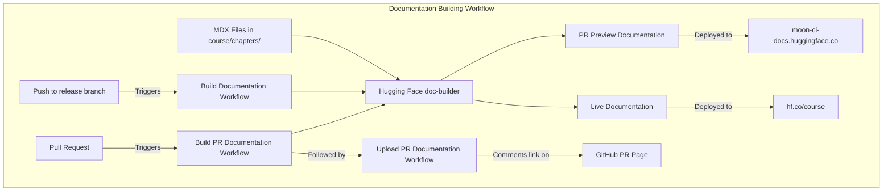
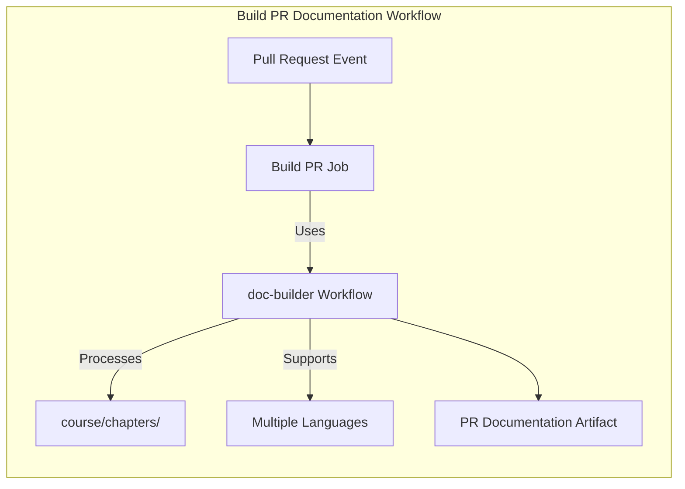
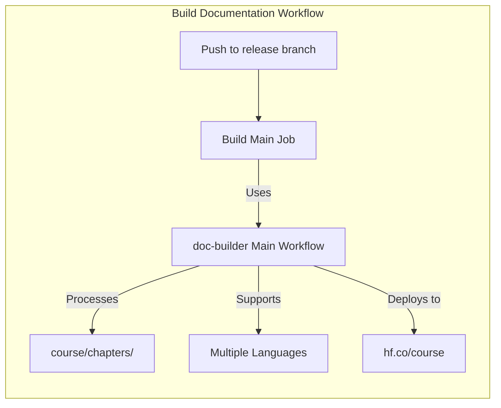
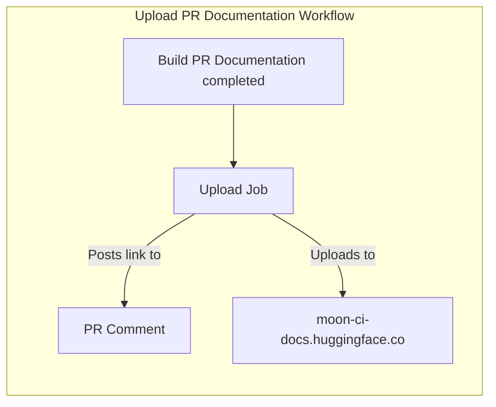
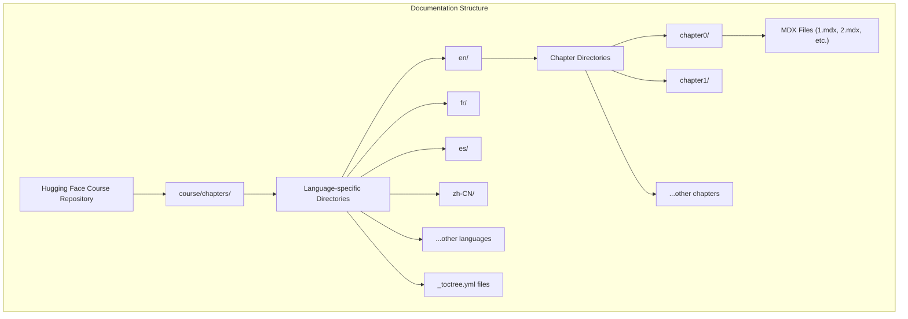
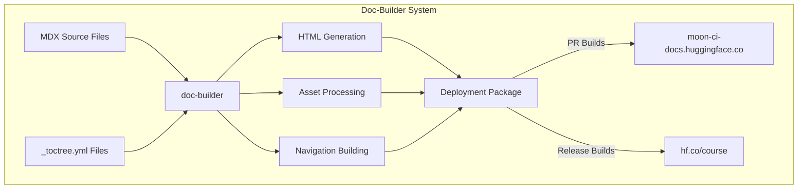
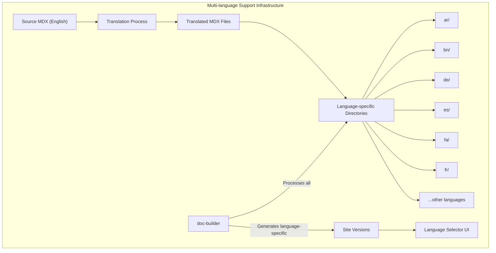
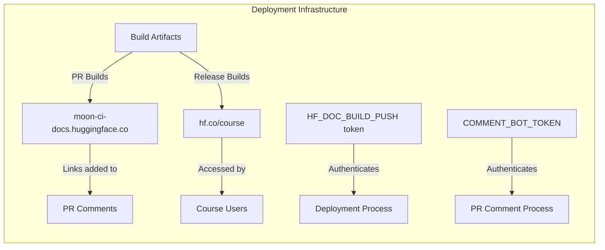

<!-- source: DeepWiki mcp.deepwiki.com · repo huggingface/course · page 7 Documentation and Infrastructure · fetched 2026-10-26 -->

# Documentation and Infrastructure

<details>
<summary>Relevant source files</summary>

The following files were used as context for generating this wiki page:

- [.github/workflows/build_documentation.yml](.github/workflows/build_documentation.yml)
- [.github/workflows/build_pr_documentation.yml](.github/workflows/build_pr_documentation.yml)
- [.github/workflows/upload_pr_documentation.yml](.github/workflows/upload_pr_documentation.yml)
- [chapters/gj/_toctree.yml](chapters/gj/_toctree.yml)
- [chapters/gj/chapter0/1.mdx](chapters/gj/chapter0/1.mdx)

</details>


This document explains the documentation building process and infrastructure for the Hugging Face course repository. It covers how course content is managed, built, and deployed across multiple languages using GitHub Actions workflows and the Hugging Face doc-builder tool. For information about the multilingual support specifically, see [Multilingual Support](#2.1).

## Documentation Building Process

The Hugging Face course documentation follows a structured building process that ensures content is properly formatted, compiled, and deployed. The documentation is written in MDX format (Markdown + JSX) and organized in language-specific directories.



Sources: [.github/workflows/build_pr_documentation.yml](), [.github/workflows/build_documentation.yml](), [.github/workflows/upload_pr_documentation.yml]()

### GitHub Workflows for Documentation

The documentation building process is automated through three GitHub Actions workflows:

1. **Build PR Documentation**: Triggered when a pull request is opened or updated
2. **Build Documentation**: Triggered when changes are pushed to the release branch
3. **Upload PR Documentation**: Uploads and links the PR documentation after it's built

#### Build PR Documentation Workflow

This workflow builds documentation for pull requests to preview changes before they're merged into the main branch.



Key configuration:
- Path to documentation: `course/chapters/`
- Additional arguments: `--not_python_module`
- Supported languages: ar, bn, de, en, es, fa, fr, gj, he, hi, id, it, ja, ko, ne, pt, ru, rum, th, tr, vi, zh-CN, zh-TW

Sources: [.github/workflows/build_pr_documentation.yml]()

#### Build Documentation Workflow

This workflow builds the official documentation when changes are pushed to the release branch.



Key configuration:
- Triggered branches: `release` and `doc-builder*`
- Path to documentation: `course/chapters/`
- Additional arguments: `--not_python_module`
- Requires HF token for deployment: `HF_DOC_BUILD_PUSH`

Sources: [.github/workflows/build_documentation.yml]()

#### Upload PR Documentation Workflow

This workflow uploads the PR documentation built by the "Build PR Documentation" workflow and adds a comment to the PR with a link to the preview.



Key configuration:
- Triggered by: Completion of "Build PR Documentation" workflow
- Hub base path: `https://moon-ci-docs.huggingface.co`
- Requires tokens: `HF_DOC_BUILD_PUSH` and `COMMENT_BOT_TOKEN`

Sources: [.github/workflows/upload_pr_documentation.yml]()

## Documentation Structure

The course documentation is organized hierarchically by language and chapter, with content stored in MDX files.



### Content Organization

Each language directory contains:
- Chapter directories (chapter0, chapter1, etc.)
- A `_toctree.yml` file that defines the table of contents

Each chapter directory contains numbered MDX files (1.mdx, 2.mdx, etc.) which represent individual pages or sections within that chapter.

Example of a `_toctree.yml` file:
```yaml
- title: 0. સિસ્ટમ સેટઅપ 
  sections:
  - local: chapter0/1
    title: પરિચય
```

Sources: [chapters/gj/_toctree.yml]()

### MDX File Structure

The MDX files contain a mixture of Markdown and JSX components. They typically include:
- Headings and text content
- Code snippets
- Images and diagrams
- Interactive components

Example MDX content:
```mdx
# પરિચય 

હગિંગ ફેસ પર આપનું સ્વાગત છે! આ પરિચય તમને કામનું વાતાવરણ ગોઠવવામાં માર્ગદર્શન આપશે...

<div class="flex justify-center">

</div>

```

Sources: [chapters/gj/chapter0/1.mdx]()

## Doc-Builder System

The Hugging Face doc-builder is a specialized tool for building documentation from MDX files. It handles multiple languages, page formatting, and deployment.



### Doc-Builder Configuration

The doc-builder is invoked with specific parameters in the GitHub Actions workflows:

| Parameter | Description | Value |
|-----------|-------------|-------|
| package | Package name | course |
| path_to_docs | Path to documentation files | course/chapters/ |
| additional_args | Additional arguments | --not_python_module |
| languages | Supported languages | ar bn de en es fa fr gj he hi id it ja ko ne pt ru rum th tr vi zh-CN zh-TW |

Sources: [.github/workflows/build_pr_documentation.yml](), [.github/workflows/build_documentation.yml]()

## Multi-language Support Infrastructure

The documentation infrastructure supports 22 different languages, making the course accessible to a global audience.



### Supported Languages

The course documentation is available in the following languages:

| Code | Language | | Code | Language |
|------|----------|---|------|----------|
| ar | Arabic | | ko | Korean |
| bn | Bengali | | ne | Nepali |
| de | German | | pt | Portuguese |
| en | English | | ru | Russian |
| es | Spanish | | rum | Romanian |
| fa | Farsi | | th | Thai |
| fr | French | | tr | Turkish |
| gj | Gujarati | | vi | Vietnamese |
| he | Hebrew | | zh-CN | Simplified Chinese |
| hi | Hindi | | zh-TW | Traditional Chinese |
| id | Indonesian | | | |
| it | Italian | | | |
| ja | Japanese | | | |

Sources: [.github/workflows/build_pr_documentation.yml](), [.github/workflows/build_documentation.yml]()

## Deployment Infrastructure

The documentation is deployed to two different environments:

1. **PR Preview Documentation**: Deployed to `moon-ci-docs.huggingface.co` for reviewing changes in pull requests
2. **Live Documentation**: Deployed to `hf.co/course` when changes are merged into the release branch



Sources: [.github/workflows/upload_pr_documentation.yml](), [.github/workflows/build_documentation.yml]()

## Summary

The documentation and infrastructure system for the Hugging Face course uses:

1. **MDX files** for content, organized by language and chapter
2. **GitHub Actions workflows** to automate the documentation building process
3. **Hugging Face doc-builder** to process and build the documentation
4. **Multi-language support** for 22 different languages
5. **Deployment infrastructure** for both PR previews and live documentation

This infrastructure ensures that the course content is accessible, maintainable, and can be continuously improved through the pull request process.