# Page: Hugging Face Course Overview

# Hugging Face Course Overview

<details>
<summary>Relevant source files</summary>

The following files were used as context for generating this wiki page:

- [.github/ISSUE_TEMPLATE/translations.md](.github/ISSUE_TEMPLATE/translations.md)
- [README.md](README.md)
- [chapters/en/chapter1/1.mdx](chapters/en/chapter1/1.mdx)
- [chapters/en/chapter1/2.mdx](chapters/en/chapter1/2.mdx)
- [chapters/en/chapter1/4.mdx](chapters/en/chapter1/4.mdx)
- [chapters/en/chapter1/8.mdx](chapters/en/chapter1/8.mdx)
- [chapters/en/chapter1/9.mdx](chapters/en/chapter1/9.mdx)
- [chapters/en/chapter8/4.mdx](chapters/en/chapter8/4.mdx)
- [chapters/en/chapter8/4_tf.mdx](chapters/en/chapter8/4_tf.mdx)
- [chapters/en/chapter8/7.mdx](chapters/en/chapter8/7.mdx)
- [chapters/es/chapter8/1.mdx](chapters/es/chapter8/1.mdx)
- [chapters/es/chapter8/2.mdx](chapters/es/chapter8/2.mdx)
- [chapters/fr/chapter8/4.mdx](chapters/fr/chapter8/4.mdx)
- [chapters/fr/chapter8/4_tf.mdx](chapters/fr/chapter8/4_tf.mdx)
- [chapters/vi/chapter1/1.mdx](chapters/vi/chapter1/1.mdx)
- [chapters/vi/chapter8/4.mdx](chapters/vi/chapter8/4.mdx)
- [utils/generate_notebooks.py](utils/generate_notebooks.py)

</details>


This document provides a technical overview of the Hugging Face Course repository, its structure, and how it operates. The course is designed to teach students about the Hugging Face ecosystem, with a focus on large language models (LLMs), natural language processing (NLP), and how to use libraries like 🤗 Transformers, 🤗 Datasets, 🤗 Tokenizers, and 🤗 Accelerate.

## Purpose and Scope

The Hugging Face Course is an open-source educational resource focused on teaching students how to apply Transformer models to various tasks in natural language processing and beyond. The course is completely free and available in multiple languages.

The repository at https://github.com/huggingface/course contains all the content used to build the course website at https://huggingface.co/course. It includes text explanations, code snippets, diagrams, and utilities for generating Jupyter notebooks from the course content.

Sources: [README.md:1-4](). [chapters/en/chapter1/1.mdx:10-14]()

## Repository Structure and Content Organization

### Course Content Organization

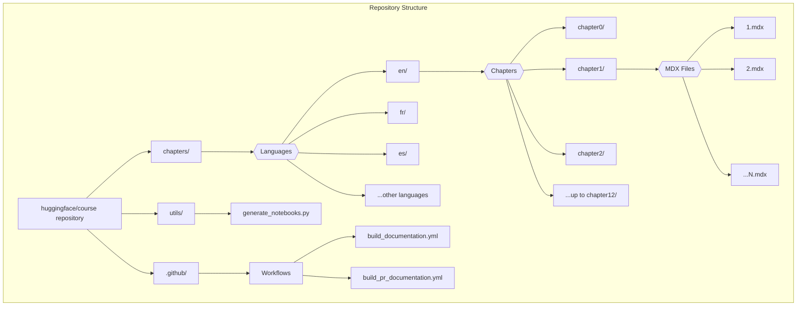

The course repository is organized into several main directories:

- `chapters/`: Contains the course content in MDX format, organized by language and chapter
- `utils/`: Contains utility scripts like notebook generators
- `.github/`: Contains GitHub workflows for CI/CD and documentation building

Each language directory in `chapters/` (like `en/`, `fr/`, etc.) contains chapter directories, and each chapter directory contains numbered MDX files representing sections of that chapter.

Sources: [README.md:57-60](), [README.md:117-131]()

### Content Structure and Progression

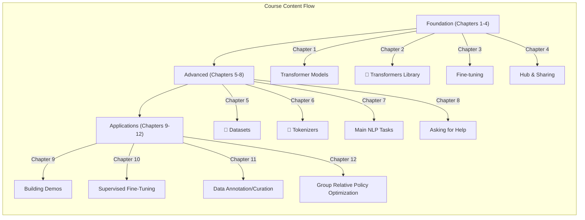

The course is divided into three main sections:

1. **Foundation (Chapters 1-4)**: Introduction to Transformer models, using the 🤗 Transformers library, fine-tuning, and sharing models on the Hub
2. **Advanced (Chapters 5-8)**: Deeper exploration of 🤗 Datasets and 🤗 Tokenizers, NLP tasks, and troubleshooting
3. **Applications (Chapters 9-12)**: Building demos, advanced fine-tuning techniques, data curation, and reinforcement learning

Sources: [chapters/en/chapter1/1.mdx:33-36](), [README.md:1-4]()

## Multilingual Support

The course is available in multiple languages, with translations managed by community contributors. Each language has its own directory under `chapters/`, with content files that mirror the English versions.

| Language | Status | Directory | Example |
|----------|--------|-----------|---------|
| English | Complete | `chapters/en/` | Original content |
| French | Complete | `chapters/fr/` | Fully translated |
| Vietnamese | Complete | `chapters/vi/` | Fully translated |
| Chinese (simplified) | Complete | `chapters/zh-CN/` | Fully translated |
| Spanish | WIP | `chapters/es/` | In progress |
| German | WIP | `chapters/de/` | In progress |
| ... | ... | ... | ... |

Translation contributions follow a structured process, with new translations submitted via pull requests after the original English content is completed.

Sources: [README.md:5-28](), [README.md:31-115](), [chapters/en/chapter1/1.mdx:115-147]()

## Documentation Building Pipeline

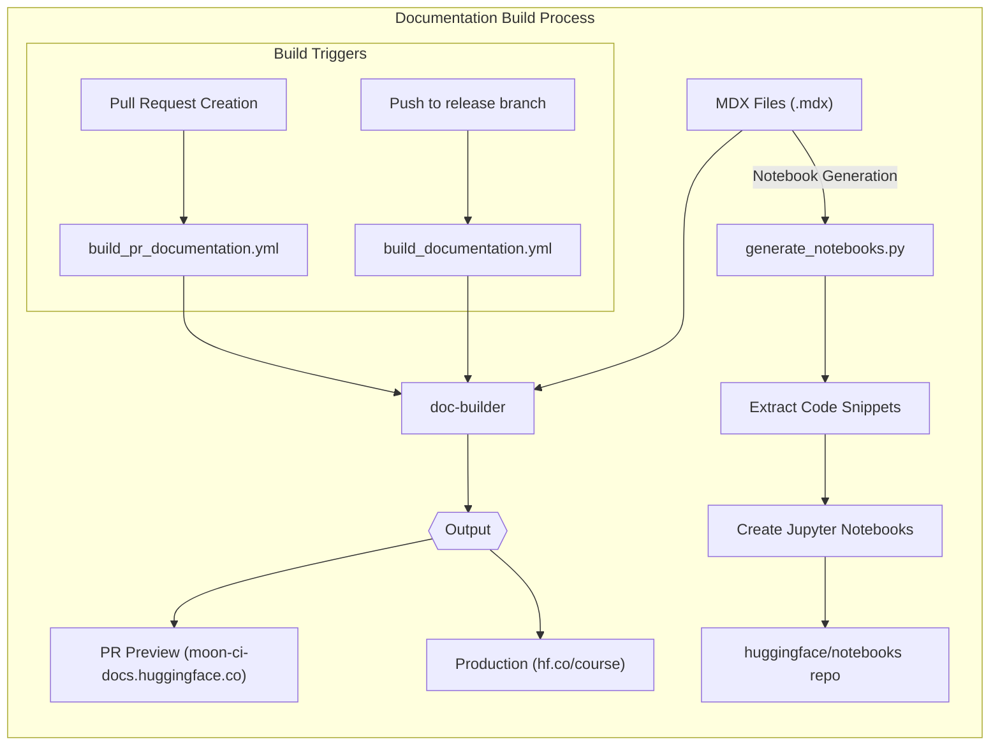

The documentation for the course is built using the `doc-builder` tool from Hugging Face. This process occurs in two main scenarios:

1. **Pull Request Preview**: When a PR is created, the `build_pr_documentation.yml` workflow runs to build a preview version of the documentation, accessible via a temporary URL for review.

2. **Production Build**: When changes are pushed to the `release` branch, the `build_documentation.yml` workflow runs to build the documentation for the production website at `hf.co/course`.

Sources: [README.md:147-163](), [.github/ISSUE_TEMPLATE/translations.md:1-4]()

## Notebook Generation Process

The repository includes a utility script, `generate_notebooks.py`, which extracts code snippets from the MDX files and generates Jupyter notebooks. This allows students to run the code examples interactively.

The notebook generation process:

1. Reads MDX files and extracts code blocks
2. Creates notebook cells for each extracted code block
3. Adds necessary import and setup cells
4. Organizes notebooks by chapter and language
5. Handles framework-specific code (PyTorch vs. TensorFlow)

Generated notebooks are available in the [`huggingface/notebooks`](https://github.com/huggingface/notebooks) repository and can be run in Google Colab or Amazon SageMaker Studio Lab.

Sources: [README.md:117-131](), [utils/generate_notebooks.py:1-290]()

## Core Components and Technology Stack

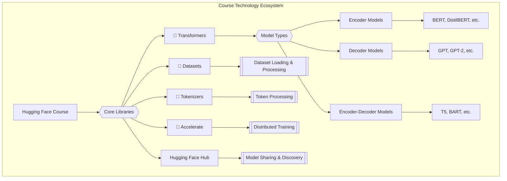

The course is built around the Hugging Face ecosystem of libraries:

1. **🤗 Transformers**: The main library for working with Transformer models
2. **🤗 Datasets**: For loading, processing, and sharing datasets
3. **🤗 Tokenizers**: For efficient text tokenization
4. **🤗 Accelerate**: For distributed training
5. **Hugging Face Hub**: For sharing and discovering models and datasets

These libraries are integrated throughout the course, with examples showing how to use them for various NLP tasks.

Sources: [chapters/en/chapter1/1.mdx:12-13](), [chapters/en/chapter1/4.mdx:9-169]()

## Model Architectures and Use Cases

The course covers three main types of Transformer architectures:

1. **Encoder-only models** (BERT, DistilBERT, ALBERT, RoBERTa):
   - Used for: Sentence classification, named entity recognition, extractive question answering
   - Focus on understanding input

2. **Decoder-only models** (GPT, GPT-2, CTRL):
   - Used for: Text generation
   - Focus on generating output

3. **Encoder-decoder models** (BART, T5, Marian):
   - Used for: Summarization, translation, generative question answering
   - Combine understanding of input with generation of output

Sources: [chapters/en/chapter1/4.mdx:124-141](), [chapters/en/chapter1/9.mdx:10-16]()

## Contributing to the Course

The repository includes guidelines for contributing, especially for translations. Contributors can:

1. Create a fork of the repository
2. Create new content or translate existing content
3. Submit pull requests
4. Use the `doc-builder` tool to preview changes locally

New translations are managed through GitHub issues, with contributors claiming specific chapters to translate. The community coordinates translation efforts through Discord channels.

Sources: [README.md:31-115](), [.github/ISSUE_TEMPLATE/translations.md:1-107]()

## Conclusion

The Hugging Face Course is a comprehensive educational resource for learning about Transformer models and the Hugging Face ecosystem. The repository is designed to be accessible, multilingual, and community-driven, with tools for building documentation and generating code examples. The course covers a wide range of topics, from the basics of Transformer models to advanced techniques for fine-tuning and building applications.

---

# Page: Course Structure and Organization

# Course Structure and Organization

<details>
<summary>Relevant source files</summary>

The following files were used as context for generating this wiki page:

- [.github/ISSUE_TEMPLATE/translations.md](.github/ISSUE_TEMPLATE/translations.md)
- [README.md](README.md)
- [chapters/en/_toctree.yml](chapters/en/_toctree.yml)
- [chapters/en/chapter12/1.mdx](chapters/en/chapter12/1.mdx)
- [chapters/en/chapter12/2.mdx](chapters/en/chapter12/2.mdx)
- [chapters/en/chapter12/3.mdx](chapters/en/chapter12/3.mdx)
- [chapters/en/chapter12/3a.mdx](chapters/en/chapter12/3a.mdx)
- [chapters/en/chapter12/4.mdx](chapters/en/chapter12/4.mdx)
- [chapters/en/chapter12/5.mdx](chapters/en/chapter12/5.mdx)
- [chapters/en/chapter12/6.mdx](chapters/en/chapter12/6.mdx)
- [chapters/en/chapter12/7.mdx](chapters/en/chapter12/7.mdx)
- [chapters/en/chapter12/img/1.png](chapters/en/chapter12/img/1.png)
- [chapters/en/chapter12/img/2.jpg](chapters/en/chapter12/img/2.jpg)
- [chapters/en/chapter8/4.mdx](chapters/en/chapter8/4.mdx)
- [chapters/en/chapter8/4_tf.mdx](chapters/en/chapter8/4_tf.mdx)
- [chapters/en/chapter8/7.mdx](chapters/en/chapter8/7.mdx)
- [chapters/es/chapter8/1.mdx](chapters/es/chapter8/1.mdx)
- [chapters/es/chapter8/2.mdx](chapters/es/chapter8/2.mdx)
- [chapters/fr/chapter8/4.mdx](chapters/fr/chapter8/4.mdx)
- [chapters/fr/chapter8/4_tf.mdx](chapters/fr/chapter8/4_tf.mdx)
- [chapters/pt/_toctree.yml](chapters/pt/_toctree.yml)
- [chapters/pt/chapter1/10.mdx](chapters/pt/chapter1/10.mdx)
- [chapters/pt/chapter1/4.mdx](chapters/pt/chapter1/4.mdx)
- [chapters/pt/chapter1/5.mdx](chapters/pt/chapter1/5.mdx)
- [chapters/pt/chapter1/6.mdx](chapters/pt/chapter1/6.mdx)
- [chapters/pt/chapter1/7.mdx](chapters/pt/chapter1/7.mdx)
- [chapters/pt/chapter1/8.mdx](chapters/pt/chapter1/8.mdx)
- [chapters/pt/chapter1/9.mdx](chapters/pt/chapter1/9.mdx)
- [chapters/pt/chapter4/3.mdx](chapters/pt/chapter4/3.mdx)
- [chapters/pt/chapter6/1.mdx](chapters/pt/chapter6/1.mdx)
- [chapters/pt/chapter6/2.mdx](chapters/pt/chapter6/2.mdx)
- [chapters/pt/chapter6/3.mdx](chapters/pt/chapter6/3.mdx)
- [chapters/vi/chapter8/4.mdx](chapters/vi/chapter8/4.mdx)
- [utils/generate_notebooks.py](utils/generate_notebooks.py)

</details>


This document provides an overview of the Hugging Face course structure, organization, and content flow. It explains how the course is organized into chapters, the progression of topics, and how different components work together. For information about multilingual support and translations, see [Multilingual Support](#2.1).

## Course Overview

The Hugging Face course is a comprehensive educational resource designed to teach users how to apply Transformer models to various tasks in natural language processing and beyond. The course is structured to provide a progressive learning path, beginning with foundational concepts and advancing to more complex applications.

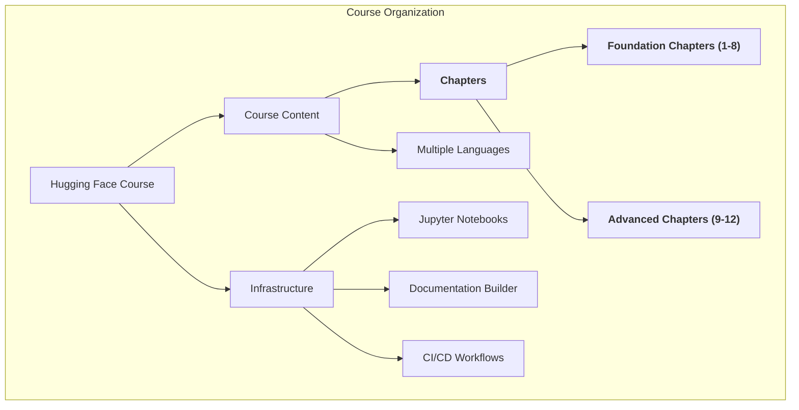

Sources: [README.md:1-46](). [chapters/en/_toctree.yml:1-251]()

## Chapter Organization

The course is organized into 12 chapters plus supplementary materials. Each chapter focuses on a specific aspect of Transformer models, libraries, or applications and follows a structured organization.

### Foundation Chapters (1-8)

The foundation chapters cover the essential concepts and tools needed to understand and work with Transformer models:

| Chapter | Title | Focus |
|---------|-------|-------|
| 1 | Transformer models | Understanding the core architecture and capabilities |
| 2 | Using 🤗 Transformers | Getting started with the primary library |
| 3 | Fine-tuning a pretrained model | Adapting models to specific tasks |
| 4 | Sharing models and tokenizers | Using and contributing to the Hub |
| 5 | The 🤗 Datasets library | Working with datasets efficiently |
| 6 | The 🤗 Tokenizers library | Understanding and customizing tokenization |
| 7 | Classical NLP tasks | Applying models to common NLP problems |
| 8 | How to ask for help | Debugging and community resources |

### Advanced Chapters (9-12)

The advanced chapters build on the foundation to explore more complex applications and techniques:

| Chapter | Title | Focus |
|---------|-------|-------|
| 9 | Building and sharing demos | Creating interactive demos with Gradio |
| 10 | Curate high-quality datasets | Data annotation and curation with Argilla |
| 11 | Fine-tune Large Language Models | SFT and Low-Rank Adaptation techniques |
| 12 | Build Reasoning Models | Group Relative Policy Optimization (GRPO) |

Sources: [chapters/en/_toctree.yml:1-251](). [README.md:1-46]()

## Section Structure

Each chapter is divided into multiple sections, typically following this pattern:

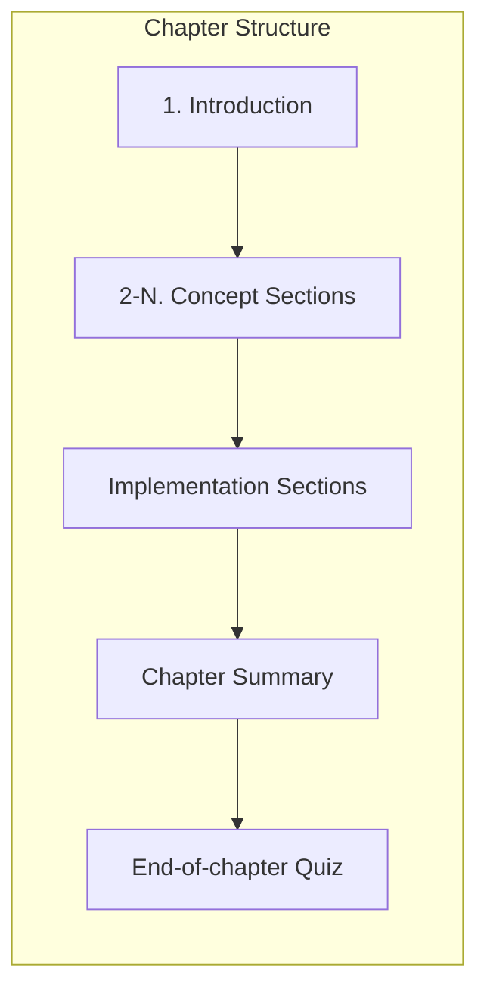

Sections are delivered as MDX files (Markdown with JSX components), which allow for interactive elements, executable code snippets, and embedded media. Each section generally includes:

- Explanatory text with concepts and theory
- Code examples that can be copied and run
- Interactive elements (when viewed on the website)
- Visual diagrams and illustrations
- Practical application tips

Sources: [chapters/en/_toctree.yml:1-251](). [chapters/en/chapter12/1.mdx:1-94](). [chapters/en/chapter12/2.mdx:1-246]()

## Content Formats and Generation

The course content exists in multiple formats to accommodate different learning preferences:

### MDX Source Files

The primary content is authored in MDX format, which combines Markdown with JSX components for enhanced interactivity.

### Jupyter Notebooks

Jupyter notebooks are automatically generated from the MDX source files, allowing learners to execute code examples directly.

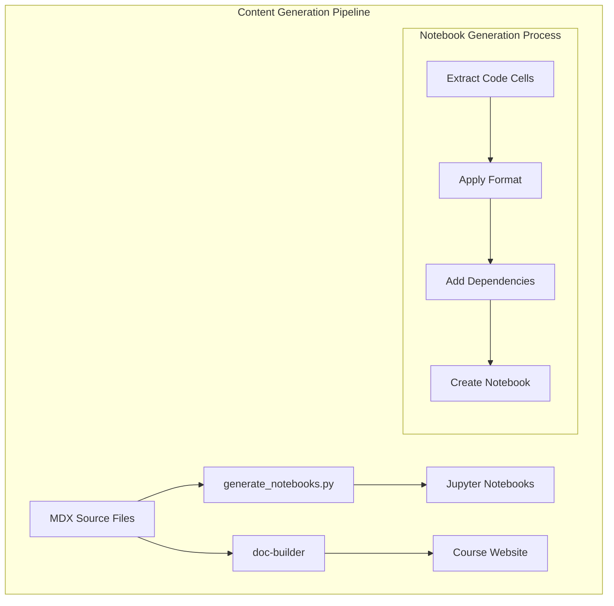

The notebook generation process:
1. Extracts code cells from MDX files
2. Applies proper formatting
3. Adds necessary dependencies (libraries like transformers, datasets)
4. Creates executable Jupyter notebooks

Sources: [utils/generate_notebooks.py:1-291](). [README.md:117-131]()

## Documentation Building and Deployment

The course website is built using a documentation builder that processes the MDX files:

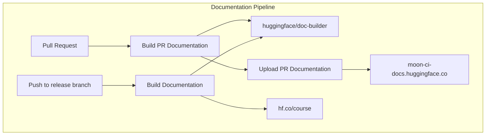

The documentation process includes:
1. Building PR previews for review
2. Building the main documentation on release
3. Deploying to the Hugging Face course website

Sources: [README.md:147-165]()

## Learning Pathways

The course is designed to support multiple learning pathways depending on the learner's interests and goals:

### Foundation Path
For those new to Transformers, following chapters 1-8 in sequence provides a comprehensive understanding of the core concepts and libraries.

### Task-Specific Paths
Learners can focus on specific NLP tasks by studying:
- Chapter 1 for understanding the architecture
- Chapter 2 for basic usage
- Chapter 3 for fine-tuning
- Chapter 7 for the specific task of interest

### Advanced Applications Path
For those interested in building and deploying models:
- Chapters 1-4 for core concepts
- Chapter 9 for creating demos
- Chapter 10 for dataset curation
- Chapter 11-12 for advanced fine-tuning techniques

Sources: [chapters/en/_toctree.yml:1-251]()

## Practical Exercises and Quizzes

Each chapter includes practical exercises throughout the sections and concludes with a quiz to test understanding:

1. **In-chapter exercises**: Marked with "Your turn!" prompts for hands-on practice
2. **End-of-chapter quizzes**: Multiple-choice questions testing comprehension
3. **Practical projects**: More extensive exercises, especially in advanced chapters

The advanced chapters (11-12) feature comprehensive practical exercises like fine-tuning models with GRPO (Group Relative Policy Optimization).

Sources: [chapters/en/chapter12/5.mdx:1-238](). [chapters/en/chapter12/6.mdx:1-378](). [chapters/en/chapter8/7.mdx:1-205]()

## Course Materials and Resources

The course leverages various types of materials to enhance the learning experience:

1. **Explanatory text**: Core concepts and theory
2. **Code snippets**: Practical implementation examples
3. **Diagrams**: Visual representations of architectures and workflows
4. **Jupyter notebooks**: Interactive environments for code execution
5. **Sample applications**: Working examples of model usage
6. **Community forums**: Spaces for questions and discussion

Sources: [README.md:1-169](). [chapters/en/_toctree.yml:1-251]()

## Course Updates and Maintenance

The course is actively maintained and updated with new content:

1. New chapters are added to cover emerging techniques (like chapter 12 on reasoning models)
2. Existing chapters are updated to reflect library changes
3. Community contributions and translations expand the reach
4. Course events provide additional learning opportunities

The most recent updates are typically marked with a "new" tag in the table of contents.

Sources: [chapters/en/_toctree.yml:231-250](). [chapters/en/chapter12/7.mdx:1-17]()

## Conclusion

The Hugging Face course provides a structured learning path from foundational concepts to advanced applications of Transformer models. Through its progressive chapter organization, multilingual support, and various content formats, it accommodates different learning styles and objectives. The course continues to evolve with new chapters and updates that reflect the latest developments in the field.

---

# Page: Multilingual Support

# Multilingual Support

<details>
<summary>Relevant source files</summary>

The following files were used as context for generating this wiki page:

- [.github/ISSUE_TEMPLATE/translations.md](.github/ISSUE_TEMPLATE/translations.md)
- [.github/workflows/quality.yml](.github/workflows/quality.yml)
- [README.md](README.md)
- [chapters/en/chapter8/4.mdx](chapters/en/chapter8/4.mdx)
- [chapters/en/chapter8/4_tf.mdx](chapters/en/chapter8/4_tf.mdx)
- [chapters/en/chapter8/7.mdx](chapters/en/chapter8/7.mdx)
- [chapters/es/TRANSLATING.txt](chapters/es/TRANSLATING.txt)
- [chapters/es/_toctree.yml](chapters/es/_toctree.yml)
- [chapters/es/chapter0/1.mdx](chapters/es/chapter0/1.mdx)
- [chapters/es/chapter1/10.mdx](chapters/es/chapter1/10.mdx)
- [chapters/es/chapter2/4.mdx](chapters/es/chapter2/4.mdx)
- [chapters/es/chapter2/5.mdx](chapters/es/chapter2/5.mdx)
- [chapters/es/chapter2/6.mdx](chapters/es/chapter2/6.mdx)
- [chapters/es/chapter3/1.mdx](chapters/es/chapter3/1.mdx)
- [chapters/es/chapter3/3.mdx](chapters/es/chapter3/3.mdx)
- [chapters/es/chapter3/3_tf.mdx](chapters/es/chapter3/3_tf.mdx)
- [chapters/es/chapter3/4.mdx](chapters/es/chapter3/4.mdx)
- [chapters/es/chapter3/5.mdx](chapters/es/chapter3/5.mdx)
- [chapters/es/chapter3/6.mdx](chapters/es/chapter3/6.mdx)
- [chapters/es/chapter8/1.mdx](chapters/es/chapter8/1.mdx)
- [chapters/es/chapter8/2.mdx](chapters/es/chapter8/2.mdx)
- [chapters/es/glossary/1.mdx](chapters/es/glossary/1.mdx)
- [chapters/fr/chapter8/4.mdx](chapters/fr/chapter8/4.mdx)
- [chapters/fr/chapter8/4_tf.mdx](chapters/fr/chapter8/4_tf.mdx)
- [chapters/ja/_toctree.yml](chapters/ja/_toctree.yml)
- [chapters/ja/chapter2/1.mdx](chapters/ja/chapter2/1.mdx)
- [chapters/ja/chapter2/2.mdx](chapters/ja/chapter2/2.mdx)
- [chapters/ja/chapter2/3.mdx](chapters/ja/chapter2/3.mdx)
- [chapters/ja/chapter2/4.mdx](chapters/ja/chapter2/4.mdx)
- [chapters/ja/chapter2/5.mdx](chapters/ja/chapter2/5.mdx)
- [chapters/ru/_toctree.yml](chapters/ru/_toctree.yml)
- [chapters/ru/chapter2/1.mdx](chapters/ru/chapter2/1.mdx)
- [chapters/ru/chapter2/2.mdx](chapters/ru/chapter2/2.mdx)
- [chapters/ru/chapter2/3.mdx](chapters/ru/chapter2/3.mdx)
- [chapters/ru/chapter2/4.mdx](chapters/ru/chapter2/4.mdx)
- [chapters/ru/chapter2/5.mdx](chapters/ru/chapter2/5.mdx)
- [chapters/ru/chapter2/6.mdx](chapters/ru/chapter2/6.mdx)
- [chapters/ru/chapter2/7.mdx](chapters/ru/chapter2/7.mdx)
- [chapters/ru/chapter2/8.mdx](chapters/ru/chapter2/8.mdx)
- [chapters/vi/chapter8/4.mdx](chapters/vi/chapter8/4.mdx)
- [utils/generate_notebooks.py](utils/generate_notebooks.py)

</details>


This page documents how the Hugging Face course is translated and maintained across multiple languages, enabling a global audience to access educational materials on machine learning and Natural Language Processing (NLP). The multilingual support system ensures consistency across translations while accommodating the unique characteristics of each language.

## Overview

The Hugging Face course is designed with internationalization as a core principle. The course's repository structure, build processes, and contribution workflows all support multiple languages, allowing the community to collaborate on translations. Currently, the course is available in several languages, with more being added through community contributions.

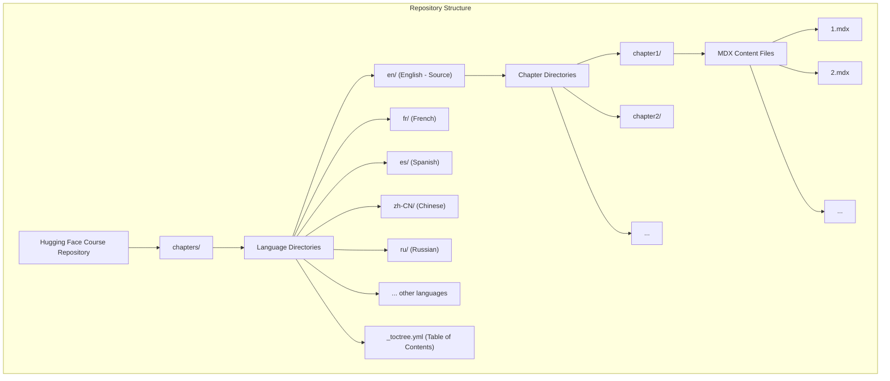

Sources: [README.md:5-32](), [utils/generate_notebooks.py:23-26]()

## Available Languages

The course is currently available in multiple languages, with varying levels of completion. The English version serves as the source content, while other languages are translated from it.

| Language | Status | Repository Path |
|----------|--------|-----------------|
| English | Complete | `chapters/en/` |
| French | Complete | `chapters/fr/` |
| Vietnamese | Complete | `chapters/vi/` |
| Chinese (simplified) | Complete | `chapters/zh-CN/` |
| Spanish | In Progress | `chapters/es/` |
| Russian | In Progress | `chapters/ru/` |
| Japanese | In Progress | `chapters/ja/` |
| German | In Progress | `chapters/de/` |
| Portuguese | In Progress | `chapters/pt/` |
| ... | ... | ... |

Many more languages are in various stages of translation, including Bengali, Persian, Gujarati, Hebrew, Hindi, Indonesian, Italian, Korean, Thai, Turkish, and traditional Chinese.

Sources: [README.md:7-28]()

## Content Organization

Each language version has an identical structure, mirroring the English source content. This ensures that readers can easily navigate between languages while maintaining their place in the course.

### Directory Structure

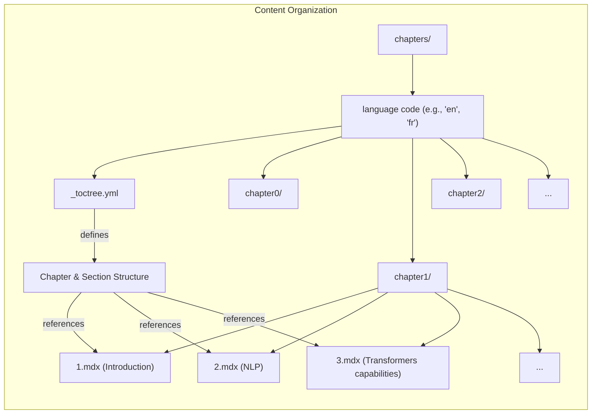

Sources: [chapters/ru/_toctree.yml:1-204](), [chapters/es/_toctree.yml:1-120](), [chapters/ja/_toctree.yml:1-93]()

### Table of Contents

Each language has a `_toctree.yml` file that defines the course structure. This file specifies:

- Chapter titles and organization
- Section titles and corresponding MDX files
- Quiz locations and identifiers
- Framework-specific content variants (PyTorch/TensorFlow)

The table of contents serves as the structural backbone for rendering the course website and ensures consistent navigation across all language versions.

Sources: [chapters/ru/_toctree.yml:1-204](), [chapters/es/_toctree.yml:1-120](), [chapters/ja/_toctree.yml:1-93]()

## Translation Workflow

Contributing to the translation of the course follows a structured process designed to ensure quality and consistency.

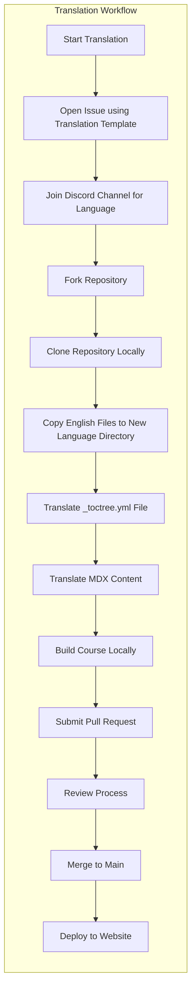

Sources: [README.md:31-115](), [.github/ISSUE_TEMPLATE/translations.md:1-107]()

### Starting a Translation

1. **Open an Issue**: Begin by creating an issue using the translation template, specifying which language you want to translate to and which chapters you'll work on.
2. **Join Discord**: Connect with other translators for your language in the dedicated Discord channel.
3. **Fork & Clone**: Fork the repository and clone it locally to start working.

### Translation Process

1. **Copy Source Files**: Copy the English files from `chapters/en/` to your language directory (e.g., `chapters/es/`).
2. **Translate TOC**: Start by translating the `_toctree.yml` file to establish the chapter and section structure.
3. **Translate Content**: Translate the MDX files, maintaining all code blocks, special syntax, and formatting.
4. **Local Testing**: Build the course locally to test your changes.

### Review and Publishing

1. **Submit PR**: Once a section or chapter is translated, submit a pull request.
2. **Review**: Native speakers review the translation for accuracy and clarity.
3. **Merge**: After approval, changes are merged to the main branch.
4. **Deployment**: Translated content is automatically built and deployed to the course website.

Sources: [README.md:31-115](), [.github/ISSUE_TEMPLATE/translations.md:1-107](), [chapters/es/TRANSLATING.txt:1-45]()

## Technical Implementation

The multilingual support system is built on several key components that work together to handle content in different languages.

### Document Building Process

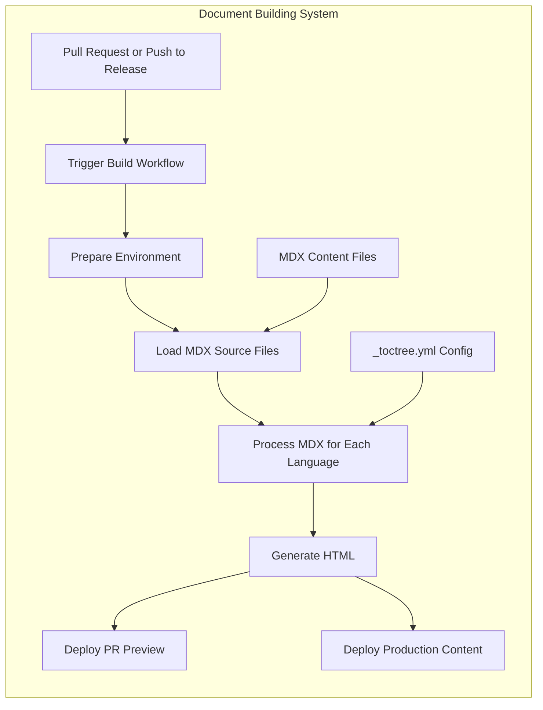

Sources: [README.md:88-102](), [README.md:147-164]()

### Notebook Generation

The course automatically generates Jupyter notebooks from the MDX content files for each language (except for French, which has manually created notebooks). This process extracts code snippets and creates executable notebooks that learners can use.

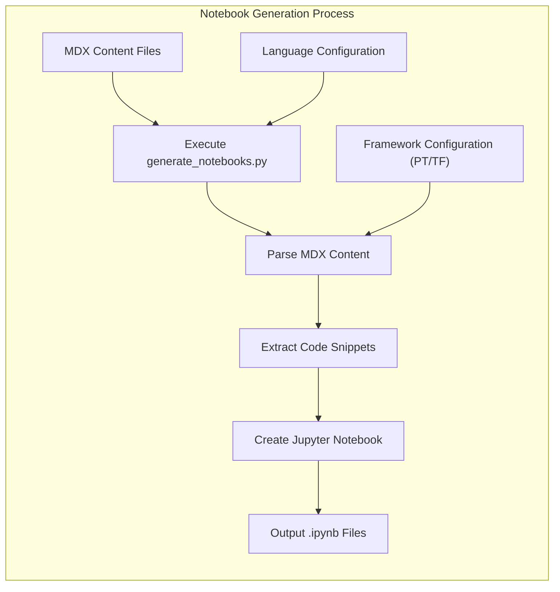

Sources: [utils/generate_notebooks.py:1-291](), [README.md:117-131]()

## Translation Guidelines

Each language has specific guidelines to ensure consistency across translations. These guidelines typically cover:

1. **Terminology**: Standard translations for technical terms
2. **Style**: Voice, formality level, and cultural adaptations
3. **Formatting**: How to handle code blocks, special characters, and layout
4. **Diagrams and Images**: Instructions for translating or adapting visual elements

Translators are encouraged to use the glossary specific to their language when available, to maintain consistent terminology throughout the course.

Sources: [chapters/es/TRANSLATING.txt:1-45](), [chapters/es/glossary/1.mdx:1-100]()

## Framework-Specific Content

The course supports both PyTorch and TensorFlow, with some content varying depending on the framework. This is handled in the MDX files using special syntax:

```
{#if fw === 'pt'}
PyTorch-specific content
{:else}
TensorFlow-specific content
{/if}
```

During the build process, this generates separate content for each framework while maintaining a single source file. The notebook generation process also creates framework-specific notebooks when necessary.

Sources: [chapters/ru/chapter2/2.mdx:1-354](), [utils/generate_notebooks.py:10-12](), [utils/generate_notebooks.py:173-190]()

## Quality Assurance

To ensure high-quality translations, several processes are in place:

1. **Review Process**: Pull requests for translations are reviewed by native speakers
2. **Style Checks**: Automated checks ensure formatting is consistent
3. **Build Testing**: Continuous integration validates that translated content builds correctly
4. **Community Feedback**: Readers can provide feedback on translations through GitHub issues

Quality checks run on every pull request to verify that the content meets the project's standards before merging.

Sources: [.github/workflows/quality.yml:1-22]()

## Contributing to Translations

New translators are always welcome to contribute to the project. The recommended workflow for new translators is:

1. Check the README for already supported languages and their status
2. Open an issue using the translation template if starting a new language
3. Join the Discord server to coordinate with other translators
4. Start with small sections (e.g., chapter introductions) to get familiar with the process
5. Submit regular, small pull requests rather than large ones

For detailed instructions on contributing to translations, refer to the "Translating the course into your language" section in the README.

Sources: [README.md:31-115](), [.github/ISSUE_TEMPLATE/translations.md:1-107]()

---

# Page: 🤗 Transformers Library Core Components

# 🤗 Transformers Library Core Components

<details>
<summary>Relevant source files</summary>

The following files were used as context for generating this wiki page:

- [chapters/ru/_toctree.yml](chapters/ru/_toctree.yml)
- [chapters/ru/chapter2/1.mdx](chapters/ru/chapter2/1.mdx)
- [chapters/ru/chapter2/2.mdx](chapters/ru/chapter2/2.mdx)
- [chapters/ru/chapter2/3.mdx](chapters/ru/chapter2/3.mdx)
- [chapters/ru/chapter2/4.mdx](chapters/ru/chapter2/4.mdx)
- [chapters/ru/chapter2/5.mdx](chapters/ru/chapter2/5.mdx)
- [chapters/ru/chapter2/6.mdx](chapters/ru/chapter2/6.mdx)
- [chapters/ru/chapter2/7.mdx](chapters/ru/chapter2/7.mdx)
- [chapters/ru/chapter2/8.mdx](chapters/ru/chapter2/8.mdx)

</details>


This document provides an overview of the core components that make up the Hugging Face Transformers library. It explains how these components work together to enable efficient use of pre-trained transformer models for various natural language processing (NLP) tasks. For information about specific model architectures, see the related wiki pages on transformers architectures.

## Overview of Core Components

The 🤗 Transformers library provides a unified interface for working with transformer-based models. At its core, the library consists of several key components that work together in a pipeline:

```mermaid
flowchart TD
    subgraph "Core Components Pipeline"
        "RawText"["Raw Text Input"] --> "Tokenizer"["AutoTokenizer"]
        "Tokenizer" --> "ModelInputs"["Preprocessed Inputs<br>(input_ids, attention_mask)"]
        "ModelInputs" --> "Model"["AutoModel"]
        "Model" --> "HiddenStates"["Hidden States<br>(Batch, Seq, Hidden)"]
        "HiddenStates" --> "ModelHead"["Task-Specific Head"]
        "ModelHead" --> "Outputs"["Task Outputs<br>(logits, etc.)"]
        "Outputs" --> "PostProcess"["Post-processing"]
        "PostProcess" --> "Predictions"["Final Predictions"]
    end
    
    "Pipeline"["pipeline() function"] -.-> "Tokenizer"
    "Pipeline" -.-> "Model"
    "Pipeline" -.-> "PostProcess"
```

Sources: [chapters/ru/chapter2/2.mdx:56-61](). The diagram shows the complete processing pipeline from raw text to predictions.

Let's explore each of these core components in detail.

## AutoClasses: The Entry Point

The `Auto*` classes serve as the primary entry point to the library, automatically loading the appropriate implementation based on the specified pre-trained checkpoint.

```mermaid
flowchart TD
    subgraph "Auto Classes System"
        "Checkpoint"["Checkpoint Name<br>(e.g., 'bert-base-uncased')"] --> "AutoTokenizer"["AutoTokenizer.from_pretrained()"]
        "Checkpoint" --> "AutoModelClasses"["AutoModel*.from_pretrained()"]
        
        "AutoModelClasses" --> "AutoModel"["AutoModel<br>(Base architecture only)"]
        "AutoModelClasses" --> "TaskModels"["Task-Specific Models"]
        
        "TaskModels" --> "AutoSeqClass"["AutoModelForSequenceClassification"]
        "TaskModels" --> "AutoTokenClass"["AutoModelForTokenClassification"]
        "TaskModels" --> "AutoQA"["AutoModelForQuestionAnswering"]
        "TaskModels" --> "AutoCausalLM"["AutoModelForCausalLM"]
        "TaskModels" --> "AutoMaskedLM"["AutoModelForMaskedLM"]
        
        "ConfigFile"["config.json"] --> "AutoModelClasses"
        "WeightsFile"["pytorch_model.bin/tf_model.h5"] --> "AutoModelClasses"
    end
```

Sources: [chapters/ru/chapter2/3.mdx:30-47]()

The `Auto*` classes provide a convenient way to instantiate models and tokenizers without needing to know the specific implementation details. When you call `from_pretrained()` with a checkpoint name, the appropriate class is automatically selected based on the model's architecture.

## Models

Models are the core of the Transformers library, implementing various transformer architectures.

### Base Models vs Models with Heads

The library makes an important distinction between base models and models with task-specific heads:

```mermaid
flowchart TD
    subgraph "Model Architecture Components"
        "InputIds"["input_ids"] --> "Transformer"["Transformer Base Model"]
        "AttentionMask"["attention_mask"] --> "Transformer"
        "Transformer" --> "HiddenStates"["Hidden States<br>(Batch, Seq, Hidden)"]
        "HiddenStates" --> "ModelHead"["Task-Specific Head"]
        "ModelHead" --> "TaskOutput"["Task Outputs (e.g., logits)"]
    end
```

Sources: [chapters/ru/chapter2/2.mdx:174-178](), [chapters/ru/chapter2/2.mdx:214-226]()

Base models (loaded with `AutoModel`) return hidden states which represent contextualized embeddings for each token in the input sequence. These hidden states have a shape of (batch_size, sequence_length, hidden_size).

Models with heads (loaded with classes like `AutoModelForSequenceClassification`) include a task-specific component that transforms these hidden states into outputs appropriate for a specific task, such as classification logits, token predictions, or generated text.

### Model Loading and Saving

Models can be loaded from pre-trained checkpoints:

```python
from transformers import AutoModel, AutoModelForSequenceClassification

# Load base model
base_model = AutoModel.from_pretrained("bert-base-uncased")

# Load model with classification head
classifier = AutoModelForSequenceClassification.from_pretrained("bert-base-uncased-finetuned-sst-2-english")
```

And saved to disk:

```python
model.save_pretrained("directory_on_my_computer")
# Creates config.json and pytorch_model.bin/tf_model.h5
```

Sources: [chapters/ru/chapter2/3.mdx:146-169]()

## Tokenizers

Tokenizers convert raw text into numerical representations that models can process.

### Tokenization Process

```mermaid
flowchart TD
    subgraph "Tokenization Pipeline"
        "Text"["Raw Text"] --> "Tokenize"["tokenizer.tokenize()"]
        "Tokenize" --> "StringTokens"["String Tokens"]
        "StringTokens" --> "ConvertIds"["tokenizer.convert_tokens_to_ids()"]
        "ConvertIds" --> "InputIds"["Input IDs"]
        
        "Text2"["Raw Text"] --> "TokenizerCall"["tokenizer(text, padding=True, truncation=True)"]
        "TokenizerCall" --> "InternalProcess"["Internal Processing"]
        "InternalProcess" --> "ModelInputs"["Complete Model Inputs<br>{input_ids, attention_mask, ...}"]
    end
```

Sources: [chapters/ru/chapter2/4.mdx:92-137](), [chapters/ru/chapter2/4.mdx:168-183]()

The tokenization process involves:

1. **Tokenization**: Breaking text into tokens (words, subwords, or characters)
2. **ID Conversion**: Converting tokens to numeric IDs based on a vocabulary
3. **Additional Processing**: Adding special tokens, padding, and generating attention masks

### Tokenization Strategies

The library supports several tokenization strategies:

- **Word-based**: Split text into words (large vocabulary, many unknown tokens)
- **Character-based**: Split text into characters (small vocabulary, longer sequences)
- **Subword-based**: Balance between word and character (used by most models)
  - Examples: BPE (GPT-2), WordPiece (BERT), SentencePiece (multilingual models)

Sources: [chapters/ru/chapter2/4.mdx:39-119]()

### Handling Multiple Sequences

When processing multiple sequences of different lengths, tokenizers handle padding and attention masking:

```mermaid
flowchart TD
    subgraph "Multiple Sequence Processing"
        "Sequences"["Multiple Text Sequences"] --> "TokenizeEach"["Tokenize Each Sequence"]
        "TokenizeEach" --> "VaryingLengths"["Sequences of Varying Lengths"]
        "VaryingLengths" --> "Padding"["Apply Padding to Match Lengths"]
        "Padding" --> "PaddedIds"["Padded input_ids"]
        "PaddedIds" --> "AttentionMask"["Generate attention_mask"]
        "AttentionMask" --> "MaskValues"["1 for Real Tokens, 0 for Padding"]
        "PaddedIds" --> "BatchedInput"["Batched Model Input"]
        "MaskValues" --> "BatchedInput"
    end
```

Sources: [chapters/ru/chapter2/5.mdx:188-214](), [chapters/ru/chapter2/5.mdx:266-315]()

Attention masks tell the model which tokens to "pay attention to" (1s) and which to ignore (0s). This is crucial for correctly processing batched inputs with padding.

## The Pipeline Function

The `pipeline()` function provides a high-level interface that combines all the components:

```python
from transformers import pipeline

classifier = pipeline("sentiment-analysis")
result = classifier("I've been waiting for a HuggingFace course my whole life.")
# [{'label': 'POSITIVE', 'score': 0.9598047137260437}]
```

This function:
1. Loads the appropriate tokenizer and model
2. Preprocesses the input text
3. Runs the model
4. Post-processes the output

Sources: [chapters/ru/chapter2/2.mdx:34-54]()

## Working with Inputs and Outputs

### Model Inputs

Models expect batched inputs in the form of tensors. The key inputs are:

- **input_ids**: Token IDs from the tokenizer
- **attention_mask**: Binary mask indicating which tokens should be attended to
- **token_type_ids**: (For some models) Indicates which sequence a token belongs to

Example of complete inputs:

```python
inputs = {
    'input_ids': tensor([[101, 1045, ..., 102]]),
    'attention_mask': tensor([[1, 1, ..., 1]])
}
```

Sources: [chapters/ru/chapter2/2.mdx:99-146]()

### Model Outputs

Model outputs are typically objects with attributes for different output components:

```python
outputs = model(**inputs)
# Base models return hidden states
hidden_states = outputs.last_hidden_state  # Shape: (batch_size, seq_length, hidden_size)

# Models with heads return task-specific outputs
logits = outputs.logits  # For classification models
```

For classification tasks, logits are typically converted to probabilities using softmax:

```python
import torch
import tensorflow as tf

# PyTorch
probs = torch.nn.functional.softmax(outputs.logits, dim=-1)

# TensorFlow
probs = tf.math.softmax(outputs.logits, axis=-1)
```

Sources: [chapters/ru/chapter2/2.mdx:279-320]()

## Practical Usage Tips

### Batching and Sequence Length

- Models expect inputs in batches, even for single sequences
- Sequences longer than the model's maximum length need to be truncated
- Sequences in a batch need to be padded to the same length
- Always use attention masks with padded inputs

```python
# Process multiple sequences
sequences = ["Hello world", "This is a longer sequence that needs padding"]
inputs = tokenizer(sequences, padding=True, truncation=True, return_tensors="pt")
```

Sources: [chapters/ru/chapter2/5.mdx:40-189](), [chapters/ru/chapter2/5.mdx:326-338]()

### Matching Tokenizers and Models

Always use tokenizers and models from the same checkpoint to ensure compatibility:

```python
# Correct usage
tokenizer = AutoTokenizer.from_pretrained("bert-base-uncased")
model = AutoModel.from_pretrained("bert-base-uncased")

# Incorrect usage - tokenizer and model from different checkpoints
tokenizer = AutoTokenizer.from_pretrained("bert-base-uncased")
model = AutoModel.from_pretrained("gpt2")  # Will likely produce nonsensical results
```

Sources: [chapters/ru/chapter2/8.mdx:268-274]()

## Summary

The core components of the 🤗 Transformers library work together to provide a powerful yet flexible system for using transformer models:

1. **AutoClasses**: Provide a convenient entry point to load appropriate implementations
2. **Models**: Implement various transformer architectures and task-specific heads
3. **Tokenizers**: Convert text to numerical inputs for models
4. **Pipeline**: Combines all components for easy use

Understanding these core components allows you to use the library effectively, from simple pipelines to custom implementations.

---

# Page: The pipeline() Function

# The pipeline() Function

<details>
<summary>Relevant source files</summary>

The following files were used as context for generating this wiki page:

- [.github/workflows/quality.yml](.github/workflows/quality.yml)
- [chapters/it/_toctree.yml](chapters/it/_toctree.yml)
- [chapters/it/chapter1/10.mdx](chapters/it/chapter1/10.mdx)
- [chapters/it/chapter1/2.mdx](chapters/it/chapter1/2.mdx)
- [chapters/it/chapter1/3.mdx](chapters/it/chapter1/3.mdx)
- [chapters/it/chapter2/3.mdx](chapters/it/chapter2/3.mdx)
- [chapters/it/chapter2/4.mdx](chapters/it/chapter2/4.mdx)
- [chapters/it/chapter2/5.mdx](chapters/it/chapter2/5.mdx)
- [chapters/it/chapter2/6.mdx](chapters/it/chapter2/6.mdx)
- [chapters/it/chapter2/7.mdx](chapters/it/chapter2/7.mdx)
- [chapters/ja/_toctree.yml](chapters/ja/_toctree.yml)
- [chapters/ja/chapter2/1.mdx](chapters/ja/chapter2/1.mdx)
- [chapters/ja/chapter2/2.mdx](chapters/ja/chapter2/2.mdx)
- [chapters/ja/chapter2/3.mdx](chapters/ja/chapter2/3.mdx)
- [chapters/ja/chapter2/4.mdx](chapters/ja/chapter2/4.mdx)
- [chapters/ja/chapter2/5.mdx](chapters/ja/chapter2/5.mdx)
- [chapters/th/chapter1/3.mdx](chapters/th/chapter1/3.mdx)

</details>


The `pipeline()` function is the cornerstone of the 🤗 Transformers library, providing a simple yet powerful interface for running inference with transformer models. This function encapsulates the complete NLP workflow - from text preprocessing to prediction generation - into a single callable object, allowing users to immediately start using state-of-the-art models with minimal code.

This page details how the `pipeline()` function works, its capabilities, and various ways to use it for different NLP tasks. For information about the underlying models that power these pipelines, see [AutoModel and AutoTokenizer Classes](#3.2).

## Purpose and Architecture

The `pipeline()` function bridges the gap between raw text and model predictions by automating three essential steps:

1. **Preprocessing**: Converting text into numeric representations (tokens and IDs)
2. **Model inference**: Passing these representations through a transformer model
3. **Postprocessing**: Converting model outputs back into human-readable results

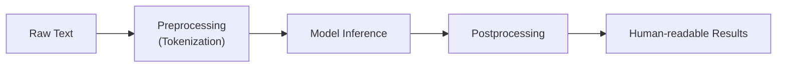

Sources: chapters/it/chapter1/3.mdx, chapters/ja/chapter2/2.mdx, chapters/th/chapter1/3.mdx

### Behind the Pipeline

Under the hood, the `pipeline()` function automatically:

1. **Loads appropriate components**: Selects and instantiates the right model and tokenizer
2. **Handles batching**: Processes multiple inputs efficiently
3. **Manages device placement**: Utilizes GPU when available
4. **Applies sensible defaults**: Sets reasonable parameter values for each task

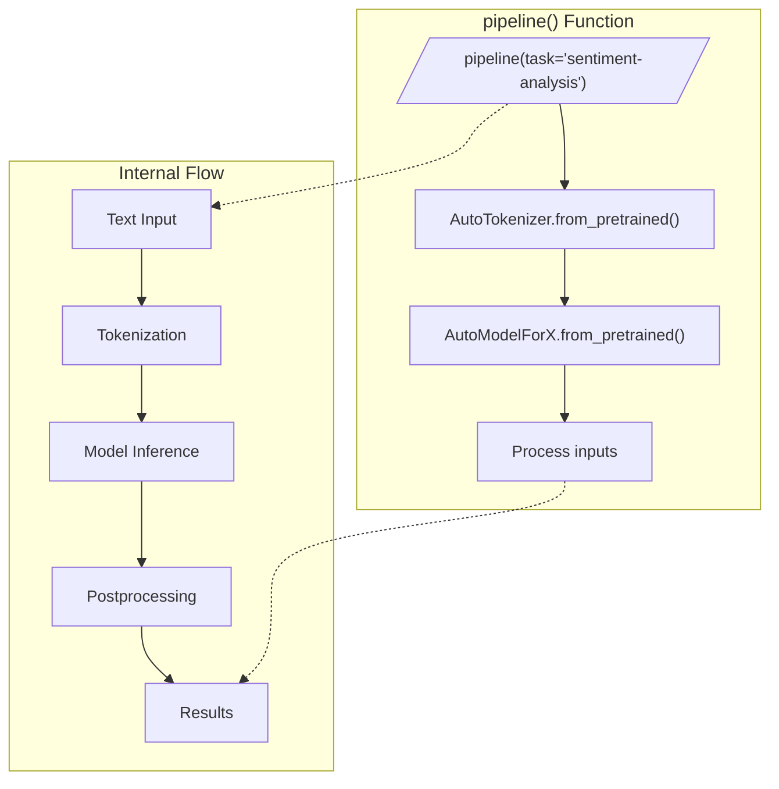

Sources: chapters/ja/chapter2/2.mdx, chapters/it/chapter1/3.mdx

## Available Tasks

The `pipeline()` function supports a variety of NLP tasks, each corresponding to a specific transformer model capability:

| Task Type | Pipeline Name | Description | Output Format |
|-----------|---------------|-------------|--------------|
| Text Classification | `sentiment-analysis` | Analyzes the sentiment of text | `[{'label': 'POSITIVE/NEGATIVE', 'score': float}]` |
| Text Classification | `zero-shot-classification` | Classifies text with user-defined labels | `{'labels': [str], 'scores': [float]}` |
| Token Classification | `ner` (Named Entity Recognition) | Identifies entities (people, organizations, locations) | `[{'entity': str, 'score': float, 'word': str, 'start': int, 'end': int}]` |
| Question Answering | `question-answering` | Extracts answers from context | `{'score': float, 'start': int, 'end': int, 'answer': str}` |
| Text Generation | `text-generation` | Completes or generates text from a prompt | `[{'generated_text': str}]` |
| Summarization | `summarization` | Creates shorter versions of text | `[{'summary_text': str}]` |
| Translation | `translation_xx_to_yy` | Translates text between languages | `[{'translation_text': str}]` |
| Fill-Mask | `fill-mask` | Fills in masked words in text | `[{'sequence': str, 'score': float, 'token': int, 'token_str': str}]` |

Sources: chapters/it/chapter1/3.mdx, chapters/th/chapter1/3.mdx

## Basic Usage

Using the `pipeline()` function typically follows this simple pattern:

1. Import the function
2. Initialize a pipeline for your desired task
3. Pass your input text to the pipeline

Here's how to use the `pipeline()` function for sentiment analysis:

```python
from transformers import pipeline

# Initialize a pipeline for sentiment analysis
classifier = pipeline("sentiment-analysis")

# Analyze a single text
result = classifier("I've been waiting for a HuggingFace course my whole life.")
# Output: [{'label': 'POSITIVE', 'score': 0.9598047137260437}]

# Analyze multiple texts
results = classifier([
    "I've been waiting for a HuggingFace course my whole life.",
    "I hate this so much!"
])
# Output: [{'label': 'POSITIVE', 'score': 0.9598047}, {'label': 'NEGATIVE', 'score': 0.9994558}]
```

Sources: chapters/it/chapter1/3.mdx, chapters/th/chapter1/3.mdx

## Pipeline Examples by Task

Let's explore how to use various pipeline types for different NLP tasks.

### Zero-shot Classification

This pipeline allows you to classify text with your own custom labels, without requiring any training:

```python
from transformers import pipeline

classifier = pipeline("zero-shot-classification")
result = classifier(
    "This is a course about the Transformers library",
    candidate_labels=["education", "politics", "business"]
)
# Output: {'sequence': '...', 'labels': ['education', 'business', 'politics'], 
#          'scores': [0.8445, 0.1119, 0.0434]}
```

Sources: chapters/it/chapter1/3.mdx, chapters/th/chapter1/3.mdx

### Text Generation

Generate text from a prompt:

```python
from transformers import pipeline

generator = pipeline("text-generation")
result = generator("In this course, we will teach you how to")
# Output: [{'generated_text': 'In this course, we will teach you how to understand and use...'}]

# Control number of sequences and maximum length
result = generator(
    "In this course, we will teach you how to",
    max_length=30,
    num_return_sequences=2
)
```

Sources: chapters/it/chapter1/3.mdx, chapters/th/chapter1/3.mdx

### Named Entity Recognition

Identify named entities in text:

```python
from transformers import pipeline

ner = pipeline("ner", grouped_entities=True)
result = ner("My name is Sylvain and I work at Hugging Face in Brooklyn.")
# Output: [{'entity_group': 'PER', 'score': 0.99816, 'word': 'Sylvain', 'start': 11, 'end': 18}, 
#          {'entity_group': 'ORG', 'score': 0.97960, 'word': 'Hugging Face', 'start': 33, 'end': 45}, 
#          {'entity_group': 'LOC', 'score': 0.99321, 'word': 'Brooklyn', 'start': 49, 'end': 57}]
```

The `grouped_entities=True` parameter enables the pipeline to group tokens that belong to the same entity, such as "Hugging" and "Face" being recognized as a single organization.

Sources: chapters/it/chapter1/3.mdx, chapters/th/chapter1/3.mdx

### Question Answering

Extract answers from a context:

```python
from transformers import pipeline

question_answerer = pipeline("question-answering")
result = question_answerer(
    question="Where do I work?",
    context="My name is Sylvain and I work at Hugging Face in Brooklyn"
)
# Output: {'score': 0.6385916471481323, 'start': 33, 'end': 45, 'answer': 'Hugging Face'}
```

Sources: chapters/it/chapter1/3.mdx, chapters/th/chapter1/3.mdx

### Summarization

Create concise summaries of longer texts:

```python
from transformers import pipeline

summarizer = pipeline("summarization")
result = summarizer("""
    America has changed dramatically during recent years. Not only has the number of 
    graduates in traditional engineering disciplines such as mechanical, civil, 
    electrical, chemical, and aeronautical engineering declined, but in most of 
    the premier American universities engineering curricula now concentrate on 
    and encourage largely the study of engineering science. As a result, there 
    are declining offerings in engineering subjects dealing with infrastructure, 
    the environment, and related issues, and greater concentration on high 
    technology subjects, largely supporting increasingly complex scientific 
    developments. While the latter is important, it should not be at the expense 
    of more traditional engineering.

    Rapidly developing economies such as China and India, as well as other 
    industrial countries in Europe and Asia, continue to encourage and advance 
    the teaching of engineering. Both China and India, respectively, graduate 
    six and eight times as many traditional engineers as does the United States. 
    Other industrial countries at minimum maintain their output, while America 
    suffers an increasingly serious decline in the number of engineering graduates 
    and a lack of well-educated engineers.
""")
# Output: [{'summary_text': 'America has changed dramatically during recent years. The number...'}]
```

Sources: chapters/it/chapter1/3.mdx, chapters/th/chapter1/3.mdx

### Fill-Mask

Complete text with masked words:

```python
from transformers import pipeline

unmasker = pipeline("fill-mask")
result = unmasker("This course will teach you all about <mask> models.", top_k=2)
# Output: [{'sequence': '...', 'score': 0.1961, 'token': 30412, 'token_str': ' mathematical'},
#          {'sequence': '...', 'score': 0.0405, 'token': 38163, 'token_str': ' computational'}]
```

Note that each model may use different mask tokens. For BERT models, the mask token is typically `[MASK]`.

Sources: chapters/it/chapter1/3.mdx, chapters/th/chapter1/3.mdx

### Translation

Translate text between languages:

```python
from transformers import pipeline

translator = pipeline("translation", model="Helsinki-NLP/opus-mt-fr-en")
result = translator("Ce cours est produit par Hugging Face.")
# Output: [{'translation_text': 'This course is produced by Hugging Face.'}]
```

Sources: chapters/it/chapter1/3.mdx, chapters/th/chapter1/3.mdx

## Using Custom Models with Pipeline

While each pipeline has a default model, you can specify any compatible model from the Hugging Face Model Hub:

```python
from transformers import pipeline

# Use a specific model for text generation
generator = pipeline("text-generation", model="distilgpt2")
result = generator(
    "In this course, we will teach you how to",
    max_length=30,
    num_return_sequences=2
)
```

This allows you to leverage specialized models tailored for specific domains, languages, or performance characteristics.

Sources: chapters/it/chapter1/3.mdx, chapters/th/chapter1/3.mdx

## Technical Implementation Details

Under the hood, the `pipeline()` function performs several important steps:

```mermaid
sequenceDiagram
    participant User
    participant Pipeline as "pipeline()"
    participant AutoTokenizer as "AutoTokenizer"
    participant AutoModel as "AutoModel"
    participant Processor as "Postprocessor"

    User->>Pipeline: Call with text input
    Pipeline->>AutoTokenizer: from_pretrained(checkpoint)
    AutoTokenizer->>Pipeline: tokenizer
    Pipeline->>AutoModel: from_pretrained(checkpoint)
    AutoModel->>Pipeline: model
    
    User->>Pipeline: __call__(text)
    Pipeline->>AutoTokenizer: Tokenize text
    AutoTokenizer->>Pipeline: input_ids, attention_mask
    Pipeline->>AutoModel: Forward pass
    AutoModel->>Pipeline: model_outputs
    Pipeline->>Processor: Process outputs
    Processor->>Pipeline: human_readable_results
    Pipeline->>User: Return results

    classDef default font-size:14px;
```

Sources: chapters/ja/chapter2/2.mdx, chapters/it/chapter2/3.mdx, chapters/it/chapter2/4.mdx

### Step 1: Tokenization

The tokenizer converts raw text into a format the model can understand:

1. **Text splitting**: Divides text into tokens (words, subwords, or characters)
2. **ID conversion**: Maps tokens to their corresponding numeric IDs
3. **Special tokens**: Adds model-specific tokens like `[CLS]`, `[SEP]`, or `[MASK]`
4. **Attention mask**: Creates masks to indicate which tokens are padding
5. **Tensor conversion**: Converts lists to tensors in the appropriate framework format

```mermaid
flowchart LR
    RawText["Raw Text"] --> Tokenization["Tokenize text into \ntokens"]
    Tokenization --> IDConversion["Convert tokens to\ninput IDs"]
    IDConversion --> AddSpecialTokens["Add special tokens \n(CLS, SEP, etc.)"]
    AddSpecialTokens --> CreateMasks["Create attention masks"]
    CreateMasks --> ConvertTensors["Convert to tensors"]
    ConvertTensors --> ModelReady["Model-ready inputs"]

    classDef default font-size:14px;
```

Sources: chapters/ja/chapter2/4.mdx, chapters/it/chapter2/4.mdx, chapters/ja/chapter2/2.mdx

### Step 2: Model Inference

The numeric inputs are passed through the model to obtain predictions:

1. **Input handling**: Processes input IDs and attention masks
2. **Forward pass**: Runs inputs through transformer layers
3. **Hidden states**: Produces contextualized representations
4. **Task-specific head**: Converts hidden states to task-specific outputs

Sources: chapters/ja/chapter2/3.mdx, chapters/it/chapter2/3.mdx, chapters/ja/chapter2/2.mdx

### Step 3: Postprocessing

Model outputs are converted to human-readable format:

1. **Interpretation**: Converts logits or hidden states to meaningful values
2. **Formatting**: Structures the output according to the task
3. **Decoding**: For generative tasks, converts IDs back to text

Sources: chapters/ja/chapter2/2.mdx, chapters/it/chapter2/6.mdx

## Advanced Pipeline Usage

The `pipeline()` function offers several advanced features for more complex use cases.

### Handling Multiple Sequences and Batching

The pipeline automatically handles batching for multiple input sequences:

```python
from transformers import pipeline

classifier = pipeline("sentiment-analysis")
results = classifier([
    "I've been waiting for a HuggingFace course my whole life.",
    "I hate this so much!"
])
```

Sources: chapters/ja/chapter2/5.mdx, chapters/it/chapter2/5.mdx

### Padding and Truncation

When dealing with sequences of different lengths, the pipeline handles padding and truncation:

```python
from transformers import pipeline

classifier = pipeline("text-classification")

# Pad sequences to the length of the longest sequence
results = classifier(sequences, padding="longest")

# Pad sequences to the maximum model length
results = classifier(sequences, padding="max_length")

# Truncate sequences longer than the model's maximum length
results = classifier(sequences, truncation=True)

# Specify a custom max length
results = classifier(sequences, max_length=128, truncation=True)
```

Sources: chapters/ja/chapter2/5.mdx, chapters/it/chapter2/5.mdx, chapters/it/chapter2/6.mdx

### Framework-Specific Tensors

You can specify which deep learning framework's tensors to return:

```python
from transformers import pipeline

classifier = pipeline("text-classification")

# Return PyTorch tensors
results = classifier(sequences, padding=True, return_tensors="pt")

# Return TensorFlow tensors
results = classifier(sequences, padding=True, return_tensors="tf")

# Return NumPy arrays
results = classifier(sequences, padding=True, return_tensors="np")
```

Sources: chapters/it/chapter2/6.mdx

## The Inference API Alternative

For quick testing without installing any libraries, the Hugging Face website provides an Inference API that you can use directly in your browser:

1. Visit [huggingface.co/models](https://huggingface.co/models)
2. Search for a model
3. Use the model's widget interface to test inputs

This API is also available as a paid service for production workloads.

Sources: chapters/it/chapter1/3.mdx, chapters/th/chapter1/3.mdx

## Limitations and Considerations

When using the `pipeline()` function, consider these limitations:

1. **Sequence length**: Most models have a maximum sequence length (typically 512 or 1024 tokens). Longer sequences need to be truncated.
2. **Memory usage**: Large models may require significant RAM or GPU memory, especially with large batch sizes.
3. **Computation time**: More parameters generally means longer inference time.
4. **Task-specific limitations**: Some tasks might require fine-tuning for domain-specific applications.

Sources: chapters/ja/chapter2/5.mdx

## Conclusion

The `pipeline()` function serves as an excellent entry point to the Hugging Face Transformers ecosystem, allowing users to quickly apply state-of-the-art models to various NLP tasks with minimal code. For more advanced usage or performance optimization, you may want to explore the underlying components: the tokenizers and models that power these pipelines.

For more detailed information on working directly with tokenizers and models, see [AutoModel and AutoTokenizer Classes](#3.2) and [The 🤗 Tokenizers Library](#3.3).

---

# Page: AutoModel and AutoTokenizer Classes

# AutoModel and AutoTokenizer Classes

<details>
<summary>Relevant source files</summary>

The following files were used as context for generating this wiki page:

- [.github/workflows/quality.yml](.github/workflows/quality.yml)
- [chapters/ja/_toctree.yml](chapters/ja/_toctree.yml)
- [chapters/ja/chapter2/1.mdx](chapters/ja/chapter2/1.mdx)
- [chapters/ja/chapter2/2.mdx](chapters/ja/chapter2/2.mdx)
- [chapters/ja/chapter2/3.mdx](chapters/ja/chapter2/3.mdx)
- [chapters/ja/chapter2/4.mdx](chapters/ja/chapter2/4.mdx)
- [chapters/ja/chapter2/5.mdx](chapters/ja/chapter2/5.mdx)
- [chapters/ru/_toctree.yml](chapters/ru/_toctree.yml)
- [chapters/ru/chapter2/1.mdx](chapters/ru/chapter2/1.mdx)
- [chapters/ru/chapter2/2.mdx](chapters/ru/chapter2/2.mdx)
- [chapters/ru/chapter2/3.mdx](chapters/ru/chapter2/3.mdx)
- [chapters/ru/chapter2/4.mdx](chapters/ru/chapter2/4.mdx)
- [chapters/ru/chapter2/5.mdx](chapters/ru/chapter2/5.mdx)
- [chapters/ru/chapter2/6.mdx](chapters/ru/chapter2/6.mdx)
- [chapters/ru/chapter2/7.mdx](chapters/ru/chapter2/7.mdx)
- [chapters/ru/chapter2/8.mdx](chapters/ru/chapter2/8.mdx)

</details>


The `AutoModel` and `AutoTokenizer` classes serve as intelligent wrappers in the 🤗 Transformers library, providing a streamlined way to load pretrained models and tokenizers regardless of their specific architecture. These classes enable you to write checkpoint-agnostic code that works with any model in the Hugging Face ecosystem, allowing for seamless experimentation with different models.

## Purpose and Function

The `Auto*` classes solve a critical problem in working with transformer models: architecture-specific code. Rather than requiring you to know and specify exact model architecture classes (like `BertModel`, `RobertaTokenizer`, etc.), these classes automatically identify and instantiate the appropriate architecture based on a checkpoint name.

```mermaid
flowchart TD
    subgraph "AutoClasses Functionality"
        direction LR
        User["User Code"] --> Checkpoint["Checkpoint Name\n(e.g., 'bert-base-cased')"]
        Checkpoint --> |"from_pretrained()"| Auto["Auto* Classes"]
        Auto --> ModelType["Automatic Architecture Detection"]
        ModelType --> |"instantiates"| SpecificClass["Specific Implementation\n(BertModel, RobertaTokenizer, etc.)"]
        SpecificClass --> |"returns"| Instance["Model/Tokenizer Instance"]
        Instance --> User
    end
```

Sources:
- chapters/ru/chapter2/3.mdx
- chapters/ru/chapter2/4.mdx

## AutoModel Classes

The `AutoModel` class is actually a family of classes designed to handle different NLP tasks. When you call `from_pretrained()` on any of these classes, the method examines the configuration of the specified checkpoint and instantiates the appropriate model architecture with loaded weights.

### Core AutoModel Classes

```mermaid
flowchart TD
    subgraph "AutoModel Class Hierarchy"
        direction TB
        AutoModel["AutoModel\n(Base Class)"] --> Task{{"Task-Specific Classes"}}
        
        Task --> |"Sequence Classification"| AutoModelForSequenceClassification
        Task --> |"Token Classification"| AutoModelForTokenClassification
        Task --> |"Question Answering"| AutoModelForQuestionAnswering
        Task --> |"Causal Language Modeling"| AutoModelForCausalLM
        Task --> |"Masked Language Modeling"| AutoModelForMaskedLM
        Task --> |"Sequence-to-Sequence"| AutoModelForSeq2SeqLM
        Task --> |"Other Tasks"| OtherTasks["..."]
    end
```

Sources:
- chapters/ru/chapter2/2.mdx
- chapters/ru/chapter2/3.mdx

### Framework-Specific Implementations

The `AutoModel` classes are available for different deep learning frameworks:

- `AutoModel` (PyTorch)
- `TFAutoModel` (TensorFlow)
- `FlaxAutoModel` (Flax - JAX-based)

Each base class has the same task-specific variants (e.g., `TFAutoModelForSequenceClassification` for TensorFlow).

### Loading a Model

When loading a model with the `from_pretrained()` method, several steps occur:

1. The model configuration is downloaded or loaded from cache
2. The appropriate model class is determined based on the configuration
3. The model is instantiated with that configuration
4. The pretrained weights are loaded into the model

```python
# PyTorch
from transformers import AutoModel
model = AutoModel.from_pretrained("bert-base-cased")

# TensorFlow
from transformers import TFAutoModel
model = TFAutoModel.from_pretrained("bert-base-cased")
```

Sources:
- chapters/ru/chapter2/3.mdx

## AutoTokenizer Class

The `AutoTokenizer` class works similarly to `AutoModel`, automatically selecting the appropriate tokenizer class for a given checkpoint. This ensures that the tokenization process matches exactly what was used during the model's pretraining.

### Tokenizer Operation Pipeline

```mermaid
flowchart LR
    subgraph "Tokenizer Pipeline"
        direction TB
        Text["Raw Text"] --> Tokenizer["AutoTokenizer"]
        Tokenizer --> Tokens["Tokens\n(split words/subwords)"]
        Tokens --> InputIDs["Input IDs\n(numerical representation)"]
        InputIDs --> AdditionalFeatures["Additional Features\n(attention mask, token type ids)"]
        AdditionalFeatures --> ModelReady["Model-Ready Inputs"]
    end
```

Sources:
- chapters/ru/chapter2/2.mdx
- chapters/ru/chapter2/4.mdx
- chapters/ru/chapter2/5.mdx

### Key Tokenizer Methods

The `AutoTokenizer` provides several important methods:

- `tokenize(text)`: Splits text into tokens
- `convert_tokens_to_ids(tokens)`: Converts tokens to input IDs
- `decode(ids)`: Converts IDs back to text
- `__call__(text, ...)`: Main method that handles all preprocessing steps at once

The `__call__` method (using the tokenizer directly as a function) is the recommended approach as it handles all the preprocessing:

```python
from transformers import AutoTokenizer

tokenizer = AutoTokenizer.from_pretrained("bert-base-cased")
inputs = tokenizer("Hello, world!", return_tensors="pt")
```

Sources:
- chapters/ru/chapter2/4.mdx
- chapters/ru/chapter2/6.mdx

## Working with AutoModel and AutoTokenizer Together

The standard pattern for using these classes together is:

```mermaid
flowchart LR
    subgraph "AutoModel and AutoTokenizer Workflow"
        direction TB
        Checkpoint["Checkpoint Name"] --> Tokenizer["AutoTokenizer.from_pretrained()"]
        Checkpoint --> Model["AutoModel*.from_pretrained()"]
        
        RawText["Raw Text"] --> |"tokenize"| Tokenizer
        Tokenizer --> |"return inputs"| Inputs["Model Inputs\n(input_ids, attention_mask, etc.)"]
        Inputs --> Model
        Model --> |"generate outputs"| Outputs["Model Outputs\n(logits, hidden states, etc.)"]
        Outputs --> |"post-process"| Predictions["Final Predictions"]
    end
```

Sources:
- chapters/ru/chapter2/2.mdx
- chapters/ru/chapter2/6.mdx

### Code Example

Below is the typical pattern for using these classes together:

```python
from transformers import AutoTokenizer, AutoModelForSequenceClassification

# 1. Load tokenizer and model with the same checkpoint
checkpoint = "distilbert-base-uncased-finetuned-sst-2-english"
tokenizer = AutoTokenizer.from_pretrained(checkpoint)
model = AutoModelForSequenceClassification.from_pretrained(checkpoint)

# 2. Prepare inputs
text = "I've been waiting for a HuggingFace course my whole life."
inputs = tokenizer(text, return_tensors="pt")  # or "tf" for TensorFlow

# 3. Forward pass through the model
outputs = model(**inputs)

# 4. Process outputs
import torch.nn.functional as F
predictions = F.softmax(outputs.logits, dim=-1)
```

Sources:
- chapters/ru/chapter2/2.mdx
- chapters/ru/chapter2/6.mdx

## Handling Multiple Sequences and Special Features

When processing multiple sequences or handling special cases, the Auto classes provide additional functionality:

### Batching and Padding

```mermaid
flowchart LR
    subgraph "Batching Multiple Sequences"
        direction TB
        Sequences["Multiple Sequences\nof Different Lengths"] --> Tokenizer["AutoTokenizer"]
        Tokenizer --> |"padding=True"| PaddedSequences["Padded Sequences\n(with padding tokens)"]
        Tokenizer --> |"truncation=True"| TruncatedSequences["Truncated Sequences\n(if too long)"]
        Tokenizer --> |"attention_mask"| AttentionMask["Attention Mask\n(1 for tokens, 0 for padding)"]
        
        PaddedSequences --> ModelInputs["Model-Ready Inputs"]
        TruncatedSequences --> ModelInputs
        AttentionMask --> ModelInputs
    end
```

Sources:
- chapters/ru/chapter2/5.mdx
- chapters/ru/chapter2/6.mdx

### Key Parameters for Tokenizer

The tokenizer's `__call__` method accepts several important parameters:

| Parameter | Description | Example |
|-----------|-------------|---------|
| `padding` | Controls padding strategy | `True`, `"longest"`, `"max_length"` |
| `truncation` | Controls truncation strategy | `True`, `max_length=128` |
| `max_length` | Maximum sequence length | Integer value (e.g., 512) |
| `return_tensors` | Output tensor format | `"pt"` (PyTorch), `"tf"` (TensorFlow), `"np"` (NumPy) |
| `return_attention_mask` | Include attention mask | Boolean (default: `True`) |

Sources:
- chapters/ru/chapter2/5.mdx
- chapters/ru/chapter2/6.mdx

## Best Practices and Important Considerations

1. **Always use the same checkpoint** for both tokenizer and model to ensure compatibility.

2. **Framework consistency**: Use the appropriate Auto classes for your framework (`AutoModel` for PyTorch, `TFAutoModel` for TensorFlow).

3. **Task-specific models**: Choose the appropriate AutoModel variant for your task (e.g., `AutoModelForSequenceClassification` for classification tasks).

4. **Handling long sequences**: Use truncation, a model with longer sequence support (e.g., Longformer, LED), or implement a sliding window approach.

5. **Batch processing**: Always batch your inputs even for single sequences (the models expect batch dimensions).

6. **Special tokens**: The tokenizer automatically adds special tokens (like `[CLS]`, `[SEP]`), which the model expects.

7. **Model outputs**: Model outputs are objects with attributes such as `logits` or `last_hidden_state`, which can be accessed directly.

Sources:
- chapters/ru/chapter2/2.mdx
- chapters/ru/chapter2/3.mdx
- chapters/ru/chapter2/5.mdx
- chapters/ru/chapter2/6.mdx
- chapters/ru/chapter2/8.mdx

## Conclusion

The `AutoModel` and `AutoTokenizer` classes form the backbone of the 🤗 Transformers library's ease of use. They abstract away the complexity of specific model architectures and tokenization approaches, allowing you to focus on your NLP tasks rather than implementation details. By providing a unified interface to the wide variety of transformer models available, these classes make it simple to experiment with different models while keeping your code clean and consistent.

---

# Page: 🤗 Tokenizers Library

# 🤗 Tokenizers Library

<details>
<summary>Relevant source files</summary>

The following files were used as context for generating this wiki page:

- [chapters/fr/chapter6/3b.mdx](chapters/fr/chapter6/3b.mdx)
- [chapters/th/_toctree.yml](chapters/th/_toctree.yml)
- [chapters/th/chapter6/1.mdx](chapters/th/chapter6/1.mdx)
- [chapters/th/chapter6/10.mdx](chapters/th/chapter6/10.mdx)
- [chapters/th/chapter6/2.mdx](chapters/th/chapter6/2.mdx)
- [chapters/th/chapter6/3.mdx](chapters/th/chapter6/3.mdx)
- [chapters/th/chapter6/3b.mdx](chapters/th/chapter6/3b.mdx)
- [chapters/th/chapter6/4.mdx](chapters/th/chapter6/4.mdx)
- [chapters/th/chapter6/5.mdx](chapters/th/chapter6/5.mdx)
- [chapters/th/chapter6/6.mdx](chapters/th/chapter6/6.mdx)
- [chapters/th/chapter6/7.mdx](chapters/th/chapter6/7.mdx)
- [chapters/th/chapter6/9.mdx](chapters/th/chapter6/9.mdx)
- [chapters/vi/chapter6/3b.mdx](chapters/vi/chapter6/3b.mdx)

</details>


The 🤗 Tokenizers library provides efficient implementations of tokenization algorithms, which transform text into sequences of tokens that machine learning models can process. This page covers the key components of the library, its performance characteristics, and how to use it to create and customize tokenizers for your NLP tasks. For information on using pre-trained tokenizers with models, see [AutoTokenizer and AutoModel Classes](#3.2).

## Overview and Architecture

The Tokenizers library is designed to be both powerful and efficient, offering high-performance implementations of common tokenization algorithms. It bridges the gap between raw text and the numerical representations that transformer models can understand.

```mermaid
flowchart LR
    subgraph "Natural Language Space"
        RawText["Raw Text"]
    end
    
    subgraph "🤗 Tokenizers Library"
        FastTokenizers["Fast Tokenizers (Rust)"]
        SlowTokenizers["Slow Tokenizers (Python)"]
        TokenizationAlgorithms["Tokenization Algorithms
        - BPE
        - WordPiece
        - Unigram"]
    end
    
    subgraph "Numerical Space"
        TokenIDs["Token IDs"]
        AttentionMasks["Attention Masks"]
        OffsetMappings["Offset Mappings"]
    end
    
    RawText --> FastTokenizers & SlowTokenizers
    FastTokenizers & SlowTokenizers --> TokenizationAlgorithms
    TokenizationAlgorithms --> TokenIDs
    TokenizationAlgorithms --> AttentionMasks
    FastTokenizers --> OffsetMappings
    
    style FastTokenizers stroke:bold
```

Sources: chapters/th/chapter6/2.mdx, chapters/th/chapter6/3.mdx

## Fast vs. Slow Tokenizers

The library offers two types of tokenizers:

1. **Fast tokenizers**: Implemented in Rust, these provide parallel processing capabilities and additional features like offset mappings.
2. **Slow tokenizers**: Pure Python implementations, easier to understand but significantly slower, especially on larger texts.

The performance difference is substantial when processing batches of text:

| Batch Mode | Fast tokenizer | Slow tokenizer |
|:----------:|:--------------:|:-------------:|
| `batched=True` | 10.8s | 4min41s |
| `batched=False` | 59.2s | 5min3s |

Fast tokenizers offer several additional features:

- **Parallel processing**: Multiple texts can be tokenized simultaneously
- **Offset mappings**: Track the original character spans for each token
- **Word IDs**: Map tokens back to their original words
- **Special token handling**: Better management of special tokens like `[CLS]`, `[SEP]`, etc.

```mermaid
flowchart TD
    subgraph "Tokenizer Components"
        direction LR
        Tokenizer["BatchEncoding
        (Return from tokenizer)"]
        Tokenizer --> InputIDs["input_ids
        (Token IDs)"]
        Tokenizer --> AttentionMask["attention_mask"]
        
        subgraph "Fast Tokenizers Only"
            OffsetMapping["offset_mapping
            (Character spans)"]
            WordIDs["word_ids()
            (Map tokens to words)"]
            TokenToChars["token_to_chars()
            (Token to character mapping)"]
            Tokens["tokens()
            (Get token strings)"]
        end
        
        Tokenizer --> OffsetMapping
        Tokenizer --> WordIDs
        Tokenizer --> TokenToChars
        Tokenizer --> Tokens
    end
```

Sources: chapters/th/chapter6/3.mdx

## Tokenization Algorithms

The library implements three main subword tokenization algorithms:

### Byte-Pair Encoding (BPE)

BPE starts with a small vocabulary consisting of individual characters and iteratively merges the most frequent pairs of tokens to form new tokens. It's used in models like GPT, GPT-2, RoBERTa, and BART.

Training process:
1. Start with a vocabulary of single characters
2. Count token pair frequencies in the corpus
3. Merge the most frequent pair and add to vocabulary
4. Repeat until reaching desired vocabulary size

```mermaid
flowchart TD
    subgraph "BPE Algorithm"
        direction TB
        Chars["Initial Vocabulary
        (Single Characters)"]
        Pairs["Count Token Pairs"]
        Merge["Merge Most Frequent Pair"]
        AddToVocab["Add to Vocabulary"]
        Check["Vocabulary
        Size Reached?"]
        
        Chars --> Pairs
        Pairs --> Merge
        Merge --> AddToVocab
        AddToVocab --> Check
        Check -->|No| Pairs
        Check -->|Yes| FinalVocab["Final Vocabulary"]
    end
```

Sources: chapters/th/chapter6/5.mdx

### WordPiece

WordPiece is similar to BPE but uses a different selection criteria for merging tokens. Instead of merging the most frequent pair, it merges the pair that maximizes the likelihood of the training data when added to the vocabulary. It's used in models like BERT, DistilBERT, and Electra.

The WordPiece algorithm tracks pairs based on a scoring formula:
```
score(pair) = (freq(pair)) / (freq(first_token) * freq(second_token))
```

Sources: chapters/th/chapter6/6.mdx (inferred from context since this file wasn't provided)

### Unigram

Unigram takes the opposite approach to BPE. It starts with a large vocabulary and iteratively removes tokens to maximize the likelihood of the training data. It's used in models like ALBERT, T5, mBART, and XLNet.

Training process:
1. Start with a large vocabulary
2. Score each token based on how much the data likelihood drops when removed
3. Remove a percentage of the lowest-scoring tokens
4. Repeat until reaching the desired vocabulary size

Sources: chapters/th/chapter6/7.mdx

## Creating Custom Tokenizers

The Tokenizers library makes it straightforward to train a new tokenizer on your specific data.

### Training from an Existing Tokenizer

The most common approach is to start from an existing tokenizer and train it on your data:

```python
from transformers import AutoTokenizer

# Load a base tokenizer
base_tokenizer = AutoTokenizer.from_pretrained("gpt2")

# Create a training corpus
def get_training_corpus():
    return (
        dataset[i : i + 1000]["text"]
        for i in range(0, len(dataset), 1000)
    )

training_corpus = get_training_corpus()

# Train a new tokenizer
new_tokenizer = base_tokenizer.train_new_from_iterator(training_corpus, 52000)

# Save the tokenizer
new_tokenizer.save_pretrained("path/to/save")
```

This approach allows you to:
- Maintain the same tokenization algorithm and special tokens
- Adapt the vocabulary to your specific domain
- Control the vocabulary size

```mermaid
flowchart LR
    subgraph "Training a Custom Tokenizer"
        direction TB
        BaseTokenizer["Base Tokenizer
        (e.g., GPT-2)"]
        Iterator["Iterator of Texts"]
        TrainMethod["train_new_from_iterator()"]
        NewTokenizer["New Tokenizer
        (Domain-adapted)"]
        SaveTokenizer["save_pretrained()"]
        
        BaseTokenizer --> TrainMethod
        Iterator --> TrainMethod
        TrainMethod --> NewTokenizer
        NewTokenizer --> SaveTokenizer
    end
```

Sources: chapters/th/chapter6/2.mdx

## Advanced Features and Applications

### Offset Mapping

One of the most powerful features of fast tokenizers is offset mapping, which tracks the original character spans for each token. This is crucial for tasks that require mapping predictions back to the original text.

```python
from transformers import AutoTokenizer

tokenizer = AutoTokenizer.from_pretrained("bert-base-cased")
encoding = tokenizer("Hello, how are you?", return_offsets_mapping=True)
offsets = encoding["offset_mapping"]

# To get the character span of a token
start, end = offsets[5]
original_text[start:end]  # Will extract the characters of the 5th token
```

The offset mapping is particularly valuable for:

#### Token Classification (Named Entity Recognition)

In token classification tasks, offset mapping allows you to:
1. Identify which tokens belong to the same entity
2. Extract the complete text of recognized entities
3. Handle subword tokenization properly

#### Question Answering

For question answering tasks, fast tokenizers help:
1. Extract the answer span from the context
2. Handle long contexts by splitting them with overlap
3. Preserve the mapping between tokens and original text positions

```mermaid
flowchart TD
    subgraph "Question Answering with Tokenizers"
        direction TB
        LongContext["Long Context"]
        SplitContext["Split with Overlap"]
        Tokenize["Tokenize Splits"]
        ModelPredict["Model Predicts Start/End Positions"]
        MapBack["Map Back to Original Text
        using offset_mapping"]
        
        LongContext --> SplitContext
        SplitContext --> Tokenize
        Tokenize --> ModelPredict
        ModelPredict --> MapBack
        MapBack --> Answer["Extract Answer Text"]
    end
```

Sources: chapters/th/chapter6/3.mdx, chapters/th/chapter6/3b.mdx

### Batch Processing

Fast tokenizers can process multiple inputs simultaneously, significantly reducing tokenization time for large datasets:

```python
# Batch processing example
texts = ["First example", "Second example", "Third example"]
encoding = tokenizer(texts, padding=True, truncation=True, return_tensors="pt")
```

### Handling Long Texts

For handling texts longer than the model's maximum sequence length, the tokenizers library provides functionality to split texts with overlapping windows:

```python
# Processing long texts with overlap
encoding = tokenizer(
    question,
    context,
    max_length=384,
    stride=128,
    truncation="only_second",
    padding="max_length",
    return_overflowing_tokens=True,
    return_offsets_mapping=True
)
```

This approach is especially useful for tasks like question answering where the answer might be located anywhere in a long document.

Sources: chapters/th/chapter6/3b.mdx

## Tokenizer Components

A tokenizer in the 🤗 Tokenizers library consists of several components that work together to transform text into tokens:

1. **Normalizer**: Cleans the text (e.g., lowercase, unicode normalization)
2. **Pre-tokenizer**: Splits text into words (using spaces, punctuation, etc.)
3. **Model**: Applies the tokenization algorithm (BPE, WordPiece, or Unigram)
4. **Post-processor**: Adds special tokens and generates attention masks
5. **Decoder**: Converts tokens back to text (used for decoding model outputs)

```mermaid
flowchart LR
    subgraph "Tokenizer Pipeline Architecture"
        direction LR
        RawText["Raw Text"] --> Normalizer
        Normalizer["1. Normalizer
        (Cleanup text)"] --> Pretokenizer
        Pretokenizer["2. Pre-tokenizer
        (Split into words)"] --> Model
        Model["3. Model
        (BPE/WordPiece/Unigram)"] --> Postprocessor
        Postprocessor["4. Post-processor
        (Add special tokens)"] --> Output
        Output["5. Final Output
        (input_ids, attention_mask)"]
    end
```

You can build a custom tokenizer by configuring each of these components separately:

```python
from tokenizers import Tokenizer, models, normalizers, pre_tokenizers, processors
from tokenizers.models import BPE

# Create a BPE tokenizer
tokenizer = Tokenizer(BPE())

# Add a normalizer
tokenizer.normalizer = normalizers.Sequence([
    normalizers.NFD(),
    normalizers.Lowercase(),
    normalizers.StripAccents()
])

# Add a pre-tokenizer
tokenizer.pre_tokenizer = pre_tokenizers.Whitespace()

# Train the tokenizer
tokenizer.train(["path/to/files/*.txt"], trainer)

# Add a post-processor
tokenizer.post_processor = processors.TemplateProcessing(
    single="[CLS] $A [SEP]",
    pair="[CLS] $A [SEP] $B [SEP]",
    special_tokens=[
        ("[CLS]", 1),
        ("[SEP]", 2),
    ],
)
```

Sources: chapters/th/chapter6/4.mdx, chapters/th/chapter6/8.mdx (inferred from context)

## Integration with 🤗 Transformers

The Tokenizers library is deeply integrated with the Transformers library, allowing seamless use of tokenizers with models:

```python
from transformers import AutoTokenizer, AutoModel

# Load a tokenizer and model with the same architecture
tokenizer = AutoTokenizer.from_pretrained("bert-base-uncased")
model = AutoModel.from_pretrained("bert-base-uncased")

# Tokenize input
inputs = tokenizer("Hello world!", return_tensors="pt")

# Pass to model
outputs = model(**inputs)
```

The `AutoTokenizer` class automatically loads the appropriate tokenizer for a given model, ensuring compatibility between the tokenization process and the model's expectations.

Sources: chapters/th/chapter6/3.mdx

## Summary

The 🤗 Tokenizers library provides a powerful, flexible, and efficient toolkit for text tokenization. Its key advantages include:

- **Performance**: Fast tokenizers enable efficient processing of large datasets
- **Features**: Offset mapping, word IDs, and batch processing for advanced NLP tasks
- **Flexibility**: Support for multiple tokenization algorithms and customization options
- **Integration**: Seamless compatibility with the Transformers library

Whether you're using pre-trained models or training your own tokenizers for domain-specific tasks, the Tokenizers library offers the tools needed to effectively process text for modern NLP applications.

---

# Page: Fine-tuning Transformer Models

# Fine-tuning Transformer Models

<details>
<summary>Relevant source files</summary>

The following files were used as context for generating this wiki page:

- [chapters/de/chapter3/3_tf.mdx](chapters/de/chapter3/3_tf.mdx)
- [chapters/en/chapter3/3.mdx](chapters/en/chapter3/3.mdx)
- [chapters/en/chapter3/3_tf.mdx](chapters/en/chapter3/3_tf.mdx)
- [chapters/en/chapter7/2.mdx](chapters/en/chapter7/2.mdx)
- [chapters/en/chapter7/3.mdx](chapters/en/chapter7/3.mdx)
- [chapters/en/chapter7/4.mdx](chapters/en/chapter7/4.mdx)
- [chapters/en/chapter7/5.mdx](chapters/en/chapter7/5.mdx)
- [chapters/en/chapter7/6.mdx](chapters/en/chapter7/6.mdx)
- [chapters/en/chapter7/7.mdx](chapters/en/chapter7/7.mdx)
- [chapters/fa/TRANSLATING.txt](chapters/fa/TRANSLATING.txt)
- [chapters/fa/_toctree.yml](chapters/fa/_toctree.yml)
- [chapters/fa/chapter2/2.mdx](chapters/fa/chapter2/2.mdx)
- [chapters/fa/chapter3/1.mdx](chapters/fa/chapter3/1.mdx)
- [chapters/fa/chapter3/2.mdx](chapters/fa/chapter3/2.mdx)
- [chapters/fa/chapter3/3.mdx](chapters/fa/chapter3/3.mdx)
- [chapters/fa/chapter3/3_tf.mdx](chapters/fa/chapter3/3_tf.mdx)
- [chapters/fa/chapter4/1.mdx](chapters/fa/chapter4/1.mdx)
- [chapters/fa/glossary/1.mdx](chapters/fa/glossary/1.mdx)
- [chapters/th/chapter2/2.mdx](chapters/th/chapter2/2.mdx)

</details>


Fine-tuning is the process of taking a pre-trained model and further training it on a specific dataset for a particular task. This page explains how to fine-tune transformer models using the Hugging Face ecosystem, covering data preparation, training configuration, and evaluation. For information about creating models from scratch, see [Training a Causal Language Model from Scratch](#4.3).

## Overview of the Fine-tuning Process

Fine-tuning allows you to adapt powerful pre-trained models to specific tasks with relatively small amounts of task-specific data. The process follows these key steps:

```mermaid
graph TD
    PretrainedModel["Pre-trained Model"] --> |"Load"| InitializedModel["Initialized Model for Fine-tuning"]
    Dataset["Dataset"] --> |"Preprocess"| ProcessedData["Processed Data"]
    ProcessedData --> TrainingLoop["Training Loop"]
    InitializedModel --> TrainingLoop
    TrainingLoop --> |"Train"| FineTunedModel["Fine-tuned Model"]
    FineTunedModel --> |"Evaluate"| EvaluatedModel["Evaluated Model"]
    EvaluatedModel --> |"Save or Share"| SavedModel["Saved Model"]
```

Sources: 
- chapters/fa/chapter3/2.mdx
- chapters/fa/chapter3/3.mdx
- chapters/fa/chapter3/3_tf.mdx

## Framework Options for Fine-tuning

You can fine-tune transformer models using different frameworks and approaches:

```mermaid
graph TD
    FineTuning["Fine-tuning Transformers"] --> PyTorch["PyTorch"]
    FineTuning --> TensorFlow["TensorFlow"]
    
    PyTorch --> TrainerAPI["Trainer API"]
    PyTorch --> CustomLoop["Custom Training Loop"]
    
    TensorFlow --> KerasAPI["Keras API"]
    TensorFlow --> TFTC["TF Custom Training Loop"]
    
    TrainerAPI --> |"Components"| TrainingArgs["TrainingArguments"]
    TrainerAPI --> |"Components"| Trainer["Trainer Class"]
    
    KerasAPI --> |"Components"| Compile["Model Compilation"]
    KerasAPI --> |"Components"| Fit["Model Fit"]
```

Sources:
- chapters/en/chapter3/3.mdx
- chapters/en/chapter3/3_tf.mdx

## Data Preparation

### Loading Datasets

The first step is to load your dataset using the `load_dataset()` function from the 🤗 Datasets library. This function can load both datasets from the Hugging Face Hub and custom datasets.

```mermaid
graph LR
    loadDataset["load_dataset()"] --> rawDatasets["raw_datasets"]
    rawDatasets --> trainSplit["train split"]
    rawDatasets --> validationSplit["validation split"]
```

Sources:
- chapters/fa/chapter3/2.mdx:20-30
- chapters/en/chapter3/3.mdx:18-20

### Tokenization

Tokenization converts text into token IDs that the model can understand. The `AutoTokenizer` class handles this by loading the appropriate tokenizer for your chosen model.

```mermaid
graph TD
    subgraph "Data Processing Pipeline"
        RawData["Raw Text Data"] --> Tokenize["Tokenization"]
        Tokenize --> InputIDs["input_ids"]
        Tokenize --> AttentionMask["attention_mask"]
        Tokenize --> TokenTypeIDs["token_type_ids"]
        InputIDs --> DataCollator["DataCollatorWithPadding"]
        AttentionMask --> DataCollator
        TokenTypeIDs --> DataCollator
        DataCollator --> BatchedData["Batched Data for Model"]
    end
```

The tokenization process typically uses a function like `tokenize_function` to process multiple examples at once using the `map()` method of datasets.

Sources:
- chapters/fa/chapter3/2.mdx:185-217
- chapters/fa/chapter3/2.mdx:290-334

### Dynamic Padding

Instead of padding all sequences to the maximum length in the dataset, dynamic padding pads sequences to the maximum length within each batch. This is more efficient and is handled by the `DataCollatorWithPadding` class.

```mermaid
sequenceDiagram
    participant RawTexts as "Raw Texts"
    participant Tokenizer as "Tokenizer"
    participant DataCollator as "DataCollatorWithPadding"
    participant Model as "Model"
    
    RawTexts->>Tokenizer: Text data
    Tokenizer->>DataCollator: Tokenized data (different lengths)
    DataCollator->>Model: Batched data with padding to max length in batch
```

Sources:
- chapters/fa/chapter3/2.mdx:361-384
- chapters/en/chapter3/3.mdx:28-33

## Fine-tuning with the Trainer API (PyTorch)

### Setting Up Training Arguments

The `TrainingArguments` class configures the training process. You must specify an output directory for saving the model, and can optionally set learning rate, batch size, epochs, and evaluation strategy.

```mermaid
graph TD
    TrainingArgs["TrainingArguments"] --> OutputDir["output_dir"]
    TrainingArgs --> LearningRate["learning_rate"]
    TrainingArgs --> BatchSize["batch_size"]
    TrainingArgs --> Epochs["num_train_epochs"]
    TrainingArgs --> EvalStrategy["evaluation_strategy"]
```

Sources:
- chapters/fa/chapter3/3.mdx:42-53
- chapters/en/chapter3/3.mdx:37-42

### Creating the Model

For fine-tuning, you'll need to load a pre-trained model with an appropriate head for your task. For classification tasks, use the `AutoModelForSequenceClassification` class.

```mermaid
graph TD
    AutoModel["AutoModelForSequenceClassification"] --> |"from_pretrained()"| Model["Model with classification head"]
    Model --> |"num_labels=2"| BinaryClassifier["Binary classifier"]
```

Sources:
- chapters/fa/chapter3/3.mdx:63-73
- chapters/en/chapter3/3.mdx:51-57

### Training

The `Trainer` class handles the entire training loop. You need to pass it the model, training arguments, datasets, tokenizer, and data collator.

```mermaid
graph TD
    Trainer["Trainer"] --> Model["model"]
    Trainer --> Args["training_args"]
    Trainer --> TrainData["train_dataset"]
    Trainer --> EvalData["eval_dataset"]
    Trainer --> Tokenizer["tokenizer"]
    Trainer --> DataCollator["data_collator"]
```

Call the `train()` method to start training. The model updates according to the specified hyperparameters.

Sources:
- chapters/fa/chapter3/3.mdx:77-96
- chapters/en/chapter3/3.mdx:61-74

### Evaluation

To evaluate the model, define a `compute_metrics` function that calculates metrics such as accuracy and F1 score from the model's predictions.

```mermaid
graph TD
    ComputeMetrics["compute_metrics()"] --> EvalPred["EvalPrediction"]
    EvalPred --> Predictions["predictions"]
    EvalPred --> Labels["label_ids"]
    Predictions --> |"argmax()"| Classes["predicted classes"]
    Classes --> |"compare with"| Labels
    Classes --> Metrics["accuracy, F1, etc."]
```

The metrics can be used to assess model performance and compare different fine-tuning approaches.

Sources:
- chapters/fa/chapter3/3.mdx:116-157
- chapters/en/chapter3/3.mdx:92-122

## Fine-tuning with Keras (TensorFlow)

### Preparing TensorFlow Datasets

Convert your tokenized datasets to TensorFlow format using the `to_tf_dataset()` method. Specify which columns to use as inputs and which to use as labels.

```mermaid
graph TD
    TokenizedDatasets["tokenized_datasets"] --> |"to_tf_dataset()"| TFDatasets["TF datasets"]
    TFDatasets --> Columns["columns selection"]
    TFDatasets --> LabelCols["label columns"]
    TFDatasets --> Shuffle["shuffle option"]
    TFDatasets --> BatchSize["batch size"]
```

Sources:
- chapters/fa/chapter3/3_tf.mdx:477-495
- chapters/en/chapter3/3_tf.mdx:34-48

### Compiling and Training

Use `TFAutoModelForSequenceClassification` to load your model, then compile it with an optimizer, loss function, and metrics before calling the `fit()` method for training.

```mermaid
graph TD
    TFModel["TFAutoModelForSequenceClassification"] --> |"from_pretrained()"| Model["Model"]
    Model --> |"compile()"| CompiledModel["Compiled Model"]
    CompiledModel --> Optimizer["optimizer"]
    CompiledModel --> Loss["loss function"]
    CompiledModel --> Metrics["metrics"]
    CompiledModel --> |"fit()"| TrainedModel["Trained Model"]
```

Sources:
- chapters/fa/chapter3/3_tf.mdx:80-104
- chapters/en/chapter3/3_tf.mdx:63-88

### Learning Rate Optimization

Optimize the learning rate to improve training results. TensorFlow provides schedulers like `PolynomialDecay` to gradually decrease the learning rate during training.

```mermaid
graph TD
    LRScheduler["learning rate scheduler"] --> InitialLR["initial_learning_rate"]
    LRScheduler --> EndLR["end_learning_rate"]
    LRScheduler --> DecaySteps["decay_steps"]
    LRScheduler --> |"creates"| Optimizer["optimizer with scheduled LR"]
```

Sources:
- chapters/fa/chapter3/3_tf.mdx:114-137
- chapters/en/chapter3/3_tf.mdx:89-110

## Task-Specific Fine-tuning

Different NLP tasks require different model types. Choose the appropriate model class for your specific task:

| Task | Model Class | Example Use Case |
|------|-------------|------------------|
| Text Classification | AutoModelForSequenceClassification | Sentiment analysis |
| Token Classification | AutoModelForTokenClassification | Named entity recognition |
| Question Answering | AutoModelForQuestionAnswering | Extractive QA |
| Translation | AutoModelForSeq2SeqLM | Language translation |
| Summarization | AutoModelForSeq2SeqLM | Text summarization |
| Masked Language Modeling | AutoModelForMaskedLM | Domain adaptation |
| Causal Language Modeling | AutoModelForCausalLM | Text generation |

Sources:
- chapters/en/chapter7/2.mdx
- chapters/en/chapter7/3.mdx
- chapters/en/chapter7/4.mdx
- chapters/en/chapter7/5.mdx
- chapters/en/chapter7/6.mdx
- chapters/en/chapter7/7.mdx

## Domain Adaptation

When your target data differs significantly from the pretraining corpus, you may want to perform domain adaptation by first fine-tuning the language model on in-domain data before task-specific fine-tuning.

```mermaid
graph LR
    PretrainedModel["Pre-trained Model"] --> |"Domain Adaptation"| DomainModel["Domain-adapted Model"]
    DomainModel --> |"Task-specific Fine-tuning"| TaskModel["Task-specific Model"]
```

Domain adaptation is particularly useful for specialized domains like legal texts, scientific articles, or programming languages, where general-purpose models might not perform well.

Sources:
- chapters/en/chapter7/3.mdx:25-35

## Saving and Sharing Fine-tuned Models

After fine-tuning, save your model locally using `save_pretrained()` or share it on the Hugging Face Hub using `push_to_hub()`.

```mermaid
graph TD
    FineTunedModel["Fine-tuned Model"] --> |"save_pretrained()"| LocalSave["Local Save"]
    FineTunedModel --> |"push_to_hub()"| HuggingFaceHub["Hugging Face Hub"]
    LocalSave --> |"git push"| GitRepo["Git Repository"]
    HuggingFaceHub --> |"public access"| Community["Community Use"]
```

When sharing models, include information about the fine-tuning process, dataset, and performance metrics to help others understand the model's capabilities and limitations.

Sources:
- chapters/fa/chapter3/3.mdx:59-61
- chapters/en/chapter3/3.mdx:47-49

## Practical Tips for Effective Fine-tuning

1. **Start with an appropriate pre-trained model**: Choose a model architecture that was pre-trained on data similar to your task domain when possible.

2. **Perform hyperparameter tuning**: Experiment with learning rates, batch sizes, and number of epochs to find optimal settings.

3. **Monitor for overfitting**: Track both training and validation metrics to ensure your model generalizes well.

4. **Use dynamic padding**: This reduces memory usage and improves efficiency.

5. **Implement learning rate scheduling**: Gradually decreasing the learning rate often produces better results.

6. **Leverage mixed precision training**: For large models, use 16-bit precision to speed up training and reduce memory usage.

7. **Try domain adaptation**: For specialized domains, consider fine-tuning the language model on domain data before task-specific fine-tuning.

Sources:
- chapters/fa/chapter3/3_tf.mdx:114-146
- chapters/en/chapter7/3.mdx

---

# Page: Fine-tuning for Sequence Classification

# Fine-tuning for Sequence Classification

<details>
<summary>Relevant source files</summary>

The following files were used as context for generating this wiki page:

- [chapters/fa/TRANSLATING.txt](chapters/fa/TRANSLATING.txt)
- [chapters/fa/_toctree.yml](chapters/fa/_toctree.yml)
- [chapters/fa/chapter2/2.mdx](chapters/fa/chapter2/2.mdx)
- [chapters/fa/chapter3/1.mdx](chapters/fa/chapter3/1.mdx)
- [chapters/fa/chapter3/2.mdx](chapters/fa/chapter3/2.mdx)
- [chapters/fa/chapter3/3.mdx](chapters/fa/chapter3/3.mdx)
- [chapters/fa/chapter3/3_tf.mdx](chapters/fa/chapter3/3_tf.mdx)
- [chapters/fa/chapter4/1.mdx](chapters/fa/chapter4/1.mdx)
- [chapters/fa/glossary/1.mdx](chapters/fa/glossary/1.mdx)
- [chapters/fr/chapter3/3_tf.mdx](chapters/fr/chapter3/3_tf.mdx)
- [chapters/fr/chapter5/4.mdx](chapters/fr/chapter5/4.mdx)
- [chapters/fr/chapter6/8.mdx](chapters/fr/chapter6/8.mdx)
- [chapters/fr/chapter7/2.mdx](chapters/fr/chapter7/2.mdx)
- [chapters/fr/chapter7/3.mdx](chapters/fr/chapter7/3.mdx)
- [chapters/fr/chapter7/4.mdx](chapters/fr/chapter7/4.mdx)
- [chapters/fr/chapter7/5.mdx](chapters/fr/chapter7/5.mdx)
- [chapters/fr/chapter7/6.mdx](chapters/fr/chapter7/6.mdx)
- [chapters/fr/chapter7/7.mdx](chapters/fr/chapter7/7.mdx)
- [chapters/fr/chapter7/8.mdx](chapters/fr/chapter7/8.mdx)
- [chapters/th/chapter2/2.mdx](chapters/th/chapter2/2.mdx)

</details>


This document explains how to fine-tune transformer models for sequence classification tasks. Sequence classification is the task of assigning a label or class to an entire input sequence. Common examples include sentiment analysis, topic classification, spam detection, and language identification.

For information about fine-tuning models for token-level classification (like named entity recognition), see [Fine-tuning for Other NLP Tasks](#4.4). For conversational AI and chat applications, refer to [Supervised Fine-tuning (SFT) with ChatML](#4.2).

## Overview of Sequence Classification

Sequence classification involves training a model to predict a single label for an entire input sequence, such as a sentence or paragraph. This is in contrast to token classification, where the model predicts a label for each token in the sequence.

```mermaid
flowchart LR
    subgraph "Sequence Classification Process"
        direction TB
        InputText["Input Text"] --> Tokenizer
        Tokenizer --> ModelInput["Model Inputs"]
        ModelInput --> TransformerModel["Transformer Model"]
        TransformerModel --> ClassificationHead["Classification Head"]
        ClassificationHead --> PredictedLabel["Predicted Label"]
    end
```

Sources: [chapters/fa/chapter3/2.mdx:26-28](), [chapters/fa/chapter3/3.mdx:61-76]()

## Preparing Data for Sequence Classification

Before fine-tuning a model, you need to prepare your dataset. This involves loading the dataset, tokenizing the input sequences, and formatting the data for model training.

### Loading Datasets

The Hugging Face ecosystem provides easy access to many datasets through the `datasets` library. For sequence classification, common datasets include GLUE tasks like MRPC (Microsoft Research Paraphrase Corpus).

```python
from datasets import load_dataset

# Load a dataset for sequence classification
raw_datasets = load_dataset("glue", "mrpc")
```

The MRPC dataset contains pairs of sentences, along with a label indicating whether they are paraphrases.

Sources: [chapters/fa/chapter3/2.mdx:94-105]()

### Tokenization and Processing

For sequence classification, you need to tokenize your input texts and convert them to model inputs. This involves several steps:

1. **Tokenization**: Converting text to tokens that the model understands
2. **Input ID generation**: Mapping tokens to their numerical IDs
3. **Special tokens handling**: Adding model-specific tokens (like `[CLS]` and `[SEP]` for BERT)
4. **Attention mask creation**: Generating masks to indicate which tokens should be attended to

For sentence pair classification (like paraphrase detection), the tokenizer handles both sentences together:

```python
from transformers import AutoTokenizer

# Load a tokenizer
checkpoint = "bert-base-uncased"
tokenizer = AutoTokenizer.from_pretrained(checkpoint)

# Tokenize a pair of sentences
inputs = tokenizer("This is the first sentence.", "This is the second one.")
```

This produces output that includes `input_ids`, `attention_mask`, and (for some models) `token_type_ids` which indicates which sentence each token belongs to.

```mermaid
flowchart LR
    subgraph "Sentence Pair Tokenization"
        direction TB
        Sent1["Sentence 1"] & Sent2["Sentence 2"] --> Tokenizer
        Tokenizer --> TokenIDs["Token IDs"]
        Tokenizer --> TokenTypes["Token Type IDs"]
        Tokenizer --> AttentionMask["Attention Mask"]

        subgraph "Resulting Tokens"
            CLS["[CLS]"] --- S1T["Sentence 1 Tokens"] --- SEP1["[SEP]"] --- S2T["Sentence 2 Tokens"] --- SEP2["[SEP]"]
        end
        
        subgraph "Token Type IDs"
            TT0["0 0 0...0"] --- TT1["1 1...1"]
        end
    end
```

Sources: [chapters/fa/chapter3/2.mdx:185-267](), [chapters/fa/chapter3/2.mdx:290-334]()

### Batch Processing and Dynamic Padding

To efficiently process data, we need to handle batches of inputs. Since sequences often have different lengths, we use padding to make them uniform within a batch:

1. **Map function**: Process the entire dataset using a `tokenize_function` with `Dataset.map()`
2. **Data collator**: Use `DataCollatorWithPadding` for dynamic padding at batch creation time

```python
# Tokenize function for processing dataset
def tokenize_function(example):
    return tokenizer(example["sentence1"], example["sentence2"], truncation=True)

# Apply to entire dataset
tokenized_datasets = raw_datasets.map(tokenize_function, batched=True)

# Create data collator for dynamic padding
from transformers import DataCollatorWithPadding
data_collator = DataCollatorWithPadding(tokenizer=tokenizer)
```

Dynamic padding is more efficient than static padding because it only pads to the maximum length within each batch, not the maximum length in the entire dataset.

Sources: [chapters/fa/chapter3/2.mdx:307-320](), [chapters/fa/chapter3/2.mdx:361-406]()

## Fine-tuning Models for Sequence Classification

There are two main approaches to fine-tuning models for sequence classification, depending on whether you're using PyTorch (with the Trainer API) or TensorFlow (with Keras).

### Using the Trainer API (PyTorch)

The `Trainer` API provides a high-level interface for fine-tuning models in PyTorch:

```python
from transformers import AutoModelForSequenceClassification, TrainingArguments, Trainer

# 1. Define model
model = AutoModelForSequenceClassification.from_pretrained(checkpoint, num_labels=2)

# 2. Define training arguments
training_args = TrainingArguments(
    "output-directory",
    evaluation_strategy="epoch",
    per_device_train_batch_size=16,
    learning_rate=5e-5,
    num_train_epochs=3,
)

# 3. Create Trainer
trainer = Trainer(
    model,
    training_args,
    train_dataset=tokenized_datasets["train"],
    eval_dataset=tokenized_datasets["validation"],
    data_collator=data_collator,
    tokenizer=tokenizer,
)

# 4. Train the model
trainer.train()
```

The `Trainer` handles many training details automatically, including:
- Batching and padding
- Learning rate scheduling
- Gradient accumulation
- Mixed precision training (when enabled)
- Model checkpointing

Sources: [chapters/fa/chapter3/3.mdx:42-104](), [chapters/fa/chapter3/3.mdx:116-132]()

### Using Keras (TensorFlow)

For TensorFlow users, you can fine-tune models using Keras:

```python
from transformers import TFAutoModelForSequenceClassification

# 1. Convert dataset to TF format
tf_train_dataset = tokenized_datasets["train"].to_tf_dataset(
    columns=["attention_mask", "input_ids", "token_type_ids"],
    label_cols=["labels"],
    shuffle=True,
    batch_size=8,
    collate_fn=data_collator,
)

# 2. Define model
model = TFAutoModelForSequenceClassification.from_pretrained(checkpoint, num_labels=2)

# 3. Compile model
from tensorflow.keras.optimizers import Adam
from tensorflow.keras.losses import SparseCategoricalCrossentropy

model.compile(
    optimizer=Adam(learning_rate=5e-5),
    loss=SparseCategoricalCrossentropy(from_logits=True),
    metrics=["accuracy"],
)

# 4. Train model
model.fit(
    tf_train_dataset,
    validation_data=tf_validation_dataset,
    epochs=3,
)
```

Sources: [chapters/fa/chapter3/3_tf.mdx:62-105](), [chapters/fa/chapter3/3_tf.mdx:114-169]()

## Model Architecture and Fine-tuning Process

Fine-tuning for sequence classification typically involves adding a classification head on top of a pre-trained transformer model. The process adapts the pre-trained weights to the specific classification task.

```mermaid
flowchart TB
    subgraph "Model Architecture for Sequence Classification"
        direction TB
        input["Input IDs & Attention Mask"] --> PretrainedTransformer["Pre-trained Transformer Layers"]
        PretrainedTransformer --> ClassificationHead["Classification Head"]
        ClassificationHead --> output["Class Probabilities"]
        
        subgraph "Pre-trained Transformer Layers"
            embedding["Embedding Layer"] --> encoderLayers["Encoder Layers"]
            encoderLayers --> pooler["Pooler (CLS token or mean pooling)"]
        end
        
        subgraph "Classification Head"
            dense["Dense Layer"] --> dropout["Dropout"] --> softmax["Softmax"]
        end
    end
```

Sources: [chapters/fa/chapter3/3.mdx:75-76](), [chapters/fa/chapter3/3_tf.mdx:71-81]()

## Evaluation and Metrics

After fine-tuning, it's important to evaluate the model's performance on validation data. Common metrics for sequence classification include:

- **Accuracy**: The proportion of correctly classified samples
- **F1 Score**: Harmonic mean of precision and recall
- **Precision/Recall**: Metrics that balance true positives against false positives/negatives

### Computing Metrics

You can define a custom metrics function to evaluate your model:

```python
import numpy as np
from datasets import load_metric

def compute_metrics(eval_pred):
    metric = load_metric("glue", "mrpc")
    logits, labels = eval_pred
    predictions = np.argmax(logits, axis=-1)
    return metric.compute(predictions=predictions, references=labels)
```

This function can be passed to the `Trainer` for automatic evaluation during training.

### Getting Predictions

After training, you can use the model to make predictions on new data:

```python
from transformers import pipeline

classifier = pipeline("text-classification", model="your-fine-tuned-model")
predictions = classifier(["This is a test sentence."])
```

Sources: [chapters/fa/chapter3/3.mdx:144-158](), [chapters/fa/chapter3/3_tf.mdx:182-233]()

## End-to-End Fine-tuning Workflow

The complete workflow for fine-tuning a sequence classification model can be summarized as follows:

```mermaid
flowchart TB
    subgraph "Sequence Classification Fine-tuning Workflow"
        direction TB
        Dataset["Load Dataset"] --> Preprocess["Preprocess & Tokenize"]
        Preprocess --> Split["Split into Train/Validation"]
        Split --> CreateDataloader["Create Dataloader with Padding"]
        CreateDataloader --> LoadModel["Load Pre-trained Model"]
        LoadModel --> DefineTraining["Define Training Parameters"]
        DefineTraining --> TrainModel["Train/Fine-tune Model"]
        TrainModel --> EvaluateModel["Evaluate Model"]
        EvaluateModel --> SaveModel["Save Model & Tokenizer"]
    end
```

Sources: [chapters/fa/chapter3/2.mdx:94-105](), [chapters/fa/chapter3/2.mdx:290-334](), [chapters/fa/chapter3/3.mdx:42-104](), [chapters/fa/chapter3/3_tf.mdx:62-105](), [chapters/fa/chapter3/3_tf.mdx:114-169]()

## Practical Considerations and Tips

Here are some practical considerations to keep in mind when fine-tuning models for sequence classification:

1. **Model Selection**: Choose a model architecture appropriate for your task. BERT and RoBERTa work well for shorter sequence classification, while models like Longformer are better for longer documents.

2. **Hyperparameter Tuning**: Key hyperparameters to tune include:
   - Learning rate: Typically 2e-5 to 5e-5 for most transformer models
   - Batch size: As large as your GPU memory allows
   - Number of epochs: Usually 2-5 is sufficient

3. **Handling Class Imbalance**: For imbalanced datasets, consider:
   - Using class weights in the loss function
   - Adjusting evaluation metrics (F1 instead of accuracy)
   - Resampling techniques

4. **Multi-label Classification**: For tasks where multiple labels can apply to a single sequence, use:
   - Binary cross-entropy loss instead of cross-entropy
   - Sigmoid activation instead of softmax

5. **Resource Constraints**: If you have limited GPU memory:
   - Use gradient accumulation
   - Try smaller models like DistilBERT
   - Use mixed precision training

Sources: [chapters/fa/chapter3/3.mdx:116-132](), [chapters/fa/chapter3/3_tf.mdx:117-146]()

## Conclusion

Fine-tuning transformer models for sequence classification is a powerful technique for solving a wide range of NLP problems. The Hugging Face ecosystem provides tools that make this process streamlined and accessible, allowing you to quickly adapt state-of-the-art models to your specific needs.

By following the workflow outlined in this document – preparing your data, selecting an appropriate model, fine-tuning with the right parameters, and properly evaluating the results – you can build effective sequence classification models for various applications.

---

# Page: Supervised Fine-tuning (SFT) with ChatML

# Supervised Fine-tuning (SFT) with ChatML

<details>
<summary>Relevant source files</summary>

The following files were used as context for generating this wiki page:

- [chapters/en/chapter11/1.mdx](chapters/en/chapter11/1.mdx)
- [chapters/en/chapter11/2.mdx](chapters/en/chapter11/2.mdx)
- [chapters/en/chapter11/3.mdx](chapters/en/chapter11/3.mdx)
- [chapters/en/chapter11/4.mdx](chapters/en/chapter11/4.mdx)
- [chapters/en/chapter11/5.mdx](chapters/en/chapter11/5.mdx)
- [chapters/en/chapter11/6.mdx](chapters/en/chapter11/6.mdx)
- [chapters/en/chapter11/7.mdx](chapters/en/chapter11/7.mdx)

</details>


## Purpose and Scope

This document provides detailed technical guidance on implementing Supervised Fine-Tuning (SFT) using the ChatML format. SFT is a process used to adapt pre-trained language models to follow instructions, engage in dialogue, and use specific output formats. This guide focuses specifically on the implementation and monitoring of SFT with ChatML using the Transformers Reinforcement Learning (TRL) library.

For information about standard fine-tuning techniques, see [Fine-tuning Transformer Models](#4). For details about Group Relative Policy Optimization (GRPO), see [GRPO](#4.3).

## Understanding ChatML

ChatML is a structured chat template format that provides clear role demarcation for conversational AI. Before diving into SFT, it's important to understand how ChatML organizes conversations.

```mermaid
graph TD
    subgraph "ChatML Format Structure"
        conversation["Conversation"] --> msg1["Message 1"]
        conversation --> msg2["Message 2"]
        conversation --> msgN["Message N..."]
        
        msg1 --> role1["<|im_start|>system"]
        msg1 --> content1["System Instructions"]
        msg1 --> end1["<|im_end|>"]
        
        msg2 --> role2["<|im_start|>user"]
        msg2 --> content2["User Query"]
        msg2 --> end2["<|im_end|>"]
        
        msgN --> roleN["<|im_start|>assistant"]
        msgN --> contentN["Assistant Response"]
        msgN --> endN["<|im_end|>"]
    end
```

Sources: [chapters/en/chapter11/2.mdx:49-125](). This diagram illustrates the nested structure of messages in the ChatML format, showing how special tokens mark the beginning and end of each message from different roles.

## When to Use SFT

Before implementing SFT with ChatML, evaluate whether it's the appropriate solution for your needs:

```mermaid
flowchart TD
    start["Evaluation Decision"] --> q1{"Is prompting existing models sufficient?"}
    q1 -->|Yes| a1["Use existing models with prompting"]
    q1 -->|No| q2{"Do you need any of these?"}
    
    q2 --> need1["Specific output format control"]
    q2 --> need2["Domain-specific knowledge"]
    q2 --> need3["Consistent response patterns"]
    q2 --> need4["Specialized guidelines compliance"]
    
    need1 --> decision["SFT is appropriate"]
    need2 --> decision
    need3 --> decision
    need4 --> decision
    
    decision --> implementation["Implement SFT with ChatML"]
```

Sources: [chapters/en/chapter11/3.mdx:14-47]()

## Dataset Preparation

The SFT process requires datasets with structured conversation format. Each example should contain:

| Component | Description | Format |
|-----------|-------------|--------|
| System Message | Instructions for the assistant | `{"role": "system", "content": "You are a helpful assistant."}` |
| User Messages | Queries or instructions | `{"role": "user", "content": "What is machine learning?"}` |
| Assistant Messages | Expected model responses | `{"role": "assistant", "content": "Machine learning is..."}` |

A properly formatted dataset example for SFT with ChatML looks like:

```json
{
  "messages": [
    {"role": "system", "content": "You are a helpful assistant."},
    {"role": "user", "content": "What is machine learning?"},
    {"role": "assistant", "content": "Machine learning is a branch of artificial intelligence..."}
  ]
}
```

Sources: [chapters/en/chapter11/3.mdx:49-64]()

## SFT Implementation with TRL

The TRL library provides the `SFTTrainer` class, which streamlines the process of implementing SFT with ChatML.

```mermaid
flowchart TD
    subgraph "SFT with ChatML Implementation"
        dataset["Dataset with messages field"] --> sftTrainer["SFTTrainer"]
        model["Pre-trained LLM"] --> sftTrainer
        tokenizer["Tokenizer with chat_template"] --> sftTrainer
        config["SFTConfig"] --> sftTrainer
        
        sftTrainer --> implicitStep1["1. Apply chat template to messages"]
        implicitStep1 --> implicitStep2["2. Tokenize conversations"]
        implicitStep2 --> implicitStep3["3. Compute loss on assistant tokens"]
        implicitStep3 --> implicitStep4["4. Update model weights"]
        
        implicitStep4 --> fineTunedModel["Fine-tuned Model"]
    end
```

Sources: [chapters/en/chapter11/3.mdx:99-146]()

### Training Configuration

The success of SFT depends heavily on proper configuration. Here are the critical parameters:

| Parameter Category | Key Parameters | Purpose | Recommendations |
|--------------------|----------------|---------|-----------------|
| Duration | `num_train_epochs`, `max_steps` | Control training length | Start with 1-3 epochs |
| Batch Size | `per_device_train_batch_size`, `gradient_accumulation_steps` | Memory usage and gradient stability | Smaller initially, increase if stable |
| Learning Rate | `learning_rate`, `warmup_ratio` | Control weight update size | Typically 1e-5 to 5e-5 for SFT |
| Monitoring | `logging_steps`, `eval_steps`, `save_steps` | Track training progress | Set based on dataset size |

A basic implementation example:

```python
from datasets import load_dataset
from trl import SFTConfig, SFTTrainer
from transformers import AutoModelForCausalLM, AutoTokenizer

# Load model and tokenizer
model_name = "HuggingFaceTB/SmolLM2-135M"
model = AutoModelForCausalLM.from_pretrained(model_name)
tokenizer = AutoTokenizer.from_pretrained(model_name)

# Load dataset
dataset = load_dataset("HuggingFaceTB/smoltalk", "all")

# Configure trainer
training_args = SFTConfig(
    output_dir="./sft_output",
    max_steps=1000,
    per_device_train_batch_size=4,
    learning_rate=5e-5,
    logging_steps=10,
    save_steps=100,
    eval_strategy="steps",
    eval_steps=50,
)

# Initialize trainer
trainer = SFTTrainer(
    model=model,
    args=training_args,
    train_dataset=dataset["train"],
    eval_dataset=dataset["test"],
    processing_class=tokenizer,
)

# Start training
trainer.train()
```

Sources: [chapters/en/chapter11/3.mdx:66-97](), [chapters/en/chapter11/3.mdx:99-146]()

### Optimizing with Dataset Packing

The `SFTTrainer` supports packing multiple examples into a single sequence to improve training efficiency:

```python
# Enable packing for more efficient training
training_args = SFTConfig(
    output_dir="./sft_output",
    max_steps=1000,
    per_device_train_batch_size=4,
    learning_rate=5e-5,
    packing=True,  # Enable packing for greater efficiency
)

# Custom formatting for multi-field datasets
def formatting_func(example):
    text = f"### Question: {example['question']}\n ### Answer: {example['answer']}"
    return text

trainer = SFTTrainer(
    model=model,
    args=training_args,
    train_dataset=dataset["train"],
    formatting_func=formatting_func,  # Optional custom formatting
)
```

Sources: [chapters/en/chapter11/3.mdx:152-180]()

## Monitoring Training Progress

Effective monitoring is crucial for successful fine-tuning. The loss curve provides key insights into training progress.

```mermaid
flowchart LR
    subgraph "Training Loss Patterns"
        direction TB
        phase1["Phase 1: Initial Sharp Drop"] --> phase2["Phase 2: Gradual Stabilization"]
        phase2 --> phase3["Phase 3: Convergence"]
        
        subgraph "Warning Signs"
            warning1["Validation loss increases while training loss decreases"]
            warning2["No significant improvement in loss"]
            warning3["Extremely low loss values"]
        end
        
        subgraph "Remedies"
            remedy1["Reduce training steps/Increase dataset size"]
            remedy2["Increase learning rate/Check data quality"]
            remedy3["Check for memorization/Increase data diversity"]
        end
        
        warning1 --> remedy1
        warning2 --> remedy2
        warning3 --> remedy3
    end
```

Sources: [chapters/en/chapter11/3.mdx:182-245]()

Key metrics to monitor:
- Training loss
- Validation loss
- Learning rate progression
- Gradient norms

## Using LoRA with SFT

LoRA (Low-Rank Adaptation) can be combined with SFT to significantly reduce memory requirements while maintaining performance.

```mermaid
flowchart TD
    subgraph "LoRA with SFT Implementation"
        baseModel["Pre-trained LLM"] --> frozenWeights["Frozen Model Weights"]
        
        baseModel --> loraAdapter["LoRA Adapter"]
        loraConfig["LoraConfig Parameters:
        - r (rank)
        - lora_alpha
        - lora_dropout
        - target_modules"] --> loraAdapter
        
        frozenWeights --> training["Training Process"]
        loraAdapter --> training
        dataset["Training Dataset"] --> training
        
        training --> trainedAdapter["Trained LoRA Adapter"]
        
        trainedAdapter --> directUse["Use model + adapter"]
        trainedAdapter --> merge["Merge adapter with base model"]
        merge --> mergedModel["Single Deployable Model"]
    end
```

Sources: [chapters/en/chapter11/4.mdx:9-17](), [chapters/en/chapter11/4.mdx:32-44](), [chapters/en/chapter11/4.mdx:58-72]()

### Implementing LoRA with SFTTrainer

Integration with TRL's `SFTTrainer` is straightforward:

```python
from peft import LoraConfig

# Configure LoRA parameters
peft_config = LoraConfig(
    r=6,                    # Rank dimension (4-32 typical)
    lora_alpha=8,           # LoRA scaling factor
    lora_dropout=0.05,      # Dropout probability for LoRA layers
    bias="none",            # Bias handling
    target_modules="all-linear",  # Modules to apply LoRA to
    task_type="CAUSAL_LM",  # Task type for model architecture
)

# Create SFTTrainer with LoRA configuration
trainer = SFTTrainer(
    model=model,
    args=training_args,
    train_dataset=dataset["train"],
    peft_config=peft_config,  # Pass LoRA configuration
    max_seq_length=512,
    processing_class=tokenizer,
)

# Training proceeds as normal
trainer.train()
```

Sources: [chapters/en/chapter11/4.mdx:74-113]()

### Merging LoRA Adapters

After training, you can merge LoRA adapters back into the base model for deployment:

```python
import torch
from transformers import AutoModelForCausalLM, AutoTokenizer
from peft import PeftModel

# Load base model
base_model = AutoModelForCausalLM.from_pretrained(
    "base_model_name", torch_dtype=torch.float16, device_map="auto"
)

# Load LoRA adapter
peft_model = PeftModel.from_pretrained(
    base_model, "path/to/adapter", torch_dtype=torch.float16
)

# Merge adapter with base model
merged_model = peft_model.merge_and_unload()

# Save the merged model and tokenizer
tokenizer = AutoTokenizer.from_pretrained("base_model_name")
merged_model.save_pretrained("path/to/save/merged_model")
tokenizer.save_pretrained("path/to/save/merged_model")
```

Sources: [chapters/en/chapter11/4.mdx:125-159]()

## Evaluation after SFT

After completing SFT, thorough evaluation is essential to validate the model's performance.

```mermaid
flowchart LR
    subgraph "Post-SFT Evaluation Strategy"
        direction TB
        auto["Automatic Benchmarks"] --> metrics["Quantitative Metrics"]
        custom["Custom Test Sets"] --> metrics
        
        benchmarks["Standard Benchmarks:
        - MMLU
        - BBH
        - TruthfulQA
        - GSM8K"] --> auto
        
        domain["Domain-Specific Tests:
        - Template adherence
        - Domain knowledge
        - Output consistency"] --> custom
        
        metrics --> interpret["Results Interpretation"]
        
        interpret --> action["Action Items:
        - Continue training
        - Modify dataset
        - Adjust hyperparameters
        - Deploy model"]
    end
```

Sources: [chapters/en/chapter11/5.mdx:1-44](), [chapters/en/chapter11/3.mdx:252-262]()

### Implementing Evaluation with LightEval

You can use `lighteval` to evaluate your model on standard benchmarks:

```bash
lighteval accelerate \
    "pretrained=your-model-name" \
    "mmlu|anatomy|0|0" \
    "mmlu|high_school_biology|0|0" \
    "mmlu|high_school_chemistry|0|0" \
    "mmlu|professional_medicine|0|0" \
    --max_samples 40 \
    --batch_size 1 \
    --output_path "./results" \
    --save_generations true
```

Sources: [chapters/en/chapter11/5.mdx:74-108]()

## Best Practices

1. **Dataset Quality**: Ensure high-quality, diverse training examples that represent your target use case.

2. **Hyperparameter Selection**:
   - Start with conservative learning rates (1e-5 to 5e-5)
   - Use shorter training durations initially (1-3 epochs)
   - Monitor validation loss to prevent overfitting

3. **Monitoring and Evaluation**:
   - Track both quantitative metrics and qualitative outputs
   - Watch for divergence between training and validation loss
   - Regularly sample model outputs during training

4. **Documentation**:
   - Record training parameters, dataset characteristics, and performance metrics
   - Document known limitations and edge cases

Sources: [chapters/en/chapter11/3.mdx:252-262](), [chapters/en/chapter11/3.mdx:182-245]()

## Conclusion

Supervised Fine-tuning with ChatML provides a powerful approach to adapt pre-trained language models for specific applications while maintaining consistent output formatting. By following the implementation guidelines in this document and carefully monitoring the training process, you can create models that better understand instructions, engage in natural dialogue, and produce responses in your desired format.

---

# Page: Fine-tuning for Other NLP Tasks

# Fine-tuning for Other NLP Tasks

<details>
<summary>Relevant source files</summary>

The following files were used as context for generating this wiki page:

- [chapters/de/chapter3/3_tf.mdx](chapters/de/chapter3/3_tf.mdx)
- [chapters/en/chapter3/3.mdx](chapters/en/chapter3/3.mdx)
- [chapters/en/chapter3/3_tf.mdx](chapters/en/chapter3/3_tf.mdx)
- [chapters/en/chapter7/2.mdx](chapters/en/chapter7/2.mdx)
- [chapters/en/chapter7/3.mdx](chapters/en/chapter7/3.mdx)
- [chapters/en/chapter7/4.mdx](chapters/en/chapter7/4.mdx)
- [chapters/en/chapter7/5.mdx](chapters/en/chapter7/5.mdx)
- [chapters/en/chapter7/6.mdx](chapters/en/chapter7/6.mdx)
- [chapters/en/chapter7/7.mdx](chapters/en/chapter7/7.mdx)
- [chapters/ru/chapter7/1.mdx](chapters/ru/chapter7/1.mdx)
- [chapters/ru/chapter7/2.mdx](chapters/ru/chapter7/2.mdx)
- [chapters/ru/chapter7/3.mdx](chapters/ru/chapter7/3.mdx)
- [chapters/ru/chapter7/4.mdx](chapters/ru/chapter7/4.mdx)
- [chapters/ru/chapter7/5.mdx](chapters/ru/chapter7/5.mdx)
- [chapters/ru/chapter7/6.mdx](chapters/ru/chapter7/6.mdx)
- [chapters/ru/chapter7/7.mdx](chapters/ru/chapter7/7.mdx)
- [chapters/ru/chapter7/8.mdx](chapters/ru/chapter7/8.mdx)
- [chapters/ru/chapter7/9.mdx](chapters/ru/chapter7/9.mdx)

</details>


This page provides a comprehensive guide to fine-tuning transformer models for various NLP tasks beyond the standard sequence classification covered in earlier chapters. While previous sections focused on specific applications like [token classification](#7.2), [masked language modeling](#7.3), and [question answering](#7.7), here we'll explore how to approach a wider range of NLP tasks and adapt these techniques to your specific needs.

## Overview of NLP Tasks and Model Architectures

When approaching a new NLP task, it's crucial to understand which model architecture is most suitable. Different NLP tasks require different model architectures based on their input-output structure.

```mermaid
flowchart TD
    subgraph "NLP Task Categories"
        A["NLP Tasks"] --> B["Sequence-level Tasks"]
        A --> C["Token-level Tasks"]
        A --> D["Generative Tasks"]
        A --> E["Sequence-to-Sequence Tasks"]
        
        B --> B1["Text Classification"]
        B --> B2["Sentiment Analysis"]
        B --> B3["Natural Language Inference"]
        
        C --> C1["Named Entity Recognition"]
        C --> C2["Part-of-Speech Tagging"]
        C --> C3["Token Classification"]
        
        D --> D1["Text Generation"]
        D --> D2["Causal Language Modeling"]
        D --> D3["Masked Language Modeling"]
        
        E --> E1["Translation"]
        E --> E2["Summarization"]
        E --> E3["Question Answering"]
    end
    
    subgraph "Model Architectures"
        M["Transformer Models"] --> M1["Encoder-only Models"]
        M --> M2["Decoder-only Models"]
        M --> M3["Encoder-Decoder Models"]
        
        M1 --> M1E["BERT, RoBERTa, DistilBERT"]
        M2 --> M2E["GPT-2, GPT-3, GPT-J"]
        M3 --> M3E["T5, BART, Marian"]
    end
    
    B -.-> M1
    C -.-> M1
    D -.-> M2
    E -.-> M3
```

Sources: [chapters/ru/chapter7/1.mdx:10-20](). [chapters/en/chapter7/4.mdx:25-32]().

### Matching Task Type to Model Architecture

Selecting the right architecture for your task is fundamental to successful fine-tuning:

| Task Type | Examples | Recommended Architecture | Popular Models |
|-----------|----------|-------------------------|----------------|
| Sequence-level | Text classification, sentiment analysis | Encoder-only | BERT, RoBERTa, DistilBERT |
| Token-level | NER, POS tagging | Encoder-only | BERT, RoBERTa, DistilBERT |
| Generative | Text generation, story completion | Decoder-only | GPT-2, GPT-3, OPT |
| Sequence-to-sequence | Translation, summarization, Q&A | Encoder-decoder | T5, BART, Marian |

Sources: [chapters/en/chapter7/4.mdx:25-32](). [chapters/ru/chapter7/7.mdx:35-39]().

## Fine-tuning Process Across NLP Tasks

While specific preprocessing steps vary across tasks, the general fine-tuning workflow follows a consistent pattern:

```mermaid
flowchart LR
    A["Load Dataset"] --> B["Preprocess Data"]
    B --> C["Tokenize Inputs"]
    C --> D["Create Data Collator"]
    D --> E["Initialize Model"]
    E --> F["Define Training Arguments"]
    F --> G["Fine-tune Model"]
    G --> H["Evaluate Performance"]
    H --> I["Deploy Model"]
    
    subgraph "Task-Specific Parts"
        B
        C
        D
        E
    end
```

Sources: [chapters/en/chapter3/3.mdx:36-80](). [chapters/en/chapter7/3.mdx:446-466]().

### Common Components Across Tasks

Despite differences in tasks, several components remain consistent across different fine-tuning scenarios:

```mermaid
flowchart TD
    subgraph "Fine-tuning Components"
        A["🤗 Transformers"] --> A1["AutoModel Classes"]
        A --> A2["Tokenizers"]
        A --> A3["Training Utilities"]
        
        A1 --> A1a["AutoModelForSequenceClassification"]
        A1 --> A1b["AutoModelForTokenClassification"] 
        A1 --> A1c["AutoModelForQuestionAnswering"]
        A1 --> A1d["AutoModelForSeq2SeqLM"]
        A1 --> A1e["AutoModelForCausalLM"]
        A1 --> A1f["AutoModelForMaskedLM"]
        
        A2 --> A2a["Tokenization"]
        A2 --> A2b["Special Tokens"]
        A2 --> A2c["Padding & Truncation"]
        
        A3 --> A3a["Trainer"]
        A3 --> A3b["TFTrainer"]
        A3 --> A3c["Training Arguments"]
        A3 --> A3d["Data Collators"]
        
        A3d --> D1["DataCollatorWithPadding"]
        A3d --> D2["DataCollatorForTokenClassification"]
        A3d --> D3["DataCollatorForLanguageModeling"]
        A3d --> D4["DataCollatorForSeq2Seq"]
    end
```

Sources: [chapters/en/chapter7/3.mdx:446-466](). [chapters/en/chapter7/2.mdx:318-323]().

## Task-Specific Approaches

### Sequence Classification Tasks

For tasks like sentiment analysis, topic classification, or spam detection:

1. Use `AutoModelForSequenceClassification` with the number of labels appropriate for your task
2. Employ `DataCollatorWithPadding` for efficient batching
3. Metrics typically include accuracy, F1 score, and confusion matrices

```python
# Example model initialization for sequence classification
model = AutoModelForSequenceClassification.from_pretrained(
    checkpoint, num_labels=num_labels
)
```

Sources: [chapters/en/chapter3/3.mdx:52-58]().

### Token Classification Tasks

For tasks like named entity recognition (NER) or part-of-speech (POS) tagging:

1. Use `AutoModelForTokenClassification` with the appropriate number of labels
2. Special data processing is needed to align labels with tokenized inputs
3. Specifically handle subtokens when tokenization splits words
4. Use `DataCollatorForTokenClassification` for proper padding

Key considerations for token classification include:

```python
# Aligning labels with tokens is a critical step unique to token classification
def align_labels_with_tokens(labels, word_ids):
    new_labels = []
    current_word = None
    for word_id in word_ids:
        if word_id != current_word:
            # Start of a new word
            current_word = word_id
            label = -100 if word_id is None else labels[word_id]
            new_labels.append(label)
        elif word_id is None:
            # Special token
            new_labels.append(-100)
        else:
            # Same word as previous token
            label = labels[word_id]
            # If the label is B-XXX we change it to I-XXX
            if label % 2 == 1:
                label += 1
            new_labels.append(label)
    return new_labels
```

Sources: [chapters/en/chapter7/2.mdx:227-248](). [chapters/en/chapter7/2.mdx:318-323]().

### Sequence-to-Sequence Tasks

For tasks like translation, summarization, and question answering:

1. Use encoder-decoder models like T5, BART, or Marian
2. Employ `DataCollatorForSeq2Seq` to handle padding efficiently
3. Input formatting is critical for these tasks
4. Evaluation typically uses task-specific metrics like BLEU for translation or ROUGE for summarization

Example for translation task:

```python
# Preprocessing for sequence-to-sequence tasks needs to handle both source and target sequences
def preprocess_function(examples):
    inputs = [ex[source_lang] for ex in examples["translation"]]
    targets = [ex[target_lang] for ex in examples["translation"]]
    model_inputs = tokenizer(inputs, max_length=max_input_length, truncation=True)
    
    # Set up the tokenizer for targets
    with tokenizer.as_target_tokenizer():
        labels = tokenizer(targets, max_length=max_target_length, truncation=True)
    
    model_inputs["labels"] = labels["input_ids"]
    return model_inputs
```

Sources: [chapters/en/chapter7/4.mdx:165-179](). [chapters/en/chapter7/5.mdx:391-404]().

### Language Modeling Tasks

For both masked language modeling (MLM) and causal language modeling (CLM):

1. MLM uses `AutoModelForMaskedLM` while CLM uses `AutoModelForCausalLM`
2. Both require special data collators to handle the task specifics
3. Special considerations for concatenation and chunking of texts

Example for masked language modeling:

```python
# Data collation for masked language modeling
data_collator = DataCollatorForLanguageModeling(
    tokenizer=tokenizer, mlm=True, mlm_probability=0.15
)
```

Sources: [chapters/en/chapter7/3.mdx:446-454](). [chapters/en/chapter7/6.mdx:334-340]().

## Adapting Pre-trained Models for Custom Tasks

When adapting techniques to your own custom tasks, consider the following workflow:

```mermaid
flowchart TD
    A["Identify Task Type"] --> B["Select Base Architecture"]
    B --> C["Choose Pre-trained Model"]
    C --> D["Prepare Dataset"]
    D --> E["Define Task-Specific Processing"]
    E --> F["Initialize Model with Task Head"]
    F --> G["Configure Training Parameters"]
    G --> H["Fine-tune & Evaluate"]
    
    subgraph "Key Decision Points"
        B
        C
        E
        F
    end
```

Sources: [chapters/ru/chapter7/1.mdx:10-20](). [chapters/en/chapter7/2.mdx:44-51]().

### Domain Adaptation Considerations

If your task involves specialized domains (like legal, medical, or scientific texts), consider domain adaptation:

1. First fine-tune a language model on in-domain data
2. Then fine-tune for your specific task
3. This can significantly improve performance for domain-specific vocabulary

```python
# Example domain adaptation workflow
# Step 1: Fine-tune language model on domain-specific data
model_lm = AutoModelForMaskedLM.from_pretrained(checkpoint)
# Train on domain data

# Step 2: Use the domain-adapted model for your task
model_task = AutoModelForSequenceClassification.from_pretrained(
    "your-domain-adapted-model", num_labels=num_labels
)
# Fine-tune for your specific task
```

Sources: [chapters/en/chapter7/3.mdx:25-39]().

## Training Framework Options

The Hugging Face ecosystem offers multiple training frameworks to accommodate different preferences and requirements:

### Trainer API

The `Trainer` API provides a high-level interface with built-in functionality for:
- Distributed training
- Mixed precision
- Logging and checkpointing
- Hyperparameter optimization

```python
# Example Trainer setup
training_args = TrainingArguments(
    output_dir="./results",
    evaluation_strategy="epoch",
    learning_rate=2e-5,
    per_device_train_batch_size=16,
    per_device_eval_batch_size=16,
    num_train_epochs=3,
    weight_decay=0.01,
)

trainer = Trainer(
    model=model,
    args=training_args,
    train_dataset=tokenized_datasets["train"],
    eval_dataset=tokenized_datasets["validation"],
    tokenizer=tokenizer,
    data_collator=data_collator,
)

trainer.train()
```

Sources: [chapters/en/chapter3/3.mdx:63-74](). [chapters/en/chapter7/3.mdx:446-466]().

### Custom Training Loops with 🤗 Accelerate

For more control over the training process, you can use 🤗 Accelerate:

```python
# Example Accelerate setup pattern
from accelerate import Accelerator

accelerator = Accelerator()
model, optimizer, train_dataloader, eval_dataloader = accelerator.prepare(
    model, optimizer, train_dataloader, eval_dataloader
)

# Custom training loop
for epoch in range(num_epochs):
    model.train()
    for batch in train_dataloader:
        outputs = model(**batch)
        loss = outputs.loss
        accelerator.backward(loss)
        optimizer.step()
        optimizer.zero_grad()
```

Sources: [chapters/en/chapter7/6.mdx:656-687]().

### TensorFlow/Keras Integration

If you prefer TensorFlow, you can use the Keras API:

```python
# Example Keras fine-tuning
model = TFAutoModelForSequenceClassification.from_pretrained(checkpoint, num_labels=2)
optimizer = tf.keras.optimizers.Adam(learning_rate=5e-5)
model.compile(optimizer=optimizer, loss=loss, metrics=['accuracy'])

model.fit(
    tf_train_dataset,
    validation_data=tf_validation_dataset,
    epochs=3
)
```

Sources: [chapters/en/chapter3/3_tf.mdx:62-71]().

## Evaluation and Model Selection

Different NLP tasks require different evaluation metrics:

| Task | Common Metrics | Notes |
|------|----------------|-------|
| Classification | Accuracy, F1, Precision, Recall | Balance metrics based on class distribution |
| Token Classification | Per-token accuracy, Entity-level F1 | Consider both token and entity-level performance |
| Translation | BLEU, chrF | Reference-based metrics with limitations |
| Summarization | ROUGE, BERTScore | Captures different aspects of summary quality |
| Question Answering | Exact Match, F1 | Based on text span overlap |
| Language Modeling | Perplexity | Lower is better |

Sources: [chapters/en/chapter7/5.mdx:356-362](). [chapters/en/chapter7/7.mdx:115-122]().

## Best Practices for Fine-tuning Across Tasks

1. **Data preprocessing**: Pay special attention to task-specific preprocessing needs
2. **Model selection**: Choose the appropriate architecture based on task type
3. **Hyperparameter tuning**: Learning rate and batch size are most impactful
4. **Evaluation**: Use task-appropriate metrics and validation strategies
5. **Domain adaptation**: Consider domain-specific fine-tuning for specialized applications
6. **Mixed-precision training**: Use fp16 for faster training when available
7. **Version control**: Track all parameters, code, and results with tools like 🤗 Hub

Sources: [chapters/en/chapter7/3.mdx:25-39](). [chapters/en/chapter3/3.mdx:36-80]().

By understanding these principles and techniques, you can effectively fine-tune transformer models for virtually any NLP task, adapting the approaches covered in this course to your specific needs.

---

# Page: Building and Sharing ML Demos

# Building and Sharing ML Demos

<details>
<summary>Relevant source files</summary>

The following files were used as context for generating this wiki page:

- [chapters/en/chapter9/1.mdx](chapters/en/chapter9/1.mdx)
- [chapters/en/chapter9/2.mdx](chapters/en/chapter9/2.mdx)
- [chapters/en/chapter9/3.mdx](chapters/en/chapter9/3.mdx)
- [chapters/en/chapter9/4.mdx](chapters/en/chapter9/4.mdx)
- [chapters/en/chapter9/5.mdx](chapters/en/chapter9/5.mdx)
- [chapters/en/chapter9/6.mdx](chapters/en/chapter9/6.mdx)
- [chapters/en/chapter9/7.mdx](chapters/en/chapter9/7.mdx)
- [chapters/en/chapter9/8.mdx](chapters/en/chapter9/8.mdx)
- [chapters/en/chapter9/9.mdx](chapters/en/chapter9/9.mdx)
- [chapters/fr/chapter9/8.mdx](chapters/fr/chapter9/8.mdx)
- [chapters/pt/chapter1/2.mdx](chapters/pt/chapter1/2.mdx)
- [chapters/ru/chapter9/1.mdx](chapters/ru/chapter9/1.mdx)
- [chapters/ru/chapter9/2.mdx](chapters/ru/chapter9/2.mdx)
- [chapters/ru/chapter9/3.mdx](chapters/ru/chapter9/3.mdx)
- [chapters/ru/chapter9/4.mdx](chapters/ru/chapter9/4.mdx)
- [chapters/ru/chapter9/5.mdx](chapters/ru/chapter9/5.mdx)
- [chapters/ru/chapter9/6.mdx](chapters/ru/chapter9/6.mdx)
- [chapters/ru/chapter9/7.mdx](chapters/ru/chapter9/7.mdx)
- [chapters/ru/chapter9/8.mdx](chapters/ru/chapter9/8.mdx)
- [chapters/ru/chapter9/9.mdx](chapters/ru/chapter9/9.mdx)
- [chapters/ru/events/1.mdx](chapters/ru/events/1.mdx)

</details>


This document explains how to build and share interactive machine learning demos using Gradio. Gradio is a Python library that allows you to create web interfaces for your machine learning models with just a few lines of code. This enables you to demonstrate your models to both technical and non-technical audiences, debug your models through user interaction, and collect feedback from users. For information about data annotation tools, see [Data Annotation and Curation](#6).

## Gradio: Interface vs Blocks

Gradio provides two main APIs for creating demos:

```mermaid
graph TD
    subgraph "Gradio Library"
        Interface["Interface Class"] --> SimpleDemo["Simple, Single-function Demos"]
        Blocks["Blocks API"] --> ComplexDemo["Complex, Multi-step Demos"]
        
        Interface --> InterfaceParams["fn, inputs, outputs"]
        Blocks --> BlocksComponents["Components + Custom Layout + Events"]
        
        InterfaceParams --> Components["Shared Components"]
        BlocksComponents --> Components
        
        Components --> InputComp["Input Components (Textbox, Image, Audio)"]
        Components --> OutputComp["Output Components (Label, Image, Audio)"]
        Components --> DisplayComp["Display (Markdown, HTML)"]
    end
```

Sources: [chapters/en/chapter9/1.mdx], [chapters/en/chapter9/7.mdx:10-17]

### Interface API

The `Interface` class is a high-level API that requires three main parameters:

1. `fn`: The prediction function that processes inputs and returns outputs
2. `inputs`: Input component(s) that collect data from users
3. `outputs`: Output component(s) that display results

```python
import gradio as gr

def greet(name):
    return "Hello " + name

demo = gr.Interface(fn=greet, inputs="text", outputs="text")
demo.launch()
```

The `Interface` handles all the layout and event binding automatically, making it ideal for simple demos.

Sources: [chapters/en/chapter9/2.mdx:19-37], [chapters/en/chapter9/3.mdx:10-25]

### Blocks API

The `Blocks` API is a lower-level API that gives you full control over layout and data flow:

```python
import gradio as gr

def flip_text(x):
    return x[::-1]

demo = gr.Blocks()

with demo:
    gr.Markdown("# Flip Text!")
    input = gr.Textbox(placeholder="Flip this text")
    output = gr.Textbox()
    
    input.change(fn=flip_text, inputs=input, outputs=output)

demo.launch()
```

Key features of Blocks:
- Custom layouts with rows, columns, and tabs
- Explicit event handling
- Multi-step interfaces where outputs feed into other components
- Dynamic component properties

Sources: [chapters/en/chapter9/7.mdx:31-67]

## Building Demos with Interface

### Basic Structure

```mermaid
graph LR
    subgraph "Interface Demo Flow"
        User["User"] -->|"Provides Input"| InputComp["Input Component"]
        InputComp -->|"Data"| Function["Prediction Function"]
        Function -->|"Result"| OutputComp["Output Component"]
        OutputComp -->|"Displays Output"| User
    end
```

Sources: [chapters/en/chapter9/2.mdx], [chapters/en/chapter9/3.mdx]

### Input and Output Components

Gradio provides a variety of components for different data types:

| Component Type | Examples | Description |
|----------------|----------|-------------|
| Text Input     | `Textbox`, `Number`, `Slider` | For text and numerical inputs |
| Media Input    | `Image`, `Audio`, `Video` | For file uploads or recorded media |
| Selection      | `Dropdown`, `Radio`, `Checkbox` | For selecting options |
| Display Output | `Label`, `HighlightedText`, `JSON` | For displaying predictions |

Components can be customized by instantiating them directly:

```python
textbox = gr.Textbox(
    label="Type your query here:",
    placeholder="What is machine learning?",
    lines=3
)
```

Sources: [chapters/en/chapter9/2.mdx:46-68], [chapters/en/chapter9/3.mdx:30-76]

### Multiple Inputs and Outputs

For functions with multiple parameters or return values, pass lists of components:

```python
gr.Interface(
    fn=generate_tone,
    inputs=[
        gr.Dropdown(notes, type="index"),
        gr.Slider(minimum=4, maximum=6, step=1),
        gr.Number(value=1, label="Duration in seconds"),
    ],
    outputs="audio",
).launch()
```

Sources: [chapters/en/chapter9/3.mdx:78-121]

### Customizing Demos

Enhance your demos with additional parameters:

```python
gr.Interface(
    fn=predict,
    inputs="textbox",
    outputs="text",
    title="Ask Rick a Question",
    description="Bot trained on Rick and Morty dialogues",
    article="Based on [the original Rick and Morty Bot](https://example.com)",
    examples=[["What are you doing?"], ["Where should we time travel to?"]],
    theme="huggingface",
    live=True
).launch()
```

Sources: [chapters/en/chapter9/4.mdx:15-53]

## Building Complex Demos with Blocks

### Custom Layouts

With Blocks, you can create sophisticated layouts using `Row`, `Column`, and `Tabs`:

```mermaid
graph TD
    subgraph "Blocks Layout Example"
        Root["Blocks Root"] --> Row["Row"]
        Root --> Tabs["Tabs"]
        
        Row --> Col1["Column 1"]
        Row --> Col2["Column 2"]
        
        Tabs --> Tab1["Tab 1: Flip Text"]
        Tabs --> Tab2["Tab 2: Flip Image"]
        
        Col1 --> TextInput["Text Input"]
        Col2 --> TextOutput["Text Output"]
        
        Tab1 --> TextRow["Row with Text Components"]
        Tab2 --> ImageRow["Row with Image Components"]
    end
```

Sources: [chapters/en/chapter9/7.mdx:78-127]

Example of a multi-tab interface:

```python
with gr.Blocks() as demo:
    gr.Markdown("Flip text or image files using this demo.")
    with gr.Tabs():
        with gr.TabItem("Flip Text"):
            with gr.Row():
                text_input = gr.Textbox()
                text_output = gr.Textbox()
            text_button = gr.Button("Flip")
        with gr.TabItem("Flip Image"):
            with gr.Row():
                image_input = gr.Image()
                image_output = gr.Image()
            image_button = gr.Button("Flip")

    text_button.click(flip_text, inputs=text_input, outputs=text_output)
    image_button.click(flip_image, inputs=image_input, outputs=image_output)

demo.launch()
```

Sources: [chapters/en/chapter9/7.mdx:90-124]

### Events and Data Flow

Events connect user interactions to function calls:

| Component | Event | Triggered when |
|-----------|-------|----------------|
| Button | `click()` | Button is clicked |
| Textbox | `change()` | Content changes |
| Textbox | `submit()` | Enter key is pressed |
| Audio | `play()`, `pause()` | Media playback state changes |

Sources: [chapters/en/chapter9/7.mdx:132-145]

### Multi-step Interfaces

You can build multi-step workflows where outputs feed into other components:

```mermaid
graph LR
    subgraph "Speech-to-Sentiment Analysis"
        AudioFile["Audio File"] -->|"File Path"| SpeechToText["speech_to_text()"]
        SpeechToText -->|"Transcribed Text"| TextBox["Textbox"]
        TextBox -->|"Text Content"| TextToSentiment["text_to_sentiment()"]
        TextToSentiment -->|"Sentiment Label"| Label["Label Output"]
    end
```

Sources: [chapters/en/chapter9/7.mdx:168-206]

Example code:

```python
with demo:
    audio_file = gr.Audio(type="filepath")
    text = gr.Textbox()
    label = gr.Label()

    b1 = gr.Button("Recognize Speech")
    b2 = gr.Button("Classify Sentiment")

    b1.click(speech_to_text, inputs=audio_file, outputs=text)
    b2.click(text_to_sentiment, inputs=text, outputs=label)
```

Sources: [chapters/en/chapter9/7.mdx:176-202]

### Dynamic Component Updates

You can dynamically update component properties:

```python
def change_textbox(choice):
    if choice == "short":
        return gr.Textbox.update(lines=2, visible=True)
    elif choice == "long":
        return gr.Textbox.update(lines=8, visible=True)
    else:
        return gr.Textbox.update(visible=False)
```

Sources: [chapters/en/chapter9/7.mdx:208-237]

## Sharing Demos

### Temporary Share Links

Create a temporary public link (valid for 72 hours):

```python
demo.launch(share=True)
```

```mermaid
sequenceDiagram
    participant Creator as "Demo Creator"
    participant Local as "Local Machine"
    participant Gradio as "Gradio Servers"
    participant User as "End User"
    
    Creator->>Local: "demo.launch(share=True)"
    Local->>Gradio: "Create public tunnel"
    Gradio-->>Creator: "Returns XXXXX.gradio.app link"
    Creator->>User: "Shares link"
    User->>Gradio: "Accesses demo"
    Gradio->>Local: "Forwards requests"
    Local->>Local: "Processes with model"
    Local->>Gradio: "Returns results"
    Gradio->>User: "Displays results"
```

Sources: [chapters/en/chapter9/4.mdx:55-65]

### Hosting on Hugging Face Spaces

For permanent hosting:

1. Create a new Space on Hugging Face Spaces
2. Choose Gradio as the SDK
3. Push your code to the repository with the main file named `app.py`

```mermaid
graph TD
    subgraph "Deploying to Hugging Face Spaces"
        CreateCode["Create Gradio Demo Code"]
        CreateSpace["Create Space on Hugging Face"]
        PushCode["Push Code to Repository"]
        DeployedDemo["Automatically Deployed Demo"]
        
        CreateCode --> CreateSpace
        CreateSpace --> PushCode
        PushCode --> DeployedDemo
        
        DeployedDemo --> ShareURL["Permanent Public URL"]
        DeployedDemo --> UpdateCode["Update Code as Needed"]
        UpdateCode --> PushCode
    end
```

Sources: [chapters/en/chapter9/4.mdx:67-75]

## Integration with Hugging Face Hub

### Loading Models from the Hub

Load models directly from the Hugging Face Hub:

```python
gr.Interface.load(
    "huggingface/EleutherAI/gpt-j-6B",
    inputs=gr.Textbox(lines=5, label="Input Text"),
    title="GPT-J Demo"
).launch()
```

This uses the Hugging Face Inference API rather than loading models locally, which is ideal for large models.

Sources: [chapters/en/chapter9/5.mdx:13-42]

### Loading from Spaces

Load and customize existing demos from Hugging Face Spaces:

```python
gr.Interface.load(
    "spaces/abidlabs/remove-bg", 
    inputs="webcam", 
    title="Remove your webcam background!"
).launch()
```

Sources: [chapters/en/chapter9/5.mdx:44-67]

## Advanced Features

### Session State for Data Persistence

Maintain state between interactions (useful for chatbots):

```python
def chat(message, history):
    history = history or []
    # Process message and generate response
    history.append((message, response))
    return history, history

iface = gr.Interface(
    chat,
    ["text", "state"],
    ["chatbot", "state"]
)
```

Sources: [chapters/en/chapter9/6.mdx:12-60]

### Model Interpretation

Enable interpretation to explain model predictions:

```python
gr.Interface(
    fn=classify_image,
    inputs=image,
    outputs=label,
    interpretation="default"
).launch()
```

This adds an "Interpret" button that highlights input features that influenced the output.

Sources: [chapters/en/chapter9/6.mdx:62-100]

## Complete Example: Sketch Recognition Demo

Let's look at a complete example of building a sketch recognition demo:

```mermaid
graph TD
    subgraph "Sketch Recognition Demo"
        User["User"] -->|"Draws on"| Sketchpad["Sketchpad Component"]
        Sketchpad -->|"Image Data"| PredictFunction["predict() Function"]
        PredictFunction -->|"Processes Image"| Model["PyTorch Neural Network"]
        Model -->|"Raw Predictions"| Postprocess["Extract Top Classes"]
        Postprocess -->|"Class Probabilities"| LabelOutput["Label Component"]
        LabelOutput --> User
    end
```

Sources: [chapters/en/chapter9/4.mdx:82-143]

Example code:

```python
from pathlib import Path
import torch
import gradio as gr
from torch import nn

# Load model and labels
LABELS = Path("class_names.txt").read_text().splitlines()
model = nn.Sequential(
    # Model architecture defined here
)
model.load_state_dict(torch.load("pytorch_model.bin", map_location="cpu"))
model.eval()

# Define prediction function
def predict(im):
    x = torch.tensor(im, dtype=torch.float32).unsqueeze(0).unsqueeze(0) / 255.0
    with torch.no_grad():
        out = model(x)
    probabilities = torch.nn.functional.softmax(out[0], dim=0)
    values, indices = torch.topk(probabilities, 5)
    return {LABELS[i]: v.item() for i, v in zip(indices, values)}

# Create and launch interface
interface = gr.Interface(
    predict,
    inputs="sketchpad",
    outputs="label",
    theme="huggingface",
    title="Sketch Recognition",
    description="Draw a common object, and the algorithm will guess in real time!",
    live=True
)
interface.launch(share=True)
```

Sources: [chapters/en/chapter9/4.mdx:82-132]

## Demo Creation Workflow

Here's the typical workflow for creating and sharing a Gradio demo:

```mermaid
graph TD
    subgraph "Gradio Demo Development Workflow"
        Start["Start"] --> ChooseAPI["Choose API (Interface or Blocks)"]
        ChooseAPI --> DefineFunction["Define Prediction Function"]
        DefineFunction --> CreateComponents["Create Input/Output Components"]
        CreateComponents --> CustomizeUI["Customize UI (title, theme, etc.)"]
        CustomizeUI --> LaunchLocal["Launch Locally (demo.launch())"]
        LaunchLocal --> TestDemo["Test Demo"]
        TestDemo -->|"Needs Improvements"| DefineFunction
        TestDemo -->|"Ready to Share"| Share["Share Demo"]
        
        Share --> TempLink["Temporary Link (share=True)"]
        Share --> HFSpaces["Deploy to Hugging Face Spaces"]
    end
```

Sources: [chapters/en/chapter9/2.mdx], [chapters/en/chapter9/3.mdx], [chapters/en/chapter9/4.mdx]

## Summary

Gradio provides a simple yet powerful way to build and share ML demos:

1. Use the `Interface` class for simple demos with minimal code
2. Use the `Blocks` API for complex demos with custom layouts and interactions
3. Share demos temporarily with `share=True` or permanently on Hugging Face Spaces
4. Enhance demos with features like session state and model interpretation
5. Integrate with Hugging Face Hub to use models or existing demos

By creating interactive demos, you can make your machine learning models more accessible and gather valuable feedback from users.

Sources: [chapters/en/chapter9/8.mdx]

---

# Page: Data Annotation and Curation

# Data Annotation and Curation

<details>
<summary>Relevant source files</summary>

The following files were used as context for generating this wiki page:

- [chapters/en/chapter10/1.mdx](chapters/en/chapter10/1.mdx)
- [chapters/en/chapter10/2.mdx](chapters/en/chapter10/2.mdx)
- [chapters/en/chapter10/3.mdx](chapters/en/chapter10/3.mdx)
- [chapters/en/chapter10/4.mdx](chapters/en/chapter10/4.mdx)
- [chapters/en/chapter10/5.mdx](chapters/en/chapter10/5.mdx)
- [chapters/en/chapter10/6.mdx](chapters/en/chapter10/6.mdx)
- [chapters/en/chapter10/7.mdx](chapters/en/chapter10/7.mdx)

</details>


## Purpose and Scope

This document covers techniques for annotating and curating datasets using Argilla, an open-source data annotation platform that integrates with the Hugging Face ecosystem. You'll learn how to set up Argilla, configure datasets for various annotation tasks, perform annotations collaboratively, and export curated datasets for model training and evaluation.

For information about building datasets programmatically without annotation interfaces, see [Datasets Library Core Components](#3).

## Overview of Data Annotation with Argilla

Data annotation is the process of adding structured labels or tags to raw, unstructured data, making it suitable for machine learning model training. Argilla provides both a user-friendly web interface and a Python SDK to facilitate this process.

Key capabilities:
- Convert unstructured data into structured data for NLP tasks
- Improve dataset quality through manual curation and review
- Gather human feedback for language and multi-modal models
- Support team collaboration for annotation projects

### Data Annotation Workflow

**Data Annotation Workflow with Argilla**
```mermaid
flowchart TD
    A["Raw Data"] --> B["Set Up Argilla Instance"]
    B --> C["Configure Dataset Settings"]
    C --> D["Load Dataset to Argilla"]
    D --> E["Define Annotation Guidelines"]
    E --> F["Distribute Annotation Tasks"]
    F --> G["Perform Annotations"]
    G --> H["Export Annotated Dataset"]
    H --> I["Use for Model Training"]
```

Sources: [chapters/en/chapter10/1.mdx:8-20](), [chapters/en/chapter10/3.mdx:1-10](), [chapters/en/chapter10/4.mdx:1-8](), [chapters/en/chapter10/5.mdx:1-10]()

## Setting Up Argilla

Argilla can be deployed through Hugging Face Spaces or locally using Docker.

### Deploying via Hugging Face Spaces

1. Create a new Space using the Argilla template form
2. Enable persistent storage to prevent data loss when the Space is paused
3. Access the Argilla UI using the Space URL

### Connecting with the Python SDK

Install the Argilla Python package:

```bash
pip install argilla
```

Connect to your Argilla instance:

```python
import argilla as rg

HF_TOKEN = "..."  # only for private spaces

client = rg.Argilla(
    api_url="...",  # Space URL
    api_key="...",  # API key from Argilla UI
    headers={"Authorization": f"Bearer {HF_TOKEN}"},  # only for private spaces
)

# Verify connection
client.me  # Should return user information
```

Sources: [chapters/en/chapter10/2.mdx:9-45]()

## Argilla Integration with Hugging Face

**Argilla and Hugging Face Ecosystem**
```mermaid
flowchart LR
    subgraph "Hugging Face Ecosystem"
        HFDatasets["Datasets Library"] <--> ArgS["Argilla SDK (rg)"]
        HFSpace["HF Spaces"] --- ArgUI["Argilla UI"]
        HFHub["HF Hub"] <-- "rg.Dataset.from_hub()/to_hub()" --> ArgS
        HFModels["Transformers Models"] <-- "Train with annotated data" --> ArgS
    end
    
    subgraph "Argilla Components"
        ArgS <--> ArgUI
        ArgS --- Settings["rg.Settings"]
        ArgS --- Records["dataset.records"]
        ArgUI --- Annotation["Annotation Interface"]
        ArgUI --- Guidelines["Annotation Guidelines"]
        ArgUI --- UserMgmt["User Management"]
    end
    
    ExternalData["External Data"] --> ArgS
```

Sources: [chapters/en/chapter10/2.mdx:10-20](), [chapters/en/chapter10/3.mdx:19-36](), [chapters/en/chapter10/5.mdx:52-69]()

## Dataset Configuration in Argilla

### Basic Dataset Structure

Argilla datasets consist of:

1. **Fields** - The data to be annotated (text, chat, images)
2. **Questions** - The annotation tasks to perform
3. **Records** - The individual items to annotate
4. **Responses** - The annotations provided by users

**Dataset Configuration and Structure**
```mermaid
flowchart TD
    Dataset["rg.Dataset"] --- Settings["rg.Settings"]
    Dataset --- Records["dataset.records"]
    
    Settings --- Fields["Fields (data to annotate)"]
    Settings --- Questions["Questions (annotation tasks)"]
    
    Fields --- TextField["rg.TextField"]
    Fields --- OtherFields["Other Field Types"]
    
    Questions --- LabelQuestion["rg.LabelQuestion (classification)"]
    Questions --- SpanQuestion["rg.SpanQuestion (token classification)"]
    Questions --- TextQuestion["rg.TextQuestion (free text)"]
    
    Records --- Status["Record Status (pending/completed)"]
    Records --- Responses["User Responses"]
    Responses --- ResponseStatus["Response Status (submitted/draft/discarded)"]
```

Sources: [chapters/en/chapter10/3.mdx:37-72](), [chapters/en/chapter10/4.mdx:26-44](), [chapters/en/chapter10/5.mdx:38-48]()

### Question Types

| Question Type | Purpose | Use Case | 
|---------------|---------|----------|
| `LabelQuestion` | Select a label for the entire record | Text classification |
| `SpanQuestion` | Highlight spans of text and apply labels | Named entity recognition, token classification |
| `TextQuestion` | Provide free-text responses | Summarization, translation |

Sources: [chapters/en/chapter10/3.mdx:59-78](), [chapters/en/chapter10/7.mdx:98-120]()

## Loading Datasets to Argilla

### From Hugging Face Datasets

```python
# Load a dataset from Hugging Face
from datasets import load_dataset
data = load_dataset("SetFit/ag_news", split="train")

# Define dataset settings
settings = rg.Settings(
    fields=[rg.TextField(name="text")],
    questions=[
        rg.LabelQuestion(
            name="label", 
            title="Classify the text:", 
            labels=data.unique("label_text")
        ),
        rg.SpanQuestion(
            name="entities",
            title="Highlight all the entities in the text:",
            labels=["PERSON", "ORG", "LOC", "EVENT"],
            field="text",
        ),
    ],
)

# Create the dataset
dataset = rg.Dataset(name="ag_news", settings=settings)
dataset.create()

# Log records with mapping to use existing labels as pre-annotations
dataset.records.log(data, mapping={"label_text": "label"})
```

Sources: [chapters/en/chapter10/3.mdx:36-102]()

## Annotation Process

### Setting Annotation Guidelines

Clear guidelines help ensure consistency across annotators:

1. Access dataset settings in the UI
2. Update guidelines and question descriptions
3. Share guidelines with all annotators

Best practice is to write guidelines before starting annotation, especially when working with multiple annotators.

Sources: [chapters/en/chapter10/4.mdx:10-18]()

### Task Distribution

Configure how annotations are distributed:

1. Set minimum submitted responses per record (default: 1)
2. Increase this value to analyze inter-annotator agreement
3. Team members can log in using Hugging Face OAuth (for Spaces)

Sources: [chapters/en/chapter10/4.mdx:20-30]()

### Annotation Actions

During annotation, users can:

- **Submit responses**: Mark annotations as complete
- **Save as draft**: Save work in progress to return later
- **Discard record**: Remove record from annotation set

**Annotation Interface Workflow**
```mermaid
flowchart TD
    Record["Record to Annotate"] --> Actions["Annotation Actions"]
    
    Actions --> Submit["Submit Response"]
    Actions --> Draft["Save as Draft"]
    Actions --> Discard["Discard Record"]
    
    Submit --> Complete["Mark as Completed"]
    Draft --> InProgress["Save Progress"]
    Discard --> Remove["Remove from Dataset"]
    
    Complete --> NextRecord["Next Record"]
    InProgress --> Return["Return Later"]
```

Sources: [chapters/en/chapter10/4.mdx:31-44](), [chapters/en/chapter10/7.mdx:122-140]()

## Using Annotated Datasets

### Filtering Records

To retrieve only completed records:

```python
# Filter completed records
status_filter = rg.Query(filter=rg.Filter([("status", "==", "completed")]))
filtered_records = dataset.records(status_filter)
```

Sources: [chapters/en/chapter10/5.mdx:36-48]()

### Exporting to Hugging Face Hub

There are two ways to export datasets:

```python
# Export only filtered records
filtered_records.to_datasets().push_to_hub("username/dataset_name")

# Export the complete Argilla dataset (including settings)
dataset.to_hub(repo_id="username/dataset_name")
```

The second method preserves all Argilla settings, allowing others to import the complete dataset into their Argilla instances.

Sources: [chapters/en/chapter10/5.mdx:51-69](), [chapters/en/chapter10/7.mdx:157-186]()

### Importing from Hugging Face Hub

To import a dataset that was exported with settings:

```python
# Import a dataset from the Hub
dataset = rg.Dataset.from_hub(repo_id="username/dataset_name")
```

Sources: [chapters/en/chapter10/5.mdx:65-69]()

## Example Annotation Projects

### Text Classification

Configure a dataset for text classification:

```python
settings = rg.Settings(
    fields=[rg.TextField(name="text")],
    questions=[
        rg.LabelQuestion(
            name="topic", 
            title="Classify by topic:", 
            labels=["Business", "Technology", "Sports", "Entertainment"]
        ),
    ],
)
```

Sources: [chapters/en/chapter10/3.mdx:57-62]()

### Named Entity Recognition

Configure a dataset for token classification (NER):

```python
settings = rg.Settings(
    fields=[rg.TextField(name="text")],
    questions=[
        rg.SpanQuestion(
            name="entities",
            title="Highlight all entities:",
            labels=["PERSON", "ORG", "LOC", "EVENT"],
            field="text",
        ),
    ],
)
```

Sources: [chapters/en/chapter10/3.mdx:63-78]()

## Best Practices

1. **Start with clear guidelines**: Define annotation rules before starting to ensure consistency
2. **Pre-annotate where possible**: Use existing labels as suggestions by mapping dataset columns to question names
3. **Monitor inter-annotator agreement**: Increase minimum submitted responses for critical tasks
4. **Regular review cycles**: Check annotations periodically to ensure quality
5. **Enable persistent storage**: If using Hugging Face Spaces, enable persistent storage to prevent data loss

Sources: [chapters/en/chapter10/2.mdx:17-19](), [chapters/en/chapter10/4.mdx:10-18](), [chapters/en/chapter10/5.mdx:51-69]()

---

# Page: Documentation and Infrastructure

# Documentation and Infrastructure

<details>
<summary>Relevant source files</summary>

The following files were used as context for generating this wiki page:

- [.github/workflows/build_documentation.yml](.github/workflows/build_documentation.yml)
- [.github/workflows/build_pr_documentation.yml](.github/workflows/build_pr_documentation.yml)
- [.github/workflows/upload_pr_documentation.yml](.github/workflows/upload_pr_documentation.yml)
- [chapters/gj/_toctree.yml](chapters/gj/_toctree.yml)
- [chapters/gj/chapter0/1.mdx](chapters/gj/chapter0/1.mdx)

</details>


This document explains the documentation building process and infrastructure for the Hugging Face course repository. It covers how course content is managed, built, and deployed across multiple languages using GitHub Actions workflows and the Hugging Face doc-builder tool. For information about the multilingual support specifically, see [Multilingual Support](#2.1).

## Documentation Building Process

The Hugging Face course documentation follows a structured building process that ensures content is properly formatted, compiled, and deployed. The documentation is written in MDX format (Markdown + JSX) and organized in language-specific directories.

```mermaid
flowchart TD
    subgraph "Documentation Building Workflow"
        PR["Pull Request"] --> |"Triggers"| BuildPRWorkflow["Build PR Documentation Workflow"]
        Release["Push to release branch"] --> |"Triggers"| BuildDocWorkflow["Build Documentation Workflow"]
        
        BuildPRWorkflow --> DocBuilder["Hugging Face doc-builder"]
        BuildDocWorkflow --> DocBuilder
        
        MDXFiles["MDX Files in course/chapters/"] --> DocBuilder
        
        DocBuilder --> PRPreview["PR Preview Documentation"]
        DocBuilder --> LiveDocs["Live Documentation"]
        
        PRPreview --> |"Deployed to"| MoonCI["moon-ci-docs.huggingface.co"]
        LiveDocs --> |"Deployed to"| HFCourse["hf.co/course"]
        
        BuildPRWorkflow --> |"Followed by"| UploadPRWorkflow["Upload PR Documentation Workflow"]
        UploadPRWorkflow --> |"Comments link on"| PRPage["GitHub PR Page"]
    end
```

Sources: [.github/workflows/build_pr_documentation.yml](), [.github/workflows/build_documentation.yml](), [.github/workflows/upload_pr_documentation.yml]()

### GitHub Workflows for Documentation

The documentation building process is automated through three GitHub Actions workflows:

1. **Build PR Documentation**: Triggered when a pull request is opened or updated
2. **Build Documentation**: Triggered when changes are pushed to the release branch
3. **Upload PR Documentation**: Uploads and links the PR documentation after it's built

#### Build PR Documentation Workflow

This workflow builds documentation for pull requests to preview changes before they're merged into the main branch.

```mermaid
flowchart LR
    subgraph "Build PR Documentation Workflow"
        PREvent["Pull Request Event"] --> BuildPRJob["Build PR Job"]
        BuildPRJob --> |"Uses"| DocBuilderWorkflow["doc-builder Workflow"]
        DocBuilderWorkflow --> |"Processes"| Chapters["course/chapters/"]
        DocBuilderWorkflow --> |"Supports"| Languages["Multiple Languages"]
        DocBuilderWorkflow --> PRDocArtifact["PR Documentation Artifact"]
    end
```

Key configuration:
- Path to documentation: `course/chapters/`
- Additional arguments: `--not_python_module`
- Supported languages: ar, bn, de, en, es, fa, fr, gj, he, hi, id, it, ja, ko, ne, pt, ru, rum, th, tr, vi, zh-CN, zh-TW

Sources: [.github/workflows/build_pr_documentation.yml]()

#### Build Documentation Workflow

This workflow builds the official documentation when changes are pushed to the release branch.

```mermaid
flowchart LR
    subgraph "Build Documentation Workflow"
        PushEvent["Push to release branch"] --> BuildMainJob["Build Main Job"]
        BuildMainJob --> |"Uses"| MainDocBuilderWorkflow["doc-builder Main Workflow"]
        MainDocBuilderWorkflow --> |"Processes"| Chapters["course/chapters/"]
        MainDocBuilderWorkflow --> |"Supports"| Languages["Multiple Languages"]
        MainDocBuilderWorkflow --> |"Deploys to"| HFCourse["hf.co/course"]
    end
```

Key configuration:
- Triggered branches: `release` and `doc-builder*`
- Path to documentation: `course/chapters/`
- Additional arguments: `--not_python_module`
- Requires HF token for deployment: `HF_DOC_BUILD_PUSH`

Sources: [.github/workflows/build_documentation.yml]()

#### Upload PR Documentation Workflow

This workflow uploads the PR documentation built by the "Build PR Documentation" workflow and adds a comment to the PR with a link to the preview.

```mermaid
flowchart LR
    subgraph "Upload PR Documentation Workflow"
        WorkflowRun["Build PR Documentation completed"] --> UploadJob["Upload Job"]
        UploadJob --> |"Posts link to"| PRComment["PR Comment"]
        UploadJob --> |"Uploads to"| MoonCI["moon-ci-docs.huggingface.co"]
    end
```

Key configuration:
- Triggered by: Completion of "Build PR Documentation" workflow
- Hub base path: `https://moon-ci-docs.huggingface.co`
- Requires tokens: `HF_DOC_BUILD_PUSH` and `COMMENT_BOT_TOKEN`

Sources: [.github/workflows/upload_pr_documentation.yml]()

## Documentation Structure

The course documentation is organized hierarchically by language and chapter, with content stored in MDX files.

```mermaid
flowchart TD
    subgraph "Documentation Structure"
        Repo["Hugging Face Course Repository"] --> Chapters["course/chapters/"]
        Chapters --> Languages["Language-specific Directories"]
        Languages --> EN["en/"]
        Languages --> FR["fr/"]
        Languages --> ES["es/"]
        Languages --> ZH["zh-CN/"]
        Languages --> OtherLangs["...other languages"]
        
        EN --> ENChapters["Chapter Directories"]
        ENChapters --> Chapter0["chapter0/"]
        ENChapters --> Chapter1["chapter1/"]
        ENChapters --> ChapterN["...other chapters"]
        
        Chapter0 --> MDXFiles["MDX Files (1.mdx, 2.mdx, etc.)"]
        
        Languages --> TOCFiles["_toctree.yml files"]
    end
```

### Content Organization

Each language directory contains:
- Chapter directories (chapter0, chapter1, etc.)
- A `_toctree.yml` file that defines the table of contents

Each chapter directory contains numbered MDX files (1.mdx, 2.mdx, etc.) which represent individual pages or sections within that chapter.

Example of a `_toctree.yml` file:
```yaml
- title: 0. સિસ્ટમ સેટઅપ 
  sections:
  - local: chapter0/1
    title: પરિચય
```

Sources: [chapters/gj/_toctree.yml]()

### MDX File Structure

The MDX files contain a mixture of Markdown and JSX components. They typically include:
- Headings and text content
- Code snippets
- Images and diagrams
- Interactive components

Example MDX content:
```mdx
# પરિચય 

હગિંગ ફેસ પર આપનું સ્વાગત છે! આ પરિચય તમને કામનું વાતાવરણ ગોઠવવામાં માર્ગદર્શન આપશે...

<div class="flex justify-center">

</div>

```

Sources: [chapters/gj/chapter0/1.mdx]()

## Doc-Builder System

The Hugging Face doc-builder is a specialized tool for building documentation from MDX files. It handles multiple languages, page formatting, and deployment.

```mermaid
flowchart TD
    subgraph "Doc-Builder System"
        MDXFiles["MDX Source Files"] --> DocBuilder["doc-builder"]
        TOCFiles["_toctree.yml Files"] --> DocBuilder
        
        DocBuilder --> HTMLGeneration["HTML Generation"]
        DocBuilder --> AssetProcessing["Asset Processing"]
        DocBuilder --> NavigationBuilding["Navigation Building"]
        
        HTMLGeneration --> DeploymentPackage["Deployment Package"]
        AssetProcessing --> DeploymentPackage
        NavigationBuilding --> DeploymentPackage
        
        DeploymentPackage --> |"PR Builds"| MoonCI["moon-ci-docs.huggingface.co"]
        DeploymentPackage --> |"Release Builds"| HFCourse["hf.co/course"]
    end
```

### Doc-Builder Configuration

The doc-builder is invoked with specific parameters in the GitHub Actions workflows:

| Parameter | Description | Value |
|-----------|-------------|-------|
| package | Package name | course |
| path_to_docs | Path to documentation files | course/chapters/ |
| additional_args | Additional arguments | --not_python_module |
| languages | Supported languages | ar bn de en es fa fr gj he hi id it ja ko ne pt ru rum th tr vi zh-CN zh-TW |

Sources: [.github/workflows/build_pr_documentation.yml](), [.github/workflows/build_documentation.yml]()

## Multi-language Support Infrastructure

The documentation infrastructure supports 22 different languages, making the course accessible to a global audience.

```mermaid
flowchart TD
    subgraph "Multi-language Support Infrastructure"
        SourceMDX["Source MDX (English)"] --> Translations["Translation Process"]
        Translations --> TranslatedMDX["Translated MDX Files"]
        
        TranslatedMDX --> LanguageDirs["Language-specific Directories"]
        
        LanguageDirs --> AR["ar/"]
        LanguageDirs --> BN["bn/"]
        LanguageDirs --> DE["de/"]
        LanguageDirs --> ES["es/"]
        LanguageDirs --> FA["fa/"]
        LanguageDirs --> FR["fr/"]
        LanguageDirs --> OtherLangs["...other languages"]
        
        DocBuilder["doc-builder"] --> |"Processes all"| LanguageDirs
        DocBuilder --> |"Generates language-specific"| SiteVersions["Site Versions"]
        
        SiteVersions --> LanguageSelector["Language Selector UI"]
    end
```

### Supported Languages

The course documentation is available in the following languages:

| Code | Language | | Code | Language |
|------|----------|---|------|----------|
| ar | Arabic | | ko | Korean |
| bn | Bengali | | ne | Nepali |
| de | German | | pt | Portuguese |
| en | English | | ru | Russian |
| es | Spanish | | rum | Romanian |
| fa | Farsi | | th | Thai |
| fr | French | | tr | Turkish |
| gj | Gujarati | | vi | Vietnamese |
| he | Hebrew | | zh-CN | Simplified Chinese |
| hi | Hindi | | zh-TW | Traditional Chinese |
| id | Indonesian | | | |
| it | Italian | | | |
| ja | Japanese | | | |

Sources: [.github/workflows/build_pr_documentation.yml](), [.github/workflows/build_documentation.yml]()

## Deployment Infrastructure

The documentation is deployed to two different environments:

1. **PR Preview Documentation**: Deployed to `moon-ci-docs.huggingface.co` for reviewing changes in pull requests
2. **Live Documentation**: Deployed to `hf.co/course` when changes are merged into the release branch

```mermaid
flowchart LR
    subgraph "Deployment Infrastructure"
        BuildArtifacts["Build Artifacts"] --> |"PR Builds"| MoonCI["moon-ci-docs.huggingface.co"]
        BuildArtifacts --> |"Release Builds"| HFCourse["hf.co/course"]
        
        MoonCI --> |"Links added to"| PRComments["PR Comments"]
        HFCourse --> |"Accessed by"| Users["Course Users"]
        
        HFToken["HF_DOC_BUILD_PUSH token"] --> |"Authenticates"| DeployProcess["Deployment Process"]
        CommentBotToken["COMMENT_BOT_TOKEN"] --> |"Authenticates"| PRCommentProcess["PR Comment Process"]
    end
```

Sources: [.github/workflows/upload_pr_documentation.yml](), [.github/workflows/build_documentation.yml]()

## Summary

The documentation and infrastructure system for the Hugging Face course uses:

1. **MDX files** for content, organized by language and chapter
2. **GitHub Actions workflows** to automate the documentation building process
3. **Hugging Face doc-builder** to process and build the documentation
4. **Multi-language support** for 22 different languages
5. **Deployment infrastructure** for both PR previews and live documentation

This infrastructure ensures that the course content is accessible, maintainable, and can be continuously improved through the pull request process.