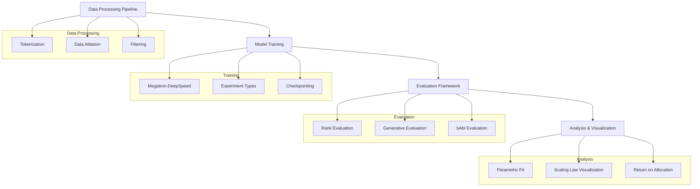
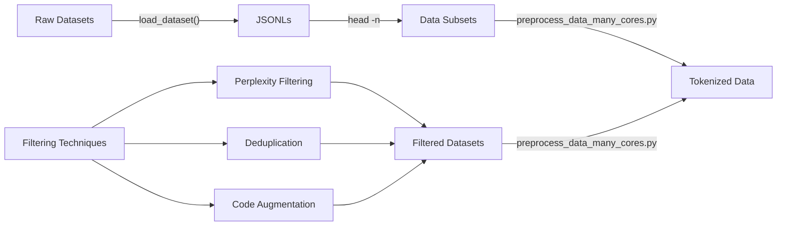
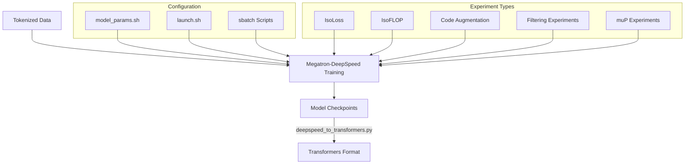
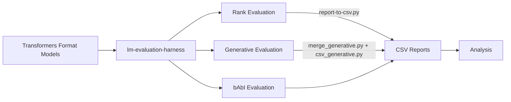
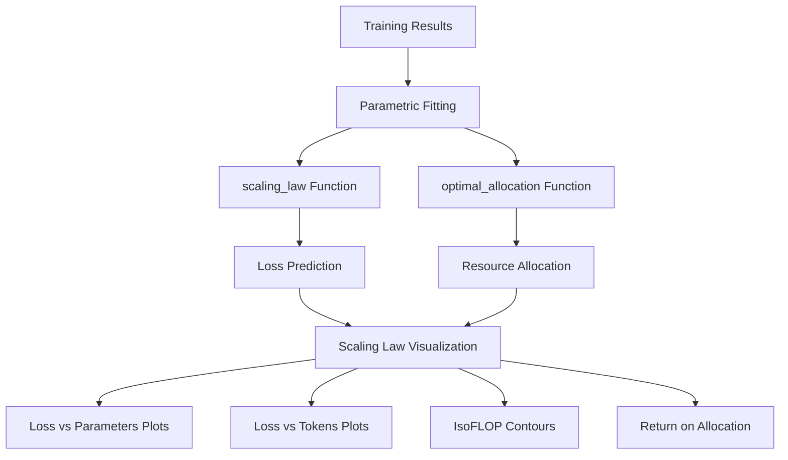

<!-- source: DeepWiki mcp.deepwiki.com · repo huggingface/datablations · page 1 Overview · fetched 2026-10-26 -->

# Overview

<details>
<summary>Relevant source files</summary>

The following files were used as context for generating this wiki page:

- [README.md](README.md)
- [plotstables/training_validation_filter.pdf](plotstables/training_validation_filter.pdf)
- [plotstables/validation_c4py.pdf](plotstables/validation_c4py.pdf)

</details>


Datablations is a framework for investigating language models in data-constrained regimes. It provides tools for preprocessing data, training models using Megatron-DeepSpeed, evaluating models on downstream tasks, and analyzing results through the lens of scaling laws. This repository supports the research presented in the paper "Scaling Data-Constrained Language Models" which examines how to optimize language model performance when limited by available unique training data.

For detailed information about repository structure and navigation, see [Repository Structure](#1.1).
For setup instructions, see [Getting Started](#1.2).

## Framework Architecture

The Datablations framework consists of four major interconnected systems:



Sources: README.md, System Overview Diagram

## Core Components

### Data Processing

The data processing pipeline handles the preparation of datasets for training language models. It supports working with C4, OSCAR, and code datasets, applying various data manipulation techniques:



Sources: README.md:40-126

The framework supports several data ablation techniques:
- **Data Repetition**: Controlling how many times the same tokens are seen during training
- **Code Augmentation**: Mixing programming language data (Python) with natural language
- **Filtering**: Removing low-quality content through perplexity filtering and deduplication

Sources: README.md:43-107

### Training Infrastructure

Datablations uses a modified version of Megatron-DeepSpeed to train language models with various configurations:



Sources: README.md:197-293

Training experiments focus on:
- **IsoLoss**: Experiments targeting the same loss with different model/data configurations
- **IsoFLOP**: Experiments using the same compute budget with different allocations
- **Data Manipulation**: Experiments testing various data processing techniques

Models are trained with parameters ranging from millions to billions, and training tokens from billions to hundreds of billions.

Sources: README.md:216-271

### Evaluation System

After training, models are evaluated on different downstream tasks using lm-evaluation-harness:



Sources: README.md:375-395

The evaluation framework supports:
- **Rank Evaluation**: Tasks measuring model's ability to rank correct answers
- **Generative Evaluation**: Tasks assessing text generation capabilities
- **bAbI Evaluation**: Tasks for basic reasoning and comprehension

Sources: README.md:375-394

### Analysis Framework

The analysis framework is centered around fitting parametric scaling laws and analyzing the results:



Sources: README.md:294-371, README.md:396-424

The analysis focuses on:
- **Parametric Fitting**: Determining scaling law parameters from experimental data
- **Optimal Allocation**: Finding the best balance between model size and training tokens
- **Visualization**: Creating plots and visualizations to understand scaling behavior

Sources: README.md:294-371

## Core Concepts

### Scaling Laws in Data-Constrained Regimes

The framework introduces a scaling law for compute optimality that accounts for:
- The decreasing value of repeated tokens
- Excess parameters when data is limited
- The relationship between model size, dataset size, and compute budget

The generalized form of the scaling law is:

```
L(N,D,R_N,R_D) = E + A/(U_N + U_N * R_N^* * (1 - e^(-1*R_N/(R_N^*))))^α + B/(U_D + U_D * R_D^* * (1 - e^(-1*R_D/(R_D^*))))^β
```

Where:
- N: number of parameters
- D: number of total training tokens
- U: number of unique training tokens
- RD: repetition factor for data
- RN: excess parameter factor
- α, β: scaling exponents
- E, A, B, R_N^*, R_D^*: fitted constants

Sources: README.md:294-371

### Repository Organization

The repository is organized into several key directories:

| Directory | Purpose |
|-----------|---------|
| `.` (root) | Main scripts, README |
| `training/` | Training scripts and configuration |
| `utils/` | Utility scripts for data manipulation, evaluation |
| `filtering/` | Scripts for filtering and deduplication |
| `plotstables/` | Analysis scripts and visualization notebooks |
| `Megatron-DeepSpeed/` | Modified training framework (external) |

Sources: README.md:15-39, Repository Structure

## Experimental Results

The repository contains the results of over 400 training runs, investigating:

1. How model performance scales with data repetition
2. Optimal allocation of compute between model size and training tokens
3. Effectiveness of different data augmentation techniques
4. Impact of filtering techniques on model quality

The findings of these experiments are published in the paper "Scaling Data-Constrained Language Models" and can be replicated using the code in this repository.

Sources: README.md:5-13

## System Requirements and Dependencies

Key dependencies include:
- Megatron-DeepSpeed for distributed training
- Hugging Face datasets for data loading
- lm-evaluation-harness for evaluation
- Python data science stack for analysis

The framework supports both AMD GPUs (via ROCm) and NVIDIA GPUs (via CUDA).

Sources: README.md:276-278

---

