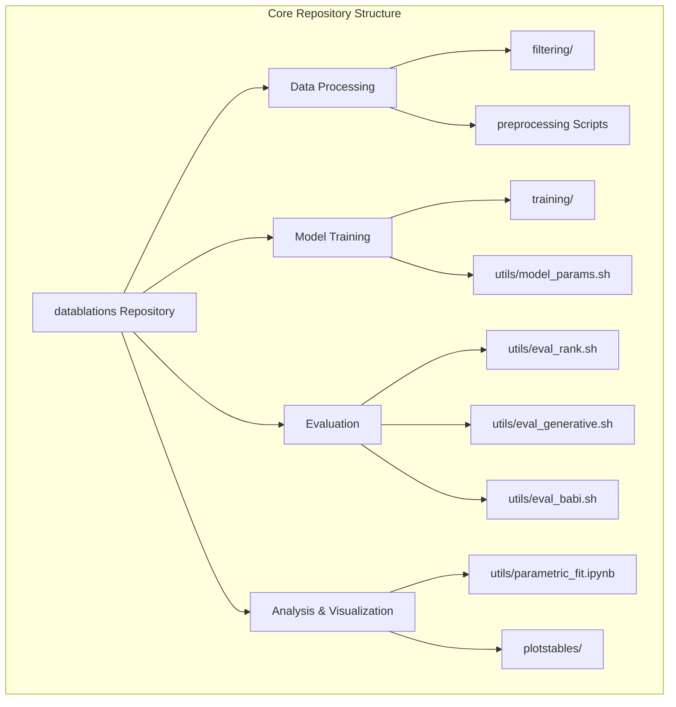
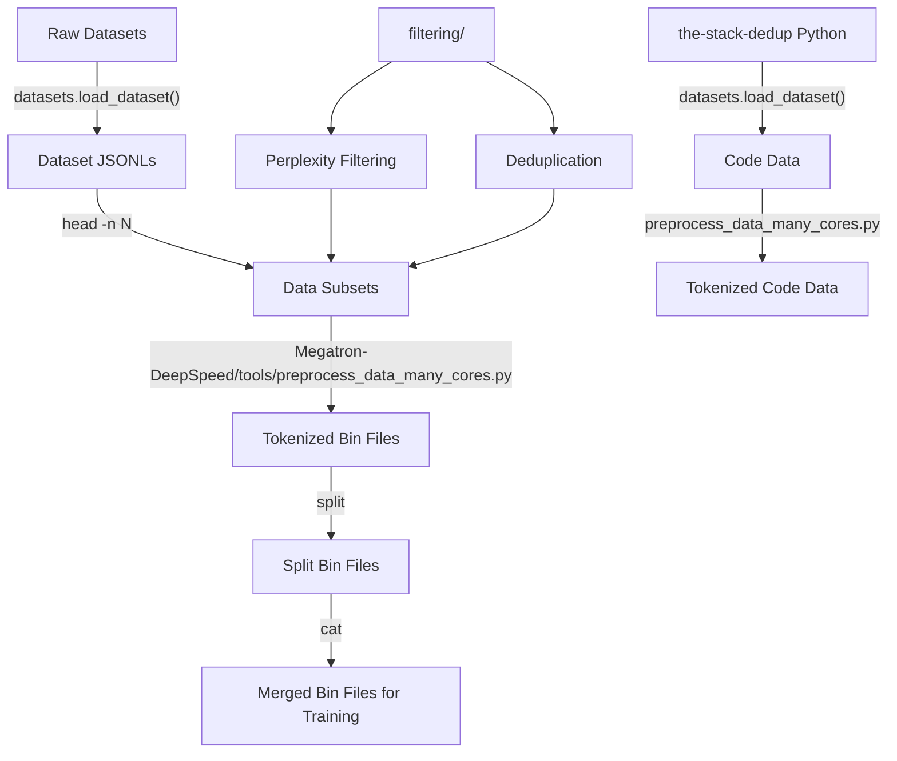
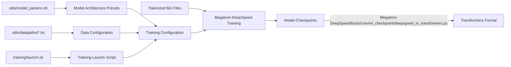
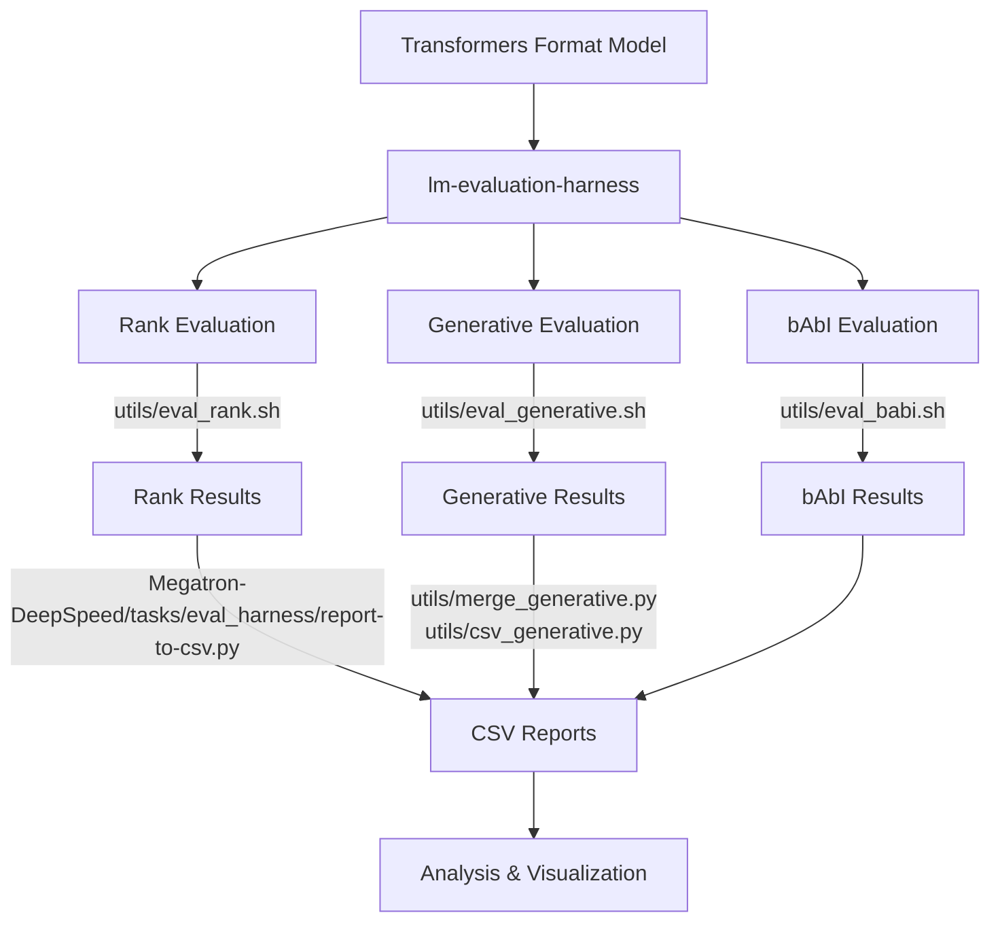
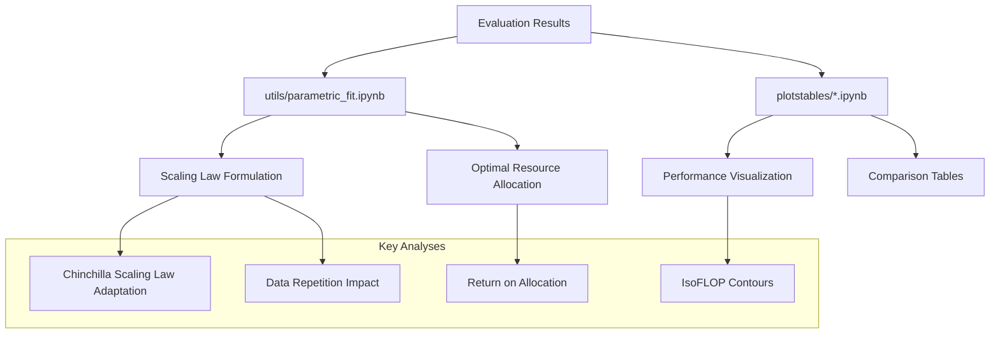

<!-- source: DeepWiki mcp.deepwiki.com · repo huggingface/datablations · page 1.1 Repository Structure · fetched 2026-10-26 -->

# Repository Structure

<details>
<summary>Relevant source files</summary>

The following files were used as context for generating this wiki page:

- [.gitignore](.gitignore)
- [README.md](README.md)
- [plotstables/training_validation_filter.pdf](plotstables/training_validation_filter.pdf)
- [plotstables/validation_c4py.pdf](plotstables/validation_c4py.pdf)

</details>


This page provides a comprehensive overview of the datablations repository organization, detailing the key directories, files, and their purposes within the system. For instructions on setting up the environment and running experiments, see [Getting Started](#1.2).

## High-Level Organization

The datablations repository is structured to support the entire workflow for studying language models in data-constrained regimes, from data preprocessing through model training to evaluation and analysis.



Sources: [README.md:1-39]()

## Key Directories and Files

The repository has a functional organization with the following important components:

| Directory/File | Purpose |
|----------------|---------|
| `filtering/` | Contains scripts for data filtering techniques (deduplication, perplexity filtering) |
| `filtering/README.md` | Documentation for filtering approaches |
| `training/` | Contains scripts for training model configuration and execution |
| `training/launch.sh` | Script for launching training jobs on compute clusters |
| `utils/` | Utility scripts for various tasks (evaluation, configuration, analysis) |
| `utils/model_params.sh` | Architecture presets for different model sizes |
| `utils/datapaths/` | Text files defining data paths for training |
| `utils/eval_*.sh` | Scripts for different evaluation approaches |
| `utils/parametric_fit.ipynb` | Notebook for fitting scaling laws to results |
| `plotstables/` | Scripts and notebooks for visualization and analysis |

Sources: [README.md:40-100]()

## Data Processing Pipeline

The data processing system prepares datasets for training, handling tokenization, filtering, and format conversion.



Sources: [README.md:41-127]()

The data processing workflow typically involves:

1. Loading datasets from Hugging Face (C4, OSCAR, the-stack-dedup)
2. Creating subsets based on experimental parameters
3. Tokenizing with the GPT-2 tokenizer via Megatron-DeepSpeed tools
4. For larger files, splitting and later recombining bin files

### Data Filtering Techniques

The repository implements several data filtering approaches:

1. **Perplexity Filtering**: Removes examples based on language model perplexity scores
   - Scripts: `filtering/deduplication/filter_oscar_jsonl.py`
   - Example datasets: `datablations/c4-filter`, `datablations/oscar-filter`

2. **Deduplication**: Removes redundant examples from datasets
   - Scripts: `filtering/deduplication/filter_oscar_jsonl.py`
   - Example implementation: Removing samples where the `repetitions` field is populated

Sources: [README.md:117-195]()

## Model Training System

The training system leverages Megatron-DeepSpeed for distributed training of language models at scale.



Sources: [README.md:197-293]()

The training workflow includes:

1. Configuring model architecture and hyperparameters via `utils/model_params.sh`
2. Specifying data paths in text files under `utils/datapaths/`
3. Launching distributed training with `training/launch.sh` 
4. Saving model checkpoints during training
5. Converting checkpoints to Hugging Face Transformers format for evaluation

### Model Naming Convention

Models are named following a consistent pattern:

```
lm1-{parameters}-{tokens}-{unique_tokens}[-{optional specifier}]
```

For example:
- `lm1-8b7-178b-c4-repetitions`: 8.7B params, 178B tokens, C4 dataset with repetitions
- `lm1-4b2-84b-c4py`: 4.2B params, 84B tokens, C4 dataset with Python code augmentation

Sources: [README.md:199-270]()

## Evaluation Framework

The evaluation system assesses model performance using the lm-evaluation-harness tool across various benchmarks.



Sources: [README.md:372-395]()

The evaluation process involves:

1. **Rank Evaluation**: 
   - Measures perplexity and accuracy on multiple-choice tasks
   - Executed with `utils/eval_rank.sh`
   - Results processed with `report-to-csv.py`

2. **Generative Evaluation**:
   - Measures generation quality using metrics like ROUGE
   - Executed with `utils/eval_generative.sh`
   - Results processed with `merge_generative.py` and `csv_generative.py`

3. **bAbI Evaluation**:
   - Measures exact match performance on reasoning tasks
   - Executed with `utils/eval_babi.sh`

Sources: [README.md:372-395]()

## Analysis and Visualization

The repository includes tools for analyzing results and visualizing scaling behaviors.



Sources: [README.md:294-425]()

Key analysis tools include:

1. **Parametric Fitting**:
   - `utils/parametric_fit.ipynb`: Fits scaling laws to experimental results
   - Formulates equations relating model size, data size, and performance

2. **Visualization Notebooks**:
   - Located in `plotstables/` directory
   - Include notebooks like `isoflops_training.ipynb`, `return_alloc.ipynb`, and others
   - Generate figures found in the research paper

3. **Performance Analysis**:
   - Compare different model configurations
   - Analyze impact of data filtering and augmentation
   - Study scaling behavior with constrained data

Sources: [README.md:396-425]()

## Experiment Types

The repository supports several experimental approaches to study language model scaling:

| Experiment Type | Description | Example Folders |
|-----------------|-------------|----------------|
| IsoLoss | Compare configurations with the same loss | `lm1-misc` |
| IsoFLOP | Compare models using same compute budget | `lm1-*b-*b-*-repetitions` |
| Code Augmentation | Assess impact of adding code data | `lm1-*b-*b-*py` |
| Filtering | Evaluate filtering techniques | `lm1-*b-*b-*-perplexity`, `lm1-*b-*b-*-dedup` |
| muP | Study maximal update parametrization | `datablations/mup` |

Sources: [README.md:216-260]()

## Related Documentation

For more detailed information about specific components, refer to:
- [Data Processing Pipeline](#2) for details on data preparation
- [Model Training](#3) for training configuration and execution
- [Evaluation Framework](#4) for model assessment
- [Scaling Laws and Analysis](#5) for understanding performance patterns

Sources: [README.md:15-37]()

---

