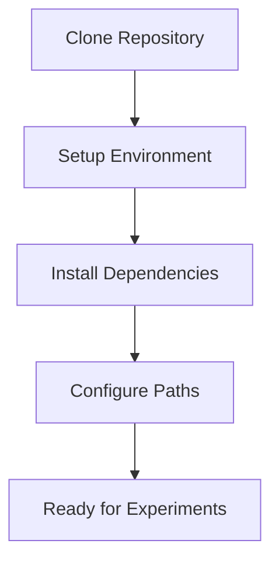
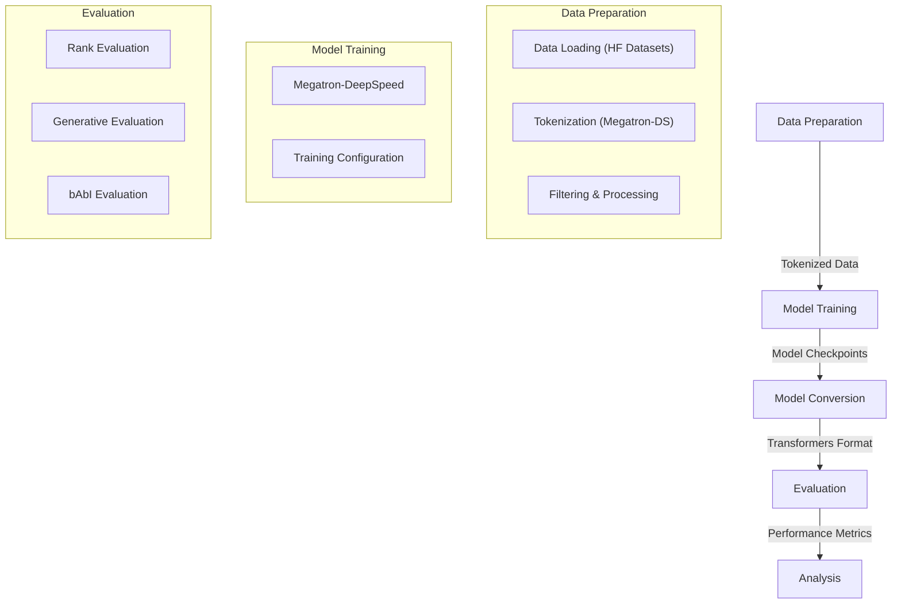
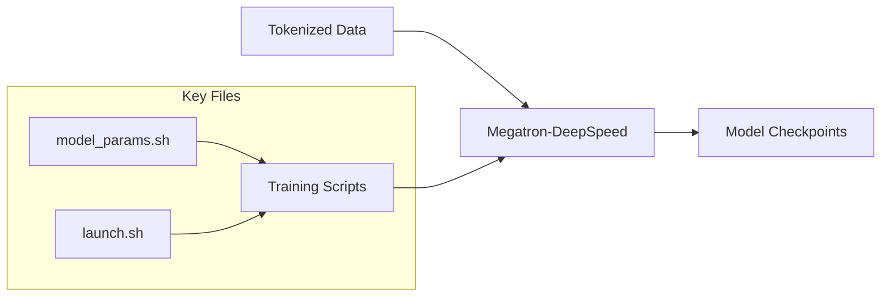
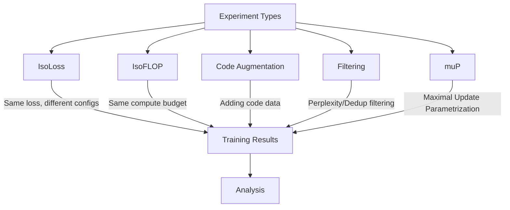

<!-- source: DeepWiki mcp.deepwiki.com · repo huggingface/datablations · page 1.2 Getting Started · fetched 2026-10-26 -->

# Getting Started

<details>
<summary>Relevant source files</summary>

The following files were used as context for generating this wiki page:

- [Makefile](Makefile)
- [README.md](README.md)
- [plotstables/training_validation_filter.pdf](plotstables/training_validation_filter.pdf)
- [plotstables/validation_c4py.pdf](plotstables/validation_c4py.pdf)

</details>


This page provides instructions for setting up the Datablations environment and running basic experiments with data-constrained language models. For detailed information about specific components like data processing, see [Data Processing Pipeline](#2) or for evaluation procedures, refer to [Evaluation Framework](#4).

## Prerequisites

Before working with Datablations, ensure you have:

- Git for repository access
- Python 3.8+ for running the codebase
- Access to GPU resources (preferably NVIDIA or AMD GPUs)
- Storage space for datasets and model checkpoints

## Repository Setup



1. Clone the repository:
   ```bash
   git clone https://github.com/huggingface/datablations
   cd datablations
   ```

2. Set up a Python environment:
   ```bash
   python -m venv datablations_env
   source datablations_env/bin/activate  # On Windows: datablations_env\Scripts\activate
   ```

3. Install dependencies for preprocessing:
   ```bash
   pip install datasets transformers
   ```

Sources: [README.md:1-39]()

## Core Components

The Datablations framework consists of several interconnected components:



Sources: [README.md:40-107]()

## Data Preparation

### Using Pre-processed Datasets

The simplest way to get started is to use the pre-processed datasets provided by the project:

| Dataset Type | HuggingFace Repository | Description |
|--------------|------------------------|-------------|
| C4 Subsets | datablations/c4-subsets | Various sizes of tokenized C4 |
| OSCAR Subsets | datablations/oscar-subsets | Various sizes of tokenized OSCAR |
| Python Code | datablations/python-megatron | Python code from The Stack |
| Filtered Data | datablations/c4-filter-megatron, datablations/oscar-filter-megatron | Perplexity and deduplication filtered datasets |

To use these datasets, download them from HuggingFace:

```bash
# Example for a C4 subset
git lfs install
git clone https://huggingface.co/datasets/datablations/c4-subsets
```

For large bin files that were split, you'll need to combine them:
```bash
cat gpt2tok_c4_en_1B9.bin.* > gpt2tok_c4_en_1B9.bin
```

Sources: [README.md:104-107](), [README.md:123-127]()

### Processing Your Own Data

If you want to process your own data, you'll need to:

1. Clone the Megatron-DeepSpeed repository:
   ```bash
   git clone https://github.com/TurkuNLP/Megatron-DeepSpeed
   # Follow setup instructions in that repository
   ```

2. Prepare your data in JSONL format
3. Tokenize using the preprocessing script:

```bash
python Megatron-DeepSpeed/tools/preprocess_data_many_cores.py \
--input your_data.jsonl \
--output-prefix gpt2tok_your_data \
--dataset-impl mmap \
--tokenizer-type PretrainedFromHF \
--tokenizer-name-or-path gpt2 \
--append-eod \
--workers 64
```

Sources: [README.md:44-96]()

## Model Training

The Datablations framework uses Megatron-DeepSpeed for training language models. 



### Training a Model

1. Set up Megatron-DeepSpeed according to the repository instructions.
   ```bash
   git clone https://github.com/TurkuNLP/Megatron-DeepSpeed  # For AMD GPUs
   # OR
   git clone https://github.com/bigscience-workshop/Megatron-DeepSpeed  # For NVIDIA GPUs
   ```

2. Examine example training scripts in the model folders:
   - Each model folder contains an `sbatch` script used for training
   - These reference files in `utils/datapaths/` for dataset locations
   - Parameters are defined in `utils/model_params.sh`

3. Adapt an existing script to your needs, modifying:
   - Dataset paths
   - Model size parameters (hidden size, layers, attention heads)
   - Training parameters (batch size, steps, learning rate)

4. Run your training script

Sources: [README.md:274-288]()

### Converting Trained Models

After training, convert your Megatron-DeepSpeed model to Hugging Face Transformers format:

```bash
python Megatron-DeepSpeed/tools/convert_checkpoint/deepspeed_to_transformers.py \
--input_folder checkpoint_folder/global_step12345 \
--output_folder transformers_model \
--target_tp 1 \
--target_pp 1
```

Sources: [README.md:286-288]()

## Model Evaluation

Datablations provides three types of evaluation methods:

### Rank Evaluation

For tasks like question answering and classification:

1. Install the evaluation harness:
   ```bash
   pip install git+https://github.com/EleutherAI/lm-evaluation-harness.git
   ```

2. Run evaluation (modify the script variables first):
   ```bash
   sbatch utils/eval_rank.sh
   ```

3. Convert results to CSV:
   ```bash
   python Megatron-DeepSpeed/tasks/eval_harness/report-to-csv.py outfile.json
   ```

Sources: [README.md:376-380]()

### Generative Evaluation

For tasks using ROUGE metrics:

1. Clone and install a specific branch of the evaluation harness:
   ```bash
   git clone -b addtasks https://github.com/Muennighoff/lm-evaluation-harness.git
   cd lm-evaluation-harness
   pip install -e ".[dev]"
   pip uninstall -y promptsource
   pip install git+https://github.com/Muennighoff/promptsource.git@tr13
   ```

2. Run evaluation (modify the script variables first):
   ```bash
   sbatch utils/eval_generative.sh
   ```

3. Process results:
   ```bash
   python utils/merge_generative.py
   python utils/csv_generative.py merged.json
   ```

Sources: [README.md:382-388]()

### bAbI Evaluation

For reasoning tasks with exact match metrics:

1. Clone and install a specific branch:
   ```bash
   git clone -b babi https://github.com/Muennighoff/lm-evaluation-harness.git
   cd lm-evaluation-harness
   pip install -e ".[dev]"
   ```

2. Run evaluation:
   ```bash
   sbatch utils/eval_babi.sh
   ```

Sources: [README.md:390-394]()

## Experiment Types

The Datablations framework supports several types of experiments:



For each experiment type, you'll need to:

1. Prepare appropriate data (regular, augmented with code, or filtered)
2. Configure the training parameters (model size, training tokens, steps)
3. Run training
4. Evaluate and analyze results

Sources: [README.md:197-270]()

## Next Steps

Now that you have the basics, you can:

- Explore the [Data Processing Pipeline](#2) for advanced data manipulation
- Learn about [Model Training](#3) configuration options
- Understand the [Evaluation Framework](#4) in depth
- Study [Scaling Laws and Analysis](#5) to interpret results

For analyzing model performance, check out the parametric fitting tools and visualization notebooks in the `plotstables/` directory.

Sources: [README.md:294-371](), [README.md:396-425]()

---

