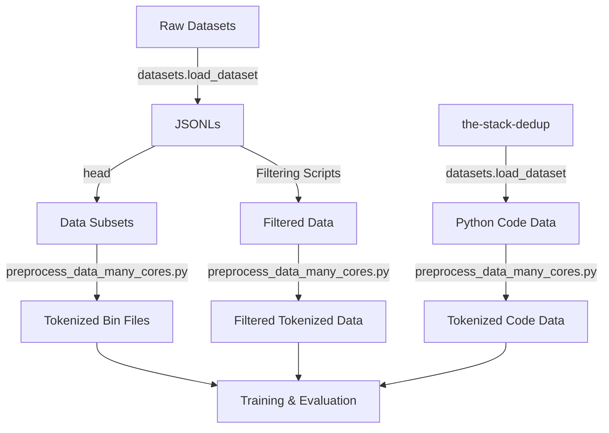
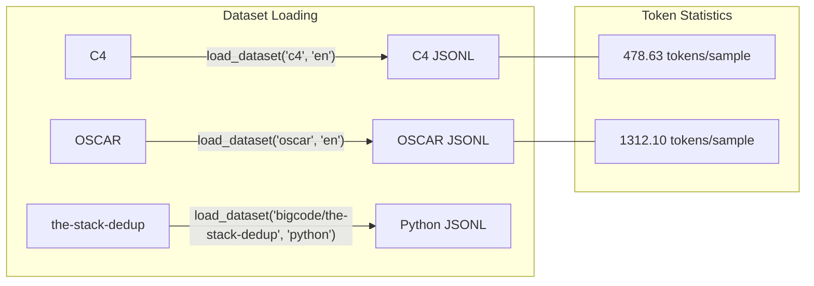
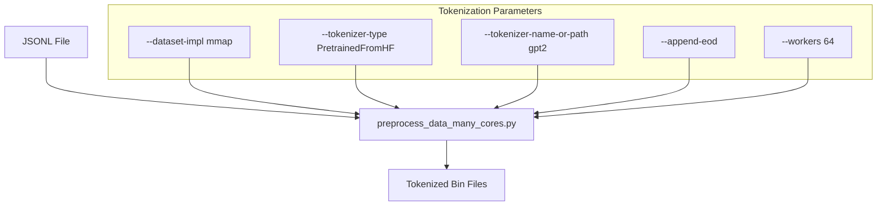
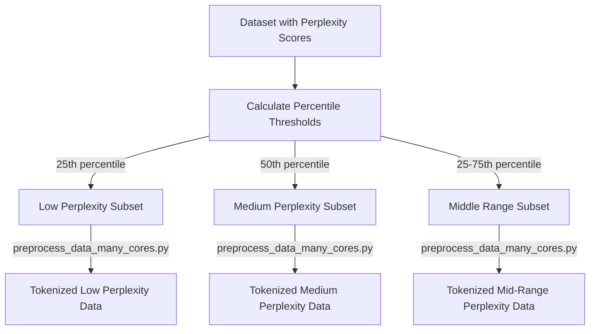
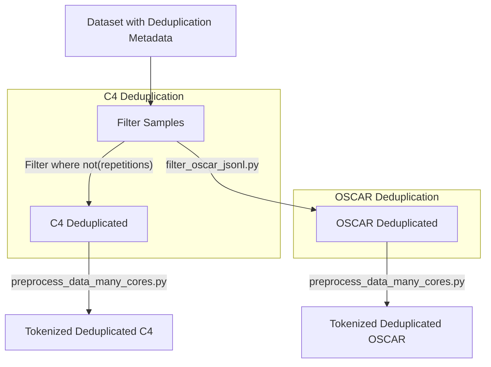
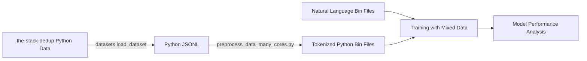
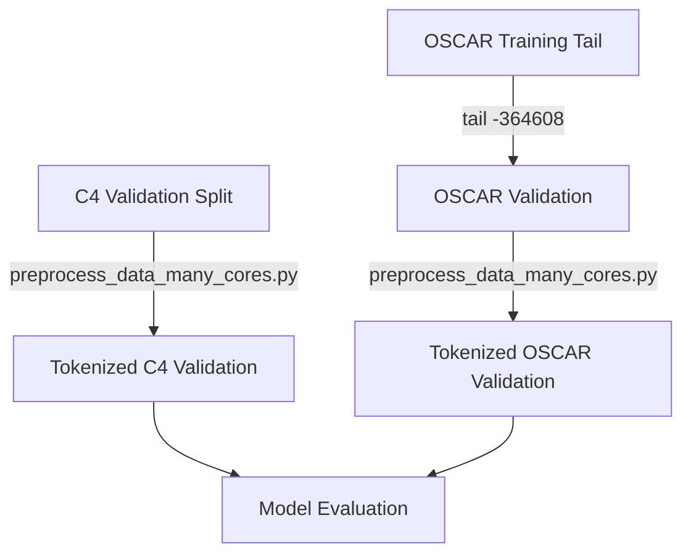
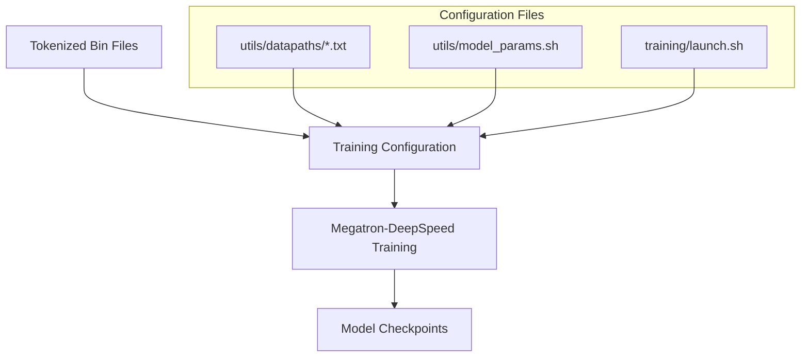

<!-- source: DeepWiki mcp.deepwiki.com · repo huggingface/datablations · page 2 Data Processing Pipeline · fetched 2026-10-26 -->

# Data Processing Pipeline

<details>
<summary>Relevant source files</summary>

The following files were used as context for generating this wiki page:

- [Makefile](Makefile)
- [README.md](README.md)
- [plotstables/training_validation_filter.pdf](plotstables/training_validation_filter.pdf)
- [plotstables/validation_c4py.pdf](plotstables/validation_c4py.pdf)

</details>


This document covers the data preprocessing workflow in the datablations repository, detailing how raw text datasets are transformed into tokenized binary files suitable for language model training. It focuses on the technical processes of data loading, tokenization, subsetting, and filtering techniques used in the repository's data ablation experiments. For information about model training using this processed data, see [Model Training](#3).

## Overview

The data processing pipeline transforms raw datasets from sources like C4, OSCAR, and The Stack (Python code) into tokenized binary files in Megatron-DeepSpeed's format. The pipeline supports various data manipulation techniques including repetition, filtering, and code augmentation used to study data-constrained regimes.



Sources: [README.md:40-127]()

## Dataset Sources

The datablations repository primarily uses three datasets:

1. **C4** (Colossal Clean Crawled Corpus) - A large, cleaned web corpus
2. **OSCAR** (Open Super-large Crawled Aggregated coRpus) - Non-deduplicated English web corpus
3. **The Stack** (Python code) - Python subset from the-stack-dedup for code augmentation experiments

These datasets are loaded using the Hugging Face `datasets` library and converted to JSONL format for further processing.



Sources: [README.md:45-46](), [README.md:110-113]()

## Data Subsetting

To study the impact of data volume and repetition, the repository creates subsets of varying sizes. The number of samples is calculated based on the average tokens per sample:

| Dataset | Tokens per Sample | Samples for 1.9B Tokens |
|---------|------------------|-------------------------|
| C4      | 478.625834583    | 3,969,698              |
| OSCAR   | 1,312.0951072    | 1,448,066              |

Subsets are created using the `head` command to select a specific number of samples from the JSONL files:

```bash
# C4 example for 1.9B tokens
head -n 3969698 c4.jsonl > c4_1b9.jsonl

# OSCAR example for 1.9B tokens  
head -n 1448066 oscar_en.jsonl > oscar_1b9.jsonl
```

Sources: [README.md:47-52](), [README.md:64-76]()

## Tokenization Process

Tokenization is performed using the `preprocess_data_many_cores.py` script from Megatron-DeepSpeed, which converts JSONL files into memory-mapped binary files with tokenized data.



Example tokenization command:

```bash
python Megatron-DeepSpeed/tools/preprocess_data_many_cores.py \
  --input c4_1b9.jsonl \
  --output-prefix gpt2tok_c4_en_1B9 \
  --dataset-impl mmap \
  --tokenizer-type PretrainedFromHF \
  --tokenizer-name-or-path gpt2 \
  --append-eod \
  --workers 64
```

Large tokenized bin files are often split for storage and need to be reconstructed before use:

```bash
# Split large bin files
split --number=l/40 gpt2tok_c4_en_1B9.bin gpt2tok_c4_en_1B9.bin.

# Reconstruct for training
cat gpt2tok_c4_en_1B9.bin.* > gpt2tok_c4_en_1B9.bin
```

Sources: [README.md:53-63](), [README.md:107-107]()

## Filtering Techniques

The repository implements two main filtering techniques to improve data quality:

### Perplexity Filtering

Perplexity filtering removes samples with high perplexity scores, which often indicate poor quality text. The process involves:

1. Calculating perplexity scores for all samples
2. Determining percentile thresholds (25th, 50th, 75th)
3. Filtering samples below the chosen threshold



Example for creating a 25th percentile filtered subset:

```python
from datasets import load_dataset
import numpy as np
ds = load_dataset("datablations/c4-filter", streaming=False, num_proc=128)
p_25 = np.percentile(ds["train"]["perplexity"], 25)
ds["train"].filter(lambda x: x["perplexity"] < p_25, num_proc=128).to_json("c4_perplexty25.jsonl", num_proc=128, force_ascii=False)
```

Sources: [README.md:137-176]()

### Deduplication

Deduplication removes redundant content from datasets to ensure greater diversity. The implementation differs between C4 and OSCAR:

- **C4**: Remove samples where the `repetitions` field is populated
- **OSCAR**: Apply the script `filtering/deduplication/filter_oscar_jsonl.py`



Example for C4 deduplication:

```python
from datasets import load_dataset
ds = load_dataset("datablations/c4-dedup", streaming=False, num_proc=128)
ds.filter(lambda x: not(x["repetitions"])).to_json('c4_dedup.jsonl', num_proc=128, force_ascii=False)
```

Sources: [README.md:179-196]()

## Code Data Augmentation

The repository uses Python code data from the-stack-dedup to augment natural language data. This allows studying the effect of code on model performance:



The preprocessed Python code data is available at `https://huggingface.co/datasets/datablations/python-megatron`.

Sources: [README.md:109-114](), [README.md:232-240]()

## Validation Data Preparation

Validation data is prepared for evaluating models during and after training:

- **C4**: The official validation split is used
  ```python
  load_dataset("c4", "en", split="validation").to_json("c4-en-validation.json")
  ```
  
- **OSCAR**: A portion of the training set is reserved since no official validation set exists
  ```bash
  tail -364608 oscar_en.jsonl > oscarvalidation.jsonl
  ```

These validation sets are tokenized using the same process as training data but with fewer workers.



Sources: [README.md:79-101]()

## Integration with Training

The processed data integrates with the training process through configuration files that specify data paths:



Data paths are specified in text files referenced by training scripts, located at `utils/datapaths/`. These paths are used in the training scripts to locate the appropriate tokenized data files.

Sources: [README.md:282-285]()

## Prepared Dataset Availability

The repository makes preprocessed datasets available via Hugging Face:

| Dataset Type | URL |
|--------------|-----|
| C4 subsets | datablations/c4-subsets |
| OSCAR subsets | datablations/oscar-subsets |
| Python code | datablations/python-megatron |
| C4 with filtering metadata | datablations/c4-filter |
| OSCAR with filtering metadata | datablations/oscar-filter |
| Tokenized filtered C4 | datablations/c4-filter-megatron |
| Tokenized filtered OSCAR | datablations/oscar-filter-megatron |

These datasets enable reproducibility and provide starting points for further research on data-constrained language models.

Sources: [README.md:103-127]()

---

