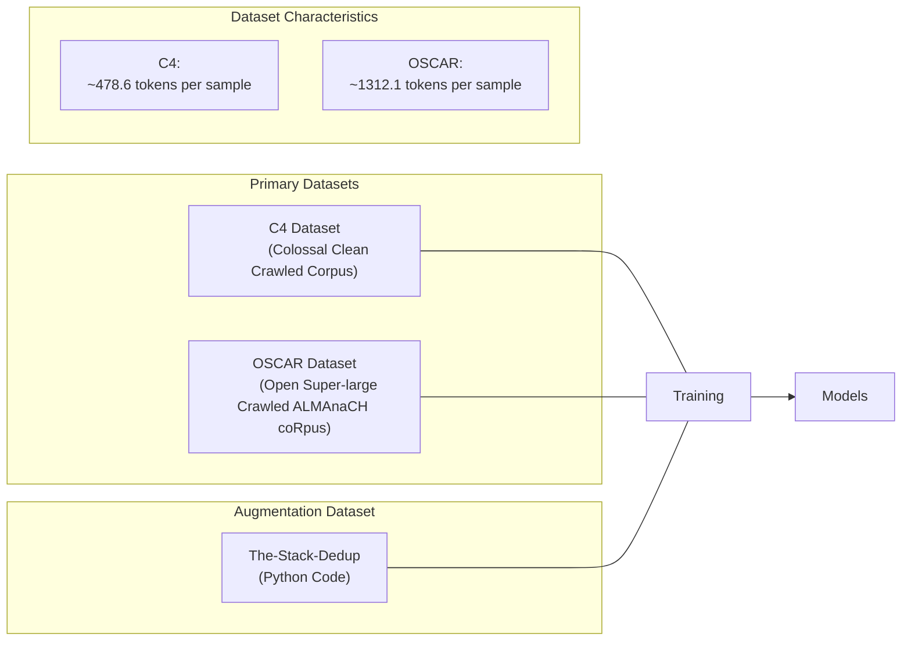
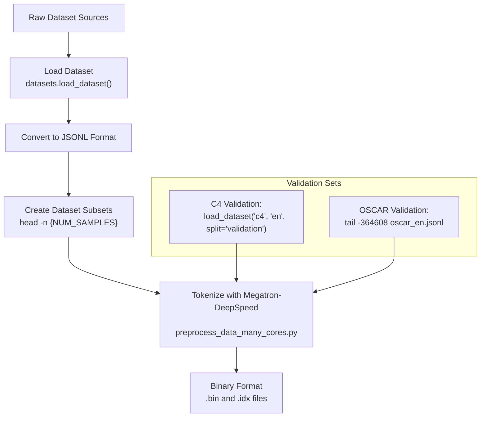
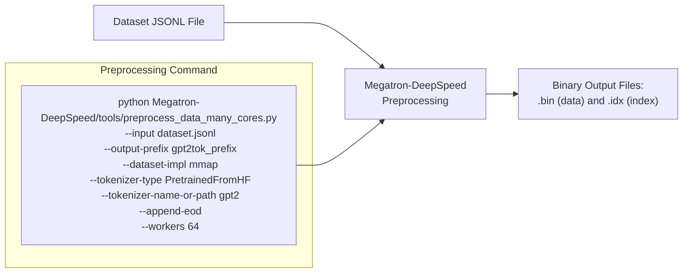
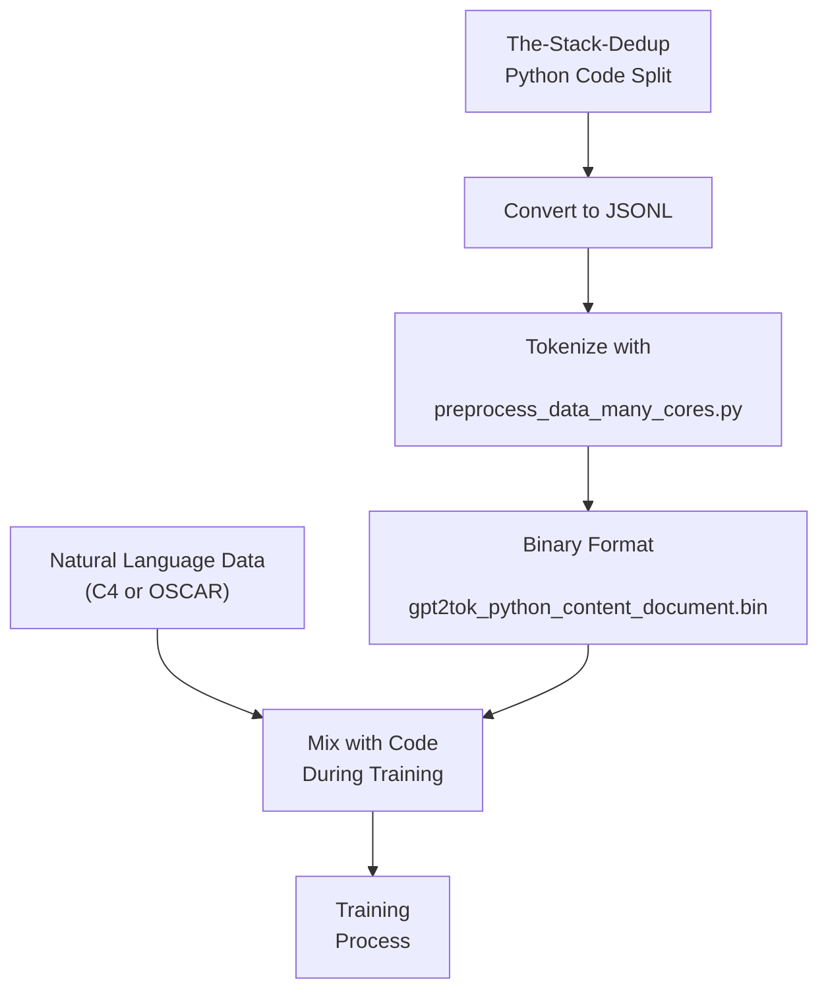

<!-- source: DeepWiki mcp.deepwiki.com · repo huggingface/datablations · page 2.1 Datasets · fetched 2026-10-26 -->

# Datasets

<details>
<summary>Relevant source files</summary>

The following files were used as context for generating this wiki page:

- [README.md](README.md)
- [plotstables/training_validation_filter.pdf](plotstables/training_validation_filter.pdf)
- [plotstables/validation_c4py.pdf](plotstables/validation_c4py.pdf)

</details>


This document describes the datasets used in the datablations framework and how they are loaded and processed. It covers the primary text corpora used for training language models, their characteristics, and the technical details of how they are prepared for training. For information about dataset filtering and deduplication techniques, see [Deduplication](#2.2) and [Data Ablation Techniques](#2.3).

## Dataset Overview

The datablations framework primarily uses two large text corpora for training language models:



### C4 (Colossal Clean Crawled Corpus)

C4 is a cleaned version of Common Crawl's web crawl data, designed for language model training. It has been filtered to remove incomplete sentences, non-English text, and other low-quality content.

Key characteristics:
- Approximately 478.6 tokens per sample (using GPT-2 tokenizer)
- Clean, filtered web text
- Comes with officially defined training and validation splits

### OSCAR (Open Super-large Crawled ALMAnaCH coRpus)

OSCAR is a large multilingual corpus obtained from Common Crawl snapshots. For datablations, the non-deduplicated English split is used.

Key characteristics:
- Approximately 1312.1 tokens per sample (using GPT-2 tokenizer)
- Multilingual corpus (English portion used)
- More tokens per sample than C4

Sources: [README.md:44-46]()

## Dataset Loading Process

The datasets are loaded using the Hugging Face `datasets` library and then processed into formats suitable for training with Megatron-DeepSpeed.



### Dataset Loading Steps

1. **Download and prepare JSONL files**:
   ```
   # For C4
   datasets.load_dataset("c4", "en") → c4.jsonl
   
   # For OSCAR
   datasets.load_dataset("oscar", "en") → oscar_en.jsonl
   ```

2. **Create dataset subsets** based on the desired number of unique tokens:
   ```
   # For 1.9B unique tokens from C4
   head -n 3969698 c4.jsonl > c4_1b9.jsonl
   
   # For 1.9B unique tokens from OSCAR
   head -n 1448066 oscar_en.jsonl > oscar_1b9.jsonl
   ```

3. **Prepare validation sets**:
   - For C4: Use the official validation split
   - For OSCAR: Create a validation set using tail command (`tail -364608 oscar_en.jsonl > oscarvalidation.jsonl`)

Sources: [README.md:47-101]()

## Tokenization and Preprocessing

All datasets are tokenized using the GPT-2 tokenizer through Megatron-DeepSpeed's preprocessing utilities to convert them into the binary format required for efficient training.



### Preprocessing Parameters

- `--input`: Path to the input JSONL file
- `--output-prefix`: Prefix for output files
- `--dataset-impl`: Implementation type for the dataset (mmap for memory-mapped files)
- `--tokenizer-type`: Type of tokenizer to use
- `--tokenizer-name-or-path`: Path to the tokenizer
- `--append-eod`: Add end-of-document tokens
- `--workers`: Number of parallel workers for preprocessing

For large files, the binary outputs may need to be split for storage using commands like:
```
split --number=l/40 gpt2tok_c4_en_1B9.bin gpt2tok_c4_en_1B9.bin.
```

These files must be recombined before training:
```
cat gpt2tok_c4_en_1B9.bin.* > gpt2tok_c4_en_1B9.bin
```

Sources: [README.md:51-62](), [README.md:87-95]()

## Dataset Variants and Repositories

The datablations framework provides several preprocessed dataset variants that are ready to use with Megatron-DeepSpeed.

| Dataset Type | Description | Repository URL |
|--------------|-------------|----------------|
| C4 Subsets | Various subsets of C4 for different token counts | datablations/c4-subsets |
| OSCAR Subsets | Various subsets of OSCAR for different token counts | datablations/oscar-subsets |
| Python Code | Python code from the-stack-dedup | datablations/python-megatron |
| C4 with Filtering Metadata | C4 with perplexity and deduplication metadata | datablations/c4-filter |
| OSCAR with Filtering Metadata | OSCAR with perplexity and deduplication metadata | datablations/oscar-filter |
| C4 Filtered (Tokenized) | Preprocessed filtered C4 datasets | datablations/c4-filter-megatron |
| OSCAR Filtered (Tokenized) | Preprocessed filtered OSCAR datasets | datablations/oscar-filter-megatron |

### Dataset Size Calculation

The number of samples needed for a specific token count is calculated using the average tokens per sample:

```
# For C4 (478.625834583 tokens per sample)
num_samples = desired_token_count / 478.625834583

# For OSCAR (1312.0951072 tokens per sample)
num_samples = desired_token_count / 1312.0951072
```

Sources: [README.md:103-127]()

## Code Augmentation

The datablations framework also supports augmenting natural language datasets with code, specifically Python code from the-stack-dedup dataset.



The Python code data is processed similarly to the natural language datasets and can be found in the repository at `datablations/python-megatron`.

Sources: [README.md:109-113](), [README.md:233-239]()

## Dataset Statistics

Here are some key statistics about the datasets used in datablations:

| Dataset | Tokens per Sample | Format | Validation Method |
|---------|-------------------|--------|------------------|
| C4 | 478.625834583 | JSONL/Binary | Official validation split |
| OSCAR | 1312.0951072 | JSONL/Binary | Custom validation split (tail -364608) |
| The-Stack-Dedup (Python) | Varies | JSONL/Binary | N/A |

These statistics help in calculating the exact number of samples needed for a specific token count and in understanding the characteristics of each dataset.

Sources: [README.md:47-50]()

## Dataset Usage in Experiments

The datasets are used in various experiments in the datablations framework:

1. **Data Repetition Experiments**: Training models with different amounts of unique data and repetition
2. **Code Augmentation**: Mixing natural language data with Python code
3. **Filtering Experiments**: Training on filtered subsets based on perplexity or deduplication

The experiments analyze how these different data characteristics affect model performance and scaling behavior.

Sources: [README.md:13-14](), [README.md:220-258]()

---

