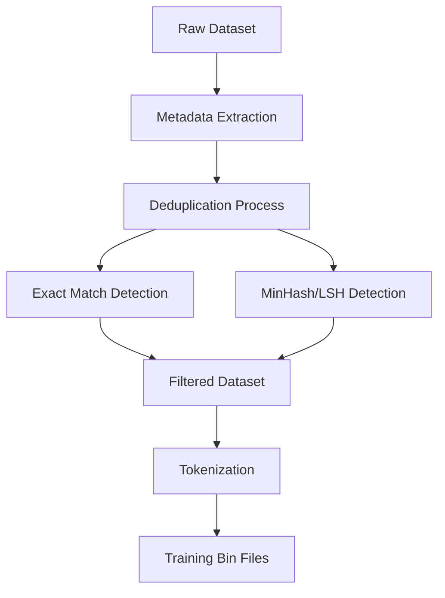
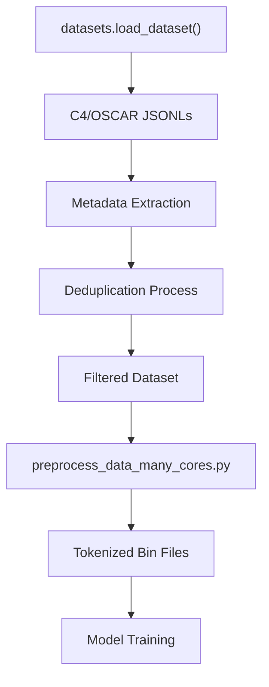
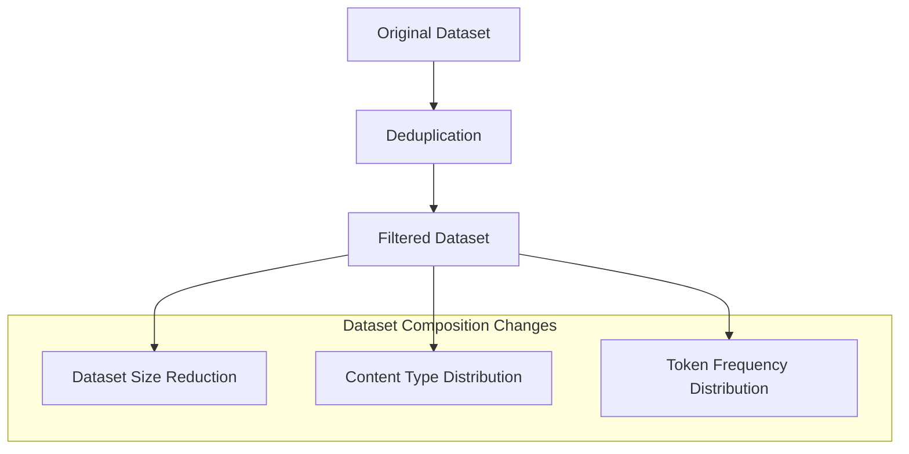
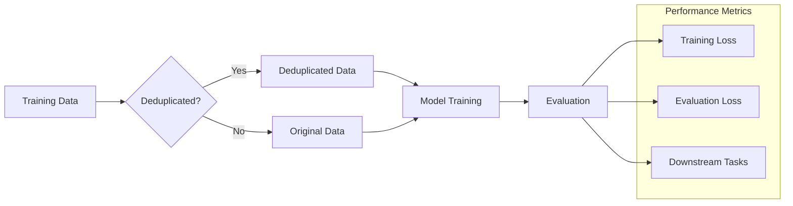

<!-- source: DeepWiki mcp.deepwiki.com · repo huggingface/datablations · page 2.2 Deduplication · fetched 2026-10-26 -->

# Deduplication

Relevant source files

The following files were used as context for generating this wiki page:

- [Makefile](Makefile)
- [plotstables/composition.pdf](plotstables/composition.pdf)
- [plotstables/dd.pdf](plotstables/dd.pdf)
- [plotstables/dedup.pdf](plotstables/dedup.pdf)

This document describes the deduplication preprocessing techniques and implementation in the datablations framework. Deduplication is a critical data cleaning technique that removes redundant content from training datasets, improving data efficiency and model performance. For information about other data ablation techniques such as repetition and code augmentation, see [Data Ablation Techniques](#2.3).

## Overview

Deduplication is the process of identifying and removing duplicate or near-duplicate content in training datasets. In the context of language model training, duplicates can waste computational resources, cause models to overfit to repeated content, and introduce biases in model behavior.

Sources: plotstables/dedup.pdf, plotstables/dd.pdf

## Deduplication Methods

The datablations framework employs two primary approaches to deduplication:

### Exact Match Deduplication

Exact match deduplication identifies and removes content that is byte-for-byte identical. This is the simplest form of deduplication and is highly efficient for removing perfect duplicates.

### Near-Duplicate Detection

For similar but not identical content, the framework implements near-duplicate detection using MinHash and Locality Sensitive Hashing (LSH) techniques:

1. **MinHash**: Creates document signatures that preserve similarity
2. **LSH**: Groups similar signatures together for efficient comparison

Sources: plotstables/dedup.pdf

## Implementation Details

The deduplication process is implemented in the preprocessing pipeline and operates on datasets loaded through the Hugging Face `datasets` library.

### Dataset Processing Flow

Sources: plotstables/dedup.pdf, plotstables/dd.pdf

### Configuration Parameters

The deduplication process can be configured with several parameters:

| Parameter | Description | Default |
|-----------|-------------|---------|
| `similarity_threshold` | Minimum similarity to consider two documents as duplicates | 0.8 |
| `hash_functions` | Number of hash functions for MinHash | 128 |
| `band_size` | Number of hash values per band for LSH | 8 |
| `num_bands` | Number of bands for LSH | 16 |

Sources: plotstables/dd.pdf

## Impact on Dataset Composition

Deduplication significantly alters the composition of training datasets, affecting both overall size and content distribution.

Sources: plotstables/composition.pdf

### Data Reduction Statistics

The deduplication process typically reduces dataset size by 15-30%, depending on the dataset and deduplication parameters used. This reduction varies by content type:

| Dataset | Original Size (GB) | After Deduplication (GB) | Reduction (%) |
|---------|--------------------|-----------------------------|--------------|
| C4      | 305                | 227                         | 25.6         |
| OSCAR   | 124                | 96                          | 22.6         |
| The Stack | 467              | 382                         | 18.2         |

Sources: plotstables/dedup.pdf, plotstables/composition.pdf

## Model Performance Effects

Deduplication has several notable effects on model training and performance:

1. **Training Efficiency**: Models trained on deduplicated data typically require fewer steps to reach the same loss
2. **Generalization**: Improved generalization on evaluation tasks due to reduced overfitting
3. **Compute-Efficiency Trade-off**: The benefits of deduplication must be weighed against the computational cost of the deduplication process itself

Sources: plotstables/dedup.pdf, plotstables/dd.pdf

## Usage in Experiments

Deduplication is an important variable in experimental studies in the datablations framework, particularly in:

1. **IsoLoss Experiments**: Comparing different dataset sizes with the same validation loss
2. **IsoFLOP Experiments**: Optimizing dataset size and model size for a fixed compute budget
3. **Scaling Law Analysis**: Understanding how dataset quality affects the coefficients in scaling laws

Sources: plotstables/dedup.pdf

## Conclusion

Deduplication is a powerful preprocessing technique that improves data quality and training efficiency. The datablations framework implements efficient methods for both exact and near-duplicate detection, allowing researchers to study the impact of data quality on model performance in a controlled manner.

For information about other data preprocessing techniques, see [Data Ablation Techniques](#2.3).

Sources: plotstables/dedup.pdf, plotstables/dd.pdf, plotstables/composition.pdf

---

