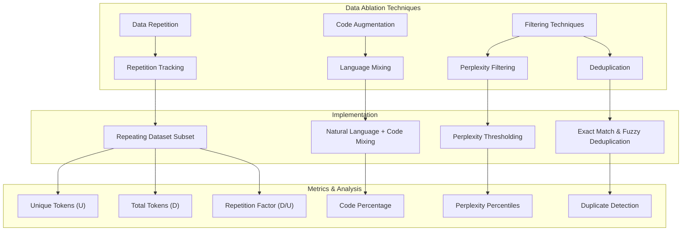
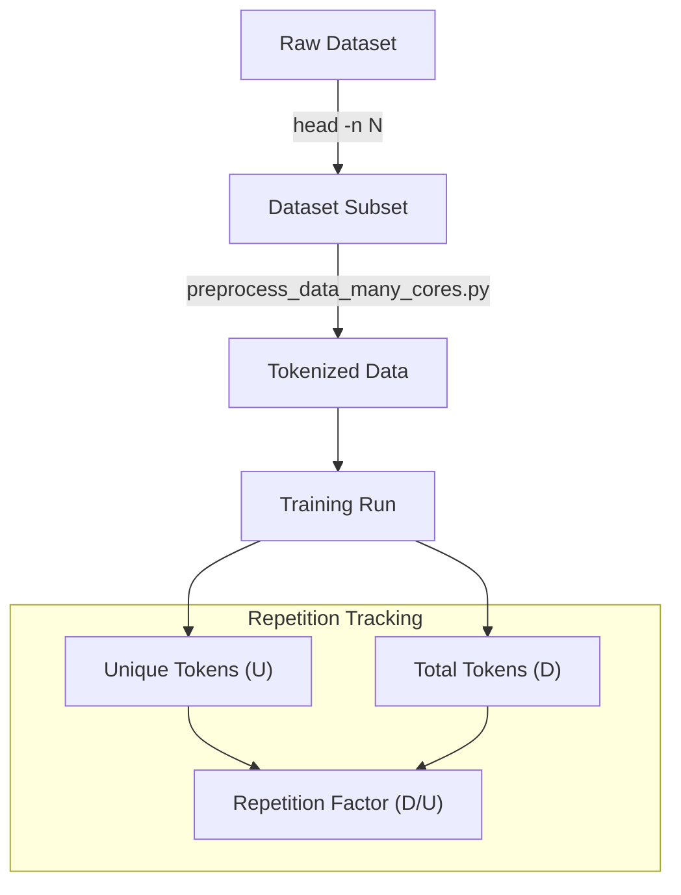
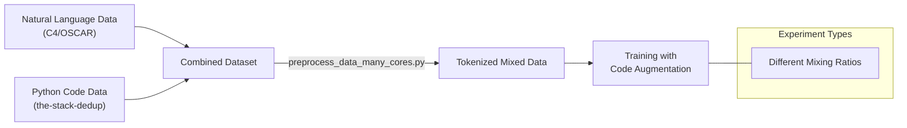
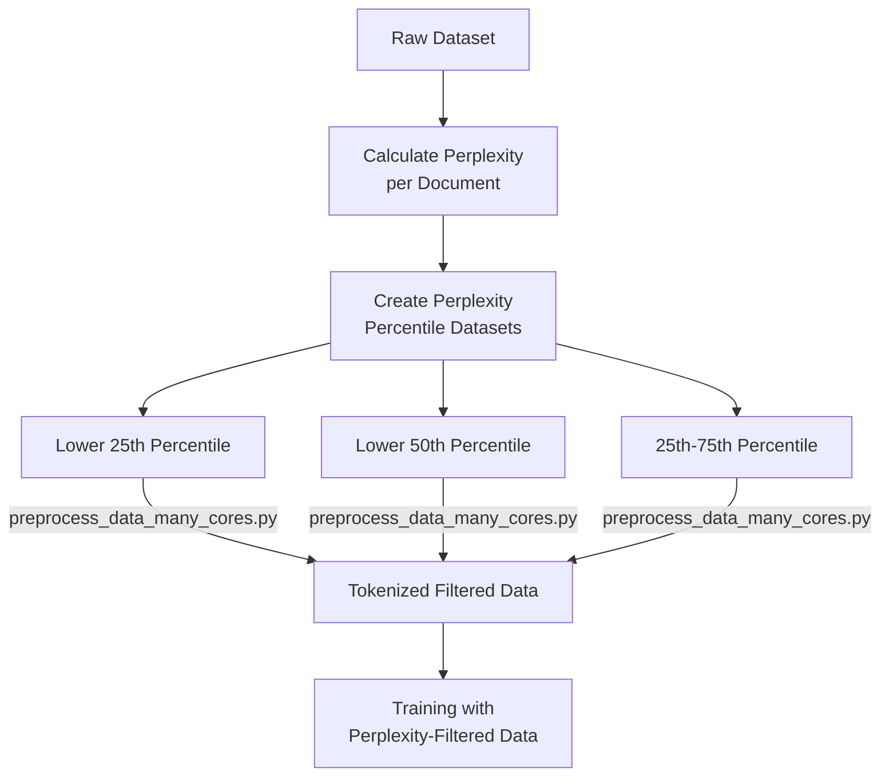
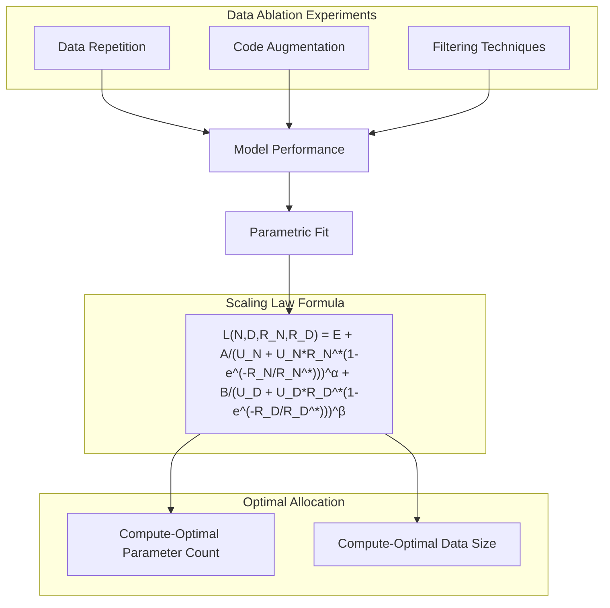
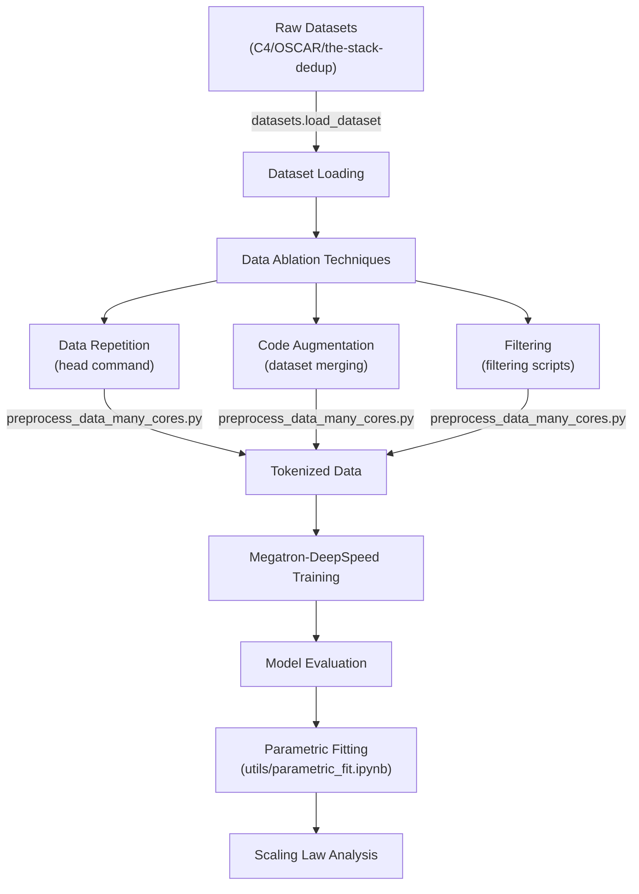

<!-- source: DeepWiki mcp.deepwiki.com · repo huggingface/datablations · page 2.3 Data Ablation Techniques · fetched 2026-10-26 -->

# Data Ablation Techniques

<details>
<summary>Relevant source files</summary>

The following files were used as context for generating this wiki page:

- [README.md](README.md)
- [plotstables/training_validation_filter.pdf](plotstables/training_validation_filter.pdf)
- [plotstables/validation_c4py.pdf](plotstables/validation_c4py.pdf)

</details>


## Purpose and Scope

This document details the various data ablation techniques used within the datablations framework to study language model performance in data-constrained regimes. These techniques focus on manipulating training data to measure the effects of data quality, quantity, and repetition on model performance. For information about the datasets themselves, see [Datasets](#2.1), and for deduplication specifically, see [Deduplication](#2.2).

## Overview of Data Ablation Techniques

Data ablation in this context refers to systematic modifications of the training data to understand how different data properties affect language model performance. These techniques are core to investigating the relationship between compute budget, model size, and dataset characteristics.



Sources: [README.md:13-23](), [README.md:41-107]()

## Data Repetition

Data repetition involves training models on the same data multiple times, systematically varying the extent of repetition to understand how repeated tokens affect model performance.

### Implementation

The implementation involves selecting subsets of C4 or OSCAR datasets and repeatedly exposing the model to the same data during training. This is tracked by:

1. Measuring the number of unique tokens (U)
2. Tracking the total tokens seen during training (D)
3. Calculating the repetition factor (D/U)



Data is preprocessed using the Megatron-DeepSpeed preprocessing tool with commands such as:

```
python Megatron-DeepSpeed/tools/preprocess_data_many_cores.py \
--input dataset_subset.jsonl \
--output-prefix gpt2tok_dataset_subset \
--dataset-impl mmap \
--tokenizer-type PretrainedFromHF \
--tokenizer-name-or-path gpt2 \
--append-eod \
--workers 64
```

Sources: [README.md:43-78]()

## Code Augmentation

Code augmentation involves mixing programming code (specifically Python) with natural language data to study how code influences model learning.

### Implementation

The implementation uses Python code from the [the-stack-dedup](https://huggingface.co/datasets/bigcode/the-stack-dedup) dataset, which is mixed with natural language datasets in different proportions.



The preprocessed Python code data is available at `datablations/python-megatron` and can be used in different proportions with natural language data.

Sources: [README.md:109-113](), [plotstables/validation_c4py.pdf:1-609]()

## Filtering Techniques

Filtering techniques involve selectively removing or prioritizing data based on specific criteria to improve data quality while maintaining the same token budget.

### Perplexity Filtering

Perplexity filtering uses a language model's perplexity scores to identify and filter low-quality text. Lower perplexity typically indicates higher quality or more predictable text.



The implementation creates different filtered datasets based on perplexity percentiles:

- Lower 25th percentile (highest quality)
- Lower 50th percentile
- 25th-75th percentile

This filtering is available for both C4 and OSCAR datasets through the repositories:
- C4: https://huggingface.co/datasets/datablations/c4-filter
- OSCAR: https://huggingface.co/datasets/datablations/oscar-filter

Sources: [README.md:115-176](), [README.md:240-255]()

### Implementation of Filtering

The filtering process involves:

1. Loading the dataset with filtering metadata
2. Calculating perplexity percentiles
3. Filtering based on percentile thresholds
4. Tokenizing the filtered data for training

For example, for OSCAR, the perplexity filtering implementation is:

```python
from datasets import load_dataset
import numpy as np
ds = load_dataset("datablations/oscar-filter", streaming=False, num_proc=128)

p_25 = np.percentile(ds["train"]["perplexity_score"], 25)
p_50 = np.percentile(ds["train"]["perplexity_score"], 50)

# 25th percentile
ds["train"].filter(lambda x: x["perplexity_score"] < p_25, num_proc=128).to_json("oscar_perplexity25.jsonl", num_proc=128, force_ascii=False)
# 50th percentile
ds["train"].filter(lambda x: x["perplexity_score"] < p_50, num_proc=128).to_json("oscar_perplexity50.jsonl", num_proc=128, force_ascii=False)
```

Sources: [README.md:157-176]()

## Relationship with Scaling Laws and Performance

The data ablation techniques are used to investigate empirical scaling laws, especially in data-constrained regimes where the unique data size is limited compared to the total training tokens.



The datablations framework uses a parametric formula that accounts for diminishing returns from both repeated tokens and excessive parameters, allowing researchers to find compute-optimal configurations for language model training in data-constrained scenarios.

Sources: [README.md:294-370]()

## Experimental Results

The data ablation techniques were used in multiple experiment types:

| Experiment Type | Purpose | Implementation |
|-----------------|---------|----------------|
| IsoLoss | Train different models to the same loss to study parameter-data tradeoffs | Varying parameter count and training tokens |
| IsoFLOP | Train models with the same compute budget to understand optimal resource allocation | Fixing compute budget, varying parameters and tokens |
| Code Augmentation | Study effect of adding code to training data | Mixing natural language with Python code |
| Filtering | Evaluate quality-filtered data performance | Perplexity filtering and deduplication |

Each experiment demonstrates different aspects of data's effect on model performance, with findings suggesting that:

1. Models trained with repeated high-quality data can outperform those trained on larger but lower-quality datasets
2. Code augmentation can improve natural language model performance in some contexts
3. Perplexity filtering can significantly improve data efficiency

Sources: [README.md:216-261](), [README.md:294-370]()

## Data Ablation Workflow in the Codebase



Sources: [README.md:41-196](), [README.md:294-370]()

---

