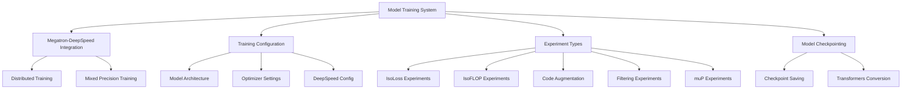
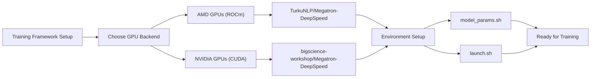
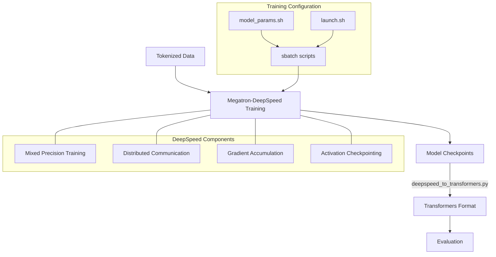
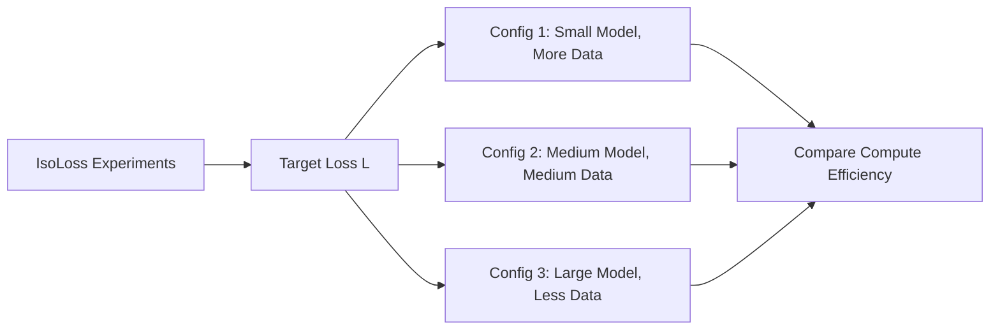
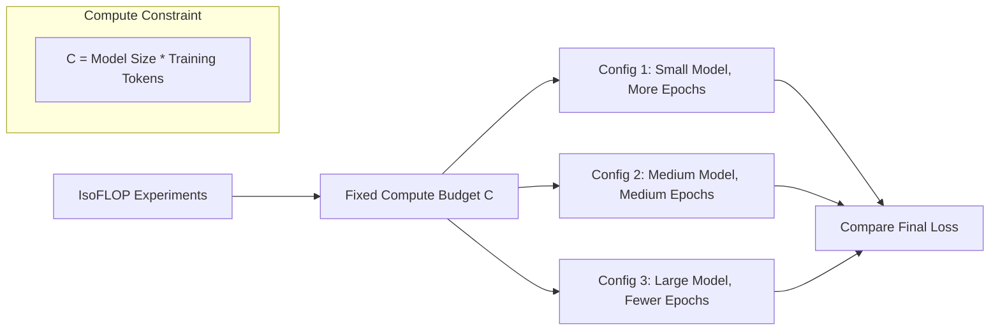
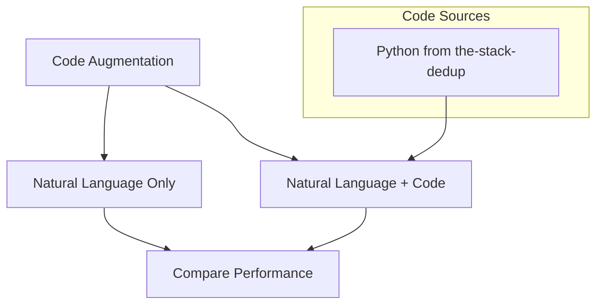
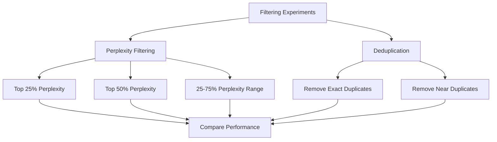
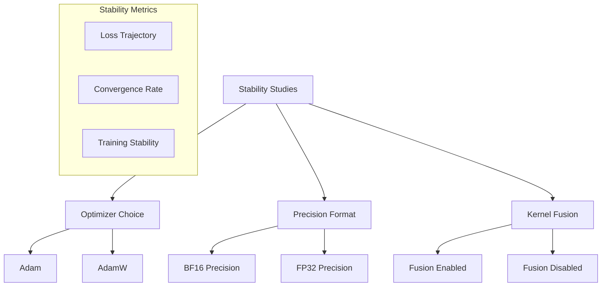
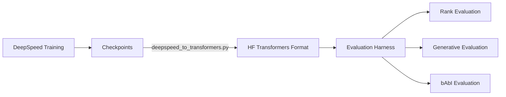

<!-- source: DeepWiki mcp.deepwiki.com · repo huggingface/datablations · page 3 Model Training · fetched 2026-10-26 -->

# Model Training

<details>
<summary>Relevant source files</summary>

The following files were used as context for generating this wiki page:

- [README.md](README.md)
- [plotstables/training_validation_filter.pdf](plotstables/training_validation_filter.pdf)
- [plotstables/validation_c4py.pdf](plotstables/validation_c4py.pdf)
- [stability_study/blowup-4-adam-alibi-bf16-nokernel.sh](stability_study/blowup-4-adam-alibi-bf16-nokernel.sh)
- [stability_study/blowup-4-adam-alibi-fp32-nokernel.sh](stability_study/blowup-4-adam-alibi-fp32-nokernel.sh)

</details>


This page documents the model training process in the Datablations framework, explaining how language models are trained using Megatron-DeepSpeed. It covers training configurations, workflows, experiment types, and model checkpointing. For information about data preprocessing, see the [Data Processing Pipeline](#2) page, and for evaluation methods, see the [Evaluation Framework](#4) page.

## Training System Overview

The model training system in Datablations is built on Megatron-DeepSpeed, a distributed training framework optimized for large language models. The system supports various experiment types designed to study scaling laws in data-constrained regimes.



Sources: [README.md:271-294]()

## Megatron-DeepSpeed Setup

The framework uses a fork of Megatron-DeepSpeed that works with both AMD (via ROCm) and NVIDIA (via CUDA) GPUs:

- For AMD GPUs: TurkuNLP/Megatron-DeepSpeed
- For NVIDIA GPUs: bigscience-workshop/Megatron-DeepSpeed



Sources: [README.md:276-278]()

## Training Configuration Parameters

Training configurations in Datablations are defined through several parameter groups that control different aspects of the training process.

### Model Architecture Parameters

| Parameter | Description | Typical Values |
|-----------|-------------|----------------|
| `num-layers` | Number of transformer layers | 12-24 for smaller models |
| `hidden-size` | Hidden dimension size | 768-1024 for smaller models |
| `num-attention-heads` | Number of attention heads | 12-16 |
| `ffn-hidden-size` | Feed-forward network hidden size | 4x hidden-size |
| `seq-length` | Maximum sequence length | 2048 |
| `position-embedding-type` | Position embedding type | alibi |

### Optimizer Parameters

| Parameter | Description | Typical Values |
|-----------|-------------|----------------|
| `optimizer` | Optimizer type | adam |
| `adam-beta1` | Adam beta1 parameter | 0.9 |
| `adam-beta2` | Adam beta2 parameter | 0.95 |
| `lr` | Learning rate | 3.0e-4 |
| `min-lr` | Minimum learning rate | 1e-5 |
| `lr-decay-style` | LR scheduler type | cosine |
| `lr-warmup-samples` | Warmup samples | 183,105 |
| `clip-grad` | Gradient clipping value | 1.0 |
| `weight-decay` | Weight decay value | 1e-1 |

### Training Size Parameters

| Parameter | Description | Typical Values |
|-----------|-------------|----------------|
| `micro-batch-size` | Per-GPU batch size | 16 |
| `global-batch-size` | Total batch size across all GPUs | 512 |
| `train-samples` | Total training samples | 73,242,187 |
| `rampup-batch-size` | Gradual batch size increase | 128 128 2,000,000 |

Sources: [stability_study/blowup-4-adam-alibi-bf16-nokernel.sh:40-48](), [stability_study/blowup-4-adam-alibi-bf16-nokernel.sh:53-65]()

### DeepSpeed Configuration

DeepSpeed settings are defined in a JSON configuration file:

```json
{
    "train_micro_batch_size_per_gpu": 16,
    "train_batch_size": 512,
    "gradient_clipping": 1.0,
    "zero_optimization": {
        "stage": 0
    },
    "bf16": {
        "enabled": true,
        "loss_scale": 0,
        "loss_scale_window": 500,
        "hysteresis": 2,
        "min_loss_scale": 1,
        "initial_scale_power": 12
    },
    "steps_per_print": 2000,
    "wall_clock_breakdown": false
}
```

Sources: [stability_study/blowup-4-adam-alibi-bf16-nokernel.sh:110-129]()

### Parallelism Options

| Parameter | Description | Typical Values |
|-----------|-------------|----------------|
| `tensor-model-parallel-size` | Tensor model parallelism degree | 1-8 |
| `pipeline-model-parallel-size` | Pipeline model parallelism degree | 1 |
| `zero-stage` | ZeRO optimization stage | 0-3 |

Sources: [stability_study/blowup-4-adam-alibi-bf16-nokernel.sh:37-38](), [stability_study/blowup-4-adam-alibi-bf16-nokernel.sh:134-135]()

## Training Workflow

The training workflow in Datablations consists of several key steps:



The workflow follows these steps:

1. **Data Preparation**: Tokenized data is prepared using the preprocessing pipeline.
2. **Training Configuration**: Parameters are set in sbatch scripts.
3. **Training Execution**: Models are trained using Megatron-DeepSpeed.
4. **Checkpointing**: Model states are saved at regular intervals.
5. **Conversion**: Checkpoints are converted to Hugging Face Transformers format.

Sources: [README.md:279-286]()

## Experiment Types

### IsoLoss Experiments

IsoLoss experiments aim to achieve the same validation loss with different training configurations, varying model size and data size.



Sources: [README.md:216-220]()

### IsoFLOP Experiments

IsoFLOP experiments use the same compute budget (FLOPs) across different configurations to study optimal allocation between model size and training tokens.



Sources: [README.md:221-233]()

### Code Augmentation Experiments

These experiments study the effect of augmenting natural language data with code data (Python) on model performance.



Sources: [README.md:234-240](), [README.md:109-113]()

### Filtering Experiments

These experiments explore different data filtering techniques:



Sources: [README.md:241-254](), [README.md:137-176](), [README.md:177-195]()

### muP Experiments

These experiments use Maximal Update Parametrization (muP) for training, as mentioned in the Appendix of the paper.

Sources: [README.md:259-260](), [README.md:290-292]()

## Stability Studies

The repository includes stability studies comparing different optimizers and precision formats:



The study configurations can be found in the `stability_study` directory with scripts like `blowup-4-adam-alibi-bf16-nokernel.sh` and `blowup-4-adam-alibi-fp32-nokernel.sh`.

Sources: [stability_study/blowup-4-adam-alibi-bf16-nokernel.sh](), [stability_study/blowup-4-adam-alibi-fp32-nokernel.sh]()

## Model Checkpointing and Conversion

After training, models are saved as checkpoints and converted to Hugging Face Transformers format:



The conversion is done using the following command:

```bash
python Megatron-DeepSpeed/tools/convert_checkpoint/deepspeed_to_transformers.py \
  --input_folder global_step52452 \
  --output_folder transformers \
  --target_tp 1 \
  --target_pp 1
```

Sources: [README.md:286-288]()

## Training Results Visualization

The training results can be visualized for both C4 and OSCAR datasets. The following plots show validation performance with different training configurations:


Sources: [plotstables/validation_c4py.pdf](), [plotstables/training_validation_filter.pdf]()

## Available Models

Trained models are available on the Hugging Face Hub at `datablations`. Models follow a naming convention:

`lm1-{parameters}-{tokens}-{unique_tokens}`

For example, `1b12b8100m` indicates a model with 1.1 billion parameters, trained on 2.8 billion tokens, with 100 million unique tokens.

Models are organized by experiment type:
- IsoLoss: `datablations/lm1-misc`
- IsoFLOP: `datablations/lm1-*-*-{c4,oscar}-repetitions`
- Code augmentation: `datablations/lm1-*-*-{c4,oscar}py`
- Filtering: `datablations/lm1-*-*-{c4,oscar}-{perplexity,dedup}`

Sources: [README.md:199-270]()

## Conclusion

The model training system in Datablations provides a comprehensive framework for studying how data characteristics affect language model performance. By supporting various experiment types and configuration options, it enables systematic research on scaling laws in data-constrained regimes.

---

