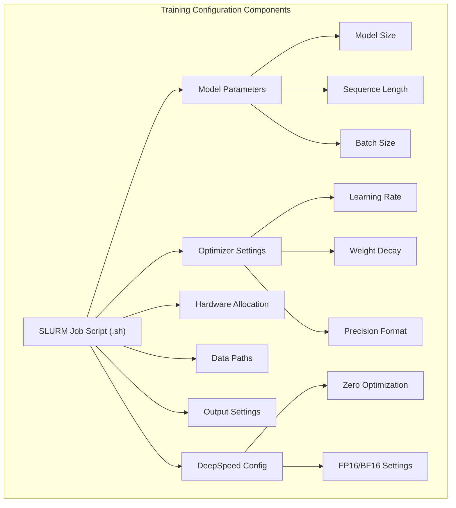
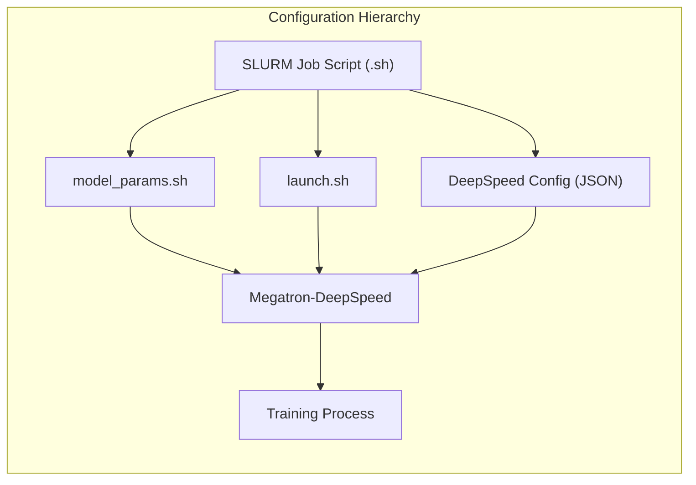
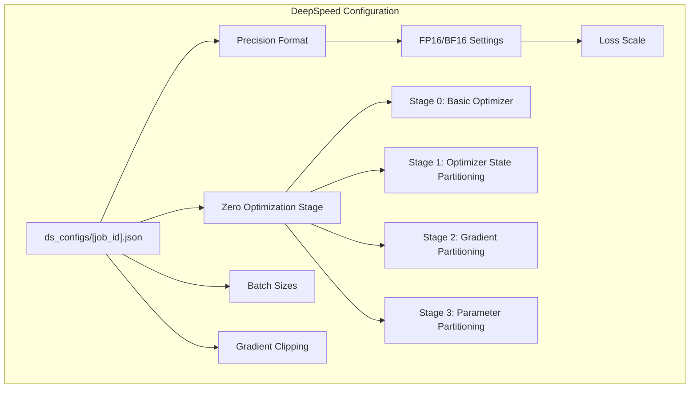
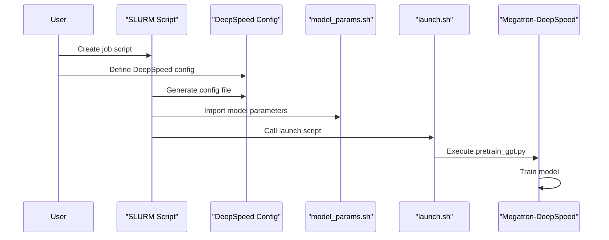
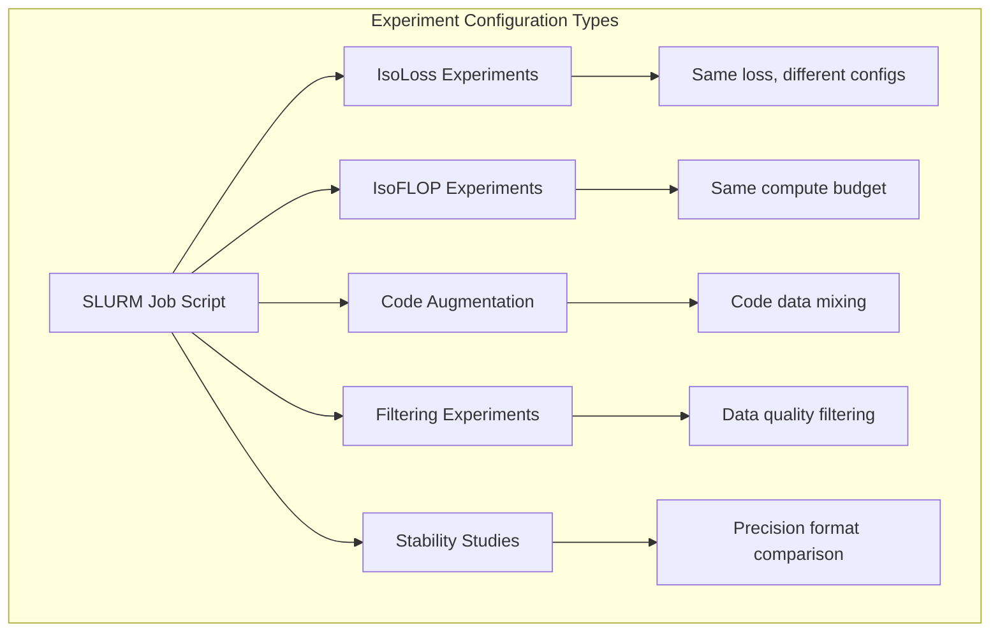

<!-- source: DeepWiki mcp.deepwiki.com · repo huggingface/datablations · page 3.1 Training Configuration · fetched 2026-10-26 -->

# Training Configuration

<details>
<summary>Relevant source files</summary>

The following files were used as context for generating this wiki page:

- [README.md](README.md)
- [plotstables/training_validation_filter.pdf](plotstables/training_validation_filter.pdf)
- [plotstables/validation_c4py.pdf](plotstables/validation_c4py.pdf)
- [stability_study/blowup-4-alibi-bf16.sh](stability_study/blowup-4-alibi-bf16.sh)
- [stability_study/blowup-4-alibi-fp32.sh](stability_study/blowup-4-alibi-fp32.sh)

</details>


This page provides comprehensive documentation on how to configure and launch training jobs in the datablations framework. It covers the structure of configuration files, key parameters, and best practices for setting up various types of training experiments. For information about the model architecture itself, see [Megatron-DeepSpeed Setup](#3.2), and for experiment-specific configurations, see [Experiment Types](#3.3).

## Configuration Overview

Training configuration in the datablations framework involves setting up appropriate parameters for Megatron-DeepSpeed to conduct language model training experiments. The configuration defines model architecture, training data, optimization parameters, and hardware allocation.



Sources: [stability_study/blowup-4-alibi-fp32.sh](), [stability_study/blowup-4-alibi-bf16.sh]()

## Configuration File Structure

Training jobs are typically configured through SLURM job scripts that define all necessary parameters. These scripts combine multiple configuration components into a single, executable file.



Sources: [README.md:274-287]()

## Key Configuration Components

### 1. SLURM Configuration

SLURM parameters define the computing resources allocated to your training job.

| Parameter | Description | Example Value |
|-----------|-------------|---------------|
| `--job-name` | Name of the job | `blowup-4-alibi-bf16` |
| `--nodes` | Number of nodes | `1` |
| `--ntasks-per-node` | Tasks per node | `1` |
| `--gpus-per-node` | GPUs allocated | `mi250:8` |
| `--mem` | Memory allocation | `256G` |
| `--time` | Time limit | `12:00:00` |

Sources: [stability_study/blowup-4-alibi-fp32.sh:3-15](), [stability_study/blowup-4-alibi-bf16.sh:3-15]()

### 2. Model Architecture Parameters

These parameters define the size and structure of the language model.

| Parameter | Description | Example Value |
|-----------|-------------|---------------|
| `--num-layers` | Number of transformer layers | `24` |
| `--hidden-size` | Hidden dimension size | `1024` |
| `--num-attention-heads` | Number of attention heads | `16` |
| `--ffn-hidden-size` | Feedforward network hidden size | `4096` |
| `--seq-length` | Maximum sequence length | `2048` |
| `--position-embedding-type` | Type of position embedding | `alibi` |

Sources: [stability_study/blowup-4-alibi-bf16.sh:44-48](), [stability_study/blowup-4-alibi-bf16.sh:67-86]()

### 3. Training Hyperparameters

These parameters control the optimization process.

| Parameter | Description | Example Value |
|-----------|-------------|---------------|
| `--optimizer` | Optimization algorithm | `adam` |
| `--adam-beta1` | Adam beta1 parameter | `0.9` |
| `--adam-beta2` | Adam beta2 parameter | `0.95` |
| `--lr` | Learning rate | `3.0e-4` |
| `--min-lr` | Minimum learning rate | `1e-5` |
| `--lr-decay-style` | LR schedule type | `cosine` |
| `--weight-decay` | Weight decay coefficient | `1e-1` |
| `--clip-grad` | Gradient clipping value | `1.0` |

Sources: [stability_study/blowup-4-alibi-bf16.sh:53-65]()

### 4. Batch Size Configuration

Properly configuring batch sizes is critical for training efficiency and stability.

| Parameter | Description | Example Value |
|-----------|-------------|---------------|
| `--micro-batch-size` | Samples per GPU | `16` |
| `--global-batch-size` | Total batch size | `512` |
| `--rampup-batch-size` | Batch size warmup schedule | `128 128 2_000_000` |

Sources: [stability_study/blowup-4-alibi-bf16.sh:40-42](), [stability_study/blowup-4-alibi-bf16.sh:74-76]()

### 5. DeepSpeed Configuration

DeepSpeed-specific parameters are typically defined in a separate JSON configuration file.



Sources: [stability_study/blowup-4-alibi-bf16.sh:102-126]()

## Precision Formats

The datablations framework supports different precision formats that affect training stability and performance.

| Format | Configuration | Pros | Cons |
|--------|---------------|------|------|
| FP32 | `--deepspeed_config` with `"fp16": {"enabled": false}` | Most stable, highest precision | Slower, higher memory usage |
| BF16 | `--bf16` and `"bf16": {"enabled": true}` | Good stability, memory efficient | Requires hardware support |
| FP16 | `"fp16": {"enabled": true}` | Memory efficient | Less stable, requires loss scaling |

Sources: [stability_study/blowup-4-alibi-fp32.sh:114-121](), [stability_study/blowup-4-alibi-bf16.sh:115-122]()

## Configuration Workflow

The following diagram illustrates the process of creating and executing a training configuration:



Sources: [stability_study/blowup-4-alibi-bf16.sh:134-147](), [README.md:274-287]()

## Configuration Examples

### Standard Training Configuration

Below is an example of a standard training configuration for a 350M parameter model:

```
# Model size parameters
NLAYERS=24
NHIDDEN=1024
NHEADS=16
FFN_HIDDEN_SIZE=4096
SEQ_LEN=2048

# Batch size parameters
MICRO_BATCH_SIZE=16
GLOBAL_BATCH_SIZE=512

# Optimizer parameters
OPTIMIZER_ARGS="
    --optimizer adam
    --adam-beta1 0.9
    --adam-beta2 0.95
    --adam-eps 1e-8
    --lr 3.0e-4
    --min-lr 1e-5
    --lr-decay-style cosine
    --clip-grad 1.0
    --weight-decay 1e-1
"
```

Sources: [stability_study/blowup-4-alibi-bf16.sh:40-65]()

### Training with Different Precision Formats

The framework allows training with different precision formats:

**BF16 Configuration:**
```
GPT_ARGS="
    --bf16
    [other parameters]
"

# DeepSpeed config
{
    "bf16": {
        "enabled": true,
        "loss_scale": 0,
        "loss_scale_window": 500,
        "hysteresis": 2,
        "min_loss_scale": 1,
        "initial_scale_power": 12
    }
}
```

**FP32 Configuration:**
```
# No bf16 flag in GPT_ARGS

# DeepSpeed config
{
    "fp16": {
        "enabled": false,
        "loss_scale": 0,
        "loss_scale_window": 500,
        "hysteresis": 2,
        "min_loss_scale": 1,
        "initial_scale_power": 12
    }
}
```

Sources: [stability_study/blowup-4-alibi-bf16.sh:85](), [stability_study/blowup-4-alibi-bf16.sh:115-122](), [stability_study/blowup-4-alibi-fp32.sh:114-121]()

## Scaling Configuration for Different Experiments

The datablations framework is designed to support various experiment types with different scaling configurations.



Sources: [README.md:214-259](), [stability_study/blowup-4-alibi-fp32.sh](), [stability_study/blowup-4-alibi-bf16.sh]()

### Configuring for Different Experiment Types

Different experiment types require specific configuration settings:

| Experiment Type | Configuration Focus | Key Parameters |
|-----------------|---------------------|----------------|
| IsoLoss | Different model/data sizes for same loss | Model size, dataset size |
| IsoFLOP | Same compute budget, different allocations | Model size, training iterations |
| Code Augmentation | Mixing code data with natural language | Data paths, mixing ratios |
| Filtering | Data quality filtering approaches | Data preprocessing paths |
| Stability | Training stability across formats | Precision format (FP32/BF16/FP16) |

Sources: [README.md:214-259]()

## Best Practices

1. **Batch Size Selection**: Start with small batch sizes and gradually increase to avoid early training instability.
2. **Learning Rate Scaling**: Scale learning rates with batch size (typically square root scaling).
3. **Precision Format**: For stability studies, compare fp32, bf16, and fp16 to identify optimal configurations.
4. **Checkpoint Frequency**: Save checkpoints frequently during early training to recover from potential instabilities.
5. **Data Path Configuration**: Verify data paths and formats before starting long training runs.

Sources: [stability_study/blowup-4-alibi-bf16.sh:40-42](), [stability_study/blowup-4-alibi-bf16.sh:50]()

## Launching Training Jobs

Once the configuration is set up, training jobs are launched using:

```
srun --label launch.sh Megatron-DeepSpeed/pretrain_gpt.py [parameters]
```

The `launch.sh` script contains environment-specific setup required for your computing cluster.

Sources: [stability_study/blowup-4-alibi-bf16.sh:153](), [README.md:284]()

## Troubleshooting Common Configuration Issues

| Issue | Possible Cause | Solution |
|-------|---------------|----------|
| Out of memory errors | Batch size too large | Reduce `--micro-batch-size` or enable gradient accumulation |
| Training divergence | Learning rate too high | Lower learning rate or add warmup period |
| Slow training | Inefficient parallelism | Adjust tensor and pipeline parallelism for your hardware |
| Checkpoint loading failures | Mismatched model configurations | Ensure configuration matches the saved checkpoint |
| NaN losses | Numerical instability | Try FP32 precision or adjust loss scaling |

Sources: [stability_study/blowup-4-alibi-fp32.sh](), [stability_study/blowup-4-alibi-bf16.sh]()

---

