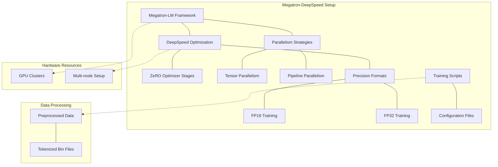
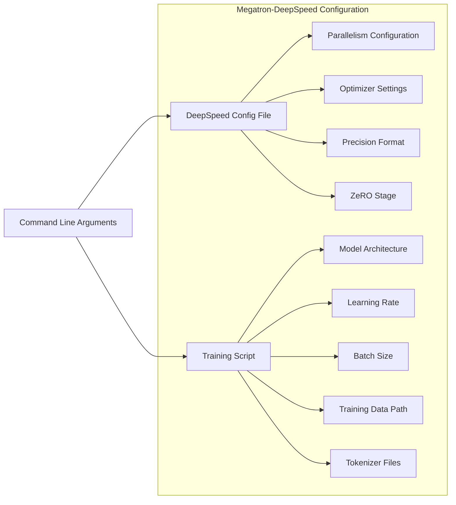
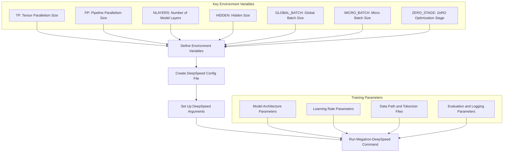

<!-- source: DeepWiki mcp.deepwiki.com · repo huggingface/datablations · page 3.2 Megatron-DeepSpeed Setup · fetched 2026-10-26 -->

# Megatron-DeepSpeed Setup

<details>
<summary>Relevant source files</summary>

The following files were used as context for generating this wiki page:

- [README.md](README.md)
- [plotstables/training_validation_filter.pdf](plotstables/training_validation_filter.pdf)
- [plotstables/validation_c4py.pdf](plotstables/validation_c4py.pdf)
- [stability_study/meg-lm/ds_pretrain_gpt2.sh](stability_study/meg-lm/ds_pretrain_gpt2.sh)
- [stability_study/meg-lm/ds_zero_stage_1_config_baseline.json](stability_study/meg-lm/ds_zero_stage_1_config_baseline.json)
- [stability_study/meg-lm/run_deepspeed_example.sh](stability_study/meg-lm/run_deepspeed_example.sh)
- [stability_study/meg-lm/run_deepspeed_example_fp32.sh](stability_study/meg-lm/run_deepspeed_example_fp32.sh)

</details>


This document explains how to set up and use Megatron-DeepSpeed for distributed training of large language models in the datablations repository. For information about specific experiment types that can be run with this setup, see [Experiment Types](#3.3). For information about training configuration details, see [Training Configuration](#3.1).

## Overview

Megatron-DeepSpeed combines NVIDIA's Megatron-LM framework for training large language models with Microsoft's DeepSpeed library for efficient distributed training. In the datablations repository, this setup is used to train and evaluate language models in data-constrained regimes, with various scaling laws and data ablation techniques.



Sources: [README.md:276-278]()

## Installation Requirements

The datablations repository uses a fork of Megatron-DeepSpeed that works with both AMD GPUs (via ROCm) and NVIDIA GPUs (via CUDA).

### For AMD GPUs (ROCm)
```
https://github.com/TurkuNLP/Megatron-DeepSpeed
```

### For NVIDIA GPUs (CUDA)
```
https://github.com/bigscience-workshop/Megatron-DeepSpeed
```

You need to follow the installation instructions of either repository to set up your environment properly. The repository also includes specific setup instructions for the LUMI supercomputer in `training/megdssetup.md`.

Sources: [README.md:276-278]()

## Configuration Components

Megatron-DeepSpeed setup involves configuring several components:



Sources: [stability_study/meg-lm/run_deepspeed_example.sh:49-66](), [stability_study/meg-lm/ds_zero_stage_1_config_baseline.json:1-26]()

## DeepSpeed Configuration File

The DeepSpeed configuration file is a JSON file that specifies key parameters for distributed training:

```json
{
  "train_batch_size": [GLOBAL_BATCH_SIZE],
  "train_micro_batch_size_per_gpu": [MICRO_BATCH_SIZE],
  "steps_per_print": 1,
  "zero_optimization": {
    "stage": [ZERO_STAGE]
  },
  "fp16": {
    "enabled": true,
    "initial_scale_power": 12
  },
  "wall_clock_breakdown": true
}
```

Key parameters include:
- `train_batch_size`: Global batch size across all GPUs
- `train_micro_batch_size_per_gpu`: Batch size per GPU
- `zero_optimization.stage`: ZeRO optimization stage (0, 1, 2, or 3)
- `fp16.enabled`: Whether to use FP16 (half-precision) training

Sources: [stability_study/meg-lm/run_deepspeed_example.sh:49-66](), [stability_study/meg-lm/ds_zero_stage_1_config_baseline.json:1-26]()

## Parallelism Strategies

Megatron-DeepSpeed supports multiple parallelism strategies for distributed training:

| Strategy | Description | Configuration Parameter |
|----------|-------------|-------------------------|
| Data Parallelism (DP) | Splits the data across GPUs, each with a full model copy | Automatically determined based on other configurations |
| Tensor Parallelism (TP) | Splits individual tensors across GPUs | `--tensor-model-parallel-size` |
| Pipeline Parallelism (PP) | Splits the model layers across GPUs | `--pipeline-model-parallel-size` |
| ZeRO Data Parallelism | Optimizes memory usage by partitioning optimizer states, gradients, and parameters | `--zero-stage` |

The effective Data Parallelism (DP) degree is calculated as:
```
DP_SIZE = NUM_GPUS / (PP_SIZE * TP_SIZE)
```

Sources: [stability_study/meg-lm/ds_pretrain_gpt2.sh:77-81]()

## Running Training Jobs

### Basic Example Script

The repository includes example scripts that demonstrate how to set up and run training using Megatron-DeepSpeed:



Sources: [stability_study/meg-lm/run_deepspeed_example.sh:1-112](), [stability_study/meg-lm/run_deepspeed_example_fp32.sh:1-112]()

### Running a GPT-2 Training Job

For running more specific models like GPT-2, a more detailed script is provided that handles different model sizes and configurations:

```bash
# Example command for running GPT-2 training
deepspeed --num_nodes ${NUM_WORKERS} --num_gpus ${NUM_GPUS_PER_WORKER} \
    Megatron-LM/pretrain_gpt.py ${gpt_options} ${deepspeed_options}
```

Sources: [stability_study/meg-lm/ds_pretrain_gpt2.sh:171-173]()

## Model Size Configurations

The repository supports various GPT-2-like model configurations:

| Model Size | Parameters | Layers | Hidden Size | Attention Heads |
|------------|------------|--------|-------------|-----------------|
| 117M       | 117M       | 12     | 768         | 12              |
| 345M       | 345M       | 24     | 1024        | 16              |
| 774M       | 774M       | 36     | 1280        | 20              |
| 1558M      | 1.56B      | 48     | 1600        | 25              |

Sources: [stability_study/meg-lm/ds_pretrain_gpt2.sh:45-68]()

## Precision Format Options

Megatron-DeepSpeed supports training in different precision formats:

1. **FP16 (Half Precision)**
   - Enabled by default in most scripts
   - More memory efficient
   - Configuration in DeepSpeed config:
   ```json
   "fp16": {
     "enabled": true,
     "initial_scale_power": 12
   }
   ```

2. **FP32 (Full Precision)**
   - More stable but consumes more memory
   - Configuration in DeepSpeed config:
   ```json
   "fp16": {
     "enabled": false
   }
   ```

Sources: [stability_study/meg-lm/run_deepspeed_example.sh:59-62](), [stability_study/meg-lm/run_deepspeed_example_fp32.sh:59-62]()

## ZeRO Optimization Stages

DeepSpeed offers ZeRO (Zero Redundancy Optimizer) in different stages for optimizing memory usage:

| Stage | Description | Memory Savings | Communication Overhead |
|-------|-------------|----------------|-------------------------|
| 0     | No partitioning | None | None |
| 1     | Partitions optimizer states | Moderate | Low |
| 2     | Partitions optimizer states and gradients | High | Medium |
| 3     | Partitions optimizer states, gradients, and parameters | Highest | High |

The stage is configured via the `--zero-stage` parameter and in the DeepSpeed config file.

Sources: [stability_study/meg-lm/run_deepspeed_example.sh:43](), [stability_study/meg-lm/ds_zero_stage_1_config_baseline.json:5-7]()

## Key Training Script Parameters

When launching a training job with Megatron-DeepSpeed, several key parameters need to be specified:

### Model Architecture Parameters
- `--num-layers`: Number of transformer layers
- `--hidden-size`: Hidden dimension size
- `--num-attention-heads`: Number of attention heads
- `--seq-length`: Maximum sequence length
- `--max-position-embeddings`: Maximum position embeddings

### Batch Size Parameters
- `--micro-batch-size`: Batch size per GPU
- `--global-batch-size`: Total batch size across all GPUs

### Learning Rate Parameters
- `--lr`: Learning rate
- `--min-lr`: Minimum learning rate
- `--lr-decay-style`: Learning rate decay style (e.g., cosine)
- `--lr-warmup-iters`: Number of warmup iterations

### Optimizer Parameters
- `--clip-grad`: Gradient clipping value
- `--weight-decay`: Weight decay value
- `--adam-beta1` and `--adam-beta2`: Adam optimizer beta parameters

### Training Duration Parameters
- `--train-iters`: Number of training iterations
- `--train-tokens`: Total number of tokens to train on
- `--lr-decay-tokens`: Number of tokens over which to decay the learning rate

Sources: [stability_study/meg-lm/run_deepspeed_example.sh:78-110](), [stability_study/meg-lm/ds_pretrain_gpt2.sh:120-158]()

## Converting Checkpoints to Hugging Face Format

After training, models can be converted to Hugging Face Transformers format for easier use in downstream tasks:

```bash
python Megatron-DeepSpeed/tools/convert_checkpoint/deepspeed_to_transformers.py \
  --input_folder global_step52452 \
  --output_folder transformers \
  --target_tp 1 \
  --target_pp 1
```

This converts the Megatron-DeepSpeed checkpoint to a format compatible with the Hugging Face Transformers library, which is used for downstream evaluation.

Sources: [README.md:286-287]()

## Example Use Cases in Datablations

In the datablations repository, Megatron-DeepSpeed is used for training models under various data constraints and configurations:

1. **IsoLoss Experiments**: Training models with the same target loss but different configurations
2. **IsoFLOP Experiments**: Training models with the same compute budget but different configurations
3. **Data Ablation**: Training with various data manipulation techniques (repetition, filtering, code augmentation)
4. **Stability Studies**: Comparing different optimizers and precision formats

Each experiment has specific configuration files and scripts in the repository.

Sources: [README.md:16-37]()

---

