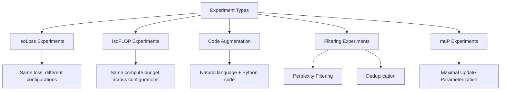
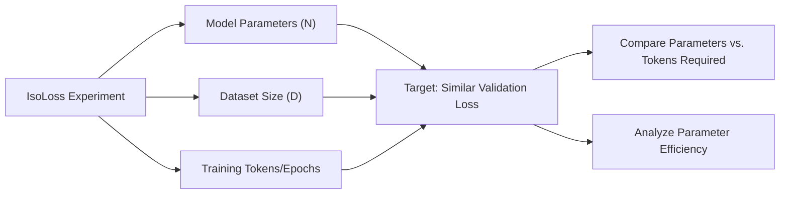
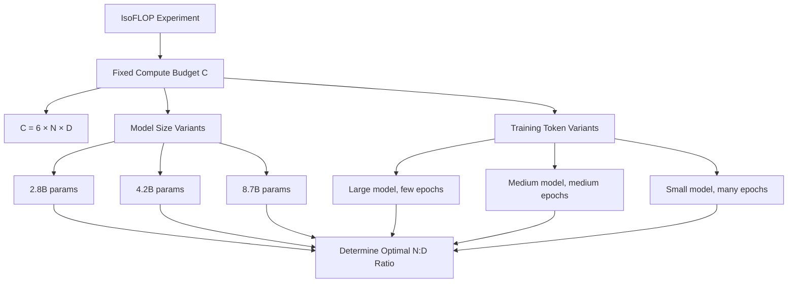
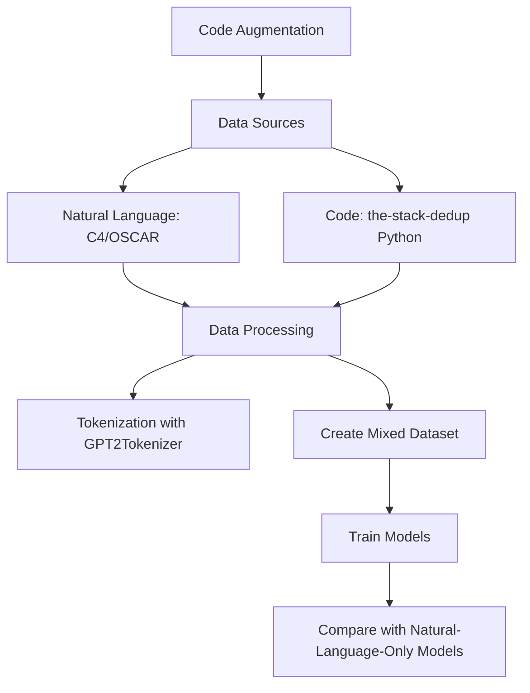
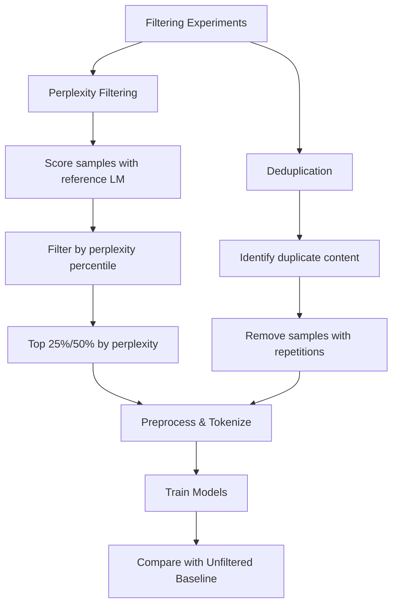
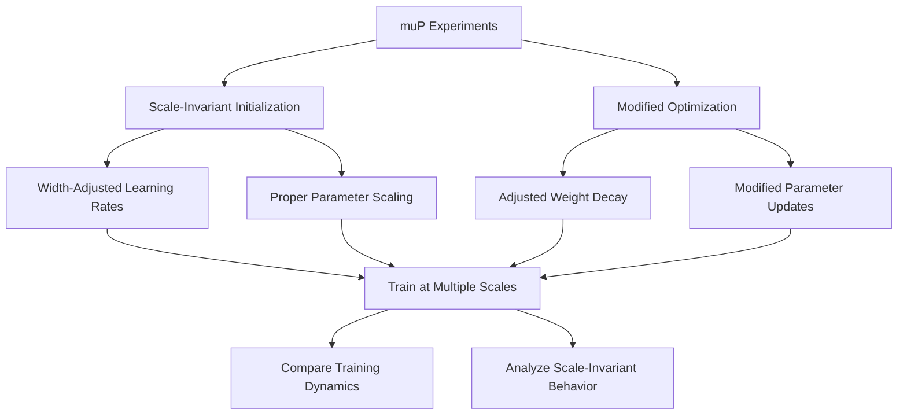
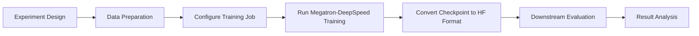

<!-- source: DeepWiki mcp.deepwiki.com · repo huggingface/datablations · page 3.3 Experiment Types · fetched 2026-10-26 -->

# Experiment Types

<details>
<summary>Relevant source files</summary>

The following files were used as context for generating this wiki page:

- [README.md](README.md)
- [plotstables/isoflops_training.ipynb](plotstables/isoflops_training.ipynb)
- [plotstables/training_validation_filter.pdf](plotstables/training_validation_filter.pdf)
- [plotstables/validation_c4py.pdf](plotstables/validation_c4py.pdf)
- [plotstables/validation_oscar.pdf](plotstables/validation_oscar.pdf)

</details>


This page documents the different experiment types in the datablations repository that are used to study language models in data-constrained regimes. These experiment types allow researchers to systematically investigate how various factors like model size, dataset size, training duration, and data quality affect language model performance. For details on how to configure training jobs, see [Training Configuration](#3.1), and for information about evaluation, see [Evaluation Framework](#4).

## Overview of Experiment Types

The datablations framework supports five main types of experiments:



Sources: [README.md:12-13](), [README.md:215-259]()

## IsoLoss Experiments

IsoLoss experiments aim to achieve the same validation loss with different model configurations. These experiments explore the trade-offs between model size, dataset size, and training duration while maintaining comparable performance.



### Implementation and Configurations

IsoLoss experiments typically vary these parameters:
- Model size (number of parameters)
- Unique tokens in dataset
- Total training tokens (unique tokens × epochs)

The models from IsoLoss experiments are stored in the repository `datablations/lm1-misc`. 

| Model Size | Training Tokens | Unique Tokens | Configuration ID |
|------------|----------------|---------------|------------------|
| 146M       | 14B            | 400M          | 146m14b400m      |
| 400M       | 7B             | 400M          | 400m7b400m       |
| 1.1B       | 2.8B           | 400M          | 1b12b8100m       |

Sources: [README.md:216-219]()

## IsoFLOP Experiments

IsoFLOP experiments maintain the same computational budget (measured in floating-point operations) across different configurations. This approach explores the optimal allocation of compute between model size and training data repetition.



### Compute Budget Calculation

The compute budget (C) is calculated as:
```
C = 6 × N × D
```
where:
- N is the number of parameters
- D is the total training tokens

### Example IsoFLOP Configurations

For a compute budget of approximately 9.36e21 FLOPs (8.7B parameters):

| Model Size | Training Tokens | Unique Tokens | Epochs | Repository |
|------------|----------------|---------------|--------|------------|
| 8.7B       | 178B           | 25B           | 1      | lm1-8b7-178b-c4-repetitions |
| 8.7B       | 88B            | 25B           | 2      | lm1-8b7-178b-c4-repetitions |
| 8.7B       | 58B            | 25B           | 3      | lm1-8b7-178b-c4-repetitions |
| 8.7B       | 44B            | 25B           | 4      | lm1-8b7-178b-c4-repetitions |
| 8.7B       | 25B            | 25B           | 7      | lm1-8b7-178b-c4-repetitions |
| 8.7B       | 13B            | 13B           | 14     | lm1-8b7-178b-c4-repetitions |
| 8.7B       | 4B             | 4B            | 44     | lm1-8b7-178b-c4-repetitions |

Similar configurations exist for the 4.2B and 2.8B parameter models.

Sources: [README.md:220-233](), [plotstables/isoflops_training.ipynb:94-116](), [plotstables/isoflops_training.ipynb:278-316]()

## Code Augmentation Experiments

Code augmentation experiments investigate the effect of adding programming code data to the natural language training data. These experiments use Python code from the-stack-dedup dataset mixed with either C4 or OSCAR datasets.



### Data Preparation

The process for preparing code data involves:

1. Downloading the Python split from the-stack-dedup dataset:
   ```python
   from datasets import load_dataset
   ds = load_dataset("bigcode/the-stack-dedup", split="train", languages=["Python"])
   ```

2. Preprocessing the data using Megatron-DeepSpeed tools:
   ```bash
   python Megatron-DeepSpeed/tools/preprocess_data_many_cores.py \
   --input python_content_document.jsonl \
   --output-prefix gpt2tok_python_content_document \
   --dataset-impl mmap \
   --tokenizer-type PretrainedFromHF \
   --tokenizer-name-or-path gpt2 \
   --append-eod \
   --workers 64
   ```

3. Mixing with natural language data during training

### Available Code Augmentation Models

| Model Size | Base Dataset | With Code | Repository |
|------------|-------------|-----------|------------|
| 4.2B       | C4 (84B)    | Yes       | lm1-4b2-84b-c4py |
| 2.8B       | C4 (55B)    | Yes       | lm1-2b8-55b-c4py |
| 2.8B       | OSCAR (55B) | Yes       | lm1-2b8-55b-oscarpy |

Sources: [README.md:109-113](), [README.md:234-240]()

## Filtering Experiments

Filtering experiments study methods to improve data quality through various filtering techniques. The two main approaches are perplexity filtering and deduplication.



### Perplexity Filtering

Perplexity filtering selects data based on how predictable it is according to a reference language model:

1. Computing perplexity scores for each data sample
2. Selecting samples based on perplexity percentiles (e.g., top 25%, top 50%)
3. Training models on the filtered data

For C4:
```python
from datasets import load_dataset
import numpy as np
ds = load_dataset("datablations/c4-filter", streaming=False, num_proc=128)

p_25 = np.percentile(ds["train"]["perplexity"], 25)
p_50 = np.percentile(ds["train"]["perplexity"], 50)

# 25th percentile
ds["train"].filter(lambda x: x["perplexity"] < p_25, num_proc=128).to_json("c4_perplexty25.jsonl", num_proc=128, force_ascii=False)
```

### Deduplication

Deduplication removes redundant or repeated content from the dataset:

1. Identifying duplicate or near-duplicate content 
2. Removing samples where the `repetitions` field is populated
3. Training models on the deduplicated data

For C4:
```python
from datasets import load_dataset
ds = load_dataset("datablations/c4-dedup", streaming=False, num_proc=128)
ds.filter(lambda x: not(x["repetitions"])).to_json('c4_dedup.jsonl', num_proc=128, force_ascii=False)
```

### Available Filtering Experiment Models

| Model Size | Filtering Method | Dataset | Repository |
|------------|------------------|---------|------------|
| 4.2B       | Perplexity 25%   | C4      | lm1-4b2-84b-c4-perplexity |
| 4.2B       | Perplexity 50%   | C4      | lm1-4b2-84b-c4-perplexity |
| 4.2B       | Deduplication    | C4      | lm1-4b2-84b-c4-dedup |
| 2.8B       | Perplexity 25%   | OSCAR   | lm1-2b8-55b-oscar-perplexity |
| 2.8B       | Perplexity 50%   | OSCAR   | lm1-2b8-55b-oscar-perplexity |
| 2.8B       | Deduplication    | OSCAR   | lm1-2b8-55b-oscar-dedup |

Sources: [README.md:115-195](), [README.md:241-255]()

## muP Experiments

muP (Maximal Update Parameterization) experiments implement a scale-invariant initialization and training scheme. This approach makes model training more stable across different scales by properly parameterizing weights and learning rates.



### Implementation

The muP implementation is available in `training_scripts/mup.py`. It differs from standard training in:

1. Model initialization using a scale-invariant approach
2. Optimizer configuration with width-adjusted learning rates
3. Modified parameter updates during training

muP experiments are described in the Appendix of the paper and models are available at `datablations/mup`.

Sources: [README.md:259-260](), [README.md:290-292]()

## Running Experiments

All experiment types follow a similar workflow but with different configurations:



### Common Configuration Parameters

All experiments share these common configuration parameters:

| Parameter | Description | Typical Values |
|-----------|-------------|----------------|
| Model Size | Number of parameters | 146M to 8.7B |
| Hidden Size | Dimension of hidden layers | 768 to 4096 |
| Layers | Number of transformer layers | 12 to 36 |
| Attention Heads | Number of attention heads | 12 to 32 |
| Dataset | Training dataset | C4, OSCAR |
| Batch Size | Samples per batch | 256 to 2048 |
| Learning Rate | Peak learning rate | 1e-4 to 6e-4 |
| Weight Decay | L2 regularization | 0.01 to 0.1 |

### Running Training Jobs

Training jobs are executed using sbatch scripts that reference model parameters from `utils/model_params.sh` and data paths from `utils/datapaths/*`. These are launched using `training/launch.sh`.

After training, models are converted to the Transformers format using:

```bash
python Megatron-DeepSpeed/tools/convert_checkpoint/deepspeed_to_transformers.py \
  --input_folder global_step52452 \
  --output_folder transformers \
  --target_tp 1 \
  --target_pp 1
```

Sources: [README.md:272-288]()

## Scaling Behavior and Analysis

The results from these experiments can be analyzed using the parametric fitting tools provided in the repository:

```python
def scaling_law(N, D, U):
    """
    N: number of parameters
    D: number of total training tokens
    U: number of unique training tokens
    """
    assert U <= D, "Cannot have more unique tokens than total tokens"

    RD = np.maximum((D / U) - 1, 0)    
    UN = np.minimum(N, D_to_N(U))
    RN = np.maximum((N / UN ) - 1, 0)

    L = E + A/(UN + UN*rn_star*(1-np.exp(-1*RN/rn_star)))**alpha + \
        B / (U + U * rd_star * (1 - np.exp(-1*RD/(rd_star))))**beta
    return L
```

The scaling laws derived from these experiments help determine the optimal allocation of compute resources between model size and training data.

Sources: [README.md:294-368]()

## Summary

The experiment types in datablations provide a systematic framework for studying language models in data-constrained regimes. By controlling for factors like model size, dataset size, training duration, and data quality, these experiments generate insights into scaling laws and optimal resource allocation for language model training.

For detailed implementation of training jobs, see [Training Configuration](#3.1) and [Megatron-DeepSpeed Setup](#3.2). For evaluation of trained models, see [Evaluation Framework](#4).

---

