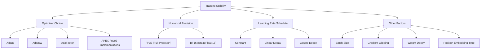
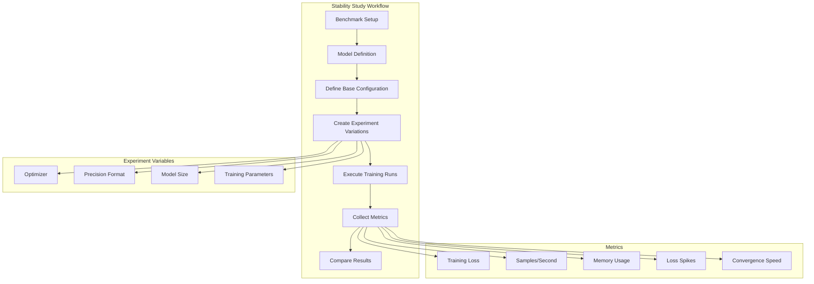
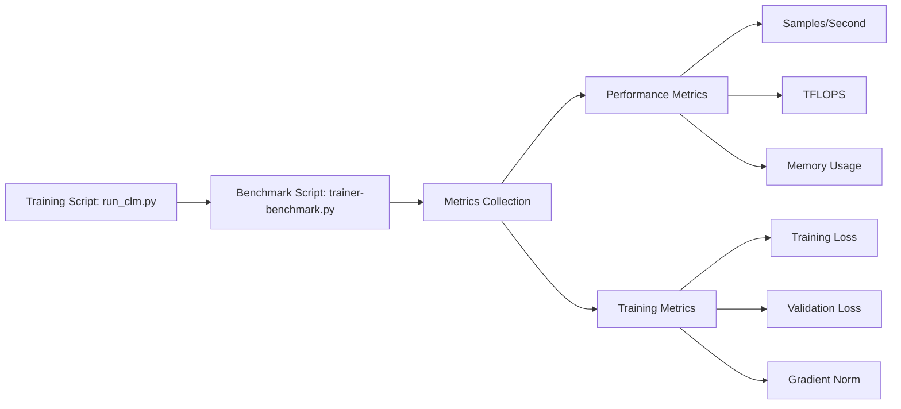
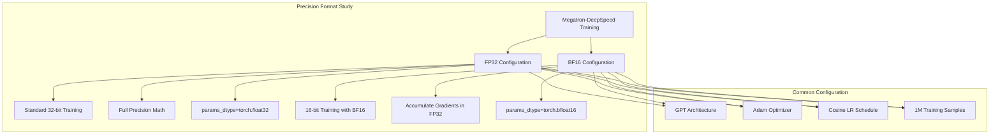
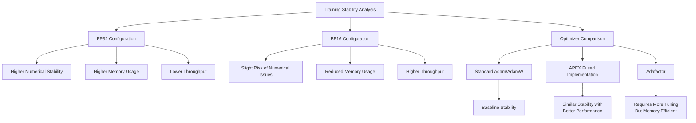
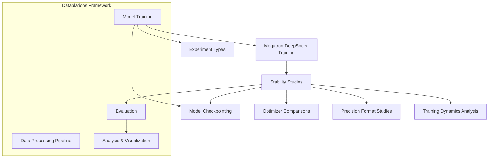

<!-- source: DeepWiki mcp.deepwiki.com · repo huggingface/datablations · page 3.4 Stability Studies · fetched 2026-10-26 -->

# Stability Studies

<details>
<summary>Relevant source files</summary>

The following files were used as context for generating this wiki page:

- [stability_study/hf-benchmark/gpt2.sh](stability_study/hf-benchmark/gpt2.sh)
- [stability_study/hf-benchmark/gpt2_adafactor.sh](stability_study/hf-benchmark/gpt2_adafactor.sh)
- [stability_study/hf-benchmark/gpt2_apex.sh](stability_study/hf-benchmark/gpt2_apex.sh)
- [stability_study/hf-benchmark/gpt2_compare.sh](stability_study/hf-benchmark/gpt2_compare.sh)
- [stability_study/logs/blowup-4-adam-alibi-bf16-1804475.err](stability_study/logs/blowup-4-adam-alibi-bf16-1804475.err)
- [stability_study/logs/blowup-4-adam-alibi-bf16-1804475.out](stability_study/logs/blowup-4-adam-alibi-bf16-1804475.out)
- [stability_study/logs/blowup-4-adam-alibi-fp32-1805002.err](stability_study/logs/blowup-4-adam-alibi-fp32-1805002.err)
- [stability_study/logs/blowup-4-adam-alibi-fp32-1805002.out](stability_study/logs/blowup-4-adam-alibi-fp32-1805002.out)

</details>


## Purpose and Scope

This document details the stability studies conducted within the datablations framework to systematically evaluate the impact of different optimizers and numerical precision formats on language model training. These studies help identify configurations that lead to stable training dynamics, preventing issues like loss spikes, divergence, or numerical instability. This page focuses on comparing the training behavior of models with different optimization algorithms and precision formats.

For information about model training configuration in general, see [Model Training](#3) and [Training Configuration](#3.1).

## Overview of Stability Factors

Training large language models involves many factors that can affect stability. The stability studies in this repository focus primarily on:

1. **Optimizer choice** - Comparing the convergence properties and training dynamics of optimizers like Adam, AdamW, AdaFactor, and APEX-fused implementations
2. **Numerical precision** - Evaluating the stability of training using different precision formats (FP32, BF16)
3. **Learning rate schedules** - Analyzing how different learning rate patterns affect training stability



Sources: [stability_study/hf-benchmark/gpt2.sh](), [stability_study/hf-benchmark/gpt2_adafactor.sh](), [stability_study/hf-benchmark/gpt2_apex.sh](), [stability_study/hf-benchmark/gpt2_compare.sh]()

## Experimental Setup

The stability studies are conducted using a standardized benchmarking framework that allows for controlled comparisons between different configurations. All experiments use GPT-2 style models and are trained on subsets of the OpenWebText dataset.

### Benchmark Configuration

Each experiment uses a consistent set of hyperparameters, varying only the optimization method or precision format being studied:

- Model: GPT-2 style architecture
- Dataset: OpenWebText (10k subset)
- Training duration: 10 epochs
- Batch size: 8 per device
- Sequence length: 512 tokens
- Warmup steps: 8



Sources: [stability_study/hf-benchmark/gpt2_compare.sh:36-43]()

### Benchmark Implementation

The stability studies use the HuggingFace Transformers training scripts with a benchmarking wrapper that measures and reports key metrics:



Sources: [stability_study/hf-benchmark/gpt2.sh:34-44](), [stability_study/hf-benchmark/gpt2_compare.sh:34-44]()

## Optimizer Comparison Studies

The optimizer comparison studies evaluate different optimization algorithms to identify their impact on training stability, convergence speed, and computational efficiency.

### Optimizers Evaluated

1. **AdamW (PyTorch)**: Standard AdamW implementation in PyTorch
2. **AdamW (APEX Fused)**: Fused implementation from NVIDIA APEX for better performance
3. **Adafactor**: Memory-efficient optimizer alternative to Adam variants

### Comparison Configuration

The scripts configure a basic language model training task with different optimizers while keeping all other parameters constant:

- Base command: `run_clm.py` with GPT-2 model on OpenWebText
- Metric key: `train_samples_per_second` (throughput)
- Also reports: `train_loss` (for stability analysis)

Key variations tested:

```
--optim adamw_torch  # Standard PyTorch AdamW
--optim adamw_apex_fused  # APEX fused implementation
--optim adafactor  # Memory-efficient alternative
```

Sources: [stability_study/hf-benchmark/gpt2.sh:40-41](), [stability_study/hf-benchmark/gpt2_apex.sh:40-41](), [stability_study/hf-benchmark/gpt2_adafactor.sh:40-41](), [stability_study/hf-benchmark/gpt2_compare.sh:40-41]()

## Precision Format Studies

The precision format studies compare training stability and efficiency across different numerical precision formats. Two main formats are tested:

1. **FP32 (32-bit floating point)**: Full precision, baseline for comparison
2. **BF16 (Brain Float 16)**: 16-bit format with better dynamic range than FP16

### Implementation Details

Full precision (FP32) configuration:
- Uses `--optimizer adam`
- No special flags for precision (default is FP32)
- Standard model parameters and activation in FP32

BF16 configuration:
- Uses `--optimizer adam`
- Adds `--bf16` flag
- Accumulates gradients in FP32 for better stability
- Model parameters and activations in BF16



Sources: [stability_study/logs/blowup-4-adam-alibi-fp32-1805002.out:64-67](), [stability_study/logs/blowup-4-adam-alibi-bf16-1804475.out:21-22](), [stability_study/logs/blowup-4-adam-alibi-bf16-1804475.out:138]()

## Training Dynamics and Monitoring

The stability studies track multiple metrics to evaluate the training dynamics:

### Key Metrics Monitored

- **Loss progression**: Watching for spikes or divergence
- **Gradient norm**: Indicates optimization stability 
- **Memory usage**: Measures efficiency of different configurations
- **Samples per second**: Throughput measurement
- **TFLOPS**: Computational efficiency

Example monitoring from logs:

```
iteration 200/148693 | consumed samples: 25600 | consumed tokens: 52428800 | 
elapsed time per iteration (s): 3.70 | learning rate: 4.194E-05 | 
global batch size: 128 | lm loss: 1.025302E+01 | grad norm: 2.121 | 
num zeros: 0.0 | number of skipped iterations: 0 | number of nan iterations: 0 | 
samples per second: 34.565 | TFLOPs: 31.24
```

Sources: [stability_study/logs/blowup-4-adam-alibi-bf16-1804475.out:634]()

## Memory Utilization Analysis

Memory usage is an important aspect of model training stability and efficiency. The logs capture memory allocation metrics at regular intervals:

```
[Rank 0] memory (MB) | allocated: 9522.70068359375 | max allocated: 20719.7001953125 | 
reserved: 28606.0 | max reserved: 28606.0
```

The BF16 training configuration typically uses less memory than FP32, as seen in the logs:

1. BF16 allocated memory: ~9.5 GB, max allocated: ~20.7 GB
2. FP32 allocated memory: ~10.4 GB, max allocated: ~31.3 GB

This demonstrates one of the key advantages of using reduced precision training.

Sources: [stability_study/logs/blowup-4-adam-alibi-bf16-1804475.out:633](), [stability_study/logs/blowup-4-adam-alibi-fp32-1805002.out:570]()

## Stability Observations

When comparing different training configurations, several patterns emerge in stability behavior:

### BF16 vs FP32 Stability

1. **Convergence rate**: BF16 and FP32 follow similar convergence patterns, but BF16 training is typically faster
2. **Memory efficiency**: BF16 uses approximately 30-40% less memory than FP32
3. **Computational throughput**: BF16 shows higher samples/second rates due to reduced computational requirements
4. **Numerical stability**: Both formats remain stable with appropriate settings, but FP32 may provide better stability for challenging datasets or architectures

### Optimizer Stability

1. **Adam/AdamW**: Generally stable with appropriate learning rates
2. **APEX fused AdamW**: Similar stability to regular AdamW with performance benefits
3. **Adafactor**: May require more careful tuning but offers memory benefits



Sources: [stability_study/logs/blowup-4-adam-alibi-fp32-1805002.out:568-570](), [stability_study/logs/blowup-4-adam-alibi-bf16-1804475.out:630-634](), [stability_study/hf-benchmark/gpt2_compare.sh:40-41]()

## Recommendations for Stable Training

Based on the stability studies in this repository, the following recommendations emerge:

1. **For most cases, use BF16 precision** with gradient accumulation in FP32 for a good balance of performance and stability
2. **When using BF16, increase batch size** where possible to improve the signal-to-noise ratio in gradients
3. **Use gradient clipping** (value around 1.0) to prevent gradient explosions
4. **For maximum stability, FP32** is still recommended for critical applications or when debugging convergence issues
5. **When using Adam/AdamW**, the APEX fused implementation provides comparable stability with better performance
6. **Monitor gradient norms** throughout training to detect potential instability early

These recommendations help establish a solid foundation for stable language model training within the datablations framework.

Sources: [stability_study/logs/blowup-4-adam-alibi-fp32-1805002.out:100-101](), [stability_study/logs/blowup-4-adam-alibi-bf16-1804475.out:472-507](), [stability_study/hf-benchmark/gpt2_compare.sh:40-41]()

## Integration with Main Pipeline

The stability studies integrate with the larger datablations framework as shown below:



The stability studies serve as an important component in the model training process, helping researchers choose appropriate training configurations for their specific experiments within the datablations framework.

Sources: [stability_study/hf-benchmark/gpt2.sh](), [stability_study/hf-benchmark/gpt2_compare.sh](), [stability_study/logs/blowup-4-adam-alibi-fp32-1805002.out](), [stability_study/logs/blowup-4-adam-alibi-bf16-1804475.out]()

---

