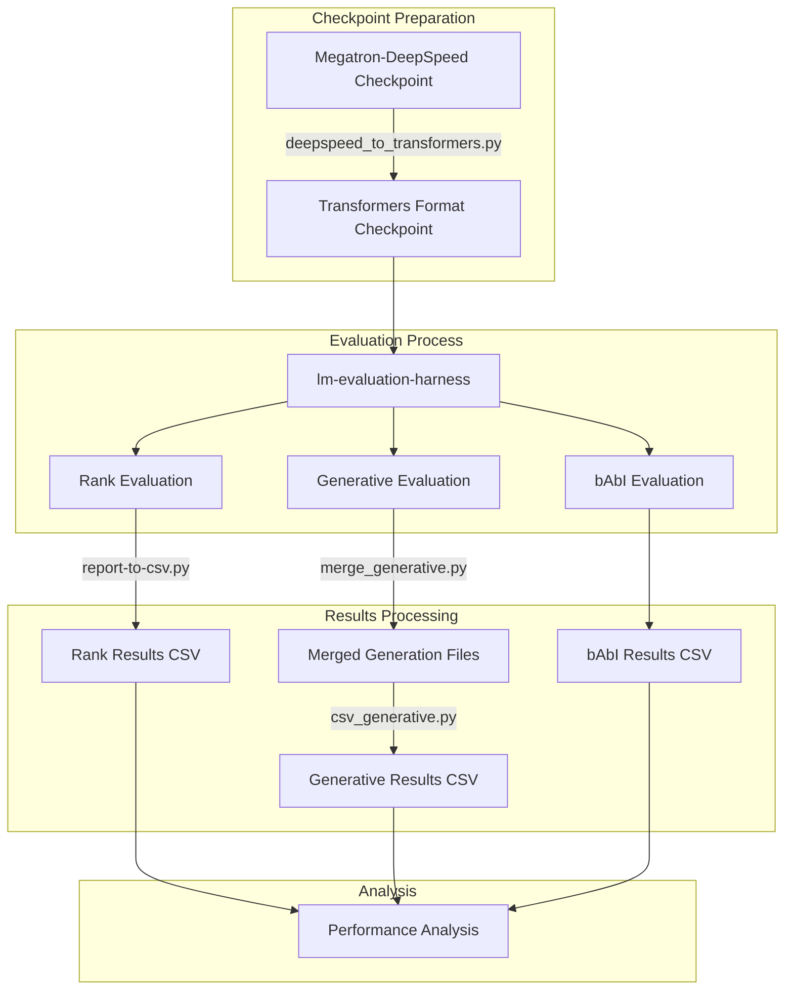
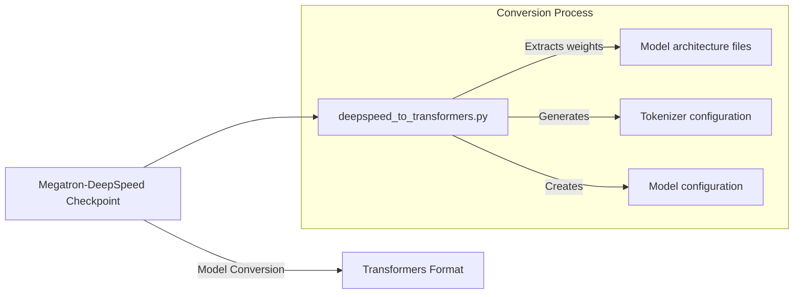
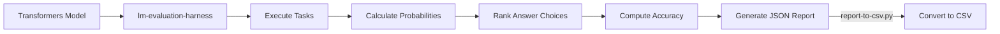
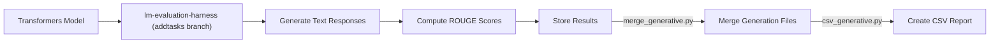
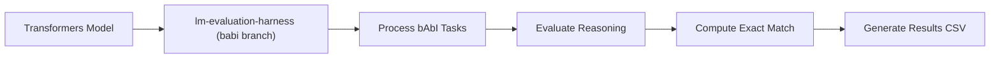
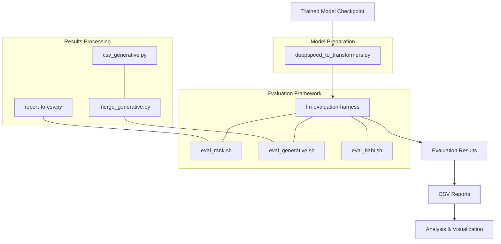
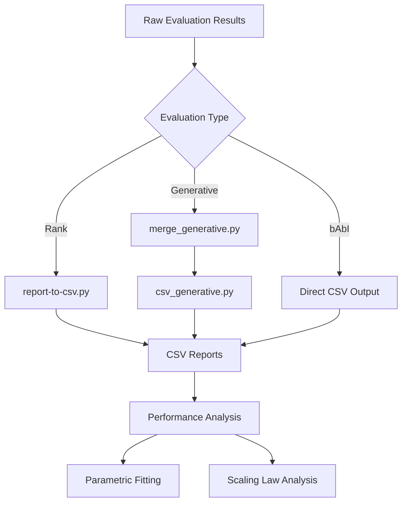
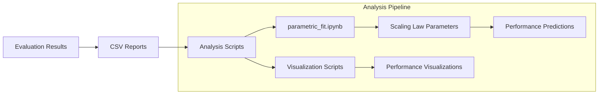

<!-- source: DeepWiki mcp.deepwiki.com · repo huggingface/datablations · page 4 Evaluation Framework · fetched 2026-10-26 -->

# Evaluation Framework

<details>
<summary>Relevant source files</summary>

The following files were used as context for generating this wiki page:

- [README.md](README.md)
- [plotstables/training_validation_filter.pdf](plotstables/training_validation_filter.pdf)
- [plotstables/validation_c4py.pdf](plotstables/validation_c4py.pdf)

</details>


The Evaluation Framework in the datablations repository provides structured methods for assessing language model performance on downstream tasks. This framework utilizes the lm-evaluation-harness to evaluate models across three distinct evaluation types: rank-based, generative, and bAbI tasks. This page explains the overall evaluation process, how to execute evaluations, and how results are processed for further analysis.

For information about model training that precedes evaluation, see [Model Training](#3).

## Evaluation Workflow Overview

The evaluation process follows a systematic workflow, transforming trained model checkpoints into a format suitable for evaluation, running the evaluation tasks, and processing the results for analysis.



Sources: [README.md:379-394]()

## Checkpoint Conversion

Before evaluation can begin, model checkpoints from Megatron-DeepSpeed must be converted to the Hugging Face Transformers format.



The conversion process uses the `deepspeed_to_transformers.py` script, which transforms the distributed model checkpoint into a format compatible with the Hugging Face Transformers library.

Example conversion command:
```
python Megatron-DeepSpeed/tools/convert_checkpoint/deepspeed_to_transformers.py --input_folder global_step52452 --output_folder transformers --target_tp 1 --target_pp 1
```

Sources: [README.md:286]()

## Evaluation Types

The framework supports three distinct types of evaluation, each targeting different aspects of language model capabilities.

### Rank Evaluation

Rank evaluation assesses the model's ability to predict correct answers by ranking possible answer choices. This is particularly useful for multiple-choice tasks and knowledge-based evaluations.

#### Process



#### Implementation

To run rank evaluation:
1. Install the evaluation harness: `pip install git+https://github.com/EleutherAI/lm-evaluation-harness.git`
2. Execute the evaluation script: `sbatch utils/eval_rank.sh`
3. Convert results to CSV: `python Megatron-DeepSpeed/tasks/eval_harness/report-to-csv.py outfile.json`

Sources: [README.md:375-380]()

### Generative Evaluation

Generative evaluation measures the model's text generation capabilities using metrics like ROUGE. This approach is suitable for summarization, translation, and open-ended generative tasks.

#### Process



#### Implementation

To run generative evaluation:
1. Clone the specialized branch: `git clone -b addtasks https://github.com/Muennighoff/lm-evaluation-harness.git`
2. Install dependencies: `pip install -e ".[dev]"; pip uninstall -y promptsource; pip install git+https://github.com/Muennighoff/promptsource.git@tr13`
3. Execute the evaluation script: `sbatch utils/eval_generative.sh`
4. Merge and convert results: 
   ```
   python utils/merge_generative.py
   python utils/csv_generative.py merged.json
   ```

Sources: [README.md:382-387]()

### bAbI Evaluation

bAbI evaluation tests a model's reasoning capabilities using the bAbI dataset, measuring exact match accuracy in answering questions that require logical reasoning.

#### Process



#### Implementation

To run bAbI evaluation:
1. Clone the specialized branch: `git clone -b babi https://github.com/Muennighoff/lm-evaluation-harness.git`
2. Install dependencies: `pip install -e ".[dev]"`
3. Ensure model checkpoint includes tokenizer files
4. Execute the evaluation script: `sbatch utils/eval_babi.sh`

Sources: [README.md:390-394]()

## Evaluation Framework Components

The following diagram illustrates the relationship between the evaluation components and the corresponding code files:



Sources: [README.md:375-394]()

## Evaluation Metrics and Tasks

The different evaluation types focus on specific metrics relevant to their task categories:

| Evaluation Type | Primary Metrics | Example Tasks |
|----------------|-----------------|---------------|
| Rank Evaluation | Accuracy, Exact Match | MMLU, HellaSwag, Winogrande |
| Generative Evaluation | ROUGE-1, ROUGE-2, ROUGE-L | CNN/DailyMail, XSum, WebNLG |
| bAbI Evaluation | Exact Match | Logical reasoning, Inference, Deduction |

Sources: [README.md:375-394]()

## Results Processing

After evaluation, the raw results are transformed into standardized CSV formats for further analysis:



The CSV reports enable consistent analysis across different experiment types and allow for visualization of performance patterns across model sizes and training data configurations.

Sources: [README.md:375-394]()

## Integration with the Analysis Pipeline

The evaluation results feed directly into the analysis pipeline, which fits parametric scaling laws and visualizes performance trends:



For more information on the analysis of evaluation results, see [Scaling Laws and Analysis](#5).

Sources: [README.md:396-439]()

---

