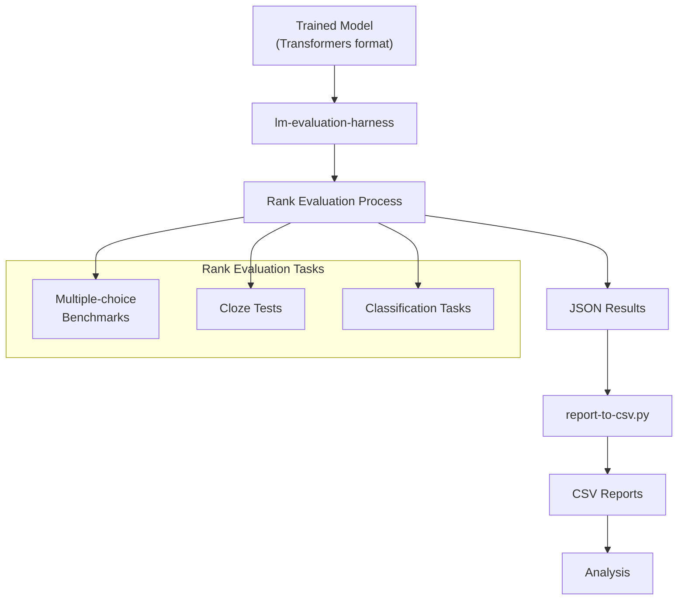
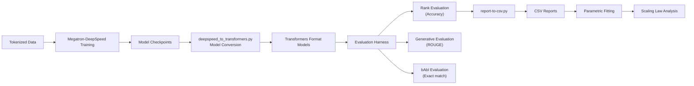
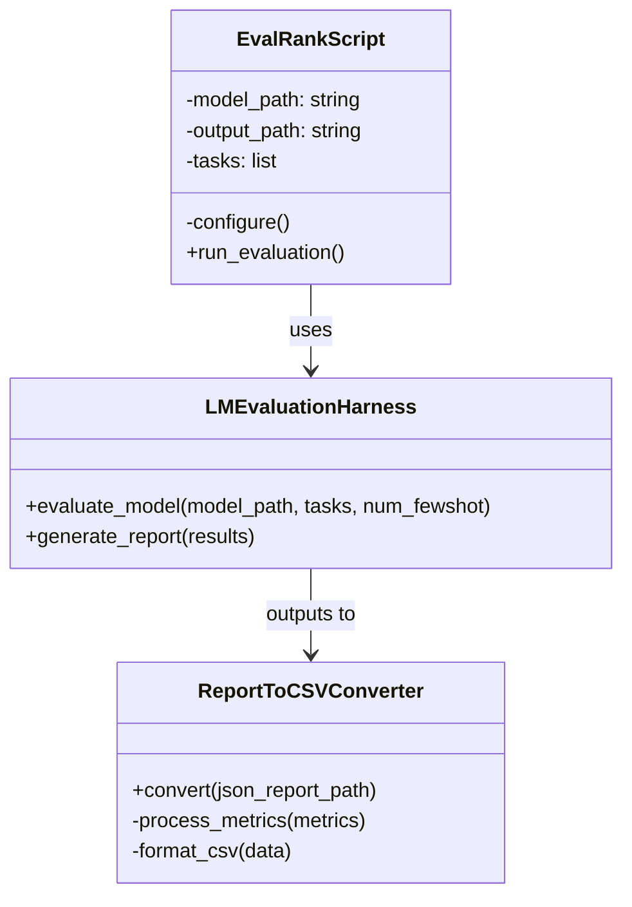
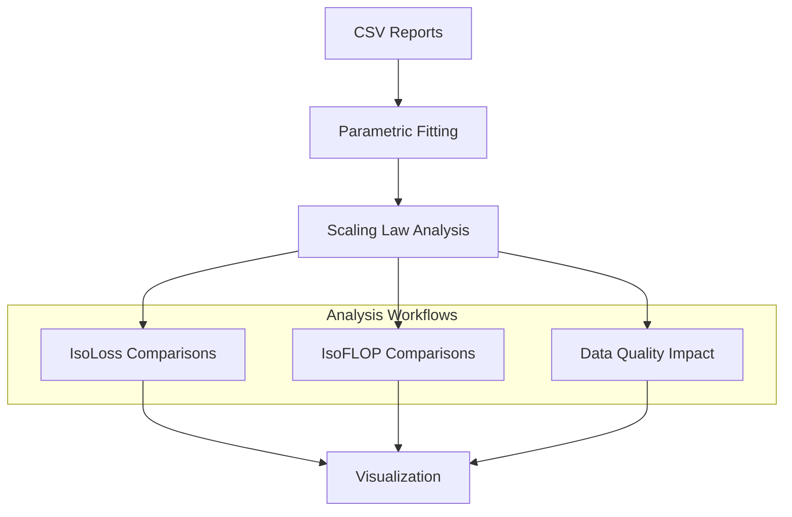

<!-- source: DeepWiki mcp.deepwiki.com · repo huggingface/datablations · page 4.1 Rank Evaluation · fetched 2026-10-26 -->

# Rank Evaluation

<details>
<summary>Relevant source files</summary>

The following files were used as context for generating this wiki page:

- [README.md](README.md)
- [plotstables/training_validation_filter.pdf](plotstables/training_validation_filter.pdf)
- [plotstables/validation_c4py.pdf](plotstables/validation_c4py.pdf)

</details>


Rank evaluation is a method for assessing language model performance on tasks where the model must rank multiple output choices, with metrics typically based on accuracy. This document covers the rank evaluation pipeline in the datablations framework, explaining how to run rank evaluations with trained models, process the results, and interpret the data.

For information about other evaluation methods, see [Generative Evaluation](#4.2) or [bAbI Evaluation](#4.3).

## Overview of Rank Evaluation

In the context of datablations, rank evaluation focuses on evaluating a language model's ability to correctly rank potential answers or completions for a given prompt. This evaluation method is particularly suited for tasks like multiple-choice questions, cloze tests, and other scenarios where the correct answer can be determined from a fixed set of options.

The framework uses the Eleuther AI's lm-evaluation-harness tool to evaluate models across a range of standard NLP benchmarks, generating accuracy-based metrics that assess model performance.



**Diagram: Rank Evaluation Pipeline**

Sources: [README.md:375-380]()

## Integration in the Datablations Framework

Rank evaluation is one of three primary evaluation methods in the datablations framework. It focuses specifically on tasks where model accuracy can be precisely measured. The evaluation results are used to analyze how different data regimes and model scaling strategies affect performance on downstream tasks.



**Diagram: Evaluation in the Datablations Framework**

Sources: [README.md:372-395]()

## Implementation Details

The rank evaluation implementation leverages Eleuther AI's lm-evaluation-harness, which provides a standardized way to evaluate language models on a wide range of NLP tasks.

### Key Components

1. **lm-evaluation-harness**: The primary evaluation tool that supports multiple benchmark tasks
2. **eval_rank.sh**: A script that configures and runs the evaluation harness on a specific model
3. **report-to-csv.py**: Converts the JSON evaluation results to CSV format for easier analysis



**Diagram: Rank Evaluation Components**

Sources: [README.md:375-380]()

## Running Rank Evaluation

To run rank evaluation on your trained models, follow these steps:

1. Set up the training environment as described in the [Model Training](#3) section
2. Install the evaluation harness:
   ```bash
   pip install git+https://github.com/EleutherAI/lm-evaluation-harness.git
   ```
3. Modify and run the evaluation script:
   ```bash
   sbatch utils/eval_rank.sh
   ```
4. Convert the results to CSV format:
   ```bash
   python Megatron-DeepSpeed/tasks/eval_harness/report-to-csv.py outfile.json
   ```

### Configuration Parameters

The evaluation script requires several parameters to be configured, including:

| Parameter | Description | Example |
|-----------|-------------|---------|
| MODEL_PATH | Path to the model checkpoint in Transformers format | `models/transformers/1b12b8100m` |
| OUTPUT_PATH | Where to save the evaluation results | `results/rank_eval_1b.json` |
| TASKS | List of evaluation tasks to run | `hellaswag,piqa,arc_easy,arc_challenge` |
| NUM_FEWSHOT | Number of examples to use for few-shot prompting | `0` |
| BATCH_SIZE | Batch size for evaluation | `8` |

Sources: [README.md:375-380]()

## Result Interpretation

Rank evaluation results provide accuracy metrics for each evaluation task. These metrics indicate how well the model performs at selecting the correct answer from a set of choices.

### Output Format

The raw output is a JSON file containing detailed information about the evaluation run, including:
- Task-specific scores
- Aggregated metrics
- Configuration details

After conversion to CSV using the `report-to-csv.py` script, the data becomes easier to analyze alongside other experimental results.

### Key Metrics

| Metric | Description |
|--------|-------------|
| Accuracy | Percentage of correct responses |
| Normalized Accuracy | Adjusted accuracy taking into account random baseline |
| F1 Score | Harmonic mean of precision and recall (for classification tasks) |
| Average | Mean performance across all evaluated tasks |

### Analyzing Results

Results from rank evaluation are typically used in conjunction with model and training metadata to:
1. Compare performance across different model sizes
2. Analyze the impact of training data quantity and quality
3. Investigate the effects of data repetition and filtration
4. Study scaling laws in data-constrained regimes



**Diagram: Analysis Pipeline for Rank Evaluation Results**

Sources: [README.md:379-380](), [README.md:390-424]()

## Example Evaluation Tasks

The lm-evaluation-harness supports numerous benchmark tasks for rank evaluation. Common tasks used in the datablations framework include:

| Task | Description | Metric |
|------|-------------|--------|
| HellaSwag | Commonsense NLI for choosing the most plausible ending | Accuracy |
| PIQA | Physical Interaction Question Answering | Accuracy |
| ARC (Easy/Challenge) | AI2 Reasoning Challenge multiple-choice questions | Accuracy |
| MMLU | Massive Multitask Language Understanding | Accuracy |
| TruthfulQA | Measuring truthfulness in generated answers | Accuracy |
| WinoGrande | Winograd Schema Challenge variant | Accuracy |

Results from these evaluations provide insights into model capabilities across different reasoning tasks and help identify the effects of data ablation strategies on downstream performance.

Sources: [README.md:375-380](), [plotstables/validation_c4py.pdf]()

---

