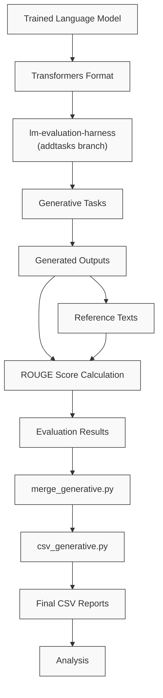
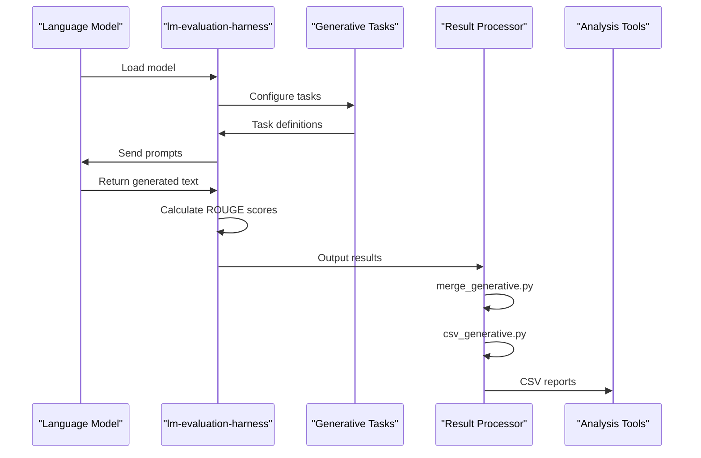
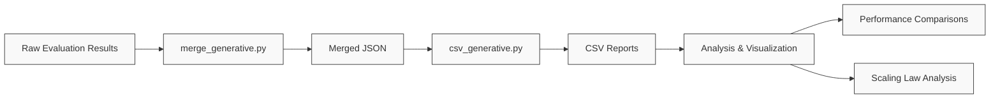

<!-- source: DeepWiki mcp.deepwiki.com · repo huggingface/datablations · page 4.2 Generative Evaluation · fetched 2026-10-26 -->

# Generative Evaluation

<details>
<summary>Relevant source files</summary>

The following files were used as context for generating this wiki page:

- [README.md](README.md)
- [plotstables/training_validation_filter.pdf](plotstables/training_validation_filter.pdf)
- [plotstables/validation_c4py.pdf](plotstables/validation_c4py.pdf)

</details>


## Purpose and Scope

This page documents the generative evaluation system in the datablations framework. Generative evaluation assesses language model performance on tasks requiring text generation, using metrics like ROUGE (Recall-Oriented Understudy for Gisting Evaluation) to measure the quality of generated outputs against reference texts. Unlike rank evaluation ([Rank Evaluation](#4.1)) which assesses classification or multiple-choice abilities, generative evaluation focuses on a model's capability to produce coherent, relevant text across various tasks.

## Overview of Generative Evaluation

Generative evaluation tests a model's ability to generate full text responses to prompts, rather than just selecting or ranking pre-defined options. It uses a customized version of the lm-evaluation-harness framework with additional tasks specifically configured for generative assessment.



*Diagram: Generative Evaluation Workflow*

Sources: [README.md:381-388]()

## Setup Requirements

Setting up the generative evaluation environment requires specific dependencies and repository configurations:

1. Clone the specialized evaluation harness branch with generative task support:
   ```bash
   git clone -b addtasks https://github.com/Muennighoff/lm-evaluation-harness.git
   ```

2. Install the required dependencies with custom promptsource package:
   ```bash
   cd lm-evaluation-harness
   pip install -e ".[dev]"
   pip uninstall -y promptsource
   pip install git+https://github.com/Muennighoff/promptsource.git@tr13
   ```

3. Ensure your model checkpoint is in Hugging Face Transformers format

Sources: [README.md:381-387]()

## Evaluation Process

The generative evaluation process follows these steps:

1. **Model Conversion**: Models trained with Megatron-DeepSpeed must first be converted to Hugging Face Transformers format.
2. **Task Configuration**: The evaluation harness is set up with tasks that require generative capabilities.
3. **Evaluation**: Models generate text responses to prompts, which are compared against reference texts.
4. **Metric Calculation**: ROUGE scores are calculated to assess the similarity between generated and reference texts.
5. **Result Processing**: Results are processed into a standard format for analysis.



*Diagram: Generative Evaluation Sequence*

Sources: [README.md:386-388]()

## Running the Evaluation

To run generative evaluation, modify the variables in the `utils/eval_generative.sh` script and execute it:

```bash
sbatch utils/eval_generative.sh
```

This script configures the evaluation harness with the appropriate model, tasks, and output parameters.

### Key Configuration Parameters

The evaluation script typically includes parameters for:

- Model path
- Output directory
- Batch size
- Device configuration
- Specific task selection

Sources: [README.md:386-387]()

## Processing Results

After running the evaluation, results must be processed into a standardized format:

1. Merge generation files using the merge_generative utility:
   ```bash
   python utils/merge_generative.py
   ```

2. Convert the merged results to CSV format:
   ```bash
   python utils/csv_generative.py merged.json
   ```

This produces CSV reports that can be used for further analysis and visualization.



*Diagram: Result Processing Pipeline*

Sources: [README.md:387-388]()

## Integration with Scaling Analysis

Generative evaluation results contribute to the broader scaling analysis in the datablations framework:

1. Results are compiled into standardized formats
2. Performance metrics are analyzed alongside model parameters, data size, and training tokens
3. Results help inform optimal resource allocation decisions when training models in data-constrained environments

The generative evaluation results are particularly useful for assessing model quality on tasks requiring long-form text generation, which complements the insights gained from other evaluation methods.

Sources: [README.md:391-425]()

## Comparison with Other Evaluation Methods

The datablations framework includes three primary evaluation approaches, each serving different purposes:

| Evaluation Type | Focus | Metrics | Implementation |
|----------------|-------|---------|----------------|
| Rank Evaluation | Multiple choice, classification | Accuracy | Standard lm-evaluation-harness |
| Generative Evaluation | Text generation | ROUGE | Custom "addtasks" branch |
| bAbI Evaluation | Reasoning tasks | Exact match | Custom "babi" branch |

Generative evaluation is particularly valuable for assessing a model's ability to produce coherent, contextually relevant text, which is critical for applications like summarization, translation, and creative writing.

Sources: [README.md:380-394]()

---

