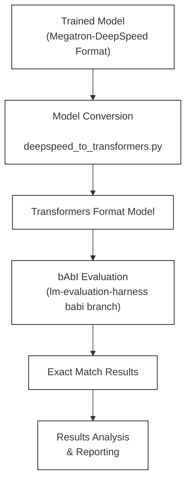
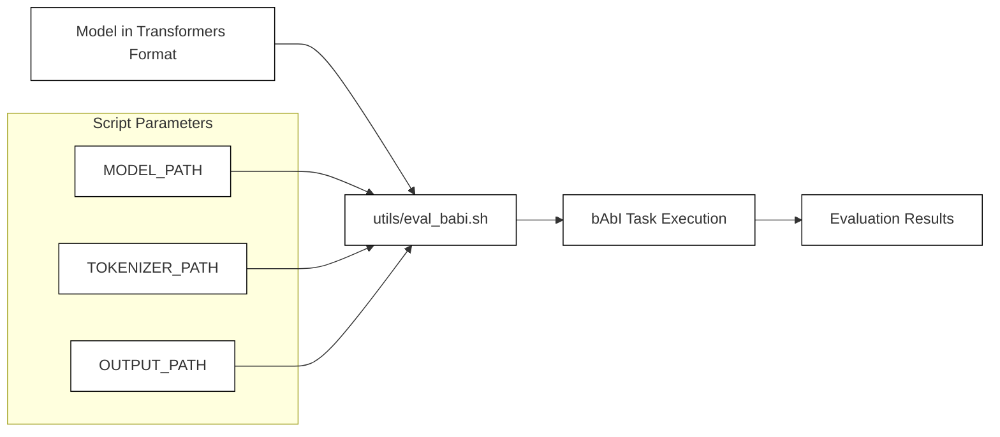
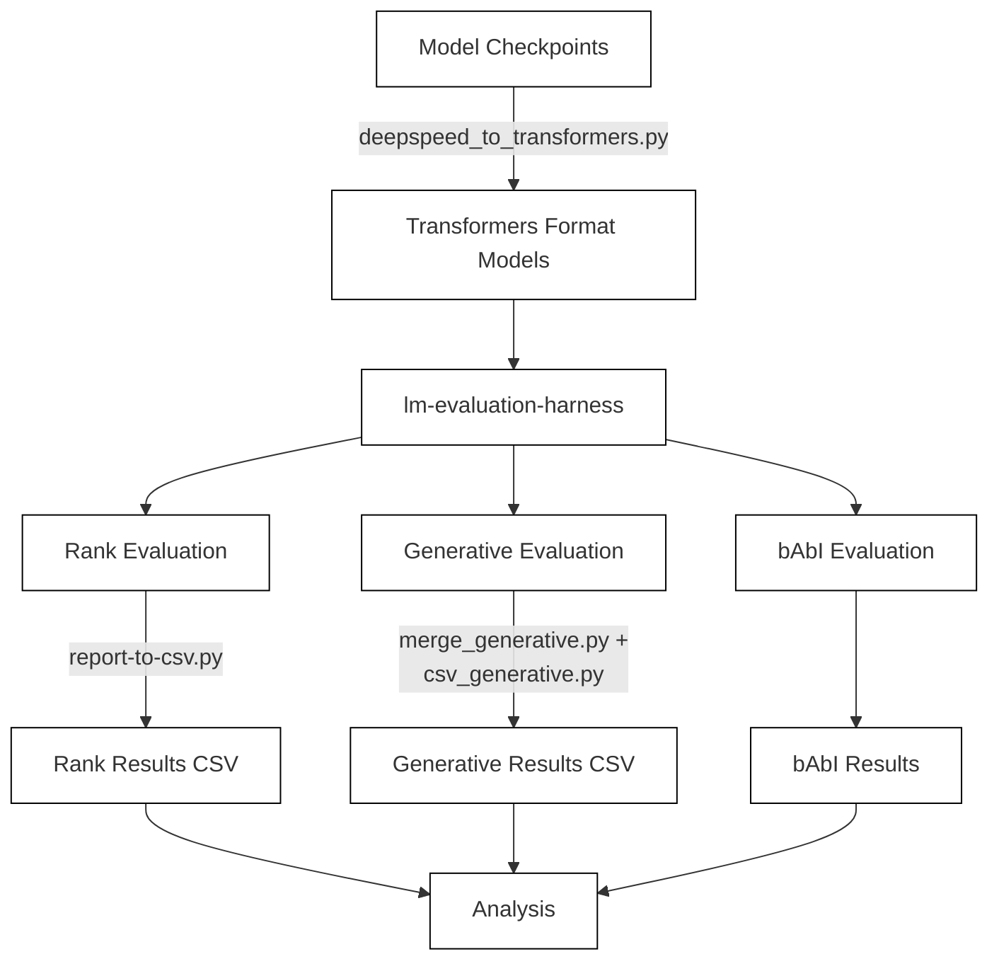

<!-- source: DeepWiki mcp.deepwiki.com · repo huggingface/datablations · page 4.3 bAbI Evaluation · fetched 2026-10-26 -->

# bAbI Evaluation

<details>
<summary>Relevant source files</summary>

The following files were used as context for generating this wiki page:

- [README.md](README.md)
- [plotstables/training_validation_filter.pdf](plotstables/training_validation_filter.pdf)
- [plotstables/validation_c4py.pdf](plotstables/validation_c4py.pdf)

</details>


This page documents the bAbI evaluation system within the datablations framework. The bAbI evaluation is used to assess language models on a set of tasks designed to test basic reasoning capabilities through exact match accuracy. For information on other evaluation methods, see [Rank Evaluation](#4.1) and [Generative Evaluation](#4.2).

## Overview

The bAbI tasks, introduced by Facebook AI Research, consist of 20 different reasoning tasks that test a model's ability to understand and reason about text. In the datablations framework, bAbI evaluation is implemented as part of the downstream evaluation pipeline using a specialized fork of the lm-evaluation-harness.



**Diagram: bAbI Evaluation Workflow**

Sources: [README.md:391-394]()

## Setup Requirements

To perform bAbI evaluation on models, a specific environment setup is required:

1. Clone the `babi` branch of lm-evaluation-harness:
   ```
   git clone -b babi https://github.com/Muennighoff/lm-evaluation-harness.git
   ```
   
2. Install the required dependencies:
   ```
   cd lm-evaluation-harness
   pip install -e ".[dev]"
   ```

3. Ensure your model checkpoint is in Hugging Face Transformers format with tokenizer files. For GPT-2 models trained in the datablations framework, the tokenizer files should match those from huggingface.co/gpt2.

Sources: [README.md:391-393]()

## Running bAbI Evaluation

The evaluation is executed using the `eval_babi.sh` script in the utils directory:



**Diagram: bAbI Evaluation Script Execution**

To run the evaluation:

1. Modify the necessary variables in `utils/eval_babi.sh` to specify:
   - The model path
   - Tokenizer path
   - Output path
   - Any other configuration options

2. Execute the script:
   ```
   sbatch utils/eval_babi.sh
   ```

Sources: [README.md:394]()

## bAbI Tasks

The bAbI evaluation suite includes 20 tasks that test different reasoning capabilities:

| Task ID | Task Name | Description |
|---------|-----------|-------------|
| 1 | Single Supporting Fact | Answer questions with a single supporting fact |
| 2 | Two Supporting Facts | Answer questions with two supporting facts |
| 3 | Three Supporting Facts | Answer questions with three supporting facts |
| 4 | Two Argument Relations | Answer questions that require reasoning about relations |
| 5 | Three Argument Relations | More complex relational reasoning |
| ... | ... | ... |
| 20 | Agent's Motivations | Understand and reason about character motivations |

Each task evaluates the model on exact match accuracy - whether the model produces the exact expected answer.

Sources: [README.md:391-394]()

## Integration with Evaluation Framework

The bAbI evaluation is part of the broader evaluation framework in the datablations repository, working alongside rank and generative evaluations.



**Diagram: Evaluation Framework Integration**

Sources: [README.md:372-394]()

## Result Interpretation

The bAbI evaluation produces results measuring exact match accuracy on each of the 20 tasks. These results can be analyzed in conjunction with other evaluation metrics to gain a comprehensive understanding of model performance.

Unlike the rank and generative evaluations, the bAbI results don't appear to have specific post-processing scripts mentioned in the README. The results are likely processed directly or through custom analysis scripts.

The exact match metric is particularly valuable for assessing the model's precise reasoning capabilities, as opposed to more flexible metrics like ROUGE used in generative evaluation.

Sources: [README.md:387-394]()

## Example Usage

A typical workflow for evaluating a model on bAbI tasks might look like:

1. Train a model using Megatron-DeepSpeed
2. Convert the model to Transformers format:
   ```
   python Megatron-DeepSpeed/tools/convert_checkpoint/deepspeed_to_transformers.py --input_folder global_step52452 --output_folder transformers --target_tp 1 --target_pp 1
   ```
3. Set up the bAbI evaluation environment
4. Run the bAbI evaluation:
   ```
   sbatch utils/eval_babi.sh
   ```
5. Analyze the results alongside other evaluation metrics

Sources: [README.md:286-394]()

## Performance Considerations

When evaluating models on bAbI tasks, it's important to consider:

1. The exact match nature of the evaluation means models must be precise in their outputs
2. Different model sizes may perform differently on reasoning tasks
3. The amount of training data and unique tokens can affect reasoning capability
4. Performance on bAbI tasks may correlate with model's general reasoning abilities

As shown in experimental results visualized in the repository (such as in `plotstables/validation_c4py.pdf`), adding code to the training data may impact model performance on reasoning tasks like bAbI.

Sources: [README.md:387-394](), [plotstables/validation_c4py.pdf]()

---

