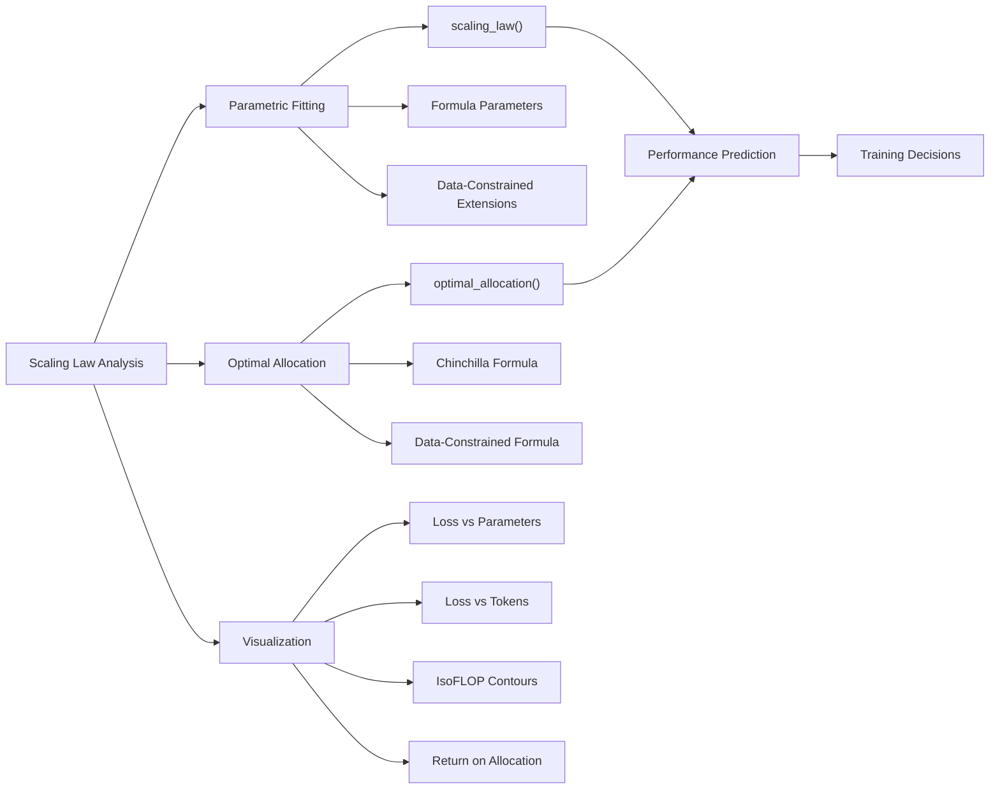
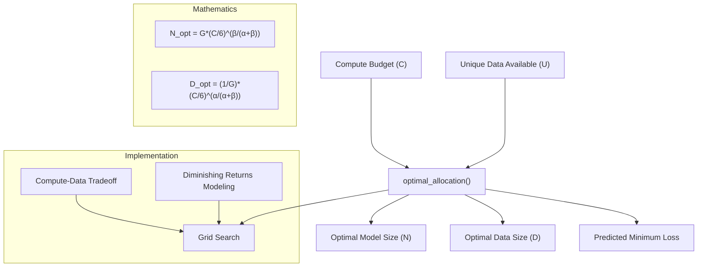
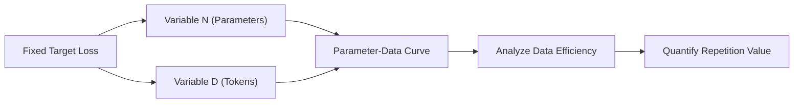
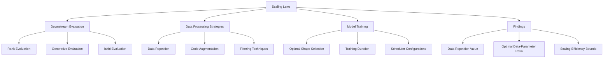

<!-- source: DeepWiki mcp.deepwiki.com · repo huggingface/datablations · page 5 Scaling Laws and Analysis · fetched 2026-10-26 -->

# Scaling Laws and Analysis

<details>
<summary>Relevant source files</summary>

The following files were used as context for generating this wiki page:

- [README.md](README.md)
- [plotstables/contours.ipynb](plotstables/contours.ipynb)
- [plotstables/mup_dd_dd.ipynb](plotstables/mup_dd_dd.ipynb)
- [plotstables/training_validation_filter.pdf](plotstables/training_validation_filter.pdf)
- [plotstables/validation_c4py.pdf](plotstables/validation_c4py.pdf)
- [utils/parametric_fit.ipynb](utils/parametric_fit.ipynb)

</details>


This page introduces the scaling law analysis framework used in the datablations repository. Scaling laws describe the mathematical relationships between model performance, model size, and training data quantity. In this codebase, these relationships are studied with a particular focus on data-constrained regimes, where available data may be repeated during training. The analysis tools provided help understand and predict model performance, determine optimal resource allocation, and visualize scaling behaviors.

For specific implementations of different experiment types that leverage these scaling laws, see [Experiment Types](#3.3).

## Key Concepts and Components



Scaling laws in this framework establish the relationships between:
- N: Number of model parameters
- D: Number of training tokens
- U: Number of unique training tokens
- L: Validation loss (model performance)
- C: Compute budget

Sources: [README.md:295-371](), [utils/parametric_fit.ipynb:1-526]()

## Parametric Scaling Law Formula

The core of the scaling analysis is the parametric formula that predicts model performance based on parameters, tokens, and unique tokens. This extends traditional scaling laws by accounting for data repetition.

### Base Formula

The main formula used for modeling the relationship between parameters, data, and performance is:

```
L(N,D,U) = E + A/(UN + UN*rn_star*(1-exp(-1*RN/rn_star)))^alpha + B/(U + U*rd_star*(1-exp(-1*RD/rd_star)))^beta
```

Where:
- L is the predicted loss
- N is the number of parameters
- D is the number of total training tokens
- U is the number of unique training tokens
- RD = max((D/U) - 1, 0) - a measure of data repetition
- UN = min(N, D_to_N(U)) - effective parameter count
- RN = max((N/UN) - 1, 0) - a measure of excess parameters
- E, A, B, alpha, beta, rd_star, rn_star are fitted constants

This formula extends Chinchilla scaling laws by explicitly modeling the diminishing returns from repeated data and excess parameters.

Sources: [README.md:300-324](), [utils/parametric_fit.ipynb:297-324]()

### Implementation

The scaling law function is implemented as follows:

```python
def scaling_law(N, D, U):
    """
    N: number of parameters
    D: number of total training tokens
    U: number of unique training tokens
    """
    assert U <= D, "Cannot have more unique tokens than total tokens"

    RD = np.maximum((D / U) - 1, 0)    
    UN = np.minimum(N, D_to_N(U))
    RN = np.maximum((N / UN ) - 1, 0)

    L = E + A/(UN + UN*rn_star*(1-np.exp(-1*RN/rn_star)))**alpha + B/(U + U*rd_star*(1-np.exp(-1*RD/rd_star)))**beta
    return L
```

The function takes model size, total tokens, and unique tokens as inputs and returns the predicted loss.

Sources: [README.md:312-324](), [utils/parametric_fit.ipynb:312-324]()

## Optimal Resource Allocation

One of the key applications of scaling laws is determining the optimal allocation of resources - how many parameters to use and how many tokens to train on given a compute budget.



### Chinchilla Optimal Allocation

The Chinchilla optimal allocation formulas provide a baseline:

```python
def chinchilla_optimal_N(C):
    a = (beta)/(alpha+beta)
    N_opt = G*(C/6)**a
    return N_opt

def chinchilla_optimal_D(C):
    b = (alpha)/(alpha+beta)
    D_opt = (1/G)*(C/6)**b
    return D_opt
```

### Data-Constrained Optimal Allocation

When the amount of unique data is limited, the optimal resource allocation changes:

```python
def optimal_allocation(C, U_BASE):
    """Compute optimal number of parameters and tokens to train for given a compute & unique data budget"""
    N_BASE = chinchilla_optimal_N(C)
    D_BASE = chinchilla_optimal_D(C)
    min_l = float("inf")
    for i in np.linspace(1.0001, 3, 500):
        D = D_BASE*i
        U = min(U_BASE, D)
        N = N_BASE/i
        new_l = scaling_law(N, D, U)
        if new_l < min_l:
            min_l, min_t, min_s = new_l, D, N
        D = D_BASE/i
        U = min(U_BASE, D)
        N = N_BASE*i
        new_l = scaling_law(N, D, U)
        if new_l < min_l:
            min_l, min_t, min_s = new_l, D, N
    return min_l, min_t, min_s
```

This function uses a grid search to find the optimal parameter and token counts that minimize the predicted loss, given compute and unique data constraints.

Sources: [README.md:332-367](), [utils/parametric_fit.ipynb:334-366]()

## Analysis Types

The scaling law framework supports several types of analysis experiments:

### IsoLoss Analysis



IsoLoss analysis fixes a target loss value and explores different combinations of model size and data quantity that achieve this loss. This approach helps understand how effectively models can trade off parameters for data and vice versa.

### IsoFLOP Analysis


IsoFLOP analysis fixes a compute budget (FLOPs = 6ND) and explores different combinations of model size and data quantity that can be trained within this budget. This approach helps find the most compute-efficient allocation.

Sources: [README.md:15-13](), [plotstables/contours.ipynb]()

## Visualization Tools

The repository includes several visualization tools for analyzing scaling behaviors:

### Loss Contour Plots

Loss contour plots show the landscape of model performance across different parameter and data configurations. These visualizations help identify valleys of optimal performance and understand the trade-offs between model size and data quantity.

### Return on Allocation Plots

Return on allocation plots show how effectively additional compute resources improve model performance. These visualizations help determine whether to invest more in model size, data quantity, or a balanced approach.

### Parameter-Data Scaling Curves

Parameter-data scaling curves show how model performance changes when varying either parameters or data while keeping the other fixed. These visualizations help understand the sensitivity of models to each resource dimension.

Sources: [README.md:396-414](), [plotstables/contours.ipynb]()

## Example Usage

Using the scaling law to predict model performance:

```python
# Example model sizes and data amounts
params = 6.34e9   # 6.34 billion parameters
tokens = 242e9    # 242 billion tokens
unique = 25e9     # 25 billion unique tokens

# Predict the validation loss
loss = scaling_law(params, tokens, unique)  # Returns 2.2256...
```

Computing optimal allocation for a compute budget:

```python
# Compute optimal parameters and tokens for a given compute budget
compute_budget = 10**22  # 10^22 FLOPs
unique_data = 25e9      # 25 billion unique tokens

min_loss, optimal_tokens, optimal_params = optimal_allocation(compute_budget, unique_data)
print(f"Optimal configuration: {optimal_tokens} tokens, {optimal_tokens/unique_data} epochs, {optimal_params} parameters")
# -> 237336955477.55075 tokens, 9.49347821910203 epochs, 7022364735.879969 parameters
```

Sources: [README.md:326-367](), [utils/parametric_fit.ipynb:296-367]()

## Relationship to Other Analyses

The scaling law analysis framework connects to several other components in the datablations repository:



The scaling law analysis provides insights that inform data preparation strategies, model training configurations, and the interpretation of downstream evaluations.

Sources: [README.md:13-37]()

## Extending the Analysis

The base scaling law formula can be extended or adapted for different scenarios:

1. **Alternative Decay Functions**: The exponential decay functions for repeated data and excess parameters can be replaced with other forms
2. **Task-Specific Parameters**: The scaling law parameters can be fitted separately for different tasks or domains
3. **Multimodal Extensions**: The formula can be extended to account for multiple data types or modalities

These extensions may require modifying the `scaling_law` function and refitting the parameters using the techniques in `parametric_fit.ipynb`.

Sources: [utils/parametric_fit.ipynb](), [plotstables/mup_dd_dd.ipynb]()

## Practical Applications

The scaling law analysis has several practical applications:

1. **Training Planning**: Determining optimal model sizes and training durations for a given compute budget and data availability
2. **Resource Allocation**: Deciding whether to invest in collecting more data or training larger models
3. **Performance Prediction**: Estimating how well models will perform before training them
4. **Experimental Design**: Planning comprehensive experiments that explore different regions of the scaling landscape

These applications help researchers and practitioners make informed decisions about model development and resource allocation.

Sources: [README.md:13-37]()

---

