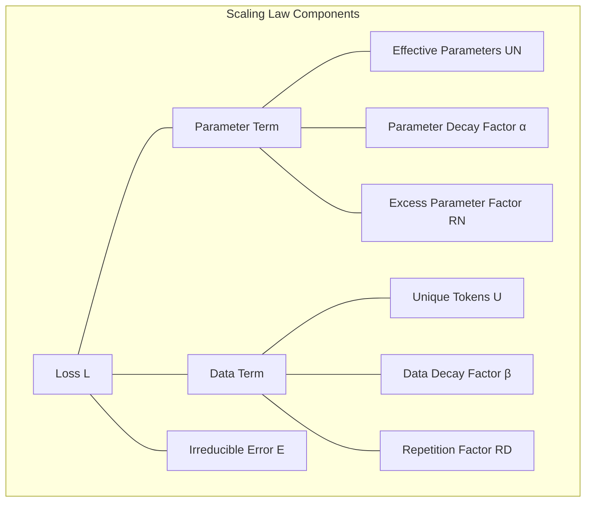
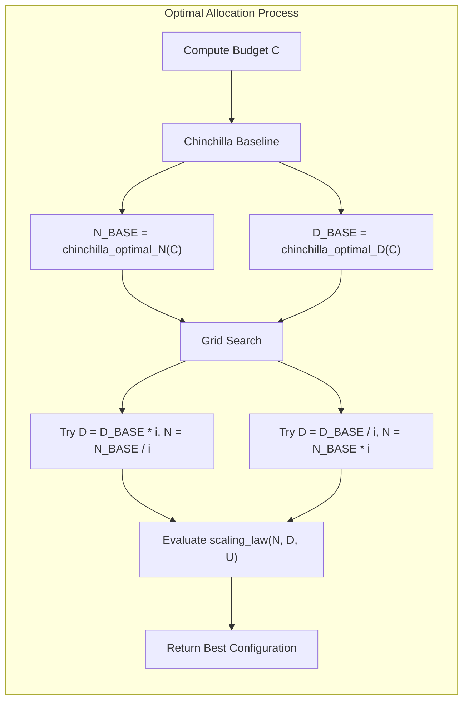
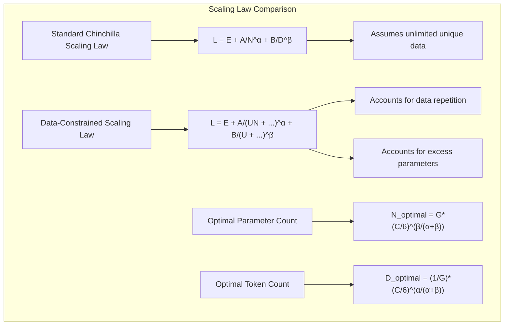
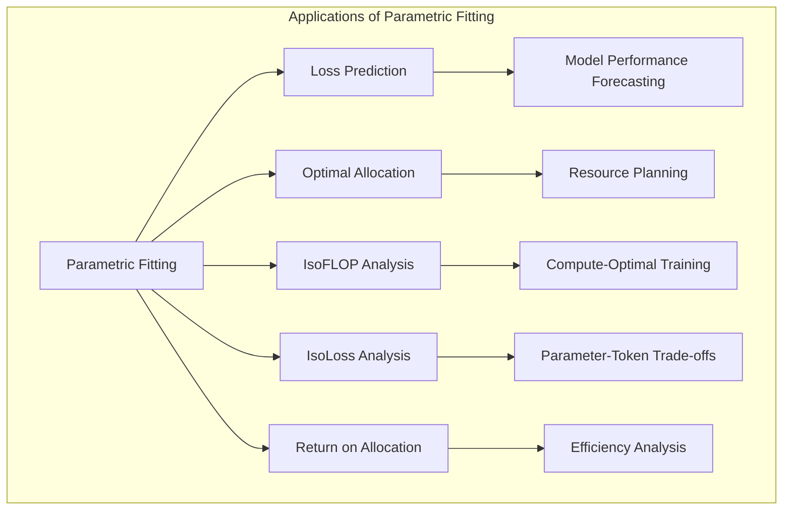
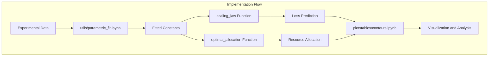

<!-- source: DeepWiki mcp.deepwiki.com · repo huggingface/datablations · page 5.1 Parametric Fitting · fetched 2026-10-26 -->

# Parametric Fitting

<details>
<summary>Relevant source files</summary>

The following files were used as context for generating this wiki page:

- [README.md](README.md)
- [plotstables/contours.ipynb](plotstables/contours.ipynb)
- [plotstables/isoloss_alphabeta_100m.pdf](plotstables/isoloss_alphabeta_100m.pdf)
- [plotstables/mup.pdf](plotstables/mup.pdf)
- [plotstables/mup_dd_dd.ipynb](plotstables/mup_dd_dd.ipynb)
- [plotstables/training_validation_filter.pdf](plotstables/training_validation_filter.pdf)
- [plotstables/validation_c4py.pdf](plotstables/validation_c4py.pdf)
- [utils/parametric_fit.ipynb](utils/parametric_fit.ipynb)

</details>


This document describes the parametric fitting process used in the datablations repository to derive scaling laws for language models trained in data-constrained regimes. Parametric fitting involves fitting mathematical formulas to experimental data to predict model performance based on parameters, training tokens, and unique tokens. For information about specific scaling laws such as Chinchilla, see [Chinchilla Scaling Laws](#5.2).

## Purpose

The parametric fitting methodology serves several critical purposes:

1. Deriving scaling laws that predict the performance (loss) of language models based on model size, dataset size, and data repetition
2. Computing optimal allocations of compute resources for model training given various constraints
3. Understanding the diminishing returns of increased model parameters and data repetition
4. Guiding decisions about model size and training data requirements

## Scaling Law Formula

The core of the parametric fitting approach is the scaling law formula that relates model loss to model parameters, training tokens, and unique tokens:

```python
def scaling_law(N, D, U):
    """
    N: number of parameters
    D: number of total training tokens
    U: number of unique training tokens
    """
    assert U <= D, "Cannot have more unique tokens than total tokens"

    RD = np.maximum((D / U) - 1, 0)    
    UN = np.minimum(N, D_to_N(U))
    RN = np.maximum((N / UN ) - 1, 0)

    L = E + A/(UN + UN*rn_star*(1-np.exp(-1*RN/rn_star)))**alpha + B / (U + U * rd_star * (1 - np.exp(-1*RD/(rd_star))))**beta
    return L
```

The formula can be written mathematically as:

$$L(N,D,U) = E + \frac{A}{(U_N + U_N \cdot R_N^* \cdot (1 - e^{(-1 \cdot R_N/(R_N^*))}))^\alpha} + \frac{B}{(U + U \cdot R_D^* \cdot (1 - e^{(-1 \cdot R_D/(R_D^*))}))^\beta}$$

Where:
- $N$ is the number of model parameters
- $D$ is the total number of training tokens
- $U$ is the number of unique training tokens
- $R_D = \max((D/U) - 1, 0)$ represents the repetition factor for data
- $U_N = \min(N, D_{to\_N}(U))$ represents the effective parameter count
- $R_N = \max((N/U_N) - 1, 0)$ represents the excess parameter factor
- $E$, $A$, $B$, $\alpha$, $\beta$, $R_D^*$, and $R_N^*$ are constants determined through fitting

Sources: [README.md:295-324](). [utils/parametric_fit.ipynb](). [plotstables/mup_dd_dd.ipynb:83-97]().

## Components and Constants

The scaling law formula has several key components that model different aspects of language model scaling:



The fitted constants for the scaling law are:

| Constant | Value | Description |
|----------|-------|-------------|
| a | 6.255414 | Log of parameter term coefficient A |
| b | 7.3049974 | Log of data term coefficient B |
| e | 0.6254804 | Log of irreducible error E |
| alpha | 0.3526596 | Parameter decay exponent |
| beta | 0.3526596 | Data decay exponent |
| rd_star | 15.387756 | Data repetition offset |
| rn_star | 5.309743 | Parameter excess offset |

These constants were determined by fitting the formula to experimental data from hundreds of language model training runs with varying parameter counts and data repetition.

Sources: [README.md:296-307](). [utils/parametric_fit.ipynb:96-97](). [plotstables/mup_dd_dd.ipynb:84]().

## Optimal Allocation

The scaling law can be used to compute the optimal allocation of parameters and tokens for a given compute budget and unique token budget:



The `optimal_allocation` function implements this search:

```python
def optimal_allocation(C, U_BASE):
    """Compute optimal number of parameters and tokens to train for given a compute & unique data budget"""
    N_BASE = chinchilla_optimal_N(C)
    D_BASE = chinchilla_optimal_D(C)
    min_l = float("inf")
    for i in np.linspace(1.0001, 3, 500):
        D =  D_BASE*i
        U = min(U_BASE, D)
        N = N_BASE/i
        new_l = scaling_law(N, D, U)
        if new_l < min_l:
            min_l, min_t, min_s = new_l, D, N
        D =  D_BASE/i
        U = min(U_BASE, D)
        N = N_BASE*i
        new_l = scaling_law(N, D, U)
        if new_l < min_l:
            min_l, min_t, min_s = new_l, D, N
    return min_l, min_t, min_s
```

This function takes a compute budget `C` and a unique token budget `U_BASE` and returns the optimal loss, token count, and parameter count.

Sources: [README.md:342-367](). [plotstables/mup_dd_dd.ipynb:56-76]().

## Comparison with Chinchilla Scaling Laws

The data-constrained scaling law differs from the standard Chinchilla scaling law by accounting for data repetition and excess parameters:



The standard Chinchilla scaling law is a special case of the data-constrained scaling law where $U = D$ (no repetition) and $U_N = N$ (no excess parameters).

Sources: [README.md:295-325](). [plotstables/mup_dd_dd.ipynb:74-76]().

## Parameter Fitting Process

The process of deriving the scaling law constants involves fitting the formula to experimental data:


The parameter fitting is performed in the `utils/parametric_fit.ipynb` notebook, which processes experimental data from hundreds of model training runs with varying parameter counts and data repetition levels.

Sources: [utils/parametric_fit.ipynb](). [README.md:369-370]().

## Applications

The parametric fitting methodology has several key applications:

1. **Loss Prediction**: Predicting the expected loss of a model given its parameter count, total training tokens, and unique training tokens.

2. **Optimal Allocation**: Computing the optimal allocation of compute resources (parameters vs. training tokens) given constraints on compute budget and unique data.

3. **IsoFLOP Analysis**: Analyzing the trade-offs between model size and training tokens at a fixed compute budget (IsoFLOP contours).

4. **IsoLoss Analysis**: Finding different configurations that achieve the same loss, to understand the relationship between parameters and tokens.

5. **Return on Allocation**: Analyzing the efficiency of different compute allocations to maximize return on investment.



Sources: [README.md:294-367](). [plotstables/contours.ipynb]().

## Code Structure and Implementation

The parametric fitting functionality is primarily implemented in the following files:

1. **utils/parametric_fit.ipynb**: Main notebook for fitting the scaling law to experimental data
2. **README.md**: Contains the scaling law and optimal allocation functions
3. **plotstables/mup_dd_dd.ipynb**: Contains implementations for comparing different scaling laws
4. **plotstables/contours.ipynb**: Code for generating contour plots to visualize scaling laws

The overall implementation flow is:



Sources: [utils/parametric_fit.ipynb](). [README.md:294-370](). [plotstables/mup_dd_dd.ipynb](). [plotstables/contours.ipynb]().

## Using the Scaling Law

Here's how to use the scaling law to predict loss and compute optimal allocations:

1. **Loss Prediction**:
```python
# Constants from fitting
a, b, e, alpha, beta, rd_star, rn_star = [6.255414, 7.3049974, 0.6254804, 0.3526596, 0.3526596, 15.387756, 5.309743]
A = np.exp(a)
B = np.exp(b)
E = np.exp(e)
G = ((alpha*A)/(beta*B))**(1/(alpha+beta))

# Predict loss for a specific configuration
loss = scaling_law(N=6.34e9, D=242e9, U=25e9)
```

2. **Optimal Allocation**:
```python
# Compute optimal configuration for a given compute budget and unique data budget
loss, tokens, params = optimal_allocation(C=10**22, U_BASE=25e9)
print(f"Optimal configuration: {tokens} tokens, {tokens/25e9} epochs, {params} parameters")
```

Sources: [README.md:297-367]().

## Conclusion

The parametric fitting methodology provides a powerful framework for understanding and predicting language model scaling behavior in data-constrained regimes. By accounting for data repetition and excess parameters, the derived scaling law offers more accurate predictions and better guidance for resource allocation than previous scaling laws that assume unlimited unique data.

The tools and techniques described in this document enable researchers and practitioners to make informed decisions about model size, training data requirements, and compute allocation for training large language models.

Sources: [README.md:293-370](). [utils/parametric_fit.ipynb](). [plotstables/mup_dd_dd.ipynb](). [plotstables/contours.ipynb]().

---

