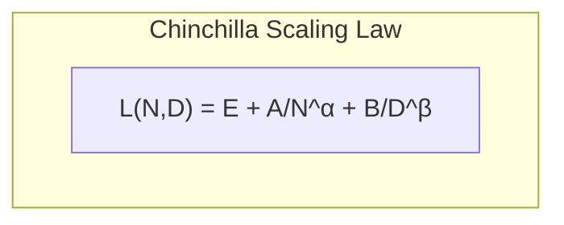
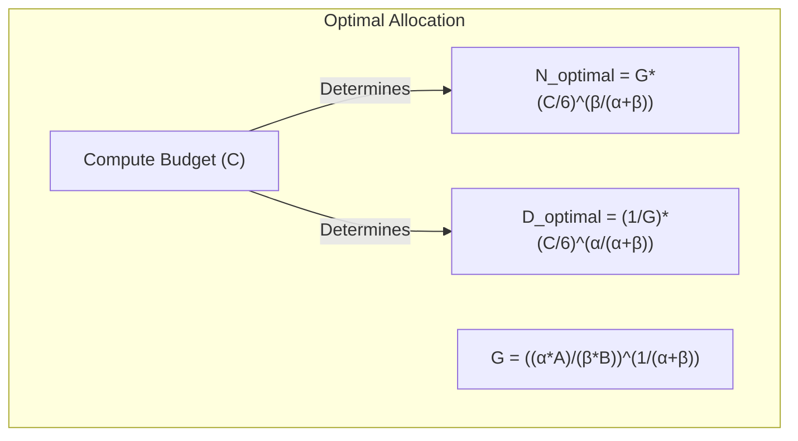
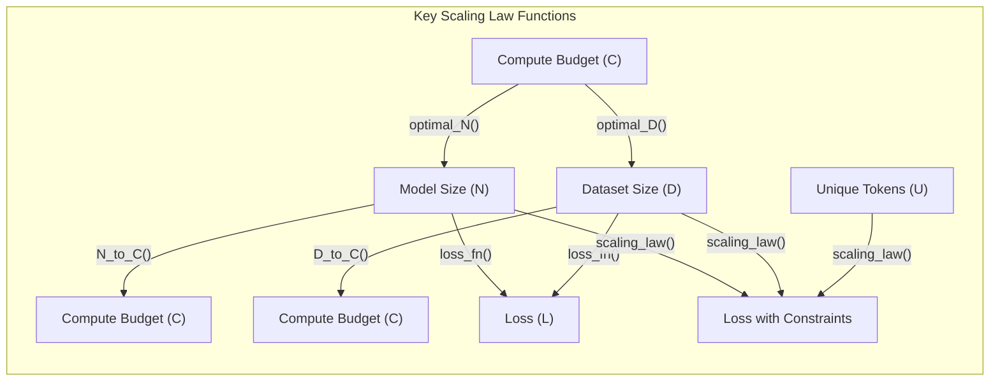
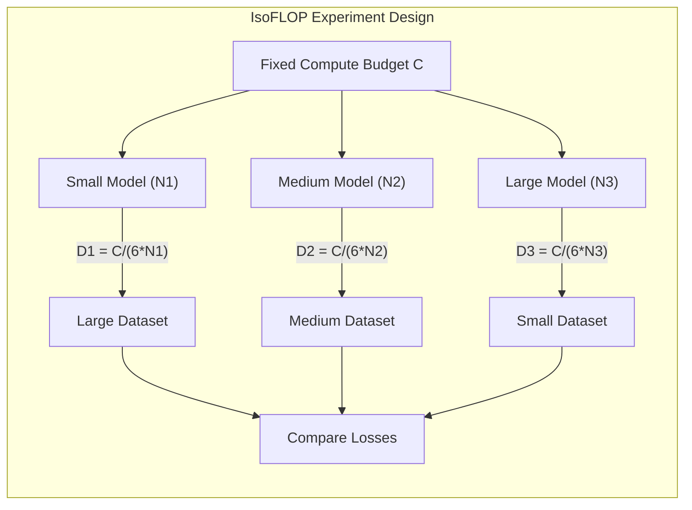
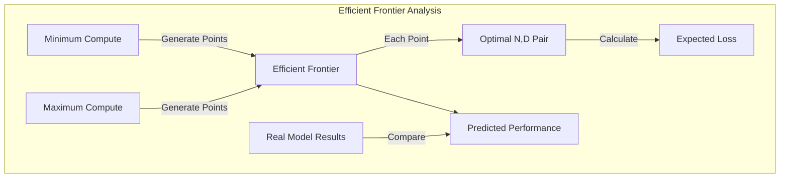
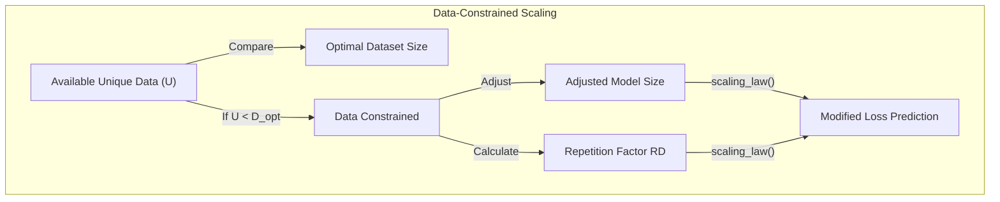
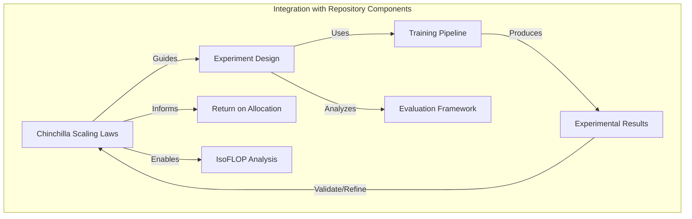

<!-- source: DeepWiki mcp.deepwiki.com · repo huggingface/datablations · page 5.2 Chinchilla Scaling Laws · fetched 2026-10-26 -->

# Chinchilla Scaling Laws

<details>
<summary>Relevant source files</summary>

The following files were used as context for generating this wiki page:

- [plotstables/galactica.ipynb](plotstables/galactica.ipynb)
- [plotstables/galactica.pdf](plotstables/galactica.pdf)
- [plotstables/old_plots/chinchilla_isoflops.png](plotstables/old_plots/chinchilla_isoflops.png)
- [plotstables/old_plots/compute.pdf](plotstables/old_plots/compute.pdf)
- [plotstables/old_plots/curve.png](plotstables/old_plots/curve.png)
- [plotstables/repetition.ipynb](plotstables/repetition.ipynb)
- [plotstables/return_alloc.ipynb](plotstables/return_alloc.ipynb)
- [plotstables/return_alloc.pdf](plotstables/return_alloc.pdf)

</details>


## Purpose and Scope

This document explains the Chinchilla scaling laws implemented in the datablations repository and how they guide optimal allocation of computational resources between model size and dataset size. Chinchilla scaling laws provide a mathematical framework for determining the most efficient way to train language models given a fixed compute budget. For information about applying these laws in specific experimental settings, see [IsoFLOP Analysis](#5.4) and [Return on Allocation](#5.3).

## Background

Chinchilla scaling laws, introduced by DeepMind in their "Training Compute-Optimal Large Language Models" paper, represent a significant improvement over previous scaling approaches. The key insight is that many earlier large language models were significantly undertrained, and performance could be improved by using smaller models trained on more data rather than larger models trained on less data.

Sources: [plotstables/return_alloc.ipynb:25-35](), [plotstables/galactica.ipynb:25-77]()

## Mathematical Framework

The core scaling law is represented by the following equation:



Where:
- L is the validation loss
- N is the model size (number of parameters)
- D is the dataset size (tokens)
- E is the irreducible loss (asymptotic performance)
- A and B are constants
- α and β are power-law exponents determining how quickly loss decreases with model size and data size

In the datablations implementation, the parameter values are:

| Parameter | Value |
|-----------|-------|
| a (log A) | 6.255414 |
| b (log B) | 7.3049974 |
| e (log E) | 0.6254804 |
| α (alpha) | 0.3526596 |
| β (beta)  | 0.3526596 |

Sources: [plotstables/galactica.ipynb:27-62]()

### Optimal Allocation Formulas

The optimal model size (N) and dataset size (D) for a given compute budget C are calculated using:



These formulas derive from the constraint that training compute is approximately 6ND (6 times the product of model size and dataset size).

Sources: [plotstables/galactica.ipynb:36-54](), [plotstables/return_alloc.ipynb:36-54]()

## Extended Scaling Law for Data Constraints

When working with data-constrained environments, the repository implements an extended version of the scaling law:

```
L(N,D,U) = E + A/(UN + UN*rn_star*(1-exp(-1*RN/rn_star)))^α + B/(U + U*rd_star*(1-exp(-1*RD/rd_star)))^β
```

Where:
- U is the unique token count
- RD is the data repetition factor: max((D/U) - 1, 0)
- UN is the minimum of N and the optimal N for the compute budget required to train on U tokens
- RN is the excess parameter factor: max((N/UN) - 1, 0)
- rd_star and rn_star are additional parameters controlling how quickly repeated data and excess parameters lose utility

Sources: [plotstables/galactica.ipynb:61-75]()

## Implementation in Code

The core functions implementing these scaling laws in the repository are:

1. `optimal_N(C)` - Calculates optimal model size for a given compute budget
2. `optimal_D(C)` - Calculates optimal dataset size for a given compute budget
3. `N_to_C(N)` - Converts model size to the implied compute budget
4. `D_to_C(D)` - Converts dataset size to the implied compute budget
5. `loss_fn(N, D)` - Calculates the expected loss for a given model size and dataset size
6. `scaling_law(N, D, U, params)` - The extended scaling law that accounts for data constraints



Sources: [plotstables/galactica.ipynb:36-75](), [plotstables/return_alloc.ipynb:36-76]()

## Application in Experiment Design

The repository uses Chinchilla scaling laws to design and analyze experiments in several ways:

### 1. IsoFLOP Experiments

IsoFLOP experiments maintain a constant compute budget while varying the allocation between model size and dataset size. This allows for empirical verification of the optimal allocation predicted by the scaling laws.



Sources: [plotstables/galactica.ipynb:112-116](), [plotstables/return_alloc.ipynb:112-132]()

### 2. Efficient Frontier Analysis

The code also enables visualization of the "efficient frontier" - the optimal combinations of model size and dataset size across different compute budgets:



The repository generates these frontiers using the optimal allocation formulas and compares actual model performance against the theoretical predictions.

Sources: [plotstables/return_alloc.ipynb:126-135](), [plotstables/galactica.ipynb:132-144]()

## Data Constraints and Performance

A key contribution of the datablations framework is extending the scaling laws to account for data constraints, particularly when:

1. The available unique data (U) is less than the optimal dataset size (D)
2. Data repetition is necessary to reach the targeted dataset size



The extended scaling law models how repeated data becomes less valuable, shifting the optimal allocation toward smaller models when unique data is limited.

Sources: [plotstables/galactica.ipynb:61-75](), [plotstables/return_alloc.ipynb:149-193]()

## Practical Examples

The notebook includes analysis of numerous models with different parameter and dataset size combinations. These real-world examples help validate the scaling laws and their predictions. 

For example, the analysis of Galactica models (30B and 120B parameter versions) demonstrates how these models compare to the theoretical efficient frontier, showing both the power and limitations of the scaling law predictions.

Sources: [plotstables/galactica.ipynb:256-293](), [plotstables/return_alloc.ipynb:41-450]()

## Relationship to Other Repository Components

The Chinchilla scaling laws provide the theoretical foundation for many experiments in the datablations repository:



The scaling laws inform experimental design choices like model size, dataset size, and training duration, while experimental results feed back to validate and refine the scaling law parameters.

Sources: [plotstables/return_alloc.ipynb:36-54](), [plotstables/galactica.ipynb:25-77]()

## Conclusion

The Chinchilla scaling laws implemented in the datablations repository provide a powerful framework for understanding the relationship between model size, dataset size, and model performance. By extending these laws to account for data constraints, the repository enables more accurate predictions in scenarios where unlimited high-quality data is not available, which is crucial for practical language model training.

---

