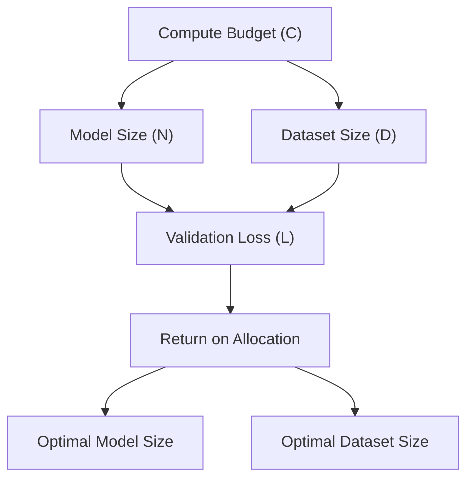
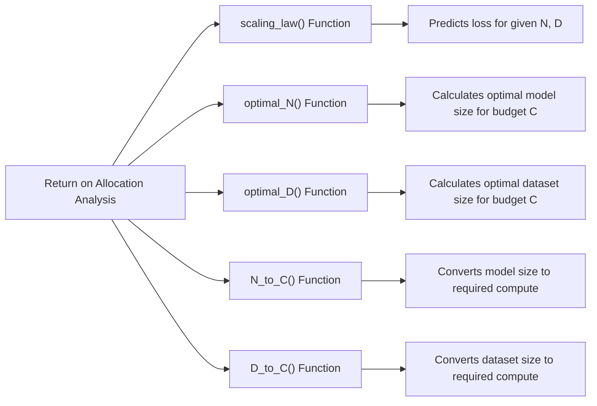
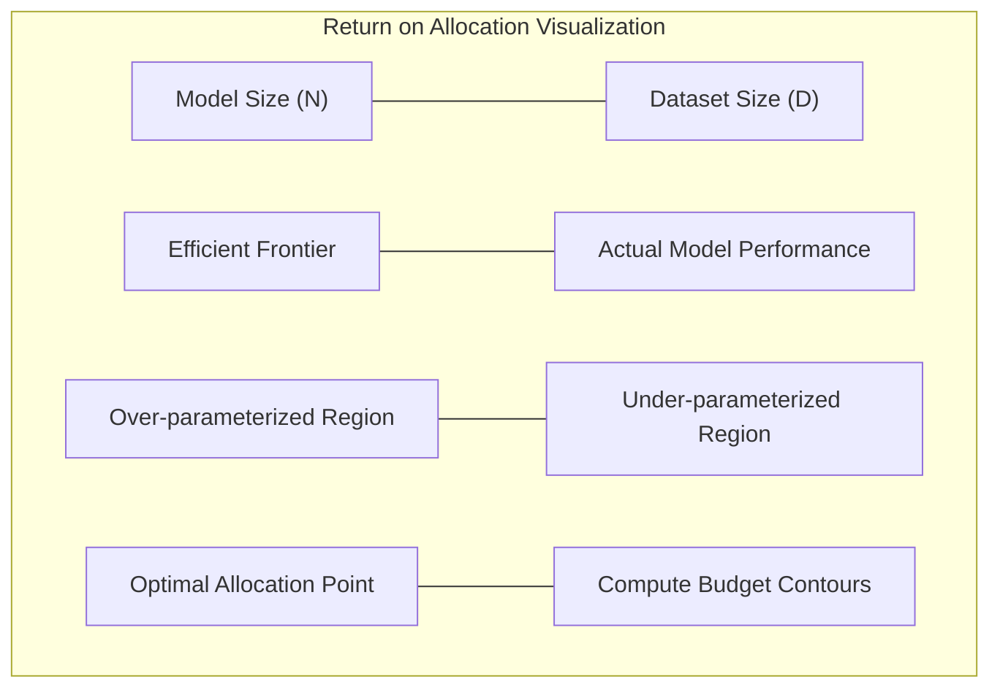
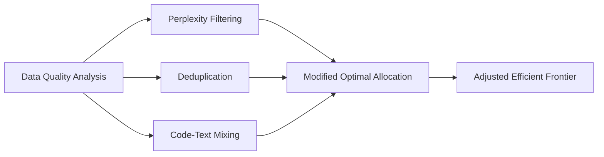
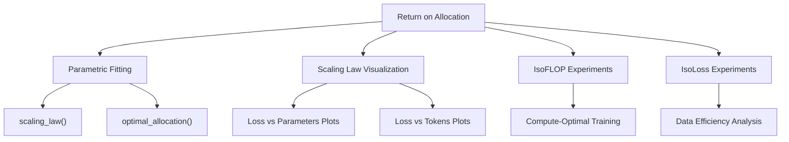

<!-- source: DeepWiki mcp.deepwiki.com · repo huggingface/datablations · page 5.3 Return on Allocation · fetched 2026-10-26 -->

# Return on Allocation

<details>
<summary>Relevant source files</summary>

The following files were used as context for generating this wiki page:

- [LICENSE.md](LICENSE.md)
- [plotstables/beyond.ipynb](plotstables/beyond.ipynb)
- [plotstables/cartoon.pdf](plotstables/cartoon.pdf)
- [plotstables/cartoon.pptx](plotstables/cartoon.pptx)
- [plotstables/galactica.ipynb](plotstables/galactica.ipynb)
- [plotstables/galactica.pdf](plotstables/galactica.pdf)
- [plotstables/old_notebooks/fits_old.ipynb](plotstables/old_notebooks/fits_old.ipynb)
- [plotstables/old_notebooks/parametric_fit_old.ipynb](plotstables/old_notebooks/parametric_fit_old.ipynb)
- [plotstables/repetition.ipynb](plotstables/repetition.ipynb)
- [plotstables/return.ipynb](plotstables/return.ipynb)
- [plotstables/return_alloc.ipynb](plotstables/return_alloc.ipynb)
- [plotstables/return_alloc.pdf](plotstables/return_alloc.pdf)
- [plotstables/return_alloc.png](plotstables/return_alloc.png)

</details>


Return on Allocation (ROA) is a framework for determining the optimal distribution of computational resources when training large language models. This page explains how to calculate and visualize the optimal allocation of parameters and training data to achieve the best model performance for a given compute budget.

For information about specific scaling laws used in these calculations, see [Chinchilla Scaling Laws](#5.2). For details on how these principles are applied in IsoFLOP experiments, see [IsoFLOP Analysis](#5.4).

## Understanding Return on Allocation

Return on Allocation analyzes the relationship between three critical factors in language model training:

1. Model size (number of parameters, N)
2. Dataset size (number of tokens, D)
3. Compute budget (C)

The goal is to determine how to optimally allocate a fixed compute budget between model size and dataset size to achieve the lowest possible validation loss.



Sources: plotstables/return_alloc.ipynb, plotstables/return_alloc.pdf

## Theoretical Framework

The framework is based on the empirical observation that language model performance follows predictable scaling laws. For a given compute budget C, there exists an optimal model size N and dataset size D that will minimize the validation loss.

### Key Equations

The relationship between model size, dataset size, and validation loss is captured by the following equation:

```
L = E + A/N^α + B/D^β
```

Where:
- L is the validation loss
- E, A, B are constants
- α, β are power-law exponents
- N is the model size (parameters)
- D is the dataset size (tokens)

The optimal allocation of compute can be calculated using:

```
N_optimal = G*(C/6)^(β/(α+β))
D_optimal = (1/G)*(C/6)^(α/(α+β))
```

Where G is a constant derived from A, B, α, and β:

```
G = ((α*A)/(β*B))^(1/(α+β))
```

Sources: plotstables/return_alloc.ipynb, plotstables/galactica.ipynb

## Implementation in Datablations

The Datablations repository provides tools for calculating and visualizing return on allocation through several key functions:



### Key Functions

The return on allocation calculations are implemented in the `return_alloc.ipynb` notebook with the following key functions:

1. `optimal_N(C)`: Calculates the optimal model size for a given compute budget C
2. `optimal_D(C)`: Calculates the optimal dataset size for a given compute budget C
3. `N_to_C(N)`: Converts a model size to the required compute budget
4. `D_to_C(D)`: Converts a dataset size to the required compute budget
5. `loss_fn(N, D)`: Predicts the validation loss for a given model size N and dataset size D

Sources: plotstables/return_alloc.ipynb, plotstables/galactica.ipynb

## Visualization and Analysis

The repository includes tools for visualizing return on allocation through various plots:

### IsoFLOP Contours

These visualizations show the relationship between model size and dataset size while keeping the compute budget constant. They help identify the optimal combination of parameters and tokens for a given compute budget.

### Return on Allocation Plot

This is a key visualization that shows:
- The efficient frontier (optimal allocations)
- The actual performance of models with different parameter and dataset sizes
- The trade-offs between over-parameterizing and under-parameterizing models



Sources: plotstables/return_alloc.png, plotstables/return_alloc.pdf

## Practical Applications

Return on Allocation provides practical guidance for:

1. **Resource Planning**: Determining how much data to collect and how large a model to train given a compute budget
2. **Experiment Design**: Planning IsoFLOP and IsoLoss experiments to test scaling law predictions
3. **Cost Optimization**: Minimizing computational resources while maximizing model performance
4. **Scaling Insights**: Understanding diminishing returns and identifying when to add more parameters vs. more data

### Example Use Case

When planning a new language model training run:

1. Estimate your available compute budget C
2. Calculate optimal model size using `optimal_N(C)`
3. Calculate optimal dataset size using `optimal_D(C)`
4. Verify that these allocations align with your hardware constraints
5. Train the model and compare actual performance to predictions

Sources: plotstables/return_alloc.ipynb, plotstables/galactica.ipynb

## Special Considerations for Data Quality

The basic Return on Allocation framework assumes all data tokens are of equal value. However, the repository also analyzes how data quality affects optimal allocation through:

1. **Repetition Effects**: How token repetition reduces the effective dataset size
2. **Data Filtering**: How high-quality data can shift the optimal allocation point
3. **Code Augmentation**: How mixing different data types affects the optimal allocation



Sources: plotstables/repetition.ipynb, plotstables/beyond.ipynb

## Relationship to Other Systems

Return on Allocation connects several key components in the Datablations repository:



The Return on Allocation framework serves as a bridge between theoretical scaling laws and practical training decisions, helping researchers design more efficient large language model training regimes.

Sources: plotstables/return_alloc.ipynb, plotstables/galactica.ipynb, plotstables/return_alloc.pdf

---

