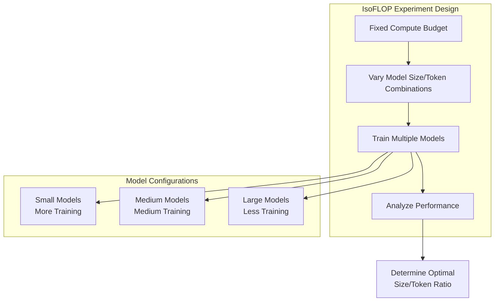
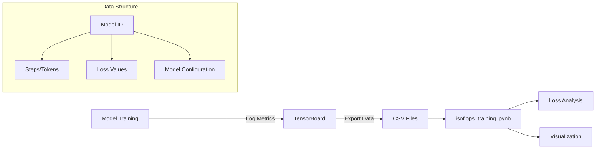
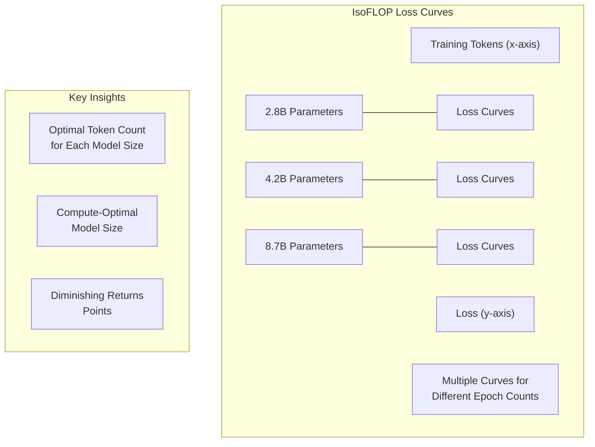
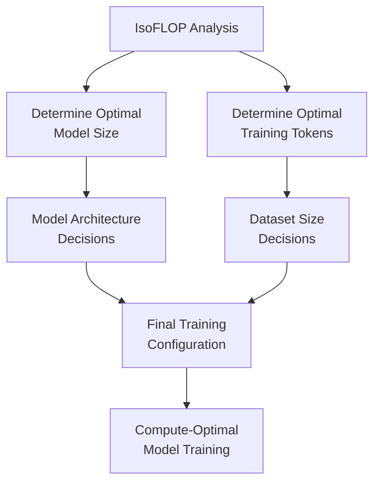
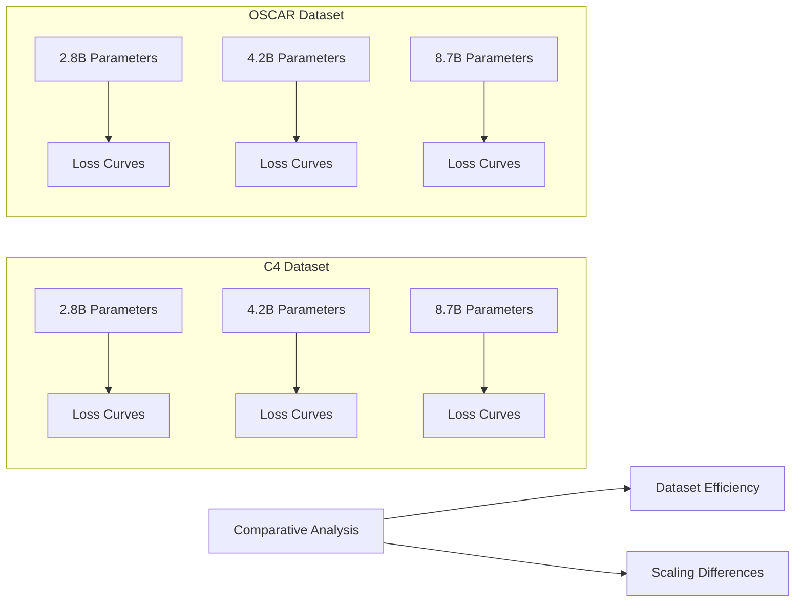

<!-- source: DeepWiki mcp.deepwiki.com · repo huggingface/datablations · page 5.4 IsoFLOP Analysis · fetched 2026-10-26 -->

# IsoFLOP Analysis

<details>
<summary>Relevant source files</summary>

The following files were used as context for generating this wiki page:

- [plotstables/isoflops_training.ipynb](plotstables/isoflops_training.ipynb)
- [plotstables/old_plots/isoflops.pdf](plotstables/old_plots/isoflops.pdf)
- [plotstables/old_plots/isoflops_single_prompt.pdf](plotstables/old_plots/isoflops_single_prompt.pdf)
- [plotstables/old_plots/loss_vs_days_chinchilla.png](plotstables/old_plots/loss_vs_days_chinchilla.png)
- [plotstables/validation_oscar.pdf](plotstables/validation_oscar.pdf)

</details>


IsoFLOP analysis is a methodology for studying the relationship between model size, dataset size, and training performance under a fixed compute budget. The term "IsoFLOP" means "equal FLOPs" (Floating Point Operations), indicating that these experiments hold the total computational resources constant while varying other training parameters. This page provides a comprehensive guide to understanding, conducting, and analyzing IsoFLOP experiments within the datablations framework.

For information about related analyses with different constraints, see [IsoLoss Analysis](#5.5) which examines experiments holding loss constant rather than compute.

## Purpose and Scope

IsoFLOP analysis serves several critical purposes:

1. Determining the optimal allocation of compute resources between model size and training tokens
2. Validating scaling laws like Chinchilla's compute-optimal training
3. Investigating the trade-offs between larger models with less training and smaller models with more training
4. Guiding practical decisions about model architecture and training dataset size when operating under fixed compute constraints

Sources: [plotstables/isoflops_training.ipynb:1-40]()

## Theoretical Background

IsoFLOP experiments are grounded in the theoretical framework of neural scaling laws, which describe how model performance relates to model size, dataset size, and compute budget. The key relationship can be expressed as:

```
L = E + A/N^α + B/D^β
```

Where:
- L: Validation loss
- E: Irreducible loss (asymptotic performance)
- N: Model size (parameters)
- D: Dataset size (tokens)
- α, β: Scaling exponents
- A, B: Constants

Under a fixed compute budget C, the optimal allocation of parameters (N) and training tokens (D) follows:

```
N_optimal = G*(C/6)^(β/(α+β))
D_optimal = (1/G)*(C/6)^(α/(α+β))
```

Where G is a constant depending on model architecture and dataset properties.

### IsoFLOP Experiment Design



Sources: [plotstables/isoflops_training.ipynb:40-260]()

## IsoFLOP Experiments in Datablations

In the datablations framework, IsoFLOP experiments are implemented by training models of different sizes (parameters) on varying amounts of training data (tokens), while ensuring that the total computation remains approximately constant.

### Experimental Setup

The repository includes experiments with three main model sizes, each trained with various token counts:

| Model Size | Parameter Count | Training Token Range | Dataset |
|------------|-----------------|----------------------|---------|
| Small      | 2.8B parameters | Up to 55B tokens     | C4/OSCAR |
| Medium     | 4.2B parameters | Up to 84B tokens     | C4/OSCAR |
| Large      | 8.7B parameters | Up to 178B tokens    | C4/OSCAR |

For each model size, multiple training runs are conducted with different epoch counts, resulting in varying total training tokens. The training configurations are named using a pattern that indicates the model size and epoch count (e.g., "8b7178b4b" represents the 8.7B parameter model trained for 4 epochs).

Sources: [plotstables/isoflops_training.ipynb:273-307](), [plotstables/isoflops_training.ipynb:460-464]()

## Data Collection and Analysis

### Data Sources

IsoFLOP experiments record training and validation loss metrics in TensorBoard. These metrics are then exported and analyzed in the `isoflops_training.ipynb` notebook.



The analysis notebook handles several data sources:
- TensorBoard logs exported to CSV files
- Configuration mappings that relate model IDs to their parameters
- Token count and loss metrics for each training run

Sources: [plotstables/isoflops_training.ipynb:78-263]()

### Analysis Methodology

The `isoflops_training.ipynb` notebook performs the following analysis steps:

1. Load and preprocess training/validation loss data for each model configuration
2. Map model IDs to their corresponding parameters (e.g., epochs, model size)
3. Apply smoothing to the loss curves if necessary
4. Generate visualizations comparing models of similar size trained for different numbers of tokens
5. Identify the optimal allocation of model size and training tokens

The analysis focuses on determining which combination of model size and training tokens yields the lowest validation loss under the fixed compute constraint.

Sources: [plotstables/isoflops_training.ipynb:264-515]()

## Visualizing IsoFLOP Results

The primary visualization from IsoFLOP experiments plots the validation (or training) loss against the number of training tokens for different model sizes:



These visualizations show:
1. How loss decreases with more training tokens for each model size
2. The diminishing returns of additional training for each model size
3. Which model size achieves the lowest loss under the compute constraint

Sources: [plotstables/isoflops_training.ipynb:400-515](), [plotstables/validation_oscar.pdf]()

### Interpretation

The key patterns to look for in IsoFLOP visualizations:

- **Fastest initial loss reduction**: Typically seen in larger models, which learn more efficiently per token in early training
- **Lowest final loss**: Indicates which model size is optimal for the given compute budget
- **Diminishing returns**: The point at which additional training yields minimal improvements
- **Crossover points**: Where a smaller model with more training outperforms a larger model with less training

By comparing these curves across different model sizes, researchers can determine the optimal allocation of parameters and training tokens for a given compute budget.

## Practical Applications

### Compute-Optimal Training

IsoFLOP analysis directly informs compute-optimal training strategies by helping to determine:

1. The optimal model size for a given compute budget
2. How many tokens to train on for that model size
3. Whether to allocate more compute to model size or training tokens



### Connection to Scaling Laws

IsoFLOP experiments help validate and refine scaling laws by:

- Confirming whether the predicted optimal allocations match empirical results
- Identifying deviations from theoretical predictions that may indicate model or dataset-specific factors
- Refining the scaling exponents (α and β) for specific model families and datasets

Sources: [plotstables/isoflops_training.ipynb:1-40]()

## Running Your Own IsoFLOP Analysis

To conduct IsoFLOP analysis using the datablations framework:

1. **Setup model configurations** with different parameter counts
2. **Calculate token limits** for each model to maintain constant compute
3. **Train models** using the Megatron-DeepSpeed setup
4. **Log metrics** to TensorBoard during training
5. **Export data** to CSV files
6. **Analyze results** using the `isoflops_training.ipynb` notebook

The notebook can be customized to analyze different model sizes, datasets, or metrics as needed for your specific research questions.

Sources: [plotstables/isoflops_training.ipynb:51-76]()

## Example: C4 vs. OSCAR Dataset Comparison

One application of IsoFLOP analysis in the datablations framework is comparing model performance across different datasets. The repository includes experiments training models on both C4 and OSCAR datasets, allowing researchers to compare the scaling properties of each dataset.



The analysis of these experiments can reveal:
- Which dataset leads to more efficient training
- How dataset quality affects the optimal model size/token allocation
- Whether the same scaling laws apply equally to different datasets

Sources: [plotstables/isoflops_training.ipynb:439-515](), [plotstables/validation_oscar.pdf]()

## Conclusion

IsoFLOP analysis is a powerful methodology for understanding the relationship between model size, dataset size, and training performance under fixed compute constraints. By systematically exploring different allocations of compute resources, researchers can identify optimal training configurations and validate theoretical scaling laws.

In the datablations framework, IsoFLOP experiments are implemented through a combination of model training scripts and analysis notebooks, providing a comprehensive toolkit for exploring compute-optimal training strategies.

---

