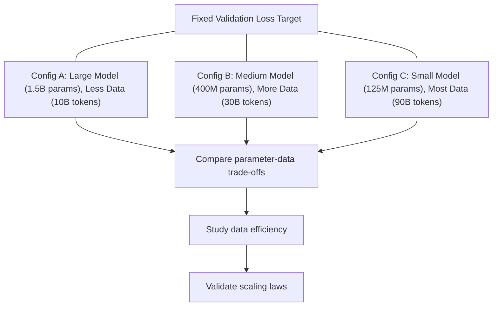
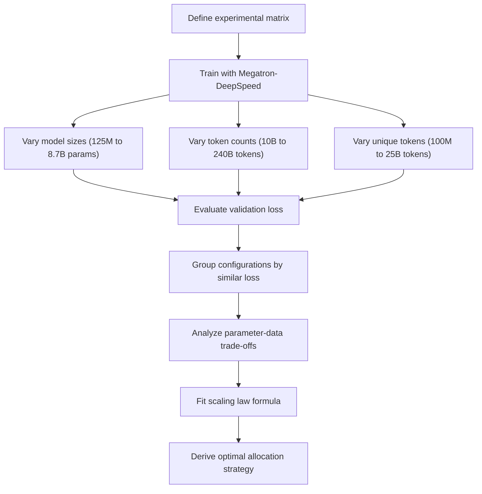
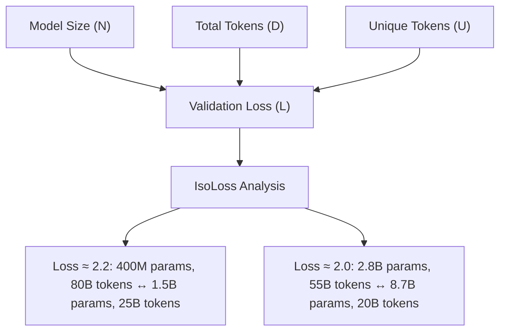

<!-- source: DeepWiki mcp.deepwiki.com · repo huggingface/datablations · page 5.5 IsoLoss Analysis · fetched 2026-10-26 -->

# IsoLoss Analysis

<details>
<summary>Relevant source files</summary>

The following files were used as context for generating this wiki page:

- [README.md](README.md)
- [plotstables/isoloss_100m.pdf](plotstables/isoloss_100m.pdf)
- [plotstables/isoloss_400m1b5.pdf](plotstables/isoloss_400m1b5.pdf)
- [plotstables/perplexity_histogram.pdf](plotstables/perplexity_histogram.pdf)
- [plotstables/training_validation_filter.pdf](plotstables/training_validation_filter.pdf)
- [plotstables/validation_c4py.pdf](plotstables/validation_c4py.pdf)

</details>


This page explains IsoLoss experiments and their role in studying data efficiency for language models. IsoLoss experiments focus on identifying different model and dataset configurations that achieve the same validation loss, allowing researchers to analyze the trade-offs between model size, dataset size, and data repetition. For related analysis on fixed compute budgets, see [IsoFLOP Analysis](#5.4).

## What are IsoLoss Experiments?

IsoLoss experiments identify configurations that achieve equivalent performance (measured by validation loss) while varying key parameters:
- Model size (number of parameters)
- Dataset size (total tokens processed during training)
- Unique tokens in the dataset
- Repetition factor/epochs (total tokens divided by unique tokens)

By finding different ways to achieve the same validation loss, we can study the efficiency trade-offs between model size and data usage, particularly in data-constrained environments where unique data is limited.



**IsoLoss Concept: Different configurations achieving the same validation loss**

Sources:
- README.md
- plotstables/isoloss_400m1b5.pdf

## Experimental Methodology

The methodology for conducting IsoLoss experiments involves:



**IsoLoss Experimental Workflow**

1. **Training multiple model configurations**: Using Megatron-DeepSpeed to train language models across a wide range of hyperparameters
2. **Measuring validation loss**: Evaluating each configuration on consistent validation sets
3. **Identifying configurations with equal loss**: Grouping models with approximately the same validation loss
4. **Analyzing parameter-data trade-offs**: Studying how different resource allocations can achieve the same performance

Sources:
- README.md

## Key Findings

IsoLoss experiments revealed several important insights:

1. **Multiple Equivalent Configurations**: For a given performance level, various combinations of model size and data amount can achieve equivalent results.

2. **Parameter-Data Trade-offs**: There's a consistent relationship between model size and data requirements. For example, configurations with 400M parameters and 80B tokens achieved similar loss to configurations with 1.5B parameters and 25B tokens.

3. **Diminishing Returns**: Both increasing model size and increasing data repetition show patterns of diminishing returns, captured in the scaling law formula.

4. **Data Efficiency Analysis**: In data-constrained regimes (limited unique tokens), optimal allocation shifts toward using larger models with more repetition of the available data.



**Relationship between parameters, tokens, and validation loss in IsoLoss analysis**

Sources:
- plotstables/isoloss_400m1b5.pdf
- README.md

## Scaling Law Formula

The IsoLoss experiments contributed to the development of a scaling law formula that accounts for data constraints:

```
L(N, D, U) = E + A/(UN + UN*rn_star*(1-exp(-1*RN/rn_star)))^alpha + B/(U + U*rd_star*(1-exp(-1*RD/(rd_star))))^beta
```

Where:
- N: number of parameters
- D: number of total training tokens
- U: number of unique training tokens
- RD: repetition factor for data = (D/U) - 1
- RN: repetition factor for parameters = (N/UN) - 1
- E, A, B, alpha, beta, rd_star, rn_star: fitted parameters

This formula predicts validation loss given model size, total tokens, and unique tokens, enabling optimized resource allocation.

| Parameter | Value |
|-----------|-------|
| E (exponential) | 0.6254804 |
| A (exponential) | 6.255414 |
| B (exponential) | 7.3049974 |
| alpha | 0.3526596 |
| beta | 0.3526596 |
| rd_star | 15.387756 |
| rn_star | 5.309743 |

Sources:
- README.md (lines 294-324)

## Experimental Data and Visualization

The repository includes IsoLoss experiment data and visualizations:

1. **Figure 8**: The `isoloss_400m1b5.pdf` shows IsoLoss curves for models sized 400M-1.5B parameters, demonstrating the trade-offs between model size and data amount.

2. **Figure 12**: The `isoloss_alphabeta_100m.pdf` visualizes how the alpha and beta parameters in the scaling law interact for models trained with 100M unique tokens.

3. **Model checkpoints**: IsoLoss experiments and related data are available in the `datablations/lm1-misc` repository.

Example usages of the scaling law formula:

```python
def scaling_law(N, D, U):
    """
    N: number of parameters
    D: number of total training tokens
    U: number of unique training tokens
    """
    assert U <= D, "Cannot have more unique tokens than total tokens"

    RD = np.maximum((D / U) - 1, 0)    
    UN = np.minimum(N, D_to_N(U))
    RN = np.maximum((N / UN ) - 1, 0)

    L = E + A/(UN + UN*rn_star*(1-np.exp(-1*RN/rn_star)))**alpha + B / (U + U * rd_star * (1 - np.exp(-1*RD/(rd_star))))**beta
    return L
```

Sources:
- README.md (lines 294-324, 407-411)
- plotstables/isoloss_400m1b5.pdf

## Applications

The insights from IsoLoss analysis have several practical applications:

1. **Resource Allocation**: Determining whether to invest in larger models or more training data to achieve desired performance.

2. **Data Collection Strategy**: Quantifying the value of additional unique data versus repeating existing data.

3. **Training Efficiency**: Identifying the most resource-effective configurations for a target performance level.

4. **Optimal Compute Usage**: Guiding decisions on how to allocate compute budgets across model size and training duration.

The optimal resource allocation can be computed using the formula:

```python
def optimal_allocation(C, U_BASE):
    """Compute optimal number of parameters and tokens to train for given a compute & unique data budget"""
    N_BASE = chinchilla_optimal_N(C)
    D_BASE = chinchilla_optimal_D(C)
    min_l = float("inf")
    for i in np.linspace(1.0001, 3, 500):
        D = D_BASE*i
        U = min(U_BASE, D)
        N = N_BASE/i
        new_l = scaling_law(N, D, U)
        if new_l < min_l:
            min_l, min_t, min_s = new_l, D, N
        D = D_BASE/i
        U = min(U_BASE, D)
        N = N_BASE*i
        new_l = scaling_law(N, D, U)
        if new_l < min_l:
            min_l, min_t, min_s = new_l, D, N
    return min_l, min_t, min_s
```

Sources:
- README.md (lines 335-367)

## Related Analyses

- For experiments with fixed compute budgets, see [IsoFLOP Analysis](#5.4)
- For techniques to improve performance with limited data, see [Data Ablation Techniques](#2.3)
- For optimal resource allocation strategies, see [Return on Allocation](#5.3)
- For parametric fitting methodology, see [Parametric Fitting](#5.1)

---

