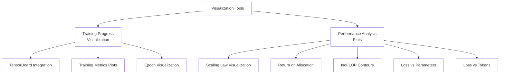
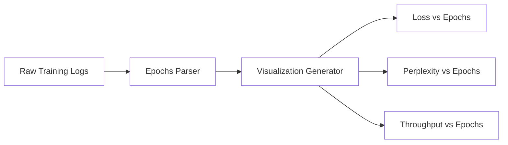
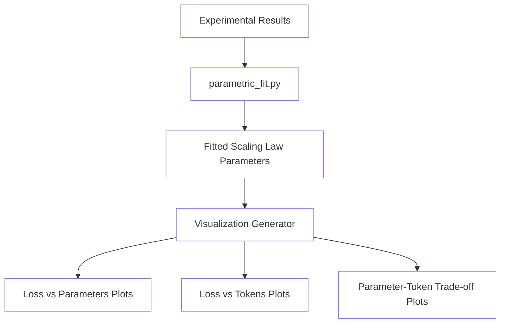
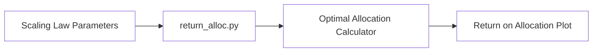
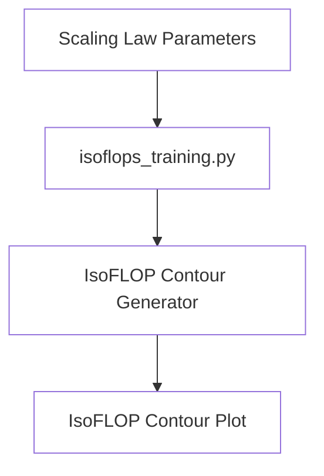
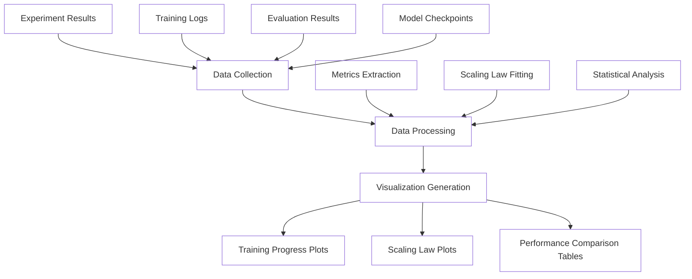
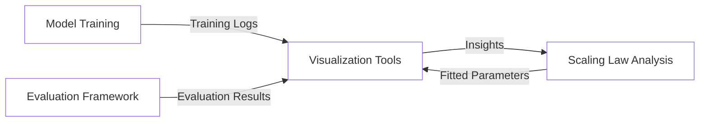

<!-- source: DeepWiki mcp.deepwiki.com · repo huggingface/datablations · page 6 Visualization Tools · fetched 2026-10-26 -->

# Visualization Tools

Relevant source files

The following files were used as context for generating this wiki page:

- [LICENSE.md](LICENSE.md)
- [plotstables/beyond.ipynb](plotstables/beyond.ipynb)
- [plotstables/old_plots/epochs.drawio](plotstables/old_plots/epochs.drawio)
- [plotstables/old_plots/epochs.pdf](plotstables/old_plots/epochs.pdf)
- [plotstables/return_alloc.png](plotstables/return_alloc.png)

This document provides an overview of the visualization tools available in the datablations repository for analyzing and interpreting experimental results. These tools allow researchers to visualize training progress, scaling behavior, and performance analysis of language models trained under various data ablation conditions. For information about the specific scaling law analysis methodologies, see [Scaling Laws and Analysis](#5).

## Overview of Visualization Components

The datablations framework includes several visualization components designed to help researchers understand experimental outcomes and derive insights from training data. These visualizations fall into two main categories: training progress visualizations and performance analysis plots.

Sources: System Overview Diagrams

## Training Progress Visualization

The training progress visualization tools allow monitoring of model training in real-time and retrospectively. They provide insights into metrics such as training loss, validation loss, and learning rate changes over time.

### TensorBoard Integration

The framework integrates with TensorBoard for real-time visualization of training metrics. TensorBoard dashboards provide interactive visualizations of:

- Training and validation loss curves
- Learning rate schedules
- Gradient statistics
- Memory usage
- Throughput metrics (tokens/sec)

### Epoch Visualization

Epoch visualization tools help researchers understand how model performance changes over training epochs. These visualizations can be particularly important for understanding training dynamics, convergence patterns, and determining optimal stopping points.

Sources: plotstables/old_plots/epochs.drawio, plotstables/old_plots/epochs.pdf

## Performance Analysis Plots

Performance analysis plots help researchers understand broader patterns in model performance and scaling behaviors across different experimental conditions.

### Scaling Law Visualization

Scaling law visualizations illustrate the relationships between model performance (typically measured as loss) and various parameters such as model size, dataset size, and compute budget. These visualizations help researchers verify and understand the underlying scaling laws governing model performance.

Sources: System Overview Diagrams

### Return on Allocation Visualization

Return on Allocation (ROA) visualizations help researchers understand the optimal allocation of compute resources between model size and dataset size. These visualizations typically show the performance gains achieved by different allocation strategies.

Sources: plotstables/return_alloc.png

### IsoFLOP Contours

IsoFLOP contours visualize performance across different combinations of model size and dataset size that require the same computational budget (FLOPs). These visualizations help identify optimal configurations for a given compute budget.

Sources: System Overview Diagrams

## Key Visualization Tables

In addition to graphical plots, the framework generates tabular visualizations that summarize key performance metrics across different experimental conditions. These tables typically include the following information:

| Category | Typical Metrics |
|----------|----------------|
| Model Parameters | Model size, hidden size, layers, heads |
| Dataset Information | Size, tokens, filtering method |
| Training Details | Batch size, learning rate, optimizer |
| Performance Metrics | Final loss, perplexity, downstream tasks performance |
| Scaling Parameters | Fitted α, β, E∞ parameters |

## Example Workflow: From Experimental Results to Visualizations

The following diagram illustrates the typical workflow for generating visualizations from experimental results:

Sources: System Overview Diagrams

## Relationship to Other Components

The visualization tools interact with other components of the datablations system as shown below:

Sources: System Overview Diagrams

## Usage Guidelines

### Generating Training Progress Visualizations

To visualize training progress:

1. Ensure TensorBoard logs are being generated during training
2. Use TensorBoard to view training metrics in real-time
3. For retrospective analysis, use the epochs visualization tools to generate static plots

### Creating Scaling Law Visualizations

To create scaling law visualizations:

1. Collect experimental results from multiple model configurations
2. Use parametric fitting tools to determine scaling law parameters
3. Generate visualization plots using the provided utilities

### Creating Return on Allocation Plots

Return on Allocation plots help determine optimal compute allocation strategies:

1. Start with fitted scaling law parameters
2. Use the return allocation utility to calculate optimal allocations
3. Generate ROA visualization to show performance gains from optimal allocation

## Common Visualization Patterns

When analyzing visualization outputs, several common patterns may emerge:

1. **Power Law Scaling**: Loss typically follows a power law relationship with model size and dataset size
2. **Compute-Optimal Frontiers**: Optimal allocation between model size and dataset size for a given compute budget
3. **Diminishing Returns**: Decreasing performance improvements as model or dataset size increases
4. **Interpolation vs. Extrapolation**: Different performance patterns in known vs. novel data regions

Understanding these patterns can help researchers interpret visualization outputs and derive meaningful insights from their experiments.

---

