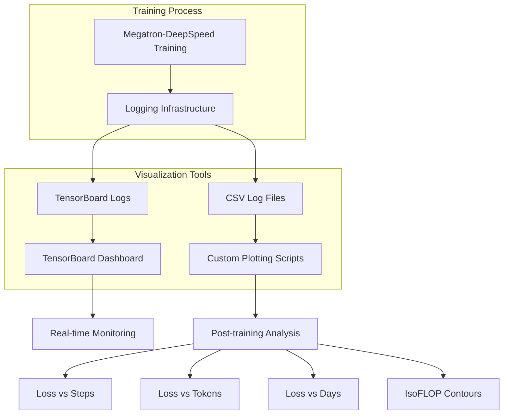
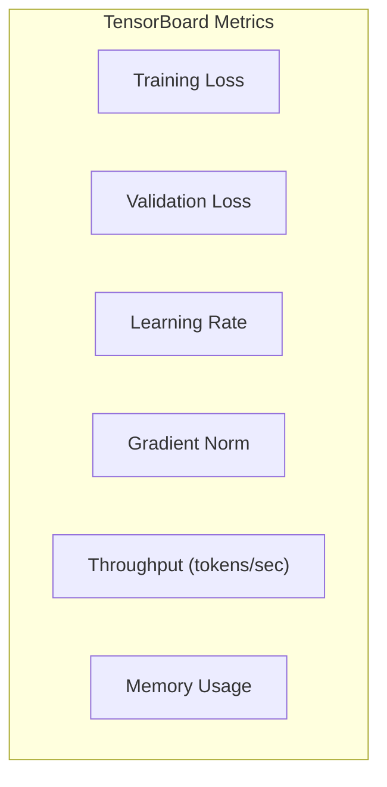
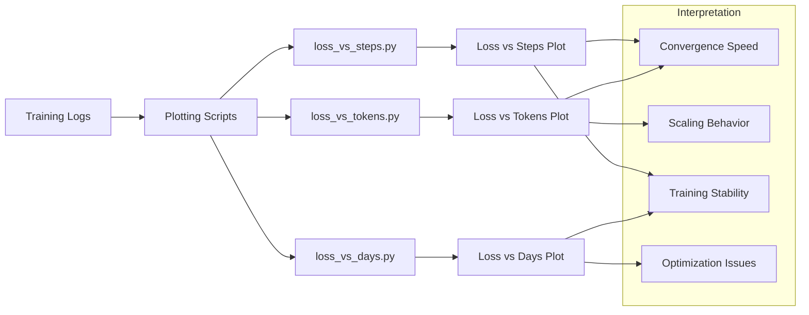
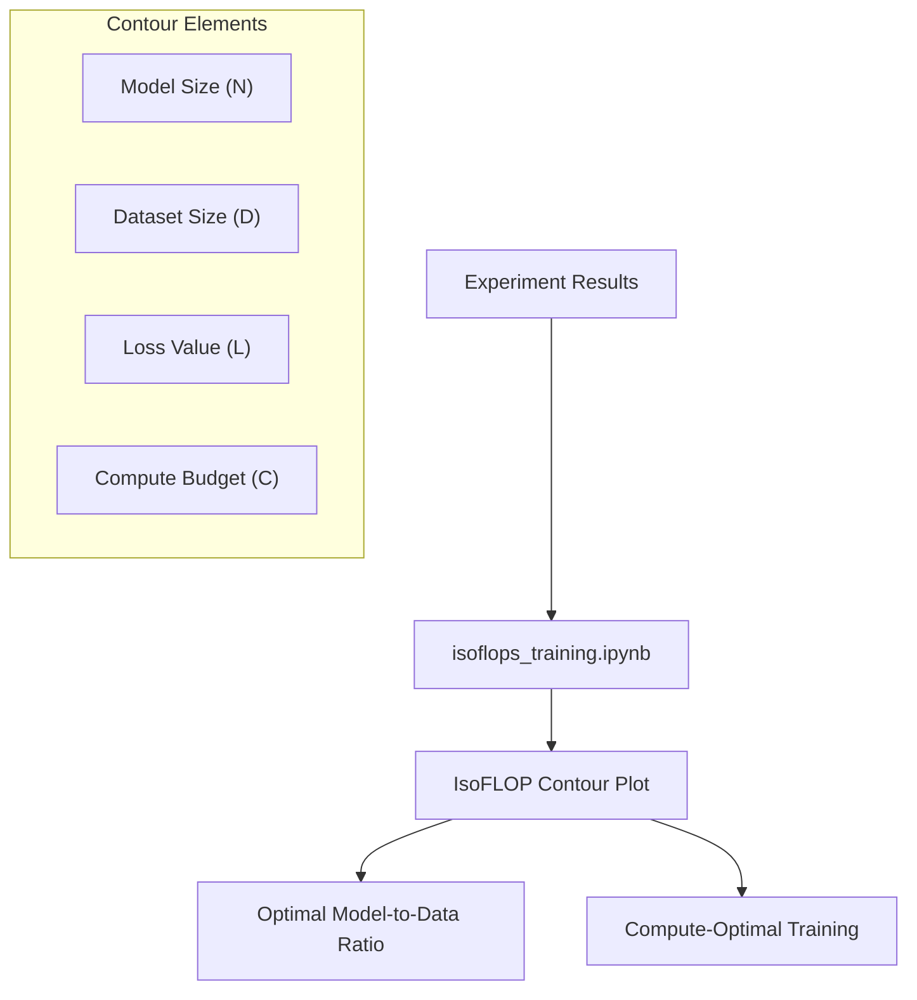
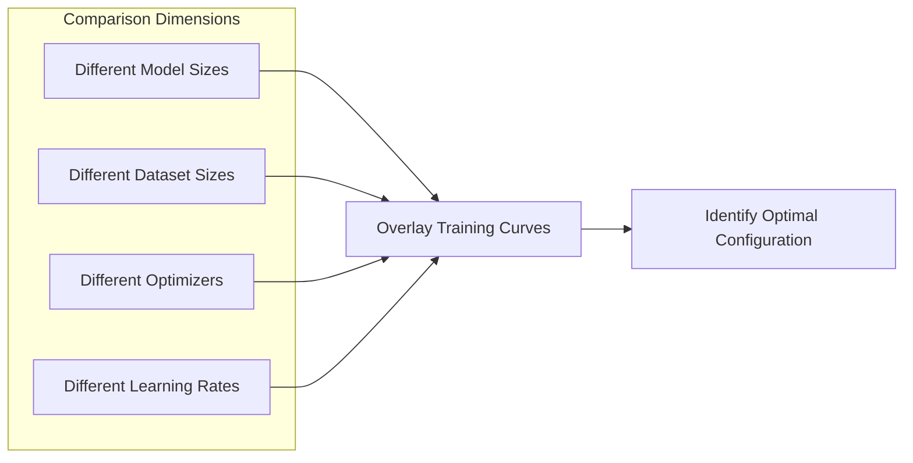

<!-- source: DeepWiki mcp.deepwiki.com · repo huggingface/datablations · page 6.1 Training Progress Visualization · fetched 2026-10-26 -->

# Training Progress Visualization

Relevant source files

The following files were used as context for generating this wiki page:

- [plotstables/old_plots/epochs_scores.pdf](plotstables/old_plots/epochs_scores.pdf)
- [plotstables/old_plots/isoflops.pdf](plotstables/old_plots/isoflops.pdf)
- [plotstables/old_plots/isoflops_single_prompt.pdf](plotstables/old_plots/isoflops_single_prompt.pdf)
- [plotstables/old_plots/loss_vs_days_chinchilla.png](plotstables/old_plots/loss_vs_days_chinchilla.png)

This page explains how to visualize and monitor training progress in the Datablations framework. It covers the tools, methods, and techniques for generating and interpreting visualization plots that help track model performance during and after training. For information about analyzing final model performance and scaling behaviors, see [Performance Analysis Plots](#6.2).

## Overview of Training Visualization System

The Datablations framework provides several ways to visualize training progress, allowing researchers to monitor experiments, detect issues, and compare different training configurations. The visualization system is integrated with the Megatron-DeepSpeed training infrastructure and consists of both real-time monitoring and post-training analysis tools.

### Visualization System Architecture

Sources: plotstables/old_plots/loss_vs_days_chinchilla.png, plotstables/old_plots/isoflops.pdf

## Real-time Monitoring with TensorBoard

TensorBoard provides real-time visualizations of training metrics. The framework logs various metrics during training that can be visualized through the TensorBoard interface.

### Setting Up TensorBoard

TensorBoard integration is configured in the training scripts. When you launch a training job using the framework's scripts, TensorBoard logs are automatically generated in the output directory.

### Key Metrics Monitored

### Accessing TensorBoard

To view the TensorBoard dashboard during or after training:

1. Navigate to the experiment directory
2. Launch TensorBoard pointing to the logs directory
3. Open the specified URL in a web browser

## Post-Training Visualization

After training completes, more detailed analysis can be performed using the custom plotting scripts in the repository.

### Loss Curve Visualizations

Loss curves are fundamental visualizations that show how the model's loss changes throughout training. These can be plotted against different x-axes:

Sources: plotstables/old_plots/loss_vs_days_chinchilla.png

### Example: Loss vs Days Visualization

The loss vs days visualization is particularly useful for understanding the practical timeline of training and comparing different model configurations based on wall-clock time efficiency.

The `loss_vs_days_chinchilla.png` plot shows training curves for different model configurations, allowing researchers to compare convergence rates and final loss values across training time measured in days.

## IsoFLOP Visualizations

IsoFLOP visualizations display the performance of different model configurations under the same compute budget (measured in floating-point operations or FLOPs).

Sources: plotstables/old_plots/isoflops.pdf

IsoFLOP contours visualize the relationship between model size, dataset size, and achieved loss within a fixed compute budget. These plots help identify the optimal allocation of compute resources between model size and training tokens.

## Interpreting Training Visualizations

### Loss Curve Patterns

| Pattern | Interpretation | Possible Actions |
| ------- | -------------- | ---------------- |
| Smooth decreasing curve | Healthy training | Continue with current configuration |
| Plateaus | Learning stalled | Adjust learning rate, review optimization |
| Oscillations | Unstable training | Reduce learning rate, increase batch size |
| Sudden jumps | Numerical instability | Check for gradient issues, reduce learning rate |
| Different convergence speeds | Model size/data effects | Compare efficiency, adjust allocations |

### IsoFLOP Visualization Interpretation

When analyzing IsoFLOP contours:

1. The optimal point is where loss is minimized for a given compute budget
2. Horizontal movement represents changing model size while keeping dataset size fixed
3. Vertical movement represents changing dataset size while keeping model size fixed
4. The shape of the contours indicates the sensitivity to changes in allocation

## Comparing Different Training Configurations

Visualization tools allow for direct comparison of different training configurations, helping to identify the most efficient settings for specific tasks.

## Troubleshooting Training Issues with Visualizations

Visual inspection of training curves can help identify and diagnose common training issues:

| Visualization Pattern | Potential Issue | Solution |
| --------------------- | --------------- | -------- |
| Loss increases drastically | Learning rate too high | Reduce learning rate |
| Loss plateaus early | Learning rate too low | Increase learning rate or use warmup |
| Spiky loss curve | Batch size too small | Increase batch size |
| Validation diverges from training | Overfitting | Add regularization, early stopping |
| Erratic performance | Numerical instability | Check for NaNs, reduce precision |

## Summary

Training progress visualization is an essential component of the Datablations framework, providing both real-time monitoring through TensorBoard and deep post-training analysis through custom plotting scripts. These visualizations help researchers understand model training dynamics, diagnose issues, compare different configurations, and ultimately identify optimal training strategies.

The integration between the training infrastructure and visualization tools ensures that data can be easily transformed into informative plots that drive research insights and decision-making.

---

