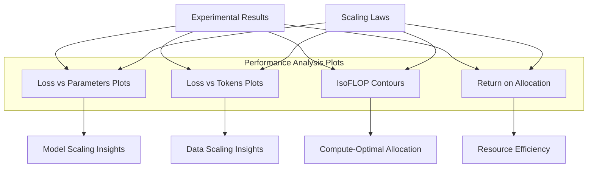
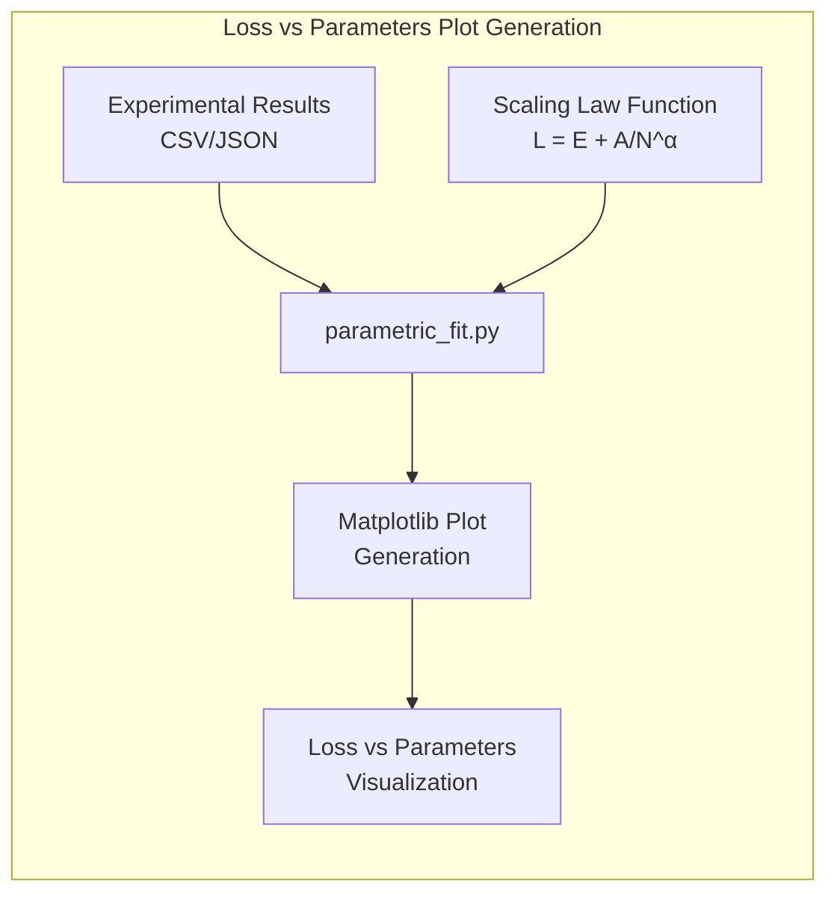
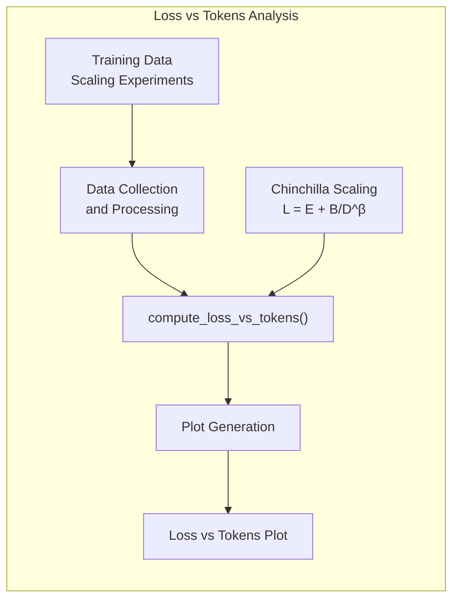
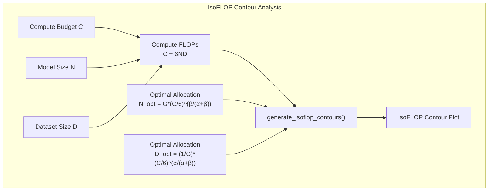
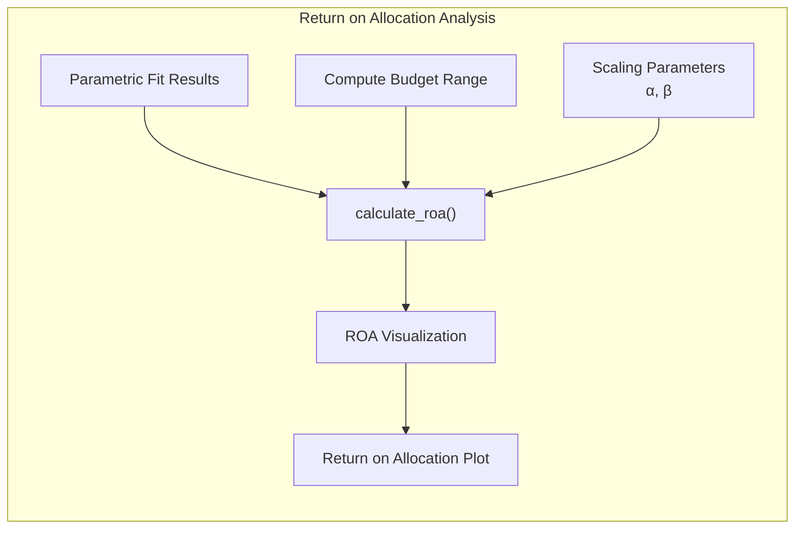
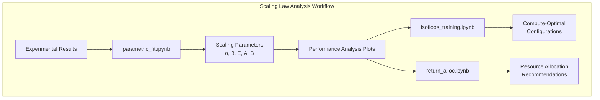
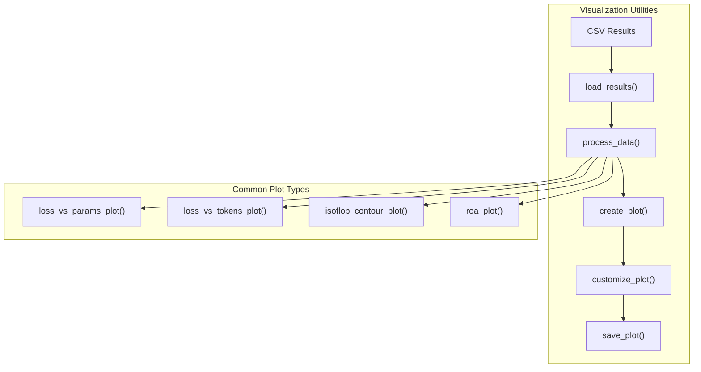

<!-- source: DeepWiki mcp.deepwiki.com · repo huggingface/datablations · page 6.2 Performance Analysis Plots · fetched 2026-10-26 -->

# Performance Analysis Plots

Relevant source files

The following files were used as context for generating this wiki page:

- [plotstables/old_plots/data_optimal.pdf](plotstables/old_plots/data_optimal.pdf)
- [plotstables/old_plots/dataset.pdf](plotstables/old_plots/dataset.pdf)

This page documents the various visualization tools and plots used in the datablations project to analyze model performance and understand scaling behavior. These plots provide insights into how model size, dataset size, and compute budget affect model performance and help validate scaling law theories. For information about visualizing the training progress itself, see [Training Progress Visualization](#6.1).

## Overview of Analysis Plots

Performance analysis plots in the datablations framework help visualize experimental results from different perspectives to understand scaling behaviors and validate scaling law theories. The framework provides tools to generate several key types of plots that help researchers reason about compute-optimal training and efficiency.

Sources: plotstables/old_plots/data_optimal.pdf, plotstables/old_plots/dataset.pdf

## Loss vs Parameters Plots

Loss vs Parameters plots show the relationship between model size (number of parameters) and validation loss. These plots help visualize how model performance improves as model size increases, typically following power-law scaling.

### Plotting Implementation

The plots are typically created using matplotlib and are customized to show both empirical measurements and theoretical scaling curves.

Sources: plotstables/old_plots/data_optimal.pdf

## Loss vs Tokens Plots

Loss vs Tokens plots illustrate how model performance improves as training dataset size increases. These plots are crucial for understanding data efficiency and determining the optimal dataset size for a given compute budget.

### Interpretation

A typical Loss vs Tokens plot shows validation loss (y-axis) against number of training tokens (x-axis), often using a log-log scale to better visualize power-law relationships. These plots may include multiple curves for different model sizes, showing how larger models can make better use of more data.

Sources: plotstables/old_plots/dataset.pdf

## IsoFLOP Contours

IsoFLOP (Iso-compute) contours show combinations of model size and dataset size that result in the same computational cost (measured in FLOPs - Floating Point Operations). These plots help identify compute-optimal configurations.

### Creating IsoFLOP Plots

IsoFLOP plots typically show model size on one axis, dataset size on another, and contour lines representing equal compute budgets. The point of minimum loss along each contour represents the compute-optimal allocation for that budget.

Sources: plotstables/old_plots/data_optimal.pdf

## Return on Allocation (ROA) Plots

Return on Allocation plots help quantify the efficiency of resource allocation. They show the relative improvement in performance per unit of additional compute, helping researchers make informed decisions about scaling up experiments.

### ROA Calculation and Visualization

ROA is calculated as the derivative of the loss with respect to compute resources and can be plotted to show diminishing returns as compute budget increases.

Sources: plotstables/old_plots/data_optimal.pdf

## Integration with the Scaling Law Framework

The performance analysis plots are tightly integrated with the scaling law framework, forming a bridge between theoretical predictions and empirical results.

Sources: plotstables/old_plots/data_optimal.pdf, plotstables/old_plots/dataset.pdf

## Creating Custom Analysis Plots

The datablations framework is designed to be flexible, allowing researchers to create custom plots based on their specific research questions. Common customizations include:

1. Comparing multiple model architectures on the same plot
2. Visualizing the effect of different data filtering techniques
3. Analyzing the impact of code augmentation on performance

### Visualization Utilities

The framework provides several utility functions to facilitate plot creation and customization:

## Conclusion

Performance analysis plots are essential tools for understanding the scaling behavior of language models in the datablations framework. They provide visual insights into the relationships between model size, dataset size, compute budget, and performance, helping researchers make informed decisions about resource allocation and experimental design.

By visualizing these relationships, researchers can validate scaling law theories, identify compute-optimal configurations, and better understand the factors affecting model performance in data-constrained regimes.

---

