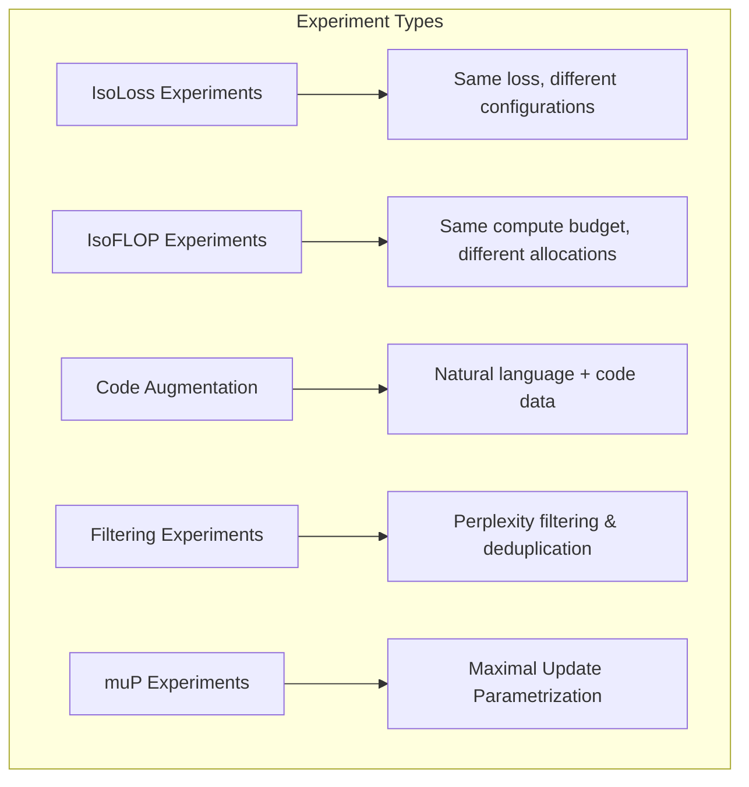
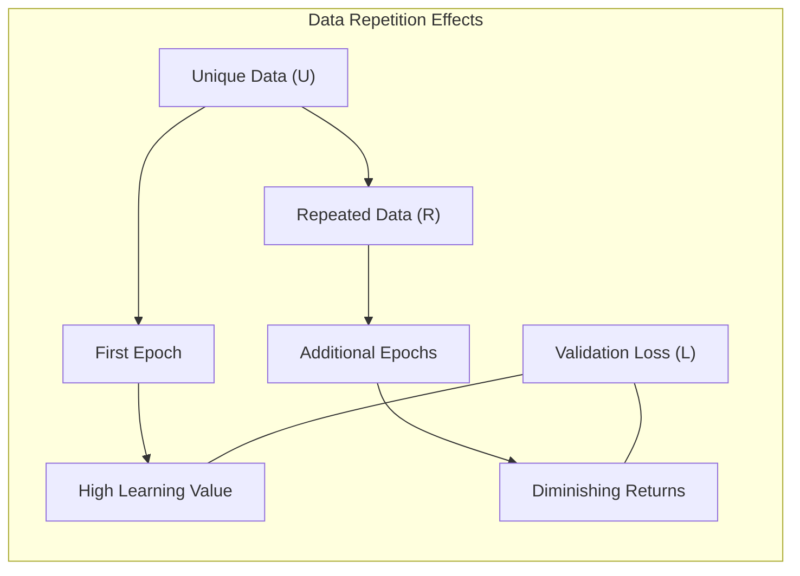
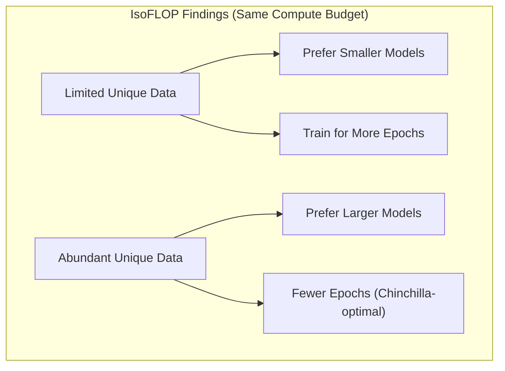
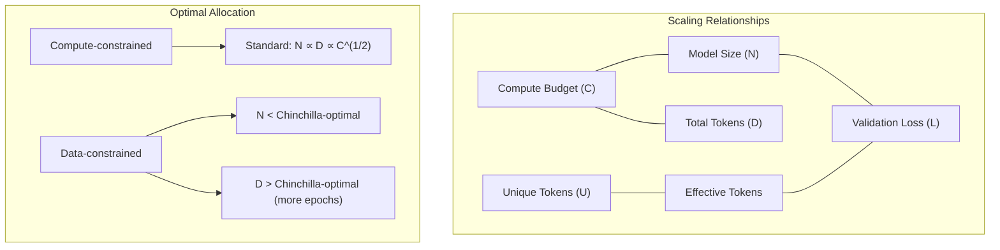
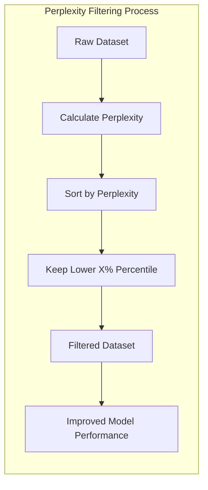
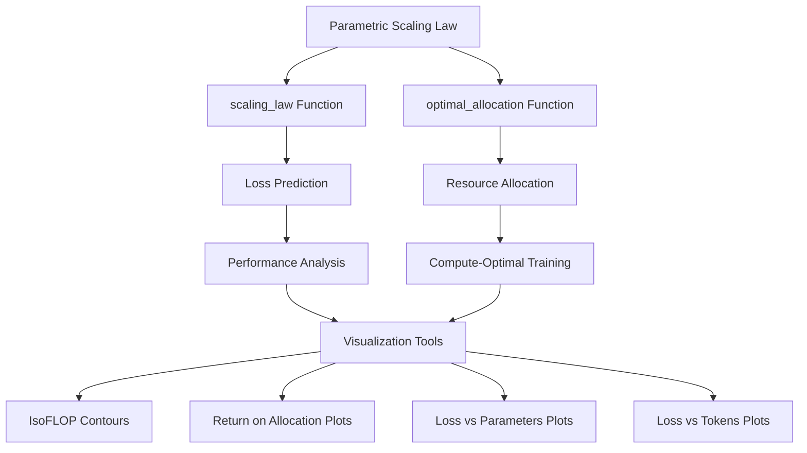

<!-- source: DeepWiki mcp.deepwiki.com · repo huggingface/datablations · page 7 Research Findings · fetched 2026-10-26 -->

# Research Findings

<details>
<summary>Relevant source files</summary>

The following files were used as context for generating this wiki page:

- [README.md](README.md)
- [plotstables/SCALINGDC_NEURIPS2023_POSTER.png](plotstables/SCALINGDC_NEURIPS2023_POSTER.png)
- [plotstables/SCALINGDC_NEURIPS2023_THUMB.png](plotstables/SCALINGDC_NEURIPS2023_THUMB.png)
- [plotstables/training_validation_filter.pdf](plotstables/training_validation_filter.pdf)
- [plotstables/validation_c4py.pdf](plotstables/validation_c4py.pdf)

</details>


This page summarizes the key findings from the Datablations research project on training language models in data-constrained regimes. It covers the experimental results, scaling laws, and mitigation strategies for scenarios where high-quality unique data is limited. For information about the specific implementation details of experiments, see [Model Training](#3) and [Data Processing Pipeline](#2).

## Overview of Research Questions

The Datablations project investigated several key questions about training language models when unique data is limited:

1. How does model performance degrade when training data is repeated?
2. Can we formulate scaling laws that account for data repetition?
3. What strategies effectively mitigate data scarcity?
4. How should compute resources be allocated optimally in data-constrained scenarios?

Sources: [README.md:13-13]()

## Experimental Setup

### Models and Datasets

The experiments spanned multiple dimensions of scale:

- **Model sizes**: From 146M to 9B parameters
- **Training tokens**: Up to 900B tokens
- **Unique tokens**: Varying from 100M to 25B
- **Primary datasets**: C4 and OSCAR (English)
- **Augmentation data**: Python code from the-stack-dedup
- **Evaluation**: Downstream task performance and validation loss

Over 400 training runs were conducted across different configurations, primarily using Megatron-DeepSpeed for training.

Sources: [README.md:13-13](), [README.md:197-202]()

### Experiment Types

The research involved several types of experiments:



Sources: [README.md:216-259]()

## Key Findings on Data Repetition

### Diminishing Returns of Repeated Tokens

A core finding is that repeated training data yields diminishing returns. While some repetition is beneficial (allowing multiple passes through the data), excessive repetition provides minimal additional benefit.



This effect is quantified in the scaling law formula, which models the decreasing value of repeated tokens.

Sources: [README.md:295-325]()

### IsoLoss and IsoFLOP Results

1. **IsoLoss experiments** showed that when targeting the same validation loss, significantly different combinations of model size and training tokens can achieve similar results.

2. **IsoFLOP experiments** demonstrated that under the same compute budget, allocation between model size and training tokens should be adjusted based on available unique data.



Sources: [README.md:220-232](), [README.md:402-403]()

## Scaling Law for Data-Constrained Regimes

### Formula and Parameters

The research introduced a scaling law that accounts for the diminishing returns of repeated tokens:

```
L(N, D, U) = E + A/(UN + UN*rn_star*(1-exp(-1*RN/rn_star)))^α + B/(U + U*rd_star*(1-exp(-1*RD/rd_star)))^β
```

Where:
- L: validation loss
- N: number of parameters
- D: total training tokens
- U: unique training tokens
- RD: repetition factor for data (D/U - 1)
- RN: repetition factor for parameters
- E, A, B, α, β, rd_star, rn_star: fitted coefficients

The derived coefficients from the experiments were:

| Parameter | Value |
|-----------|-------|
| E | 0.6254804 |
| A | 6.255414 (log) |
| B | 7.3049974 (log) |
| α | 0.3526596 |
| β | 0.3526596 |
| rd_star | 15.387756 |
| rn_star | 5.309743 |

Sources: [README.md:295-325](), [README.md:371-371]()

### Relationship Between Compute, Data, and Parameters



The research found that in data-constrained scenarios (when unique tokens are limited), the optimal allocation shifts toward training smaller models for more epochs compared to the standard Chinchilla scaling.

Sources: [README.md:344-366]()

## Mitigation Strategies for Data Scarcity

The research explored several approaches to mitigate the effects of data scarcity:

### Code Augmentation

Adding Python code data (from the-stack-dedup dataset) to natural language training data improved model performance in data-constrained scenarios. This effect was particularly pronounced for smaller unique data sizes.

Sources: [README.md:109-113](), [README.md:233-239]()

### Perplexity Filtering

Filtering datasets to keep only lower-perplexity samples (more "coherent" text) showed improvements in validation loss and downstream task performance.



Sources: [README.md:137-176](), [README.md:240-248]()

### Deduplication

Removing duplicate or near-duplicate content from training data also provided benefits, though the effects varied based on the dataset and the deduplication method.

Sources: [README.md:177-196](), [README.md:249-255]()

### Comparison of Strategies

The effectiveness of different mitigation strategies varied by dataset size and model configuration:

| Strategy | Effect on Small Data | Effect on Larger Data | Implementation Complexity |
|----------|---------------------|----------------------|---------------------------|
| Code Augmentation | Significant improvement | Moderate improvement | Low (dataset mixing) |
| Perplexity Filtering | Consistent improvement | Moderate improvement | Medium (requires scoring) |
| Deduplication | Dataset-dependent | Smaller effect | Medium-High (varies by method) |

Sources: [README.md:233-255]()

## Optimal Resource Allocation

### Return on Compute Allocation

The research provides a method to compute the optimal allocation of compute resources between model size and training tokens, accounting for unique data constraints:

```python
def optimal_allocation(C, U_BASE):
    """Compute optimal number of parameters and tokens to train for given a compute & unique data budget"""
    # Implementation uses grid search or optimization to find best N and D values
    # Returns the optimal loss, number of tokens, and number of parameters
```

In data-constrained regimes, the optimal strategy generally shifts toward:
1. Using smaller models than the Chinchilla-optimal size
2. Training for more epochs (higher D/U ratio)
3. Applying data augmentation and filtering techniques

Sources: [README.md:344-366]()

### Practical Guidelines

Based on the research findings, the following guidelines can help practitioners working with limited data:

1. **Estimate your unique data budget** (U) before determining model size
2. **Calculate the optimal model size** using the provided scaling law formulas
3. **Train for more epochs** than standard Chinchilla recommendations when unique data is limited
4. **Apply mitigation strategies** like code augmentation or perplexity filtering when appropriate
5. **Use the parametric fit** to estimate expected performance and guide resource allocation decisions

Sources: [README.md:295-325](), [README.md:344-366]()

## Validation and Application

### Double Descent Findings

The experiments validated the phenomenon of "double descent" in certain configurations, where validation loss first decreases, then increases, and finally decreases again as model capacity increases.

Sources: [README.md:219-219]()

### Stability Studies

The research included stability experiments comparing different optimizers and precision formats, providing insights into training stability in data-constrained scenarios.

Sources: [README.md:265-270]()

## Implementation of Findings

The findings from this research are implemented in various components of the Datablations framework:



Sources: [README.md:400-424]()

## Conclusion and Impact

The Datablations research provides valuable insights for training language models when faced with data constraints. The key contributions include:

1. A scaling law that accounts for the diminishing returns of repeated tokens
2. Guidelines for optimal allocation of compute resources in data-constrained regimes
3. Evaluation of data augmentation and filtering strategies
4. A framework for estimating performance and making informed training decisions

These findings have practical implications for researchers and practitioners working with limited data budgets, helping to guide decisions about model size, training duration, and data processing strategies.

Sources: [README.md:13-13](), [README.md:426-439]()

---

